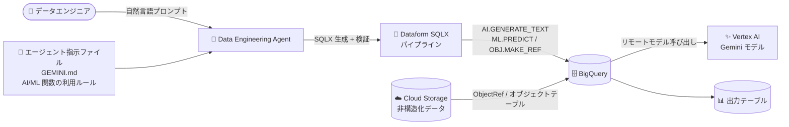

# BigQuery: Data Engineering Agent が AI・ML・オブジェクト関数の生成に対応 (GA)

**リリース日**: 2026-11-02

**サービス**: BigQuery

**機能**: Data Engineering Agent による BigQuery AI / ML / オブジェクト関数・ステートメントのサポート

**ステータス**: GA (一般提供)

📊 [このアップデートのインフォグラフィックを見る](https://takech9203.github.io/google-cloud-news-summary/20261102-bigquery-data-engineering-agent-ai-ml-object-functions.html)

## 概要

BigQuery / Dataform の Data Engineering Agent が、生成する Dataform SQLX パイプラインおよびエージェント指示ファイル (agent instruction file) において、BigQuery の AI 関数、ML 関数、オブジェクト関数・ステートメントをサポートするようになりました。この機能は一般提供 (GA) です。

Data Engineering Agent は、自然言語プロンプトから BigQuery のデータパイプラインを構築・修正・トラブルシューティングできる Gemini ベースのエージェントで、生成したパイプラインコードを Dataform リポジトリ内の SQLX ファイルとして管理します。今回のアップデートにより、`AI.GENERATE_TEXT` などの生成 AI 関数、`ML.GENERATE_TEXT` や `ML.PREDICT` といった BigQuery ML の関数・ステートメント、`OBJ.MAKE_REF` などの ObjectRef (オブジェクト) 関数を含むパイプラインを、エージェントへの自然言語指示だけで生成できるようになりました。

対象ユーザーは、BigQuery 上で ELT パイプラインを構築するデータエンジニアや、非構造化データ (画像・音声・ドキュメントなど) を含むマルチモーダルなデータ処理を SQL パイプラインに組み込みたいチームです。生成 AI による要約・分類・埋め込み生成などの処理を、手書きの SQLX を介さずにパイプラインへ統合できます。

**アップデート前の課題**

- Data Engineering Agent が生成する SQLX パイプラインは通常の SQL 変換が中心で、BigQuery の AI 関数・ML 関数・オブジェクト関数を含むコードの生成はサポートされていなかった
- 生成 AI による分類・要約や ML 推論をパイプラインに組み込むには、エージェントが生成した SQLX ファイルを開発者が手動で編集して AI/ML 関数を追記する必要があった
- エージェント指示ファイル (GEMINI.md) に AI/ML/オブジェクト関数に関するルールを記述しても、エージェント側がそれらの関数の生成に対応していなかった

**アップデート後の改善**

- 自然言語プロンプトから、AI 関数 (`AI.GENERATE_TEXT` など)・ML 関数 (`ML.GENERATE_TEXT`、`ML.PREDICT` など)・オブジェクト関数 (`OBJ.MAKE_REF` などの ObjectRef 操作) を含む Dataform SQLX パイプラインを生成できるようになった
- エージェント指示ファイルに AI/ML/オブジェクト関数の利用ルール (使用するモデル、出力形式、命名規則など) を定義し、組織全体で一貫した AI 対応パイプラインを生成できるようになった
- 非構造化データ (Cloud Storage 上の画像・音声・ドキュメント) を扱うマルチモーダルなパイプラインの構築が、エージェントとの対話のみで完結するようになった

## アーキテクチャ図



ユーザーの自然言語プロンプトとエージェント指示ファイルをもとに、Data Engineering Agent が AI・ML・オブジェクト関数を含む Dataform SQLX パイプラインを生成し、BigQuery 上で Vertex AI のモデル呼び出しや Cloud Storage の非構造化データ処理を実行する流れを示しています。

## サービスアップデートの詳細

### 主要機能

1. **AI 関数を含む SQLX パイプラインの生成**
   - `AI.GENERATE_TEXT` などの BigQuery 生成 AI 関数を含むパイプラインコードを、自然言語プロンプトから生成可能
   - テキストの分類、感情分析、要約、画像キャプション生成、音声の文字起こしといった生成 AI タスクをパイプラインに組み込める

2. **ML 関数・ステートメントのサポート**
   - `ML.GENERATE_TEXT` や `ML.PREDICT` などの BigQuery ML 関数、およびリモートモデルを参照するステートメントを含むコードを生成可能
   - Vertex AI 上の Gemini モデルやパートナーモデル、オープンモデルを参照するリモートモデル経由の推論処理をパイプライン化できる

3. **オブジェクト関数による非構造化データの処理**
   - `OBJ.MAKE_REF` などの ObjectRef 関数やオブジェクトテーブルを利用し、Cloud Storage 上の画像・音声・ドキュメントなどの非構造化データを参照するパイプラインを生成可能
   - 構造化データと非構造化データを組み合わせたマルチモーダルな変換処理を実現

4. **エージェント指示ファイルでの利用**
   - GEMINI.md 形式のエージェント指示ファイル内で AI/ML/オブジェクト関数に関するルールを定義可能
   - 組織の命名規則やスタイルガイドと同様に、AI 関数の利用ポリシーを一元管理し、生成されるパイプラインの一貫性を確保できる

## 技術仕様

### サポートされる関数カテゴリ

| カテゴリ | 代表的な関数・ステートメント | 用途 |
|------|------|------|
| AI 関数 | `AI.GENERATE_TEXT` など | Gemini モデルによるテキスト生成・分類・要約 |
| ML 関数 | `ML.GENERATE_TEXT`、`ML.PREDICT` など | BigQuery ML リモートモデルによる推論 |
| オブジェクト関数 | `OBJ.MAKE_REF`、ObjectRef 列操作 | Cloud Storage 上の非構造化データの参照・処理 |

### Data Engineering Agent の利用方法

| 利用方法 | 説明 |
|------|------|
| BigQuery パイプライン UI | クエリエディタから「Create new > Pipeline」でエージェントに依頼 |
| Dataform ワークスペース | リポジトリの開発ワークスペースで「Ask Agent」を使用 |
| VS Code 拡張 | Google Cloud Data Agent Kit 拡張機能で IDE から利用 |
| Data Engineering Agent API | A2A プロトコルベースの API 経由で操作 |

## 設定方法

### 前提条件

1. プロジェクトで Gemini in BigQuery が有効化されていること
2. Gemini Data Analytics API (`geminidataanalytics.googleapis.com`)、Gemini for Google Cloud API (`cloudaicompanion.googleapis.com`)、BigQuery API (`bigquery.googleapis.com`) が有効であること
3. 利用ユーザーに以下の IAM ロールが付与されていること
   - Dataform Code Editor (`roles/dataform.codeEditor`)
   - BigQuery Job User (`roles/bigquery.jobUser`)
   - Gemini Data Analytics Stateless Chat User (`roles/geminidataanalytics.dataAgentStatelessUser`)
4. AI/ML 関数の実行には、Vertex AI エンドポイントを参照する BigQuery ML リモートモデルと BigQuery 接続 (Connection) が必要

### 手順

#### ステップ 1: 必要な API を有効化する

```bash
gcloud services enable geminidataanalytics.googleapis.com --project=PROJECT_ID
gcloud services enable cloudaicompanion.googleapis.com --project=PROJECT_ID
gcloud services enable bigquery.googleapis.com --project=PROJECT_ID
```

Data Engineering Agent の利用に必要な API を有効化します。

#### ステップ 2: エージェントに AI 関数を含むパイプラインを依頼する

BigQuery コンソールのパイプライン UI または Dataform ワークスペースで「Ask Agent」をクリックし、自然言語で依頼します。

```text
raw.customer_reviews テーブルのレビュー本文を AI.GENERATE_TEXT で
ポジティブ / ネガティブに分類し、結果を reporting.review_sentiment
テーブルに格納するパイプラインを作成してください。
```

エージェントが AI 関数を含む SQLX ファイルの草案を生成するので、各パイプラインノードの SQLX を確認し、「Apply」で適用します。

#### ステップ 3: エージェント指示ファイルにルールを定義する (任意)

「Ask agent」配下の「Pipeline instructions」から GEMINI.md を作成し、AI/ML 関数の利用ルールを記述します。

```markdown
## AI 関数の利用ルール
- テキスト分類には AI.GENERATE_TEXT を使用し、リモートモデルは
  `mydataset.gemini_model` を参照すること
- 非構造化データは ObjectRef 列を介して参照すること
```

組織共通のルールは外部の Dataform リポジトリに格納し、複数パイプラインから参照することもできます。

## メリット

### ビジネス面

- **AI パイプライン開発の民主化**: 生成 AI・ML を組み込んだデータパイプラインを自然言語だけで構築でき、専門知識の少ないメンバーでも AI 活用を推進できる
- **開発リードタイムの短縮**: AI/ML 関数の構文やリモートモデル参照の記述をエージェントに任せられるため、手動コーディングと検証の工数を削減できる
- **ガバナンスの強化**: エージェント指示ファイルで AI 関数の利用ポリシーを一元管理し、組織全体で一貫した品質のパイプラインを生成できる

### 技術面

- **マルチモーダルデータ処理の統合**: オブジェクト関数により、Cloud Storage 上の画像・音声・ドキュメントを構造化データと同じ SQLX パイプラインで処理できる
- **コード検証の自動化**: エージェントは生成コードのコンパイルエラーを自動で検証・修正するため、AI 関数を含む複雑な SQLX でも動作するパイプラインが得られる
- **Dataform ネイティブな管理**: 生成されたコードは Dataform リポジトリで Git 管理されるため、AI 対応パイプラインにも通常の開発フロー (レビュー、バージョン管理) を適用できる

## デメリット・制約事項

### 制限事項

- Data Engineering Agent はパイプラインを実行できない (生成されたパイプラインのレビュー・実行・スケジュール設定はユーザーが行う)
- ノートブックおよびデータ準備 (Data preparation) ファイルに対する自然言語コマンドは未サポート
- エージェントはプロンプトや指示ファイル内の Web リンク・URL を検索できない
- Lakehouse ランタイムカタログ管理の Apache Iceberg テーブルに対しては、書き込み系ステートメント (`INSERT`、`UPDATE`、`MERGE` など) や DDL を生成できない

### 考慮すべき点

- AI 関数の実行には Vertex AI のリモートモデル呼び出しが発生するため、BigQuery のコンピューティング料金に加えて Vertex AI (Gemini など) の推論料金を考慮する必要がある
- エージェントによるデータサンプリング・プロファイリングは BigQuery リソースを使用し、BigQuery の料金が適用される
- 生成 AI 技術の一般的な制限が適用されるため、生成された SQLX (特に AI 関数のプロンプト部分) は必ずレビューしてから適用・実行する

## ユースケース

### ユースケース 1: カスタマーレビューの感情分析パイプライン

**シナリオ**: EC サイトのレビューデータを日次で取り込み、生成 AI で感情分類した結果をダッシュボード用テーブルに格納したい。

**実装例**:
```text
プロンプト例:
「raw.customer_reviews のレビュー本文を AI.GENERATE_TEXT で
 'positive' / 'negative' / 'neutral' に分類し、
 reporting.review_sentiment テーブルを作成してください。
 リモートモデルは mydataset.gemini_model を使用してください。」
```

**効果**: AI 関数の構文を覚えることなく感情分析パイプラインを構築でき、Dataform のスケジュール実行で日次の自動分類が実現する。

### ユースケース 2: 非構造化ドキュメントのメタデータ抽出

**シナリオ**: Cloud Storage に蓄積された商品画像や PDF ドキュメントから、説明文やカテゴリ情報を抽出して BigQuery の商品マスタに付与したい。

**効果**: ObjectRef 関数とオブジェクトテーブルを使ったマルチモーダル処理をエージェントが SQLX として生成するため、非構造化データの ETL を手書きコードなしで整備できる。

### ユースケース 3: 組織標準の AI パイプラインルールの適用

**シナリオ**: 複数チームが Data Engineering Agent を利用しており、使用するリモートモデルや出力テーブルの命名規則を統一したい。

**効果**: 中央の Dataform リポジトリにエージェント指示ファイル (GEMINI.md) を配置して各ワークスペースから参照することで、AI/ML 関数の利用ルールを組織全体で統一できる。

## 料金

Data Engineering Agent は Gemini in BigQuery の機能として提供されます。エージェントの利用はトークンベースで課金され、生成された AI/ML 関数の実行には BigQuery のコンピューティング料金および Vertex AI の推論料金が別途適用されます。

### 料金例

| 項目 | 料金 (USD) |
|--------|-----------------|
| エージェント入力 (Data Engineering Agent) | $3 / 100 万トークン |
| エージェント出力 (Data Engineering Agent) | $20 / 100 万トークン |
| BigQuery オンデマンド分析 | $6.25 / TiB スキャン (毎月 1 TiB まで無料) |
| BigQuery Editions (Gemini in BigQuery の AI 支援機能を含む) | $0.04 / スロット時間〜 |

詳細は [BigQuery の料金ページ](https://cloud.google.com/bigquery/pricing) を参照してください。

## 利用可能リージョン

Data Engineering Agent のデータ処理ロケーションは Gemini in BigQuery の処理ロケーションに準じます。詳細は [Gemini in BigQuery のロケーション](https://docs.cloud.google.com/bigquery/docs/gemini-locations) を参照してください。

## 関連サービス・機能

- **Dataform**: エージェントが生成する SQLX パイプラインの管理基盤。リポジトリ・ワークスペースでのバージョン管理とスケジュール実行を提供
- **BigQuery ML**: `CREATE MODEL` によるリモートモデル定義と `ML.PREDICT` / `ML.GENERATE_TEXT` などの推論関数を提供
- **Vertex AI**: AI 関数・ML 関数が参照する Gemini モデルやパートナーモデルのホスティング基盤
- **Cloud Storage / オブジェクトテーブル**: ObjectRef 関数で参照する非構造化データの格納先
- **Knowledge Catalog (Dataplex)**: エージェントがテーブル解決やメタデータ付与に利用するカタログ。生成パイプラインのメタデータを自動同期
- **Gemini in BigQuery**: Data Engineering Agent を含む BigQuery の AI 支援機能群

## 参考リンク

- 📊 [インフォグラフィック](https://takech9203.github.io/google-cloud-news-summary/20261102-bigquery-data-engineering-agent-ai-ml-object-functions.html)
- [公式リリースノート](https://docs.cloud.google.com/release-notes#November_02_2026)
- [Data Engineering Agent の概要](https://docs.cloud.google.com/gemini/data-agents/data-engineering-agent/agent-overview)
- [Data Engineering Agent によるデータパイプラインの構築](https://docs.cloud.google.com/bigquery/docs/data-engineering-agent-pipelines)
- [AI.GENERATE_TEXT 関数](https://docs.cloud.google.com/bigquery/docs/reference/standard-sql/bigqueryml-syntax-ai-generate-text)
- [ObjectRef の操作](https://docs.cloud.google.com/bigquery/docs/work-with-objectref)
- [オブジェクトテーブルの概要](https://docs.cloud.google.com/bigquery/docs/object-table-introduction)
- [料金ページ](https://cloud.google.com/bigquery/pricing)

## まとめ

Data Engineering Agent が AI・ML・オブジェクト関数の生成に GA 対応したことで、生成 AI を組み込んだマルチモーダルなデータパイプラインを自然言語だけで構築できるようになりました。BigQuery 上で生成 AI 活用を進めるチームは、まずレビュー分類やドキュメント要約などの小規模なパイプラインで試し、エージェント指示ファイルによる組織標準ルールの整備を進めることを推奨します。

---

**タグ**: #BigQuery #DataEngineeringAgent #Dataform #GeminiInBigQuery #BigQueryML #生成AI #GA
