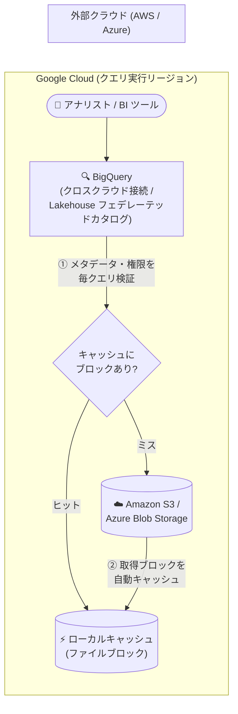

# BigQuery: Lakehouse クロスクラウドキャッシング (Intelligent Caching) GA

**リリース日**: 2026-11-02

**サービス**: BigQuery / Lakehouse

**機能**: クロスクラウドデータアクセスの Lakehouse キャッシング (Intelligent Caching)

**ステータス**: GA (一般提供)

📊 [このアップデートのインフォグラフィックを見る](https://takech9203.github.io/google-cloud-news-summary/20261102-bigquery-lakehouse-cross-cloud-caching-ga.html)

## 概要

クロスクラウドデータアクセスにおける Lakehouse キャッシング (Intelligent Caching) が一般提供 (GA) になりました。この機能を有効にすると、Amazon S3 や Azure Blob Storage から取得したファイルブロックが、クエリを実行する Google Cloud リージョン内にローカルキャッシュとして保持されます。同じファイルブロックを参照する後続のクエリは、リモートクラウドから再取得する代わりにローカルキャッシュから直接読み取るため、クロスクラウドの Egress コストを削減し、クエリ性能を向上させます。

クロスクラウドキャッシングはデフォルトで無効であり、Lakehouse のフェデレーテッドカタログ、または BigQuery のクロスクラウド接続 (cross-cloud connection) の作成時・更新時にオプトインで有効化できます。キャッシュの容量・保持期間・エビクション (削除) は Google が自動管理し、追加料金なしで利用できます。

マルチクラウド環境で BigQuery から AWS / Azure 上のデータレイク (Apache Iceberg テーブルや Parquet ファイルなど) を繰り返し参照する BI ダッシュボードや分析ワークロードを運用している組織にとって、データ転送コストとクエリレイテンシの両方を改善できる重要なアップデートです。

**アップデート前の課題**

- クロスクラウド接続やフェデレーテッドカタログ経由のクエリは、実行のたびにリモートクラウド (Amazon S3 / Azure Blob Storage) からファイルを読み取る必要があり、同じデータへの繰り返しアクセスでもその都度クロスクラウドの Egress 料金が発生していた
- リモートストレージからの読み取りがクエリのたびに発生するため、ネットワーク転送がクエリレイテンシのボトルネックになっていた
- Egress コストを抑えるには、ETL パイプラインで Google Cloud 側にデータを複製するなどの追加の仕組みが必要だった

**アップデート後の改善**

- フェデレーテッドカタログまたはクロスクラウド接続でキャッシングを有効化するだけで、取得済みファイルブロックがクエリ実行リージョン内に自動キャッシュされ、後続クエリ (同じブロックを参照する別のクエリを含む) がローカルキャッシュから読み取れるようになった
- リモートクラウドからの再取得が不要になることで、クロスクラウド Egress コストの削減と後続クエリの高速化を同時に実現できるようになった
- キャッシュの容量・保持・エビクションは Google が自動管理するため、ユーザー側の運用負荷なしで利用でき、追加料金も発生しない
- `JobStatistics2` の `objectStorageStats` フィールドでキャッシュヒット量 (`cacheBytesRead`) とリモート読み取り量 (`objectStorageBytesRead`) を確認でき、Egress 削減効果を定量的に把握できるようになった

## アーキテクチャ図



キャッシングを有効化すると、リモートストレージから取得したファイルブロックがクエリ実行リージョン内に自動保存され、後続クエリはキャッシュから直接読み取ります。キャッシュ提供前には毎回リモートソースとメタデータ・アクセス権限を検証するため、古いデータの読み取りや失効済み権限のバイパスは発生しません。

## サービスアップデートの詳細

### 主要機能

1. **ブロックレベルのリードスルーキャッシュ**
   - Amazon S3 / Azure Blob Storage から取得したファイルブロックを、Google Cloud のクエリ実行リージョン内にローカルキャッシュする
   - 同一ファイルブロックを参照するクエリであれば、異なるクエリでもキャッシュが再利用される
   - キャッシュの容量・保持期間・エビクションは Google が自動管理する

2. **鮮度と権限の自動検証**
   - キャッシュからデータを提供する前に、すべてのクエリでリモートストレージソースとメタデータ・アクセス権限を検証する
   - 古い (stale な) データを読むことや、失効済みの権限でキャッシュを読むことを防止する

3. **オプトイン方式の有効化**
   - クロスクラウドキャッシングはデフォルトで無効
   - Lakehouse フェデレーテッドカタログ、または BigQuery クロスクラウド接続の作成時・更新時に有効/無効を切り替えられる

4. **キャッシュ利用状況のモニタリング**
   - BigQuery コンソールのジョブ詳細、または `JobStatistics2` の `objectStorageStats` (`object_storage_stats`) フィールドで確認できる
   - `cloudProvider`: アクセス先のクラウドプロバイダ (例: `AWS`、`AZURE`)
   - `cacheBytesRead`: ローカルキャッシュから読み取った合計バイト数 (リモート読み取りを回避した量)
   - `objectStorageBytesRead`: リモートオブジェクトストレージから直接読み取った合計バイト数

## 技術仕様

### キャッシング仕様

| 項目 | 詳細 |
|------|------|
| 対象ストレージ | Amazon S3、Azure Blob Storage |
| キャッシュ場所 | クエリを実行する Google Cloud リージョン内 |
| キャッシュ単位 | ファイルブロック (ブロックレベルのリードスルーキャッシュ) |
| デフォルト設定 | 無効 (オプトインで有効化) |
| 有効化の単位 | Lakehouse フェデレーテッドカタログ、または BigQuery クロスクラウド接続 |
| キャッシュ管理 | 容量・保持・エビクションを Google が自動管理 |
| 鮮度・権限検証 | 毎クエリでリモートソースのメタデータとアクセス権限を検証 |
| 追加料金 | なし (no additional charge) |
| キャッシュの暗号化 | Google 所有・Google 管理の鍵によるデフォルト暗号化 (CMEK は非対応) |

### 対応カタログ (Lakehouse クロスクラウドデータアクセス)

| カタログプロバイダ | ホスト環境 |
|------|------|
| Databricks Unity Catalog | AWS、Azure、Google Cloud |
| AWS Glue Data Catalog | AWS |
| Snowflake Horizon Catalog | AWS、Azure、Google Cloud |
| Workday Data Lake | AWS、Google Cloud |
| SAP Business Data Cloud (BDC) | AWS、Azure、Google Cloud |

## 設定方法

### 前提条件

1. BigQuery クロスクラウド接続の作成には、プロジェクトに対する BigQuery Admin (`roles/bigquery.admin`) IAM ロールが必要
2. AWS の場合: AWS アカウントで IAM ポリシー・ロールを作成できる権限、Azure の場合: Microsoft Entra ID でアプリ登録を管理しロール (Storage Blob Data Reader など) を割り当てられる権限が必要
3. 接続のリージョンには標準の BigQuery ロケーション (例: `us-east4`) を指定する (BigQuery Omni ロケーションではない)

### 手順

#### ステップ 1: キャッシングを有効にした AWS クロスクラウド接続を作成する

```bash
bq mk --connection \
  --connection_type='AWS' \
  --location=LOCATION \
  --project_id=PROJECT_ID \
  --properties='{"accessRole":{"iamRoleId":"arn:aws:iam::AWS_ACCOUNT_ID:role/ROLE_NAME"},"crossCloudCacheOptions":{"enabled":true}}' \
  CONNECTION_ID
```

`crossCloudCacheOptions.enabled` を `true` に設定するとキャッシングが有効になります (デフォルトは `false`)。Google Cloud コンソールでは、接続作成画面の「Cross-cloud caching」で「Enable cross-cloud caching」を選択します。既存接続は「Connection info」ページの「Edit details」から後で変更することもできます。

#### ステップ 2: キャッシングを有効にした Azure クロスクラウド接続を作成する (Azure の場合)

```bash
bq mk --connection \
  --connection_type='Azure' \
  --tenant_id=TENANT_ID \
  --location=LOCATION \
  --federated_azure=true \
  --federated_app_client_id=APP_ID \
  --project_id=PROJECT_ID \
  --properties='{"crossCloudCacheOptions":{"enabled":true}}' \
  CONNECTION_ID
```

Azure でも同様に `crossCloudCacheOptions` でキャッシングを有効化します。Lakehouse フェデレーテッドカタログを使う場合は、各カタログプロバイダ (Databricks Unity Catalog、AWS Glue など) のセットアップガイドに従ってカタログ作成・更新時に有効化します。

#### ステップ 3: キャッシュ利用状況と Egress 削減効果を確認する

```bash
bq show --format=prettyjson --job=true JOB_ID
```

出力 JSON の `statistics.query.objectStorageStats` で、クラウドプロバイダごとの `cacheBytesRead` (キャッシュから読み取った量) と `objectStorageBytesRead` (リモートから直接読み取った量) を確認し、キャッシュヒット率と Egress コスト削減効果を測定できます。

## メリット

### ビジネス面

- **クロスクラウド Egress コストの削減**: 繰り返しアクセスされるデータをローカルキャッシュから提供することで、AWS / Azure からのデータ転送料金を削減できる。追加料金なしで利用できるため導入障壁が低い
- **データ複製パイプラインの削減**: Egress コスト対策としてデータを Google Cloud に複製する ETL パイプラインを構築・運用する必要性が下がる

### 技術面

- **後続クエリの高速化**: リモートストレージへのネットワーク往復を回避し、同じファイルブロックを参照するクエリの性能が向上する
- **運用レス**: キャッシュの容量・保持・エビクションは Google が自動管理するため、チューニングや運用作業が不要
- **一貫性と安全性**: 毎クエリでリモートソースのメタデータと権限を検証するため、古いデータの読み取りや失効権限によるアクセスが発生しない
- **効果の可視化**: `objectStorageStats` によりキャッシュヒット量を定量的に監視でき、コスト削減効果を検証できる

## デメリット・制約事項

### 制限事項

- CMEK (顧客管理の暗号鍵) はクロスクラウドキャッシングに対応していない。キャッシュデータは Google 所有・Google 管理の鍵で暗号化される
- 組織ポリシー `constraints/gcp.restrictNonCmekServices` (Restrict Non-CMEK Services) が適用されている場合、制限対象テーブルへのクエリではキャッシングが自動的に無効化される (クエリ自体はリモートストレージから直接読み取って実行される)
- デフォルトでは無効のため、効果を得るには接続またはカタログごとに明示的な有効化が必要

### 考慮すべき点

- **データレジデンシー**: キャッシング有効時、リモートファイルのキャッシュコピーがクエリ実行先の Google Cloud リージョンに一時保存される。別の地理的リージョン・法域にあるデータ (例: EU の S3 / Azure Blob Storage を `us-east4` からクエリ) をキャッシュする場合は、組織のデータレジデンシー・コンプライアンス要件を満たすか事前に確認が必要
- **削減効果はワークロード依存**: 実際の Egress 削減効果は、クエリパターン、ソースファイルの更新頻度、対象リージョンでのキャッシュ保持状況に依存する。頻繁に更新されるデータや一度しか読まないデータでは効果が限定的

## ユースケース

### ユースケース 1: AWS 上の Iceberg データレイクに対する BI ダッシュボード

**シナリオ**: Amazon S3 上の Apache Iceberg テーブル (AWS Glue カタログ管理) を BigQuery からフェデレーションし、Looker などの BI ダッシュボードが同じテーブルを 1 日に何度も参照している。毎回 S3 からデータを読み取るため、AWS の Egress コストが膨らんでいる。

**実装例**:
```sql
-- キャッシング有効のクロスクラウド接続を使って AWS Glue データベースをフェデレーション
CREATE EXTERNAL SCHEMA `my-project.aws_glue_data`
WITH CONNECTION `us-east4.my-aws-connection`
OPTIONS (
  location = 'us-east4',
  external_source = 'aws-glue://arn:aws:glue:us-east-1:123456789:database/sales_db');

-- ダッシュボードのクエリは 2 回目以降ローカルキャッシュから読み取られる
SELECT region, SUM(amount) FROM `my-project.aws_glue_data.orders` GROUP BY region;
```

**効果**: 初回クエリで取得したファイルブロックがキャッシュされ、ダッシュボードの繰り返しクエリ (同じブロックを参照する別クエリも含む) がキャッシュヒットし、S3 からの Egress コスト削減とレスポンス改善を両立できる。

### ユースケース 2: Cross-Cloud Interconnect との組み合わせによる転送コスト最適化

**シナリオ**: セキュリティポリシー上、AWS との間の通信を Cross-Cloud Interconnect (CCI) 経由のプライベート転送にしており、さらに転送量自体も減らしたい。

**効果**: 予測可能なプライベートインターコネクトの Egress 料金と、ローカルブロックキャッシングによる転送量削減を組み合わせることで、繰り返し実行される分析ワークロードのクロスクラウド転送コストを最小化できる (公式ドキュメントでも推奨されている組み合わせ)。

## 料金

クロスクラウドキャッシング自体は **追加料金なし** で利用できます。キャッシュヒットによりリモートクラウド (AWS / Azure) 側の Egress 料金を削減できますが、実際の削減額はクエリパターン、ソースファイルの更新頻度、キャッシュ保持状況に依存します。

クエリ自体の料金は通常の BigQuery 料金体系 (クロスクラウド接続では標準のスロット予約・コミットメントを消費) に従います。詳細は [BigQuery の料金ページ](https://cloud.google.com/bigquery/pricing) を参照してください。

## 利用可能リージョン

クロスクラウド接続では、標準の BigQuery ロケーション (例: `us-east4`) を接続リージョンとして使用します。対応リージョンと機能の詳細は [Supported regions and capabilities](https://docs.cloud.google.com/lakehouse/docs/regions-capabilities-cross-cloud-connections) を参照してください。

## 関連サービス・機能

- **BigQuery クロスクラウド接続 (cross-cloud connections)**: AWS / Azure / Salesforce Data 360 のデータを BigQuery に取り込んでクエリする接続。本キャッシング機能の有効化対象の 1 つで、標準スロット予約を消費し BigQuery AI やマテリアライズドビューなどの機能も利用できる
- **Lakehouse クロスクラウドデータアクセス (フェデレーテッドカタログ)**: Databricks Unity Catalog、AWS Glue、Snowflake Horizon Catalog などのリモート Iceberg REST カタログをフェデレーションし、ファイル移行や ETL なしでリモートデータをクエリする機能。もう 1 つのキャッシング有効化対象
- **Cross-Cloud Interconnect (CCI)**: クロスクラウドのクエリデータ転送とメタデータ更新をプライベート経路でルーティングするネットワークサービス。キャッシングと組み合わせることで転送コストをさらに最適化できる
- **BigQuery Omni**: リモートリージョンに計算ワーカーをデプロイしてデータ移動なしでクエリする方式。クロスクラウド接続はその代替アプローチにあたる
- **Managed Service for Apache Spark**: BigQuery SQL に加えて、フェデレーションされたリモートデータを Spark で処理できる

## 参考リンク

- 📊 [インフォグラフィック](https://takech9203.github.io/google-cloud-news-summary/20261102-bigquery-lakehouse-cross-cloud-caching-ga.html)
- [公式リリースノート](https://cloud.google.com/release-notes#November_02_2026)
- [ドキュメント: Intelligent caching (クロスクラウドデータアクセス)](https://cloud.google.com/lakehouse/docs/about-cross-cloud-data-access#intelligent-caching)
- [ドキュメント: リモートデータのクエリとキャッシュ利用状況の確認](https://cloud.google.com/lakehouse/docs/query-remote-data)
- [ドキュメント: クロスクラウド接続の作成](https://cloud.google.com/bigquery/docs/cross-cloud-connections)
- [料金ページ (BigQuery)](https://cloud.google.com/bigquery/pricing)

## まとめ

Lakehouse キャッシングの GA により、BigQuery から AWS / Azure 上のデータを繰り返しクエリするマルチクラウド分析ワークロードにおいて、追加料金なしで Egress コスト削減とクエリ高速化を実現できるようになりました。デフォルトでは無効のため、クロスクラウド接続やフェデレーテッドカタログを利用中の組織は、データレジデンシー要件と CMEK 制約を確認したうえで有効化し、`objectStorageStats` でキャッシュヒット率と削減効果を測定することを推奨します。

---

**タグ**: #BigQuery #Lakehouse #CrossCloud #Caching #GA #マルチクラウド #AWS #Azure #コスト最適化
