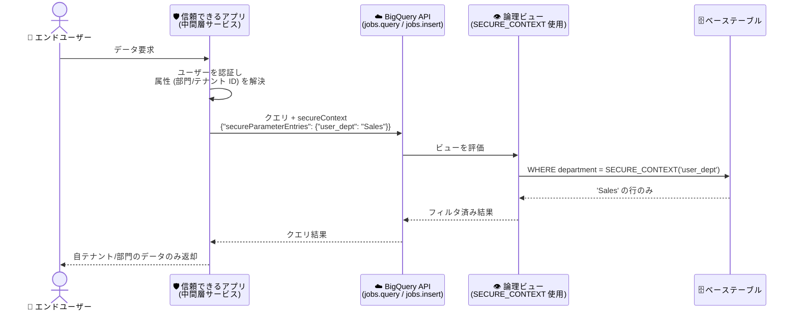

# BigQuery: SECURE_CONTEXT 関数 (Preview)

**リリース日**: 2026-11-02

**サービス**: BigQuery

**機能**: SECURE_CONTEXT 関数によるリクエストスコープのコンテキストベースフィルタリング

**ステータス**: Preview

📊 [このアップデートのインフォグラフィックを見る](https://takech9203.github.io/google-cloud-news-summary/20261102-bigquery-secure-context-preview.html)

## 概要

BigQuery の GoogleSQL に新しいセキュリティ関数 `SECURE_CONTEXT` が Preview として追加されました。`SECURE_CONTEXT(key)` は、クエリ実行時にリクエスト単位 (request-scoped) で渡されたセキュアコンテキストパラメータの値を返す関数です。クエリリクエストのボディ (`jobs.query` または `jobs.insert` API の `secureContext` フィールド) に渡したユーザー属性、部門 ID、テナント識別子などのコンテキスト変数に基づいて、論理ビュー (logical view) 内で動的にデータをフィルタリング・評価できます。

従来、属性値ごとにデータの見せ方を変えるには、属性値ごとに静的なビューを個別に作成するなどの対応が必要でした。`SECURE_CONTEXT` を使うと、1 つの論理ビューの定義内で実行時パラメータを参照できるため、ビューを量産せずに動的な属性ベースのフィルタリングを実現できます。この機能は、テナントごとにテーブルやデータセットを分けることが現実的でない大規模マルチテナントシステムや、動的な属性ベースアクセス制御 (ABAC) を想定して設計されています。

対象ユーザーは、SaaS などのマルチテナント型データ基盤を BigQuery 上に構築しているアプリケーション開発者やデータプラットフォームエンジニアです。なお、信頼できるアプリケーション (中間層サービス) のみが `secureContext` パラメータを設定できるようにする設計が前提となる点に注意が必要です。

**アップデート前の課題**

- 論理ビューでユーザー属性やテナントごとにフィルタ条件を変えるには、属性値ごとに個別の静的ビューを作成・管理する必要があった
- テナント数が多い大規模マルチテナントシステムでは、テナントごとのテーブル・データセット分離やビューの量産は運用負荷が高く、データ規模によっては現実的でなかった
- クエリリクエスト単位で実行時コンテキスト (部門 ID、テナント ID など) をビューに安全に引き渡す標準的な仕組みがなかった

**アップデート後の改善**

- クエリリクエストの `secureContext` フィールドで渡したキーと値のペアを、論理ビュー内の `SECURE_CONTEXT(key)` で参照し、動的にフィルタリングできるようになった
- 属性値ごとに静的ビューを作成する必要がなくなり、1 つのビュー定義で多数のテナント・属性に対応できるようになった
- 大規模マルチテナントシステムにおける動的な属性ベースアクセス制御の実装パターンが BigQuery ネイティブにサポートされた

## アーキテクチャ図



信頼できる中間層アプリケーションがエンドユーザーを認証し、検証済みの属性を `secureContext` としてクエリリクエストに付与します。論理ビュー内の `SECURE_CONTEXT` がその値を実行時に評価し、該当する行のみを返します。

## サービスアップデートの詳細

### 主要機能

1. **リクエストスコープのセキュアコンテキストパラメータ**
   - `jobs.query` / `jobs.insert` API リクエストペイロードの `secureContext.secureParameterEntries` フィールドにキーと値のペアを渡す
   - 論理ビュー内で `SECURE_CONTEXT('キー名')` として参照し、実行時に値が解決される
   - `key` は定数の非 NULL STRING リテラルまたはクエリパラメータで指定する (暗黙の型変換は不可)

2. **論理ビューでの動的フィルタリング**
   - ビュー定義の `WHERE` 句などで `SECURE_CONTEXT` を使用し、ユーザー属性・部門 ID・テナント識別子に基づく動的なフィルタリングと評価が可能
   - 属性値ごとに静的ビューを個別作成する必要がなくなる

3. **マルチステートメントクエリセッションとの連携**
   - セッション利用時は、セッション作成時 (`createSession: true`) にセキュアコンテキストパラメータを指定する
   - セッション作成後の後続クエリは初期セッションコンテキストを自動的に継承し、`secureContext` の変更や新規指定はできない (コンテキストの固定化)

## 技術仕様

### SECURE_CONTEXT 関数の仕様

| 項目 | 詳細 |
|------|------|
| 構文 | `SECURE_CONTEXT(key)` |
| 戻り値の型 | `STRING` |
| `key` の型 | 定数の非 NULL `STRING` リテラルまたはクエリパラメータ (coercion 不可) |
| コンテキスト値の型 | `STRING` のみサポート |
| 使用可能な場所 | 論理ビューの定義内のみ |
| 使用不可の場所 | アドホッククエリのトップレベル、マテリアライズドビュー、一時セッションビュー (エラーになる) |
| `SAFE.` プレフィックス | 非サポート (`SAFE.SECURE_CONTEXT(key)` は解析エラー) |
| パラメータ未指定時 | 参照したキーがリクエストの secureContext に存在しない場合、クエリはエラーで失敗する |
| 提供ステータス | Preview (Pre-GA Offerings Terms が適用) |

### API リクエスト例 (secureContext フィールド)

```json
{
  "query": "SELECT * FROM my_dataset.sales_view",
  "useLegacySql": false,
  "secureContext": {
    "secureParameterEntries": {
      "user_dept": "Sales",
      "user_region": "US"
    }
  }
}
```

### ビュー定義の例

```sql
CREATE OR REPLACE VIEW my_dataset.sales_view AS
WITH Orders AS (
  SELECT 1001 AS order_id, 'Sales' AS department, 250.00 AS amount UNION ALL
  SELECT 1002 AS order_id, 'Engineering' AS department, 500.00 AS amount UNION ALL
  SELECT 1004 AS order_id, 'Sales' AS department, 430.50 AS amount
)
SELECT order_id, department, amount
FROM Orders
WHERE department = SECURE_CONTEXT('user_dept');
```

`secureContext` に `{"secureParameterEntries": {"user_dept": "Sales"}}` を渡して `SELECT * FROM my_dataset.sales_view` を実行すると、`department = 'Sales'` の行 (order_id 1001 と 1004) のみが返されます。

## メリット

### ビジネス面

- **マルチテナント基盤の運用コスト削減**: テナント・属性ごとに静的ビューやテーブルを量産する必要がなくなり、ビュー管理の運用負荷を大幅に削減できる
- **大規模 SaaS への適用**: テナントごとのテーブル/データセット分離がデータ規模的に非現実的な大規模マルチテナントシステムでも、動的な属性ベースアクセス制御を実装できる

### 技術面

- **1 ビューで多数の属性値に対応**: 実行時にリクエストから値を注入するため、ビュー定義は 1 つで済み、スキーマ変更やテナント追加時のビュー再作成が不要
- **セッションでのコンテキスト固定**: マルチステートメントセッションではセッション作成時のコンテキストが継承され、後続クエリによる改変ができないため、セッション内で一貫したコンテキストを保証できる
- **アプリケーションロジックの簡素化**: SQL 文字列へのテナント ID の動的埋め込み (SQL 組み立て) を避け、構造化された API フィールドでコンテキストを渡せる

## デメリット・制約事項

### 制限事項

- 論理ビューの定義内でのみ使用可能。アドホッククエリのトップレベル、マテリアライズドビュー、一時セッションビューでの呼び出しはエラーになる
- セキュアコンテキストで渡せる値は `STRING` 型のみ
- `SAFE.` プレフィックスは非サポート (`SAFE.SECURE_CONTEXT(key)` は解析エラー)
- 参照したキーがリクエストに存在しない場合、クエリはエラーで失敗する (NULL は返らない)
- セッション利用時はセッション作成時にのみコンテキストを指定でき、後から変更・追加できない
- Preview 機能のため、Pre-GA Offerings Terms が適用され、サポートが限定される場合がある

### 考慮すべき点

- **信頼境界の設計が必須**: `SECURE_CONTEXT` はクエリリクエストペイロードの値をそのまま評価する。`secureContext` を設定できるのは、クライアントを認証し検証済み属性を代理設定する信頼できるアプリケーション・中間層サービスに限定すること。信頼できないエンドユーザー、クライアント、AI エージェントに直接設定を許すと、属性を偽装してビューのアクセス制御を回避できてしまう
- **サイドチャネル露出**: ビュー内のフィルタはハードな分離境界ではない。ビューに任意の SQL を発行できる呼び出し元は、フィルタ対象外の行で失敗する式、処理バイト数などのクエリ統計、クエリ実行時間を通じて、除外された行の存在や値を推測できる可能性がある。ビューに到達する SQL が信頼できない場合 (AI エージェント生成 SQL など)、ビューフィルタのみでのテナント分離に依存しないこと
- **Google の推奨との位置づけ**: 多くのマルチテナントワークロードでは、テーブル/データセットレベルのテナント分離 + IAM ベースのアクセス制御、行レベルセキュリティ (RLS)、列レベルセキュリティ (CLS) の組み合わせが、厳格なテナント分離とデータ漏洩防止のための Google 推奨ベストプラクティスであり続ける。`SECURE_CONTEXT` はそれが非現実的な大規模・動的ケース向けの選択肢である

## ユースケース

### ユースケース 1: 大規模マルチテナント SaaS のテナント別データフィルタリング

**シナリオ**: 数千テナントを抱える SaaS で、全テナントのデータを共有テーブルに格納している。テナントごとにデータセットやビューを分けるのは管理上非現実的。

**実装例**:
```sql
CREATE OR REPLACE VIEW app_dataset.tenant_orders_view AS
SELECT order_id, product, amount
FROM app_dataset.all_orders
WHERE tenant_id = SECURE_CONTEXT('tenant_id');
```

アプリケーションの中間層がエンドユーザーを認証し、検証済みの `tenant_id` を `secureContext` に設定してクエリを発行する。

**効果**: テナント追加のたびにビューを作成する運用が不要になり、1 つのビュー定義で全テナントに対応できる。

### ユースケース 2: 部門・地域などユーザー属性ベースの動的フィルタリング

**シナリオ**: 社内 BI アプリケーションで、ログインユーザーの所属部門と担当地域に応じて売上データの表示範囲を変えたい。

**効果**: `user_dept` や `user_region` のような複数のコンテキストパラメータを 1 リクエストで渡し、ビュー側で動的に評価することで、属性の組み合わせごとのビュー作成なしに属性ベースアクセス制御を実現できる。

## 料金

`SECURE_CONTEXT` は GoogleSQL の関数であり、この機能固有の追加料金に関する記載はありません。クエリの実行には通常の BigQuery の料金 (オンデマンドまたはエディションの課金) が適用されます。詳細は [BigQuery 料金ページ](https://cloud.google.com/bigquery/pricing) を参照してください。

## 関連サービス・機能

- **BigQuery 行レベルセキュリティ (RLS)**: テーブルに対する行単位のアクセス制御。厳格なテナント分離には RLS・CLS と IAM の組み合わせが引き続き推奨される
- **承認済みビュー (Authorized Views)**: ベーステーブルへの直接アクセスを与えずにビュー経由でデータを公開する仕組み。分離強度の比較は[承認済みビュー・行レベルセキュリティ・個別テーブルの比較](https://docs.cloud.google.com/bigquery/docs/authorized-views-row-level-security-comparison)を参照
- **BigQuery マルチテナントワークロードのベストプラクティス**: マルチテナント設計の指針。[公式ガイド](https://docs.cloud.google.com/bigquery/docs/best-practices-for-multi-tenant-workloads-on-bigquery)を参照
- **SESSION_USER 関数**: クエリ実行ユーザーの識別子を返す既存のセキュリティ関数。ユーザー単位のフィルタリングで併用されることが多い

## 参考リンク

- 📊 [インフォグラフィック](https://takech9203.github.io/google-cloud-news-summary/20261102-bigquery-secure-context-preview.html)
- [公式リリースノート](https://cloud.google.com/release-notes)
- [SECURE_CONTEXT 関数ドキュメント](https://cloud.google.com/bigquery/docs/reference/standard-sql/security_functions#secure_context)
- [SecureContext REST API リファレンス](https://docs.cloud.google.com/bigquery/docs/reference/rest/v2/SecureContext)
- [マルチテナントワークロードのベストプラクティス](https://docs.cloud.google.com/bigquery/docs/best-practices-for-multi-tenant-workloads-on-bigquery)
- [BigQuery アクセス制御の概要](https://docs.cloud.google.com/bigquery/docs/access-control)
- [料金ページ](https://cloud.google.com/bigquery/pricing)

## まとめ

`SECURE_CONTEXT` 関数の Preview 提供により、BigQuery の論理ビューで実行時コンテキストに基づく動的フィルタリングが可能になり、大規模マルチテナントシステムでのビュー量産やテーブル分離の負荷を軽減できます。ただしビューフィルタはハードな分離境界ではなく、`secureContext` の設定は信頼できる中間層に限定する設計が必須です。導入検討時は、RLS・CLS・IAM による従来の分離手法との比較を行い、信頼境界を明確にした上で評価することを推奨します。

---

**タグ**: BigQuery, SECURE_CONTEXT, セキュリティ関数, マルチテナント, アクセス制御, 論理ビュー, Preview
