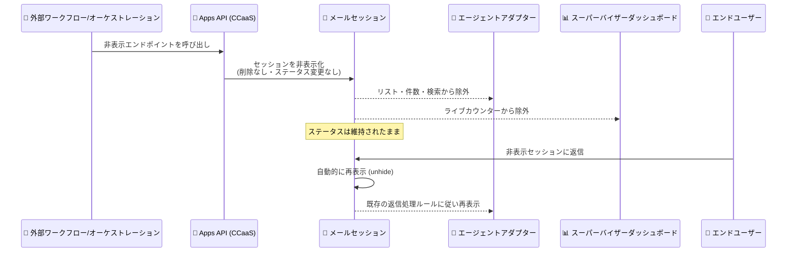

# Google Cloud CCaaS: バージョン 6.29 リリース (メールセッション非表示機能・多数のバグ修正)

**リリース日**: 2026-11-02

**サービス**: Google Cloud Contact Center as a Service (CCaaS / CCAI Platform)

**機能**: バージョン 6.29 — メールセッション非表示 (Apps API) と約 20 件のバグ修正

**ステータス**: リリース済み (メールセッション非表示機能はデフォルトで無効、サポートへの有効化依頼が必要)

📊 [このアップデートのインフォグラフィックを見る](https://takech9203.github.io/google-cloud-news-summary/20261102-ccaas-6-29-email-session-hiding.html)

## 概要

Google Cloud は 2026 年 11 月 2 日に Google Cloud CCaaS (Contact Center as a Service) のバージョン 6.29 をリリースしました。各インスタンスへの適用タイミングは、選択しているデプロイメントスケジュールに依存します。

本リリースの目玉は、**Apps API 経由でメールセッションを非表示にできる新機能**です。2 つの新しい Apps API エンドポイントを使用して、メールセッションをエージェントアダプターから隠すことができます。非表示にされたセッションは、エージェントのリスト・件数カウント・検索結果・スーパーバイザーダッシュボードのライブカウンターから除外されますが、セッション自体は削除されず、ステータスも変更されません。エンドユーザーが非表示のセッションに返信した場合、セッションは自動的に再表示され、既存の返信処理ルールに従って処理されます。

また、本リリースでは音声転送、チャット、ダッシュボード、CRM 連携など広範囲にわたる約 20 件のバグ修正が含まれており、コンタクトセンター運用の安定性が大幅に向上しています。外部のオーケストレーションやワークフローシステムと CCaaS を連携している企業、および大量のメールセッションを扱うコンタクトセンター管理者が主な対象ユーザーです。

**アップデート前の課題**

- 自動化ワークフローやバックオフィス処理の対象となったメールセッションも、エージェントのリストや件数、スーパーバイザーダッシュボードのライブカウンターに表示され続け、エージェントが対応すべき案件とそうでない案件を区別しにくかった
- セッションをエージェントの視界から外すには、ステータスを変更する (resolved / closed にする) か削除するしかなく、セッションの状態を維持したまま一時的に見えなくする手段がなかった
- 言語をまたぐエージェント間の音声転送でウィスパー音声が転送元の言語で再生される、無効な発信者 ID の着信がエージェント間をループする、ブレンド SMS コールでトランスクリプトが表示されないなど、運用上の不具合が多数存在していた

**アップデート後の改善**

- Apps API の 2 つの新エンドポイントにより、セッションを削除したりステータスを変更したりすることなく、メールセッションをエージェントアダプターから非表示にできるようになった
- エンドユーザーが非表示セッションに返信すると自動的に再表示され、既存の返信処理ルールに従うため、顧客対応の抜け漏れを防ぎながら表示制御ができるようになった
- 音声転送のウィスパー音声の言語、未読チャットバッジの過大表示、ダッシュボードの二重カウント、Salesforce アダプターのサイレント障害など約 20 件の不具合が修正され、運用の信頼性が向上した

## アーキテクチャ図

外部システムが Apps API 経由でメールセッションを非表示にするフローと、エンドユーザーの返信による自動再表示の流れを示しています。セッション自体は削除されず、ステータスも変更されない点が特徴です。

## サービスアップデートの詳細

### 主要機能

1. **Google Cloud CCaaS 6.29 のリリース**
   - バージョン 6.29 が正式にリリースされた
   - 各インスタンスへの適用タイミングは、選択している[デプロイメントスケジュール](https://cloud.google.com/contact-center/ccai-platform/docs/deployment-schedules)に依存する

2. **メールセッション非表示機能 (Apps API)**
   - 2 つの新しい Apps API エンドポイントにより、メールセッションをエージェントアダプターから非表示にできる
   - 非表示にすると、エージェントのリスト、件数カウント、検索、スーパーバイザーダッシュボードのライブカウンターから除外される
   - セッションは削除されず、ステータスも変更されない
   - エンドユーザーが非表示セッションに返信すると、セッションは自動的に再表示され、既存の返信処理ルールに従う
   - この機能は Apps API 経由でのみ利用可能 (ポータル UI からの操作は不可)
   - デフォルトでは無効。有効化には Google Cloud サポートへの連絡が必要

3. **約 20 件のバグ修正**
   - 音声・チャット・ダッシュボード・CRM 連携など広範囲の不具合が修正された (詳細は下記)

### 主なバグ修正の内容

本リリースで修正された主な不具合は以下のとおりです。

**音声・転送関連**

- 言語をまたぐエージェントからキューへの音声転送で、ウィスパー音声と「Selected Language」表示が転送先ではなく転送元の言語になる問題
- 無効または整形不能な発信者 ID の着信がエージェント側で読み込まれず、発信者が切断するまでエージェント間でコールがループする問題
- 受信側エージェントのマイク権限が無効な場合に、スーパーバイザーキューへのウォーム転送がサイレントに失敗し繰り返しループする問題
- 受信側エージェントにマイクまたはデバイスエラーがある場合に、コール転送が即座に再キューイングされない問題
- Nexmo 番号を使用したコールが、仮想エージェントエスカレーション中のプリセッションデフレクション試行時に切断される問題
- 仮想エージェントのウェルカムプロンプト再生前に、着信コールで遅延や無音が発生する問題
- エージェントが 1 回のコール中にリダクション (情報秘匿) ボタンを複数回クリックした際に、通話録音の一時停止・再開が一貫して動作しない問題

**レポート・ダッシュボード関連**

- 「Deflections - Calls」ダッシュボードで、電話番号にリダイレクトされたコールが二重カウントされる問題
- スーパーバイザーによる通話中エージェントの強制サインアウトで、必須のコールディスポジションが破棄され、レポートに対応結果が記録されない問題
- 発信者により放棄された未応答の内線・着信コールがコールアダプターの「Missed」リストに表示されず、不明なエラーとして誤分類される問題
- 一部の失敗コールがセッションデータエクスポートで「Failed: ()」と表示され、高度なレポートフィルターから漏れる問題
- ポストセッションサーベイへの転送直後に発信者が切断した場合、仮想エージェントの通話録音がエクスポートされない問題

**チャット・SMS・統合関連**

- リアルタイムリダクション有効時に、仮想エージェントからエスカレーションされたチャットで未読バッジの件数が過大表示される問題
- ブレンド SMS コールで通話トランスクリプトと SmartActions パネルが読み込まれない問題
- 必須のセキュリティキーなしでエージェントデスクトップに読み込まれた際に、Salesforce アダプターがエラーログを残さず接続に失敗する問題
- クライアント認証情報を使用した OAuth セットアップで権限が不足している場合に、Microsoft 365 のメールボックス選択ドロップダウンが空になる問題

**その他**

- サインイン後、CCaaS ポータルのキューリストが長時間ローディング状態のままになる問題
- 営業時間外およびキャパシティ超過時のアナウンス・オプションメッセージを、個々のユーザーおよびチームレベルでカスタマイズできない問題
- 直接着信コールがコンタクトリストまたはキューにデフレクトされる際に、カスタム SIP ヘッダーが引き継がれない問題

## 技術仕様

### メールセッション非表示機能の仕様

| 項目 | 詳細 |
|------|------|
| 提供方法 | Apps API のみ (2 つの新エンドポイント) |
| 非表示の影響範囲 | エージェントのリスト、件数カウント、検索、スーパーバイザーダッシュボードのライブカウンター |
| セッションへの影響 | 削除されない、ステータスも変更されない |
| 自動再表示 | エンドユーザーが返信すると自動的に再表示され、既存の返信処理ルールに従う |
| デフォルト状態 | 無効 (Google Cloud サポートへ有効化を依頼) |
| 認証 | Apps API は基本認証 (Basic authentication) を使用 |

### 関連する既存の Apps API メールエンドポイント

メールセッションを操作する既存の Apps API エンドポイントと組み合わせて利用できます。

| エンドポイント | メソッド | 用途 |
|------|------|------|
| `/apps/api/v1/email/sessions/EMAIL_SUPPORT_ID` | GET | メールセッションのサマリーとメッセージ ID 一覧を取得 |
| `/apps/api/v1/email/messages/EMAIL_THREAD_ID` | GET | 個別メールメッセージの全文を取得 |
| `/apps/api/v1/email/update_status` | POST | 最大 100 セッションのステータスを一括更新 |

メールセッションのステータスは `unopened`、`active`、`paused`、`resolved`、`closed`、`reopened` の 6 種類で、非表示機能はこれらのステータスに影響を与えません。

## 設定方法

### 前提条件

1. Google Cloud CCaaS (CCAI Platform) のインスタンスがバージョン 6.29 に更新されていること (適用時期はデプロイメントスケジュールに依存)
2. Apps API の利用資格情報 (基本認証) を保有していること

### 手順

#### ステップ 1: 機能の有効化を依頼

メールセッション非表示機能はデフォルトで無効です。Google Cloud サポートに連絡し、対象インスタンスでの有効化を依頼します。

#### ステップ 2: Apps API から非表示/再表示エンドポイントを呼び出す

有効化後、Apps API の 2 つの新エンドポイントを外部ワークフローから呼び出してセッションの非表示を制御します。エンドポイントの詳細な仕様は [Apps API ドキュメント](https://cloud.google.com/contact-center/ccai-platform/docs/apps-api)を参照してください。

## メリット

### ビジネス面

- **エージェントの作業リストの最適化**: 自動化処理やバックオフィス処理の対象となったメールをエージェントの視界から外すことで、エージェントは本当に対応が必要な案件に集中できる
- **ダッシュボード指標の正確性向上**: スーパーバイザーダッシュボードのライブカウンターから対象外のセッションが除外されるため、リアルタイムの業務量を正確に把握できる
- **運用安定性の向上**: 約 20 件のバグ修正により、音声転送・レポート・CRM 連携などの日常運用における信頼性が向上する

### 技術面

- **非破壊的な表示制御**: セッションの削除やステータス変更を伴わないため、監査やレポーティングの整合性を保ったまま表示だけを制御できる
- **自動再表示による安全性**: エンドユーザーの返信をトリガーに自動で再表示されるため、顧客からの連絡を見落とすリスクがない
- **API ファーストの設計**: Apps API 経由で提供されるため、外部のオーケストレーションツールや自動化ワークフローに組み込みやすい

## デメリット・制約事項

### 制限事項

- メールセッション非表示機能は Apps API 経由でのみ利用可能で、CCaaS ポータルの UI からは操作できない
- デフォルトで無効のため、利用には Google Cloud サポートへの有効化依頼が必要
- バージョン 6.29 の適用タイミングはインスタンスごとのデプロイメントスケジュールに依存するため、即座に利用できるとは限らない

### 考慮すべき点

- 非表示セッションはエージェントの検索からも除外されるため、運用チームには非表示ルールの存在を周知しておく必要がある
- エンドユーザーの返信で自動再表示された際の挙動は既存の返信処理ルールに従うため、再表示後のルーティング設計を事前に確認しておくことが望ましい

## ユースケース

### ユースケース 1: 自動応答で完結したメールのエージェントリストからの除外

**シナリオ**: 注文確認や配送通知への自動返信など、外部の自動化ワークフローで処理が完結したメールセッションが、エージェントのリストと件数に残り続けてしまう。

**実装例**: 外部オーケストレーションシステムが自動処理の完了後に Apps API の非表示エンドポイントを呼び出し、セッションをエージェントアダプターから除外する。顧客が追加の質問を返信した場合はセッションが自動再表示され、通常の返信処理ルールでエージェントに割り当てられる。

**効果**: エージェントは人の対応が必要なメールだけに集中でき、スーパーバイザーダッシュボードの件数も実態を反映する。

### ユースケース 2: バックオフィス処理待ちセッションの一時退避

**シナリオ**: 返金処理や外部部門への確認など、エージェントの操作を必要としない待機状態のメールセッションがキューの件数を膨らませ、業務量の把握を妨げている。

**効果**: ステータスを維持したまま非表示にすることで、レポーティングの整合性を保ちながらライブカウンターを実対応件数に近づけられる。顧客からの返信があれば即座に再表示されるため対応漏れも発生しない。

## 料金

バージョン 6.29 のリリースおよびメールセッション非表示機能に関する追加料金の情報は、リリースノートには記載されていません。Google Cloud CCaaS の料金体系については公式ドキュメントを参照してください。

- [CCAI Platform ドキュメント](https://cloud.google.com/contact-center/ccai-platform/docs)

## 関連サービス・機能

- **Apps API (CCAI Platform)**: 本機能の提供基盤。メールセッション・メッセージの取得 (`GET /apps/api/v1/email/sessions`、`GET /apps/api/v1/email/messages`) や一括ステータス更新 (`POST /apps/api/v1/email/update_status`) と組み合わせて、メール処理の自動化パイプラインを構築できる
- **エージェントデスクトップ / エージェントアダプター**: 非表示機能の表示制御対象。バージョン 6.9 以降、エージェントデスクトップはメールアダプターをサポートしている
- **Salesforce / Microsoft 365 連携**: 本リリースで Salesforce アダプターの接続エラーログ出力、M365 メールボックス選択ドロップダウンの不具合が修正され、CRM・メール連携の信頼性が向上した

## 参考リンク

- 📊 [インフォグラフィック](https://takech9203.github.io/google-cloud-news-summary/20261102-ccaas-6-29-email-session-hiding.html)
- [公式リリースノート (CCAI Platform)](https://cloud.google.com/contact-center/ccai-platform/docs/release-notes)
- [デプロイメントスケジュール](https://cloud.google.com/contact-center/ccai-platform/docs/deployment-schedules)
- [Apps API ドキュメント](https://cloud.google.com/contact-center/ccai-platform/docs/apps-api)
- [メールセッション・メッセージの取得](https://cloud.google.com/contact-center/ccai-platform/docs/get-email-sessions-and-messages)
- [メールステータス一括更新エンドポイント](https://cloud.google.com/contact-center/ccai-platform/docs/bulk-email-status-endpoint)

## まとめ

Google Cloud CCaaS 6.29 は、Apps API によるメールセッション非表示という自動化・外部連携向けの新機能と、音声転送やダッシュボードなど広範囲の約 20 件のバグ修正を含むリリースです。メール処理を外部ワークフローで自動化している組織は、Google Cloud サポートに有効化を依頼した上で、エージェントの作業リスト最適化への活用を検討することをおすすめします。また、自社インスタンスのデプロイメントスケジュールを確認し、6.29 の適用時期を把握しておきましょう。

---

**タグ**: #GoogleCloud #CCaaS #CCAIPlatform #ContactCenter #AppsAPI #Email #リリースノート
