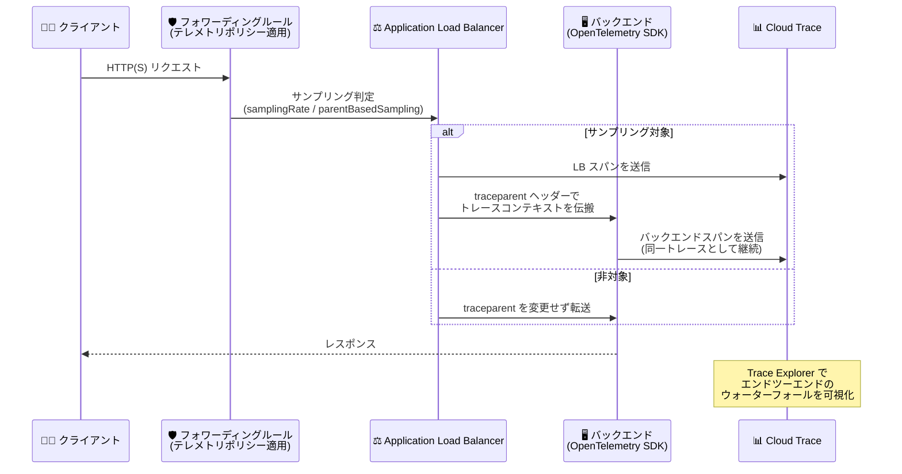

# Cloud Load Balancing: Application Load Balancer の Cloud Trace による分散トレーシング (Preview)

**リリース日**: 2026-11-02

**サービス**: Cloud Load Balancing

**機能**: Application Load Balancer の Cloud Trace による分散トレーシング

**ステータス**: Preview

📊 [このアップデートのインフォグラフィックを見る](https://takech9203.github.io/google-cloud-news-summary/20261102-cloud-load-balancing-distributed-tracing-preview.html)

## 概要

Application Load Balancer で Cloud Trace を利用した分散トレーシングが Preview として利用可能になりました。対象はグローバル外部 Application Load Balancer、リージョン外部 Application Load Balancer、リージョン内部 Application Load Balancer、クロスリージョン内部 Application Load Balancer の 4 種類です (従来型 (Classic) Application Load Balancer は非対応)。

ロードバランサーのフォワーディングルールに **テレメトリポリシー (`TelemetryPolicy`)** をアタッチすると、ロードバランサーがリクエストをサンプリングしてトレーススパンを生成し、Cloud Trace に送信します。生成されるスパンは **W3C Trace Context** と **OpenTelemetry** のオープン標準に準拠し、トレースコンテキストは `traceparent` ヘッダーでバックエンドに伝搬されます。OpenTelemetry SDK で計装されたバックエンドは、ロードバランサーが開始したトレースをそのまま継続できます。

ロードバランサーはアプリケーショントラフィックのエントリポイントであるため、この地点でトレースを開始・伝搬することで、クライアント → ロードバランサー → バックエンドというリクエストパス全体の診断可視性が得られます。マルチティア構成でのレイテンシボトルネックの特定、障害ホップの切り分け、エラーのトラブルシューティングに有効です。

**アップデート前の課題**

- 従来、Application Load Balancer は Cloud Trace に対応しておらず、ロードバランサー自身がトレースやスパンをエクスポートすることはできなかった (グローバル / 従来型 ALB は `X-Cloud-Trace-Context` ヘッダーを付与するのみで、スパンは生成されなかった)
- バックエンド側の計装だけでは、ロードバランサーがバックエンドを選択する前に発生するエッジでのエラー (TLS 失敗、404 など) やレイテンシを観測できなかった
- クライアントからバックエンドまでのリクエストパスのうち、ロードバランサー区間がトレース上の「空白」となり、レイテンシの原因がエッジ・LB ホップ・バックエンドのどこにあるかの切り分けが困難だった

**アップデート後の改善**

- テレメトリポリシーをフォワーディングルールにアタッチするだけで、ロードバランサーが W3C Trace Context / OpenTelemetry 準拠のスパンを生成し Cloud Trace に送信できるようになった
- フォワーディングルール (VIP とポート) に入る全トラフィックが対象となるため、バックエンド選択前に失敗したリクエストも含むエッジの可観測性が得られるようになった
- テレメトリポリシーはバックエンドサービス・URL マップ・ターゲットプロキシから独立したリソースであり、ルーティング設定を変更せずにトレーシングの有効化・変更・削除が可能になった
- トレーススパンを Cloud Load Balancing のリクエストログや Cloud Monitoring メトリクスと相関させ、レイテンシやエラーの発生源を特定できるようになった

## アーキテクチャ図



テレメトリポリシーが適用されたフォワーディングルールに到達したリクエストは、サンプリング判定を経てロードバランサーのスパンが Cloud Trace に送信され、`traceparent` ヘッダーによりバックエンドのスパンと同一トレースとして連結されます。

## サービスアップデートの詳細

### 主要機能

1. **フォワーディングルールへのテレメトリポリシーのアタッチ**
   - Network Services API の `TelemetryPolicy` リソースで、トレース対象のフォワーディングルール (最大 50 リソース) とサンプリング設定を定義
   - ポリシーはロケーションスコープ: グローバルフォワーディングルール (グローバル外部 ALB、クロスリージョン内部 ALB) には `global`、リージョンフォワーディングルール (リージョン外部 / 内部 ALB) には該当リージョンにポリシーを作成
   - 1 つのポリシーを複数のフロントエンドに再利用でき、一貫したトレーシング設定を適用可能

2. **確率的サンプリング (Probabilistic sampling)**
   - `samplingRate` フィールド (0.0〜1.0、デフォルト 0.0) で固定比率のリクエストをサンプリング (例: `0.01` で 1%)
   - 対応する 4 種類の Application Load Balancer すべてでサポート

3. **親ベースサンプリング (Parent-based sampling)**
   - 受信した `traceparent` ヘッダーの sampled フラグ (上流のサンプリング判断) を尊重してサンプリング。`parentBasedSampling.enabled` と `parentBasedSampling.samplingRate` で設定
   - sampled フラグが立っていないリクエストはサンプリングせず、OpenTelemetry 仕様に従い分断されたトレースの発生を防止
   - `traceparent` ヘッダーがないリクエストにはベースラインの `samplingRate` を適用
   - **内部 Application Load Balancer のみ対応** (Preview 時点)

4. **標準準拠のトレースコンテキスト処理**
   - サンプリング対象でヘッダーなし: 新しいトレース ID とスパン ID を生成し、trace flags を `03` (random + sampled) に設定
   - サンプリング対象でヘッダーあり: 受信したトレース ID と random フラグを維持し、新しいスパン ID を生成して sampled フラグを設定
   - 非サンプリング時: 受信した `traceparent` ヘッダーを変更せずバックエンドへ転送

## 技術仕様

### 対応ロードバランサーとサンプリングモード

| ロードバランサー | スキーム | 確率的サンプリング | 親ベースサンプリング |
|------|------|------|------|
| グローバル外部 Application Load Balancer | EXTERNAL_MANAGED | ✅ | ❌ |
| リージョン外部 Application Load Balancer | EXTERNAL_MANAGED | ✅ | ❌ |
| リージョン内部 Application Load Balancer | INTERNAL_MANAGED | ✅ | ✅ |
| クロスリージョン内部 Application Load Balancer | INTERNAL_MANAGED | ✅ | ✅ |
| 従来型 Application Load Balancer | - | 非対応 | 非対応 |

### 必要な IAM ロール

| 用途 | ロール |
|------|------|
| テレメトリポリシーの作成・更新・削除 | `roles/compute.networkAdmin` または `roles/compute.admin` |
| コンソールでのトレース閲覧 | `roles/cloudtrace.user` |
| LB からのスパン書き込み (サービスエージェントに付与) | `roles/cloudtrace.agent` を `service-PROJECT_NUMBER@compute-system.iam.gserviceaccount.com` と `service-PROJECT_NUMBER@gcp-sa-networksecurity.iam.gserviceaccount.com` に付与 |
| バックエンド自身のスパンエクスポート | バックエンドワークロードのサービスアカウントに `roles/cloudtrace.agent` |

### テレメトリポリシーの構成例

```yaml
name: "projects/PROJECT_ID/locations/LOCATION/telemetryPolicies/POLICY_NAME"
displayName: "DISPLAY_NAME"
telemetryTarget:
  resources:
    - "FORWARDING_RULE_URI"   # 最大 50 リソース
tracingConfiguration:
  samplingRate: 0.01            # 0.0〜1.0 (デフォルト 0.0)
  parentBasedSampling:          # 内部 ALB のみ
    enabled: true
    samplingRate: 1.0
```

## 設定方法

### 前提条件

1. Cloud Trace API と Network Services API を有効化する
   ```bash
   gcloud services enable cloudtrace.googleapis.com networkservices.googleapis.com
   ```
2. 対応する Application Load Balancer がデプロイ済みであること (従来型 ALB は非対応)
3. 対象フォワーディングルールの名前とスコープ (グローバル / リージョン) を確認する
   ```bash
   gcloud compute forwarding-rules list
   ```

### 手順

#### ステップ 1: テレメトリポリシーの YAML を作成

グローバル外部 Application Load Balancer に 1% の確率的サンプリングを設定する例:

```bash
cat <<EOF > storefront-tracing-policy.yaml
name: "projects/PROJECT_ID/locations/global/telemetryPolicies/storefront-tracing-policy"
displayName: "Tracing policy for the storefront load balancer"
telemetryTarget:
  resources:
    - "//compute.googleapis.com/projects/PROJECT_ID/global/forwardingRules/FORWARDING_RULE_NAME"
tracingConfiguration:
  samplingRate: 0.01
EOF
```

リージョン内部 Application Load Balancer で親ベースサンプリングを併用する例:

```bash
cat <<EOF > checkout-tracing-policy.yaml
name: "projects/PROJECT_ID/locations/REGION/telemetryPolicies/checkout-tracing-policy"
displayName: "Tracing policy for the internal checkout load balancer"
telemetryTarget:
  resources:
    - "//compute.googleapis.com/projects/PROJECT_ID/regions/REGION/forwardingRules/FORWARDING_RULE_NAME"
tracingConfiguration:
  samplingRate: 0.01
  parentBasedSampling:
    enabled: true
    samplingRate: 1.0
EOF
```

#### ステップ 2: テレメトリポリシーをインポート

```bash
gcloud beta network-services telemetry-policies import storefront-tracing-policy \
    --source=storefront-tracing-policy.yaml \
    --location=global
```

リージョンポリシーの場合は `--location=REGION` を指定します。インポート後、Google Cloud コンソールの Trace Explorer でロードバランサーのスパンとバックエンドのスパンを 1 つのトレースとして確認できます。

## メリット

### ビジネス面

- **障害対応時間 (MTTR) の短縮**: レイテンシやエラーの発生源がエッジ・LB ホップ・バックエンドのどこにあるかを即座に切り分けられ、インシデント対応が迅速化する
- **追加コストの抑制**: ロードバランサーによるスパン生成自体は無料で、低いサンプリングレート設定によりピークトラフィック時でも Cloud Trace の取り込みコストを予測可能に保てる

### 技術面

- **オープン標準準拠**: W3C Trace Context と OpenTelemetry に準拠するため、OpenTelemetry SDK で計装済みのバックエンドは追加作業なしでトレースを継続できる
- **ルーティング設定から独立**: テレメトリポリシーはバックエンドサービスや URL マップと独立したライフサイクルを持ち、トラフィック処理に影響を与えずに有効化・変更・削除できる
- **エッジの可観測性**: バックエンド選択前のフォワーディングルール時点でスパンを取得するため、バックエンド計装では検出できないエッジのエラーやレイテンシを観測できる
- **テレメトリの相関**: 統一されたトレース ID により、Cloud Load Balancing のリクエストログや Cloud Monitoring メトリクスとトレースを相関分析できる

## デメリット・制約事項

### 制限事項 (Preview 時点)

- 親ベースサンプリングは外部 Application Load Balancer では非対応 (内部 ALB のみ)
- カスタムスパン属性は非対応
- GKE Gateway API や Terraform からの設定は不可 (gcloud / API ベースの設定)
- 1 つのテレメトリポリシーがターゲットにできるリソースは最大 50 個
- 従来型 (Classic) Application Load Balancer は分散トレーシングに非対応

### 考慮すべき点

- Pre-GA (Preview) 機能のため「現状のまま」提供され、サポートが限定される場合がある。本番適用は Pre-GA Offerings Terms を確認のうえ判断する
- スパン生成は無料だが Cloud Trace への取り込みは課金対象。高トラフィック環境では `samplingRate` を 0.01 (1%) または 0.001 (0.1%) 程度に抑えることが推奨されている
- バックエンドのスパンをトレースに含めるには、バックエンドワークロードのサービスアカウントに `roles/cloudtrace.agent` の付与と OpenTelemetry SDK (W3C Trace Context propagator) での計装が必要

## ユースケース

### ユースケース 1: EC サイトのエッジ監視

**シナリオ**: グローバル外部 Application Load Balancer で顧客トラフィックを受ける EC ストアフロントで、エッジでのレイテンシや 404 レスポンス、TLS 障害などのエラーを監視したい。

**実装例**:
```yaml
tracingConfiguration:
  samplingRate: 0.01   # 1% サンプリング
```

**効果**: バックエンド計装では見えないエッジのエラー・レイテンシを捕捉しつつ、低サンプリングレートによりピークトラフィック時も Cloud Trace の取り込みコストを予測可能に維持できる。

### ユースケース 2: チェックアウト経路のトレース連続性の確保

**シナリオ**: ストアフロントから内部 Application Load Balancer を経由してカート・在庫・決済の各内部サービスへチェックアウトリクエストが流れる構成で、上流でサンプリングされたリクエストを内部ホップでも漏れなくトレースしたい。

**実装例**:
```yaml
tracingConfiguration:
  samplingRate: 0.01
  parentBasedSampling:
    enabled: true
    samplingRate: 1.0   # 上流でサンプリング済みのリクエストは 100% トレース
```

**効果**: ストアフロントや上流サービスでサンプリング済みのチェックアウトリクエストが内部 LB を跨いでも分断されずにトレースされ、通常トラフィックはベースラインレートで取り込み量を抑制できる。

### ユースケース 3: レイテンシボトルネックの切り分け

**シナリオ**: チェックアウトのレイテンシ増加や 5xx エラーの急増が発生した際に、原因箇所を特定したい。

**効果**: Cloud Trace のロードバランサースパンをリクエストログやレイテンシメトリクスと比較することで、問題がロードバランサーのエッジ、内部 LB ホップ、バックエンドサービスのいずれで発生しているかを切り分けられる。

## 料金

ロードバランサーによるトレーススパンの生成自体に追加料金はかかりません。ただし、Cloud Trace へのスパン取り込みには Cloud Trace の料金が適用されます。

### 料金例 (Cloud Trace 取り込み)

| 項目 | 料金 |
|--------|-----------------|
| トレーススパン取り込み | $0.20 / 100 万スパン |
| 無料枠 | 毎月最初の 250 万スパン |

高トラフィックの本番ワークロードでは、取り込みコスト管理のため `samplingRate` を 0.01 (1%) または 0.001 (0.1%) にすることが推奨されています。

詳細は [Google Cloud Observability の料金ページ](https://cloud.google.com/products/observability/pricing) を参照してください。

## 利用可能リージョン

対象のロードバランサータイプ (グローバル外部 / リージョン外部 / リージョン内部 / クロスリージョン内部 Application Load Balancer) が利用可能な構成で使用できます。テレメトリポリシーは、グローバルフォワーディングルールには `global`、リージョンフォワーディングルールには該当リージョンに作成します。

## 関連サービス・機能

- **Cloud Trace**: スパンの取り込み先。Trace Explorer でトレースのウォーターフォール表示・分析を行う
- **Cloud Logging / Cloud Load Balancing リクエストログ**: トレース ID を介してロードバランサーのリクエストログとスパンを相関分析できる
- **Cloud Monitoring**: レイテンシメトリクスのスパイクをスパンの内訳と比較し、問題箇所を特定できる
- **Network Services API**: `TelemetryPolicy` リソースを管理する API (`gcloud beta network-services telemetry-policies`)
- **OpenTelemetry**: バックエンドを OpenTelemetry SDK (W3C Trace Context propagator) で計装すると、`traceparent` ヘッダーを自動で読み取りトレースを継続できる
- **Secure Web Proxy**: 同じ `TelemetryPolicy` の仕組みによる分散トレーシングがアウトバウンドトラフィック向けに提供されており、インバウンド (ALB) と合わせて双方向の可視性を実現できる

## 参考リンク

- 📊 [インフォグラフィック](https://takech9203.github.io/google-cloud-news-summary/20261102-cloud-load-balancing-distributed-tracing-preview.html)
- [公式リリースノート](https://docs.cloud.google.com/release-notes#November_02_2026)
- [Distributed tracing overview (ドキュメント)](https://docs.cloud.google.com/load-balancing/docs/distributed-tracing-overview)
- [Trace inbound traffic with Cloud Trace (設定手順)](https://docs.cloud.google.com/load-balancing/docs/trace-inbound-traffic)
- [Cloud Trace の概要](https://docs.cloud.google.com/trace/docs/overview)
- [料金ページ (Google Cloud Observability)](https://cloud.google.com/products/observability/pricing)

## まとめ

これまでトレース上の「空白」だった Application Load Balancer 区間がスパンとして可視化され、クライアントからバックエンドまでのエンドツーエンドの分散トレーシングが Google Cloud のマネージド機能として実現できるようになりました。テレメトリポリシーはルーティング設定から独立しており、低いサンプリングレートから小さく始められるため、まずは検証環境の外部 ALB に 1% サンプリングのポリシーを適用し、バックエンドの OpenTelemetry 計装と組み合わせたトレース連続性を確認することを推奨します。Preview 機能のため、本番適用時は親ベースサンプリングの対応範囲 (内部 ALB のみ) や Terraform 非対応などの制限事項を確認してください。

---

**タグ**: Cloud Load Balancing, Cloud Trace, Application Load Balancer, 分散トレーシング, OpenTelemetry, W3C Trace Context, テレメトリポリシー, Observability, Preview
