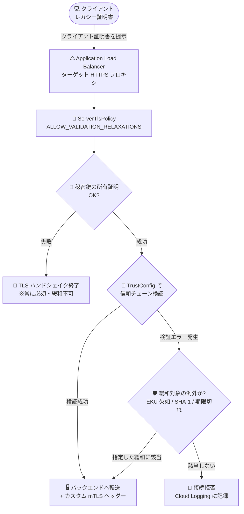

# Cloud Load Balancing: フロントエンド mTLS 検証緩和 (Validation Relaxations) が GA

**リリース日**: 2026-11-02

**サービス**: Cloud Load Balancing

**機能**: Application Load Balancer のフロントエンド mTLS 検証緩和 (ALLOW_VALIDATION_RELAXATIONS)

**ステータス**: GA (一般提供)

📊 [このアップデートのインフォグラフィックを見る](https://takech9203.github.io/google-cloud-news-summary/20261102-cloud-load-balancing-mtls-validation-relaxations-ga.html)

## 概要

Application Load Balancer の相互 TLS (mTLS) において、フロントエンドでのクライアント証明書検証を部分的に緩和できる「検証緩和 (Validation Relaxations)」機能が一般提供 (GA) になりました。Client Authentication (`ServerTlsPolicy`) リソースに新しいクライアント検証モード `ALLOW_VALIDATION_RELAXATIONS` が追加され、標準の X.509 クライアント証明書検証ルールに対して、特定の検証例外のみを明示的に許可できるようになります。

これまでのクライアント検証モードは、検証失敗時に接続を拒否する `REJECT_INVALID` と、無効・未提示の証明書でもすべてバックエンドに転送する `ALLOW_INVALID_OR_MISSING_CLIENT_CERT` の 2 択でした。新モードはこの中間に位置し、クライアント証明書の提示を必須としつつ、「EKU 拡張の欠如」「SHA-1 署名」「リーフ証明書の期限切れ」という 3 種類の例外だけをピンポイントで許容します。これにより、最新の証明書要件を満たさないレガシーなクライアント (古い IoT デバイス、組み込み機器、更新が困難な社内システムなど) を抱える組織が、セキュリティポスチャを維持したまま Application Load Balancer への移行を進められます。

本機能は Global external、Classic、Regional external、Regional internal、Cross-region internal を含むすべての Application Load Balancer タイプで利用できます。

**アップデート前の課題**

mTLS のクライアント検証モードが二者択一であり、きめ細かな制御ができませんでした。

- 検証ルールを 1 つでも満たさないクライアント証明書 (EKU 拡張なし、SHA-1 署名、期限切れなど) は、`REJECT_INVALID` モードでは一律に接続拒否されるため、レガシークライアントを受け入れられなかった
- 回避策として `ALLOW_INVALID_OR_MISSING_CLIENT_CERT` モードを使うと、証明書が未提示・完全に無効なクライアントまでバックエンドに到達してしまい、ロードバランサー側での認証強制が事実上無効化されていた
- レガシー証明書を使うワークロードの移行では、全クライアントの証明書を事前に再発行・再配布するか、セキュリティを犠牲にするかの難しい判断が必要だった

**アップデート後の改善**

- 今回のアップデートにより、`ALLOW_VALIDATION_RELAXATIONS` モードでクライアント証明書の提示と信頼チェーン検証を必須としたまま、特定の検証例外のみを選択的に許可できるようになった
- 許可する緩和項目 (`ALLOW_MISSING_EKU` / `ALLOW_SHA1_HASHING` / `ALLOW_EXPIRED_LEAF_CERTIFICATE`) を個別に指定できるため、必要最小限の緩和にとどめられる
- レガシークライアントの証明書を一斉更新しなくても Application Load Balancer への移行を進められ、移行後に段階的に `REJECT_INVALID` へ厳格化する運用が可能になった

## アーキテクチャ図



`ALLOW_VALIDATION_RELAXATIONS` モードでは、秘密鍵の所有証明と信頼チェーン検証は引き続き必須のまま、管理者が明示的に指定した 3 種類の検証例外のみが許容され、それ以外の検証エラーは従来どおり接続拒否となります。

## サービスアップデートの詳細

### 主要機能

1. **新しいクライアント検証モード `ALLOW_VALIDATION_RELAXATIONS`**
   - `ServerTlsPolicy` (Client Authentication) リソースに設定する第 3 のクライアント検証モード
   - クライアント証明書の提示を必須とし、指定した検証緩和のみを適用したうえで信頼チェーン検証を実施する
   - `REJECT_INVALID` (厳格拒否) と `ALLOW_INVALID_OR_MISSING_CLIENT_CERT` (全許可) の中間に位置する選択肢

2. **`ALLOW_MISSING_EKU`: EKU 拡張欠如の許容**
   - クライアント証明書に Extended Key Usage (EKU) 拡張が存在しない場合に、EKU 検証をバイパスする
   - EKU 拡張が存在する場合は、従来どおり `clientAuth` キー用途 (OID 1.3.6.1.5.5.7.3.2) を許可している必要がある
   - 標準検証では EKU に `clientAuth` を含まない証明書は `client_cert_chain_invalid_eku` エラーで拒否される

3. **`ALLOW_SHA1_HASHING`: SHA-1 署名証明書の許容**
   - レガシーな SHA-1 メッセージダイジェストで署名されたクライアント証明書チェーンの検証を許可する
   - 標準の証明書要件では SHA-256 以上のハッシュアルゴリズムが必須 (MD4、MD5、SHA-1 は非サポート)

4. **`ALLOW_EXPIRED_LEAF_CERTIFICATE`: 期限切れリーフ証明書の許容**
   - 有効期限が切れたクライアントのリーフ証明書を、有効期間終了 (notAfter タイムスタンプ) の 1 秒前の時点とみなして検証する
   - 対象はリーフ (クライアント) 証明書のみで、期限切れ以外の検証項目は通常どおり評価される

## 技術仕様

### クライアント検証モードの比較

| 検証モード | 証明書の提示 | 検証失敗時の動作 | 主な用途 |
|------|------|------|------|
| `REJECT_INVALID` | 必須 | 接続を終了し、エラーを Cloud Logging に記録 | 厳格な mTLS 認証の強制 |
| `ALLOW_VALIDATION_RELAXATIONS` (新規・GA) | 必須 | 指定した緩和に該当する例外のみ許容し、それ以外は拒否 | レガシーワークロードの移行 |
| `ALLOW_INVALID_OR_MISSING_CLIENT_CERT` | 任意 | 無効・未提示でもバックエンドへ転送 (カスタムヘッダーで失敗理由を通知) | ソフト適用・移行初期の観測 |

いずれのモードでも、クライアントが秘密鍵の所有を証明できない場合は TLS ハンドシェイクが終了します (緩和不可)。

### 検証緩和パラメータ

| パラメータ | 緩和内容 | 標準検証ルール |
|------|------|------|
| `ALLOW_MISSING_EKU` | EKU 拡張が存在しない場合に EKU 検証をスキップ (存在する場合は `clientAuth` が必須) | EKU 拡張に `clientAuth` を含むことが必須 |
| `ALLOW_SHA1_HASHING` | SHA-1 署名の証明書チェーンを許容 | SHA-256 以上のハッシュアルゴリズムが必須 |
| `ALLOW_EXPIRED_LEAF_CERTIFICATE` | 期限切れリーフ証明書を notAfter の 1 秒前として検証 | 証明書が有効期限内であることが必須 |

### 対応ロードバランサー

| ロードバランサータイプ | 対応 |
|------|------|
| Global external Application Load Balancer | ✅ |
| Classic Application Load Balancer | ✅ |
| Regional external Application Load Balancer | ✅ |
| Regional internal Application Load Balancer | ✅ |
| Cross-region internal Application Load Balancer | ✅ |

## 設定方法

### 前提条件

1. mTLS を構成する Application Load Balancer と、信頼アンカー (ルート証明書) を含む Certificate Manager の TrustConfig リソースが作成済みであること
2. `ServerTlsPolicy` リソースの作成・更新権限 (Network Security API) を持っていること

### 手順

#### ステップ 1: 検証緩和を指定した ServerTlsPolicy を作成

```bash
gcloud network-security server-tls-policies create LEGACY_MTLS_POLICY \
    --location=global \
    --client-validation-mode=allow-validation-relaxations \
    --client-validation-relaxations=allow-missing-eku,allow-sha1-hashing,allow-expired-leaf-certificate \
    --client-validation-trust-config=projects/PROJECT_ID/locations/global/trustConfigs/TRUST_CONFIG_NAME
```

`--client-validation-mode=allow-validation-relaxations` を指定し、`--client-validation-relaxations` に許可する緩和項目をカンマ区切りで列挙します。必要最小限の緩和のみを指定することを推奨します。

#### ステップ 2: ServerTlsPolicy をターゲット HTTPS プロキシにアタッチ

```bash
gcloud compute target-https-proxies update TARGET_HTTPS_PROXY_NAME \
    --server-tls-policy=projects/PROJECT_ID/locations/global/serverTlsPolicies/LEGACY_MTLS_POLICY
```

ポリシーをロードバランサーのターゲット HTTPS プロキシに関連付けると、以降のクライアント接続に緩和付きの mTLS 検証が適用されます。

## メリット

### ビジネス面

- **レガシーワークロード移行の加速**: 古い証明書を利用するクライアント群の証明書更新・再配布を待たずに、Application Load Balancer への移行プロジェクトを進められる
- **セキュリティとの両立**: 「全許可モード」に切り替えることなく移行期間を乗り切れるため、監査・コンプライアンス上の説明責任を果たしやすい

### 技術面

- **最小権限の原則に沿った緩和**: 3 種類の緩和項目を個別に指定でき、必要な例外だけをピンポイントで許容できる
- **認証の骨格は維持**: 証明書の提示、秘密鍵所有の証明、TrustConfig に対する信頼チェーン検証は引き続き必須で、緩和対象外の検証エラーは従来どおり拒否・ログ記録される
- **段階的な厳格化が容易**: 移行完了後は `--client-validation-mode=reject-invalid` に変更するだけで標準の厳格検証に戻せる

## デメリット・制約事項

### 制限事項

- 緩和できるのは「EKU 拡張の欠如」「SHA-1 署名」「期限切れリーフ証明書」の 3 項目のみで、自己署名証明書や信頼チェーンを構成できない証明書は許容されない (自己署名証明書を受け入れる必要がある場合は TrustConfig の `allowlistedCertificates` を検討)
- `ALLOW_EXPIRED_LEAF_CERTIFICATE` が対象とするのはリーフ証明書のみで、期限切れの中間 CA・ルート CA 証明書は緩和対象外
- `ALLOW_MISSING_EKU` は EKU 拡張が「存在しない」場合のみ有効で、EKU 拡張が存在して `clientAuth` を含まない証明書は引き続き拒否される

### 考慮すべき点

- SHA-1 署名や期限切れ証明書の許容はセキュリティリスクを伴うため、恒久的な設定ではなく移行期間中の一時的な措置として位置づけ、最終的には `REJECT_INVALID` への移行を計画すべき
- どのクライアントが緩和に依存しているかを把握するため、カスタム mTLS ヘッダーや Cloud Logging による検証結果のモニタリングを併用することが望ましい

## ユースケース

### ユースケース 1: レガシー IoT デバイス群のオンプレミスからの移行

**シナリオ**: 工場内の IoT デバイス数千台が、EKU 拡張を持たない古いクライアント証明書でオンプレミスのリバースプロキシに mTLS 接続している。ゲートウェイを Google Cloud の外部 Application Load Balancer に移行したいが、全デバイスの証明書再発行には長期間を要する。

**実装例**:
```bash
gcloud network-security server-tls-policies create iot-migration-policy \
    --location=global \
    --client-validation-mode=allow-validation-relaxations \
    --client-validation-relaxations=allow-missing-eku \
    --client-validation-trust-config=projects/my-project/locations/global/trustConfigs/iot-trust-config
```

**効果**: 証明書の一斉更新を待たずにロードバランサーを切り替えられる。信頼チェーン検証は維持されるため、社内 CA が発行した証明書を持つデバイスのみが接続でき、デバイス更新の完了後に `reject-invalid` へ切り替えて厳格化できる。

### ユースケース 2: 証明書更新が遅延したパートナーシステムの一時的救済

**シナリオ**: B2B API を mTLS (`REJECT_INVALID`) で保護しているが、一部パートナーのクライアント証明書が期限切れとなり、更新完了まで数日かかる。業務影響を避けつつ、未認証クライアントの受け入れは避けたい。

**効果**: `ALLOW_EXPIRED_LEAF_CERTIFICATE` のみを指定した緩和モードに一時的に切り替えることで、信頼チェーンが有効なパートナーの接続は維持しながら、証明書を持たない第三者の接続は引き続き拒否できる。全許可モードへ切り替える場合と比べてリスクを大幅に抑えられる。

## 料金

本機能 (mTLS 検証緩和) 自体に追加料金は発表されていません。Cloud Load Balancing の標準料金 (フォワーディングルール、処理データ量など) が適用されます。詳細は料金ページを参照してください。

- [Cloud Load Balancing の料金](https://cloud.google.com/vpc/network-pricing#lb)

## 利用可能リージョン

すべての Application Load Balancer タイプ (Global external、Classic、Regional external、Regional internal、Cross-region internal) で利用可能です。リージョンごとの提供状況は公式ドキュメントを参照してください。

## 関連サービス・機能

- **Certificate Manager (TrustConfig)**: 信頼アンカー (ルート証明書) と中間証明書を保持する TrustConfig リソースを管理し、`ServerTlsPolicy` から参照してクライアント証明書の信頼チェーン検証に利用する
- **Certificate Authority Service**: プライベート CA を構築してクライアント証明書を発行し、Application Load Balancer の mTLS と組み合わせて利用できる
- **Cloud Logging**: 検証モードに応じたクライアント証明書検証エラー (`client_cert_chain_invalid_eku`、`client_cert_validation_failed` など) が記録され、緩和に依存するクライアントの特定や移行進捗の確認に活用できる
- **カスタム mTLS ヘッダー**: 証明書のフィンガープリントや検証結果をバックエンドにヘッダーで伝達でき、アプリケーション側での追加判定に利用できる

## 参考リンク

- 📊 [インフォグラフィック](https://takech9203.github.io/google-cloud-news-summary/20261102-cloud-load-balancing-mtls-validation-relaxations-ga.html)
- [公式リリースノート](https://docs.cloud.google.com/release-notes#November_02_2026)
- [相互 TLS の概要 (クライアント検証モード)](https://docs.cloud.google.com/load-balancing/docs/mtls)
- [gcloud network-security server-tls-policies create リファレンス](https://docs.cloud.google.com/sdk/gcloud/reference/network-security/server-tls-policies/create)
- [ユーザー提供証明書による mTLS の設定](https://docs.cloud.google.com/load-balancing/docs/https/setting-up-mtls-ccm)
- [プライベート CA による mTLS の設定](https://docs.cloud.google.com/load-balancing/docs/https/setting-up-mtls-ca-ccm)
- [料金ページ](https://cloud.google.com/vpc/network-pricing#lb)

## まとめ

`ALLOW_VALIDATION_RELAXATIONS` モードの GA により、mTLS のクライアント検証が「厳格拒否か全許可か」の二者択一から脱し、レガシー証明書を使うワークロードを安全に Application Load Balancer へ移行する現実的な選択肢が加わりました。レガシークライアントを理由に mTLS の導入や移行を見送っていた場合は、必要最小限の緩和項目を指定した `ServerTlsPolicy` の検証から始め、移行完了後に `REJECT_INVALID` へ厳格化する計画を立てることを推奨します。

---

**タグ**: Cloud Load Balancing, mTLS, ServerTlsPolicy, Application Load Balancer, セキュリティ, ネットワーキング, GA
