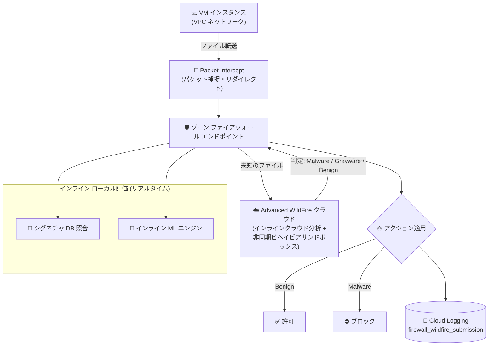

# Cloud NGFW: Advanced malware sandbox (WildFire) が GA に

**リリース日**: 2026-11-02

**サービス**: Cloud NGFW (Next Generation Firewall)

**機能**: Advanced malware sandbox (WildFire)

**ステータス**: GA (一般提供)

📊 [このアップデートのインフォグラフィックを見る](https://takech9203.github.io/google-cloud-news-summary/20261102-cloud-ngfw-advanced-malware-sandbox-ga.html)

## 概要

Cloud Next Generation Firewall (Cloud NGFW) の **Advanced malware sandbox (WildFire)** が一般提供 (GA) になりました。本機能は、動的な機械学習 (インライン ML) とクラウドベースのビヘイビアサンドボックスを統合し、ネットワーク経由のファイル転送をディープインスペクションして、ゼロデイマルウェアがワークロードに到達する前にブロックします。Palo Alto Networks の Advanced WildFire を基盤としており、Cloud NGFW Enterprise ティアの機能として提供されます。

従来の Cloud NGFW Enterprise が提供するシグネチャベースの侵入検知・防御サービス (IDS/IPS) は、既知の脅威シグネチャとの照合が中心でした。Advanced malware sandbox はこれを拡張し、疑わしいファイルをリアルタイムに評価することで、シグネチャが存在しない未知・ゼロデイの脅威も検出・ブロックできます。検出された脅威の判定 (verdict) はローカルのシグネチャデータベースに自動的に反映され、脅威インテリジェンスが継続的に強化されます。

VPC ネットワーク上の VM ワークロードを運用し、インターネットや内部ネットワーク経由のファイル転送に対する高度なマルウェア対策を必要とする組織、特に金融・医療などセキュリティ要件の厳しい企業や、SOC (Security Operations Center) を運用する組織に有用なアップデートです。

**アップデート前の課題**

- Advanced malware sandbox は Preview 段階であり、Pre-GA Offerings Terms が適用され、本番環境での利用にはサポート面の制約があった
- シグネチャベースの IDS/IPS のみでは、確立されたシグネチャを持たない新種・高度にカスタマイズされたマルウェア (ゼロデイ脅威) の検出が困難だった
- 未知のファイルの挙動分析 (サンドボックス解析) を行うには、サードパーティ製品の導入や独自の解析基盤の構築が必要だった

**アップデート後の改善**

- GA となり、SLA を含む本番環境向けのフルサポートのもとで Advanced malware sandbox を利用できるようになった
- インライン ML エンジンがファイアウォールのデータプレーン上で直接 ML モデルを実行し、ゼロデイ脅威をリアルタイムに検出できるようになった
- 判定が不明なファイルは Advanced WildFire クラウドの隔離環境で実行・挙動監査され、その判定結果が自動的にローカルシグネチャに反映されるようになった
- 脅威検出時には、サンドボックス実行の詳細な分析レポートやマルウェア検体そのものをダウンロードでき、SOC による独自分析が可能になった

## アーキテクチャ図



VM からのファイル転送は Packet Intercept によりゾーンのファイアウォール エンドポイントへリダイレクトされ、シグネチャ照合とインライン ML による並列評価を受けます。未知のファイルは Advanced WildFire クラウドでのリアルタイムルックアップと非同期サンドボックス解析に送られ、判定に基づいてブロック・許可・アラートが適用されます。

## サービスアップデートの詳細

### 主要機能

1. **インライン ML によるリアルタイム検出**
   - ファイアウォールのデータプレーン上で ML モデルを直接実行し、ファイルをリアルタイムに分析
   - `WINDOWS_EXECUTABLE`、`POWERSHELL_SCRIPT`、`ELF`、`MS_OFFICE`、`SHELL`、`OOXML`、`MACHO` などのファイルタイプごとに ML エンジンの有効/無効を設定可能
   - 部分ハッシュやファイル名を指定したインライン ML 例外 (バイパス) ルールも設定可能

2. **インラインクラウド分析とリアルタイムルックアップ**
   - セキュリティプロファイルで有効化すると、ファイル転送を一時保留して Advanced WildFire クラウドへリアルタイムルックアップを実施
   - 既知マルウェアの初回転送そのものを防止 (リアルタイムルックアップはデフォルトで有効)
   - 脅威検出時のアクションとして `ALLOW` / `DENY` / `ALERT` を指定可能

3. **非同期クラウドサンドボックス**
   - 判定が不明なファイルはファイアウォールが抽出し、Advanced WildFire クラウドへ非同期アップロード
   - 隔離されたコンテナ環境でファイルを実際に実行し、挙動を監査して判定 (Malware / Grayware / Benign) を確定
   - 解析完了後、挙動の詳細レポートと元のマルウェア検体を取得可能

4. **可視性とフォレンジック**
   - 送信ログ (`firewall_wildfire_submission`) と脅威ログが Cloud Logging に直接統合
   - NGFW Enterprise ログページの「Advanced malware sandbox submissions」タブで、ファイル送信の監査、分析レポート/検体のダウンロード、判定の変更リクエスト (誤検知・検知漏れの報告) が可能
   - Cloud NGFW ダッシュボードでファイル分析アクティビティと検出マルウェアのサマリーを確認可能

## 技術仕様

### 対応ファイルタイプとサイズ上限

| カテゴリ | 対応拡張子 | 最大サイズ |
|------|------|------|
| 実行ファイル (PE) | .dll, .exe, .exe64 | 16 MB (インラインクラウド分析時は 10 MB) |
| 実行ファイル (Linux) | .a, .dex, .elf, .ko, .o, .so | 50 MB |
| ドキュメント (Microsoft Office) | .doc, .docx, .xls, .xlsx, .ppt, .pptx, .docm など | 16 MB |
| ドキュメント (PDF) | .pdf | 3 MB |
| アーカイブ | .rar, .zip, .7z, .zbundle | 50 MB |
| スクリプト/Web (APK) | .apk | 10 MB |
| スクリプト/Web (JAR) | .jar | 5 MB |
| スクリプト/Web (その他) | .elink, .hta, .pl, .sh | 20 KB |

### 構成コンポーネント

| コンポーネント | 役割 |
|------|------|
| Advanced malware sandbox セキュリティプロファイル (`WILDFIRE_ANALYSIS` タイプ) | 分析に送信するファイルタイプとトラフィック方向 (アップロード/ダウンロード) を定義 |
| 脅威防御セキュリティプロファイル (`THREAT_PREVENTION` タイプ) | WildFire プロファイルをグループに含める際に必須 |
| セキュリティプロファイルグループ | 複数のセキュリティプロファイルのコンテナ。ファイアウォールポリシールールから参照 |
| ファイアウォール エンドポイント | ゾーンレベルの組織リソース。「Enable Advanced malware sandbox (WildFire)」オプションの有効化が必要 |
| ファイアウォールポリシールール | `apply_security_profile_group` アクションで検査対象トラフィックにプロファイルグループを適用 |

### WildFire サービスリージョン

Advanced malware sandbox のリージョンは Palo Alto Networks が Advanced WildFire をホストするロケーションを指し、Google Cloud のリージョンとは対応しません。エンドポイント作成時に `--wildfire-region` フラグで指定でき、未指定の場合は最寄りのリージョンに自動マッピングされます。日本 (`JAPAN` / jp.wildfire.paloaltonetworks.com) を含む 18 ロケーション (米国、英国、ドイツ、フランス、シンガポール、インド、オーストラリア、韓国、台湾など) がサポートされています。データレジデンシー要件がある場合は、各リージョンの FQDN でセキュリティ境界を監査できます。

### 必要な IAM 権限

| 操作 | 必要なロール/権限 |
|------|------|
| 構成と送信レコードの閲覧 | `roles/compute.networkViewer` |
| 分析レポート/検体のダウンロード、判定変更リクエスト | `roles/compute.networkAdmin`、または `networksecurity.firewallEndpoints.getWildfireReport` / `getWildfireSample` / `createVerdictChangeRequest` などの個別権限 |

## 設定方法

### 前提条件

1. VPC ネットワーク、サブネット、VM インスタンスがセットアップ済みであること
2. 課金プロジェクトで Advanced malware sandbox の EULA (使用許諾契約) に同意すること (エンドポイントの作成・更新時に同意可能)
3. 暗号化トラフィックを検査する場合は、TLS インスペクション用の CA プール・ルート CA (Certificate Authority Service) が必要

### 手順

#### ステップ 1: Advanced malware sandbox セキュリティプロファイルの作成

```bash
# WILDFIRE_ANALYSIS タイプのセキュリティプロファイルを作成
gcloud network-security security-profiles wildfire-analysis create wf-profile \
    --organization=ORGANIZATION_ID \
    --location=global

# 送信ルールを追加 (ファイルタイプと方向を指定)
gcloud network-security security-profiles wildfire-analysis add-submission-rule wf-profile \
    --organization=ORGANIZATION_ID \
    --location=global \
    --file-types=ANY_FILE \
    --direction=UPLOAD_DOWNLOAD

# インラインクラウド分析ルールを追加 (脅威検出時のアクションを指定)
gcloud network-security security-profiles wildfire-analysis add-inline-cloud-analysis-rule wf-profile \
    --organization=ORGANIZATION_ID \
    --location=global \
    --file-types=ANY_FILE \
    --direction=UPLOAD_DOWNLOAD \
    --action=DENY
```

送信対象のファイルタイプ、トラフィック方向、脅威検出時のアクション (`ALLOW` / `DENY` / `ALERT`) を定義します。

#### ステップ 2: セキュリティプロファイルグループの構成

```bash
# 脅威防御プロファイル (必須) を作成
gcloud network-security security-profiles threat-prevention create tp-profile \
    --organization=ORGANIZATION_ID \
    --location=global

# WildFire プロファイルと脅威防御プロファイルをグループに追加
gcloud network-security security-profile-groups create spg-wildfire \
    --organization=ORGANIZATION_ID \
    --location=global \
    --threat-prevention-profile=organizations/ORGANIZATION_ID/locations/global/securityProfiles/tp-profile \
    --wildfire-analysis-profile=organizations/ORGANIZATION_ID/locations/global/securityProfiles/wf-profile
```

WildFire プロファイルをグループに含める場合、脅威防御 (THREAT_PREVENTION) プロファイルが必須です。

#### ステップ 3: ファイアウォール エンドポイントの作成と VPC への関連付け

```bash
# WildFire を有効にしたゾーン エンドポイントを作成 (EULA 同意が必要)
gcloud network-security firewall-endpoints create fw-endpoint \
    --organization=ORGANIZATION_ID \
    --zone=asia-northeast1-a \
    --billing-project=BILLING_PROJECT_ID \
    --enable-wildfire \
    --wildfire-region=JAPAN

# エンドポイントを VPC ネットワークに関連付け
gcloud network-security firewall-endpoint-associations create fw-assoc \
    --endpoint=fw-endpoint \
    --network=VPC_NETWORK \
    --zone=asia-northeast1-a \
    --project=PROJECT_ID
```

検査対象のワークロードと同じゾーンにエンドポイントを作成します。既存の Cloud NGFW Enterprise エンドポイントがある場合は、エンドポイントを更新して WildFire オプションを有効化するだけでアップグレードできます。

#### ステップ 4: ファイアウォールポリシールールの適用

```bash
# グローバルネットワークファイアウォールポリシーにルールを追加
gcloud compute network-firewall-policies rules create 1000 \
    --firewall-policy=FIREWALL_POLICY \
    --global-firewall-policy \
    --direction=EGRESS \
    --dest-ip-ranges=0.0.0.0/0 \
    --layer4-configs=tcp:443,tcp:80 \
    --action=apply_security_profile_group \
    --security-profile-group=//networksecurity.googleapis.com/organizations/ORGANIZATION_ID/locations/global/securityProfileGroups/spg-wildfire
```

`apply_security_profile_group` アクションでセキュリティプロファイルグループを指定し、検査対象トラフィックを定義します。セキュアタグを併用して、高度なマルウェアスキャンが必要な VM ワークロードを選択的に対象化することも可能です。

## メリット

### ビジネス面

- **ゼロデイ攻撃リスクの低減**: シグネチャが存在しない新種マルウェアをワークロード到達前にブロックでき、ランサムウェア等によるビジネス被害を予防できる
- **サードパーティ製品が不要**: サンドボックス解析のための追加アプライアンスや独自解析基盤の構築・運用コストを削減できる
- **GA による本番適用**: Pre-GA 条項の制約がなくなり、エンタープライズの本番ネットワークに正式に導入できる

### 技術面

- **多層防御のインライン統合**: シグネチャ照合・インライン ML・クラウドルックアップ・非同期サンドボックスの 4 段階がデータプレーンに統合され、追加のトラフィック迂回設計が不要
- **適応型脅威インテリジェンス**: サンドボックスで新たに確定した判定がローカルシグネチャ DB に自動反映され、防御が継続的に強化される
- **SOC 向けフォレンジック**: 分析レポートとマルウェア検体のダウンロード、判定変更リクエスト (誤検知対応) により、既存の SOC ワークフローに組み込める
- **既存環境からの容易なアップグレード**: 既存の NGFW Enterprise エンドポイントは、WildFire プロファイル追加とエンドポイント設定更新のみで有効化可能

## デメリット・制約事項

### 制限事項

- Cloud NGFW Enterprise の機能であり、ファイアウォールポリシー (階層型/グローバルネットワーク) 経由でのみ利用可能 (VPC ファイアウォールルールでは利用不可)
- ファイルタイプごとにサイズ上限がある (PE: 16 MB、PDF: 3 MB など。インラインクラウド分析時の PE は 10 MB)
- ファイアウォール エンドポイントの MTU 上限 (ジャンボフレーム対応で 8,500 バイト、非対応で 1,460 バイト) を超える MTU が VPC に設定されていると、WildFire 検査が行われない
- サーバーレスワークロード (Cloud Run など) の下り (egress) トラフィックの L7 検査は未サポート
- エンドポイントが存在しないゾーンの VM 由来のトラフィックは L7 検査されない (ワークロードのある全ゾーンへのエンドポイント配置を推奨)

### 考慮すべき点

- ファイル分析は Palo Alto Networks がホストする Advanced WildFire クラウドで実施されるため、データレジデンシー要件がある場合は WildFire リージョン (`--wildfire-region`) の明示的な指定と FQDN の確認が必要
- 利用前に課金プロジェクトでの EULA 同意が必要
- インラインクラウド分析はファイル転送を一時保留するため、リアルタイム性が厳しいワークロードでは影響を検証すべき
- エンドポイントの時間課金と検査トラフィックの従量課金が発生するため、検査対象をセキュアタグ等で絞り込むコスト設計が重要
- 暗号化トラフィック (HTTPS) 内のファイルを検査するには TLS インスペクションの構成 (CA プール、TLS インスペクションポリシー) が別途必要

## ユースケース

### ユースケース 1: インターネットからのファイルダウンロードのゼロデイ対策

**シナリオ**: 社内システムの VM がインターネット上のリポジトリや外部サイトからファイルをダウンロードする環境で、シグネチャ未登録の新種マルウェアの侵入を防ぎたい。

**実装例**:
```
1. WILDFIRE_ANALYSIS プロファイルで direction=DOWNLOAD の送信ルールを作成
2. インラインクラウド分析ルールを action=DENY で構成
3. egress 0.0.0.0/0 向けのファイアウォールポリシールールに
   apply_security_profile_group を適用
```

**効果**: 既知マルウェアはシグネチャとリアルタイムルックアップで即座にブロックされ、未知のファイルはインライン ML とサンドボックス解析で評価される。ゼロデイマルウェアがワークロードに到達する前に遮断できる。

### ユースケース 2: SOC によるマルウェア検体のフォレンジック分析

**シナリオ**: セキュリティ運用チームが、ネットワークで検出されたマルウェアの詳細な挙動分析を行い、組織独自の脅威インテリジェンスを蓄積したい。

**効果**: Advanced malware sandbox submissions ページから、サンドボックス実行の詳細分析レポート (PDF) とマルウェア検体バイナリをダウンロードし、SOC で独立した分析が可能。誤検知・検知漏れがあった場合は判定変更リクエストを提出してチューニングできる。

### ユースケース 3: 東西トラフィックにおけるラテラルムーブメント対策

**シナリオ**: VPC 内のセグメント間 (東西トラフィック) でのファイル共有を通じたマルウェアの横展開を防ぎたい。

**効果**: セキュアタグで対象ワークロードを識別し、VPC 内部のファイル転送にも WildFire 検査を適用。侵害された VM からのマルウェア拡散を内部ネットワークの段階で検出・ブロックできる。

## 料金

Advanced malware sandbox は Cloud NGFW Enterprise ティアに含まれており、追加の個別ライセンス費用は不要です。Cloud NGFW Enterprise では以下の課金が発生します。

- **ファイアウォール エンドポイント**: デプロイしたエンドポイントごとの時間課金 ($1.75/時間)
- **検査トラフィック**: Enterprise 機能を含むルールで評価されたトラフィックの GB 単位課金 ($0.018/GB)

同一トラフィックフローが複数ルールで評価されても二重課金はされず、複数ティアの機能を含むルールでは最上位ティアのレートが適用されます。

### 料金例

| 使用量 | 月額料金 (概算) |
|--------|-----------------|
| エンドポイント 1 台 (730 時間) | 約 $1,277.50 |
| 検査トラフィック 1 TB | 約 $18.43 |
| エンドポイント 3 ゾーン + 検査 5 TB | 約 $3,924.65 |

最新の料金は [Cloud NGFW 料金ページ](https://cloud.google.com/firewall/pricing) を参照してください。

## 利用可能リージョン

ファイアウォール エンドポイントはゾーンリソースとして各 Google Cloud ゾーンにデプロイします。ファイル分析を行う WildFire サービスリージョンは、日本を含む 18 ロケーション (米国、カナダ、英国、ドイツ、フランス、スペイン、スイス、ポーランド、イスラエル、カタール、サウジアラビア、インド、シンガポール、インドネシア、台湾、韓国、オーストラリアなど) から選択できます。詳細は [Advanced malware sandbox overview](https://docs.cloud.google.com/firewall/docs/about-wildfire) を参照してください。

## 関連サービス・機能

- **侵入検知・防御サービス (IDS/IPS)**: Cloud NGFW Enterprise のシグネチャベース脅威防御。WildFire プロファイルをグループで使用する際に THREAT_PREVENTION プロファイルが必須であり、両者は連携して多層防御を構成する
- **TLS インスペクション**: HTTPS 等の暗号化トラフィック内のファイルを検査するために併用。Certificate Authority Service の CA プールと TLS インスペクションポリシーが必要
- **Cloud Logging**: 送信ログ (`firewall_wildfire_submission`) と脅威ログの保存・分析先。ログベースのアラート構成が可能
- **セキュアタグ**: ファイアウォールルールで検査対象の VM ワークロードを選択的に指定し、検査コストを最適化
- **URL フィルタリングサービス**: 同じく NGFW Enterprise ティアの L7 機能。マルウェア配布サイトへのアクセス制御と組み合わせて利用可能

## 参考リンク

- 📊 [インフォグラフィック](https://takech9203.github.io/google-cloud-news-summary/20261102-cloud-ngfw-advanced-malware-sandbox-ga.html)
- [公式リリースノート](https://docs.cloud.google.com/release-notes#November_02_2026)
- [Advanced malware sandbox overview](https://docs.cloud.google.com/firewall/docs/about-wildfire)
- [Configure Advanced malware sandbox in your network](https://docs.cloud.google.com/firewall/docs/configure-wildfire)
- [Manage Advanced malware sandbox submissions](https://docs.cloud.google.com/firewall/docs/manage-wildfire-submissions)
- [Cloud NGFW tiers](https://docs.cloud.google.com/firewall/docs/ngfw_tiers)
- [料金ページ](https://cloud.google.com/firewall/pricing)

## まとめ

Advanced malware sandbox (WildFire) の GA により、Cloud NGFW Enterprise はシグネチャベースの IDS/IPS に加えて、インライン ML とクラウドサンドボックスによるゼロデイマルウェア対策をネイティブに提供するようになりました。サードパーティのサンドボックス製品なしで、ファイル転送のディープインスペクションを VPC のデータプレーンに統合できる点が大きな価値です。既に NGFW Enterprise エンドポイントを運用している場合は、WildFire プロファイルの追加とエンドポイント設定の更新だけで有効化できるため、まずは検証環境で対象トラフィックと検査コストを評価することをお勧めします。

---

**タグ**: #CloudNGFW #WildFire #マルウェア対策 #ゼロデイ #サンドボックス #ネットワークセキュリティ #GA
