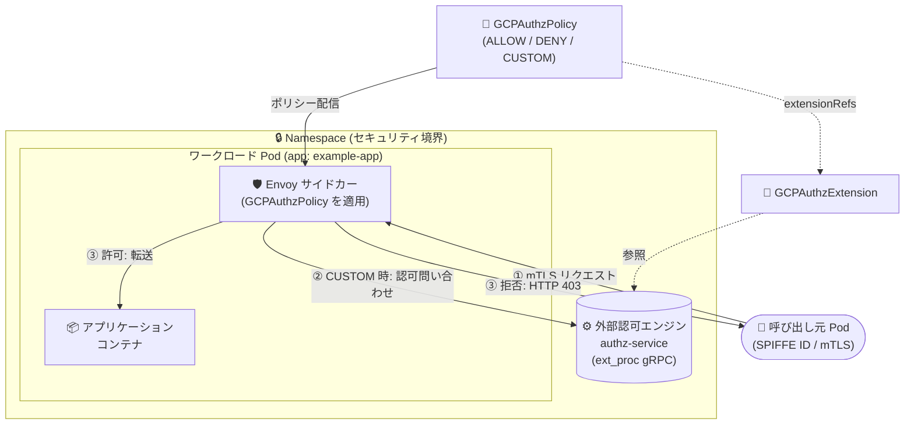

# Cloud Service Mesh: GKE サイドカー向け認可ポリシー (GCPAuthzPolicy) が Preview に

**リリース日**: 2026-11-02

**サービス**: Cloud Service Mesh

**機能**: GKE 上の Cloud Service Mesh サイドカーに対する認可ポリシー (GCPAuthzPolicy) の構成

**ステータス**: Preview

📊 [このアップデートのインフォグラフィックを見る](https://takech9203.github.io/google-cloud-news-summary/20261102-cloud-service-mesh-authz-policy-sidecars-preview.html)

## 概要

Google Kubernetes Engine (GKE) 上の Cloud Service Mesh サイドカーに対して、認可ポリシー (`GCPAuthzPolicy`) を構成できるようになりました (Preview)。この機能は Gateway API を構成 API として使用する Cloud Service Mesh でのみサポートされます。

`GCPAuthzPolicy` は Kubernetes カスタムリソース (`networking.gke.io/v1`) として定義し、Namespace 全体または特定のワークロード (Pod ラベルセレクタ) を対象に、受信 HTTP リクエストの許可 (ALLOW) / 拒否 (DENY) を宣言的に制御できます。さらに、`GCPAuthzExtension` リソースを使用して、認可判断を ext_proc gRPC プロトコルに対応した外部認可エンジン (独自の認可サービス) に委譲すること (CUSTOM アクション) も可能です。

マイクロサービス間のゼロトラストセキュリティを実現したいプラットフォームエンジニアやセキュリティチームにとって、mTLS による認証 (SPIFFE ID) と組み合わせた L7 レベルのきめ細かなアクセス制御を、Gateway API ベースのマネージドなメッシュで利用できる重要なアップデートです。

**アップデート前の課題**

- Gateway API 構成の Cloud Service Mesh サイドカーでは、受信 HTTP リクエストに対する宣言的な認可ポリシーを構成する手段がなかった
- ワークロード単位・Namespace 単位でのインバウンドアクセス制御には、アプリケーション側での実装や別の仕組みが必要だった
- 独自の認可ロジック (外部認可エンジン) をメッシュのデータプレーンに組み込む標準的な方法がなかった

**アップデート後の改善**

- `GCPAuthzPolicy` リソースにより、Namespace 全体またはワークロード単位で受信 HTTP リクエストの ALLOW / DENY を宣言的に制御できるようになった
- mTLS の SPIFFE ID (principal)、リクエストパス、HTTP メソッドなどの条件に基づく L7 認可が可能になった
- `GCPAuthzExtension` により、ext_proc gRPC 対応の外部認可エンジンへ認可判断を委譲 (CUSTOM アクション) できるようになった

## アーキテクチャ図



受信リクエストはアプリケーションに到達する前に Envoy サイドカーで `GCPAuthzPolicy` に基づき評価され、ALLOW / DENY が判定されます。CUSTOM アクションの場合、サイドカーは `GCPAuthzExtension` で参照される外部認可エンジンの応答を待ってからリクエストを転送または拒否します。

## サービスアップデートの詳細

### 主要機能

1. **Namespace 単位の認可ポリシー**
   - `targetRefs` で `kind: Pod` と空のセレクタ (`selector: {}`) を指定することで、Namespace 内のすべての Pod を対象にポリシーを適用
   - 特定のパスプレフィックスや HTTP メソッドへの受信リクエストを一括で ALLOW / DENY 可能

2. **ワークロード単位の認可ポリシー**
   - Pod のラベルセレクタ (`matchLabels`) で特定のワークロードのみを対象に指定
   - アウトバウンド専用ワークロード (cron ジョブなど) への受信リクエストをすべて拒否する、といった制御が可能
   - 拒否されたリクエストの呼び出し元には HTTP 403 Forbidden が返される

3. **mTLS ID (SPIFFE ID) ベースの ALLOW ポリシー**
   - `from.sources.principals` で `spiffe://cluster.local/NAMESPACE/pod1` のような SPIFFE ID を指定し、mTLS で認証された特定の呼び出し元のみを許可
   - 条件に一致しないリクエストはプロキシが HTTP 403 Forbidden で拒否

4. **外部認可エンジンへの委譲 (GCPAuthzExtension)**
   - ext_proc gRPC プロトコルに対応した独自の認可サービス (callout ベース) を Kubernetes にデプロイし、`GCPAuthzExtension` リソースで登録
   - `GCPAuthzPolicy` の `action: CUSTOM` と `customProviders.extensionRefs` で認可判断を外部エンジンに委譲
   - `forwardHeaders` (転送するヘッダー)、`failOpen` (障害時の挙動)、`timeout` を構成可能
   - 拡張がエラーで終了した場合や、`failOpen: false` で呼び出しが失敗・タイムアウトした場合、呼び出し元には HTTP 500 が返される

## 技術仕様

### GCPAuthzPolicy リソース

| 項目 | 詳細 |
|------|------|
| API グループ / バージョン | `networking.gke.io/v1` |
| kind | `GCPAuthzPolicy` / `GCPAuthzExtension` |
| 対象 (targetRefs) | `kind: Pod` + ラベルセレクタ (空セレクタで Namespace 全体) |
| アクション | `ALLOW` / `DENY` / `CUSTOM` (外部認可エンジンへ委譲) |
| 適用レベル | `enforcementLevel: L7` (HTTP リクエスト) |
| マッチ条件 | 送信元 principal (SPIFFE ID)、パス (Exact / Prefix)、HTTP メソッドなど |
| 外部エンジンのプロトコル | ext_proc gRPC (`wireFormat: ExtProcGRPC`) |
| 拒否時のレスポンス | HTTP 403 Forbidden (拡張の障害時は HTTP 500) |
| 反映時間 | ポリシーの作成・変更後、サイドカーでの適用開始まで最大 15 分 |

### 設定例: ワークロードへの ALLOW ポリシー

```yaml
apiVersion: networking.gke.io/v1
kind: GCPAuthzPolicy
metadata:
  name: my-workload-authz
  namespace: NAMESPACE
spec:
  targetRefs:
  - group: ""
    kind: Pod
    selector:
      matchLabels:
        app: EXAMPLE_APP
  rules:
  - from:
      sources:
      - principals:
        - principal:
            type: Exact
            value: "spiffe://cluster.local/NAMESPACE/pod1"
    action: ALLOW
  enforcementLevel: L7
```

## 設定方法

### 前提条件

1. Gateway API を構成 API (`--config-api gateway`) とする Cloud Service Mesh がセットアップ済みであること (Gateway API と Authorization Extensions の理解が前提)
2. GKE クラスタが fleet に登録され、Workload Identity Federation for GKE と Gateway API が有効化されていること

### 手順

#### ステップ 1: Namespace 全体への DENY ポリシーの適用

```bash
cat >ns-authz-policy-deny.yaml <<EOF
apiVersion: networking.gke.io/v1
kind: GCPAuthzPolicy
metadata:
  name: ns-authz
  namespace: NAMESPACE
spec:
  targetRefs:
  - group: ""
    kind: Pod
    selector: {}
  rules:
  - to:
      operations:
      - paths:
        - type: Prefix
          value: "/bad_token"
    action: DENY
  enforcementLevel: L7
EOF
kubectl apply -f ns-authz-policy-deny.yaml
```

空のセレクタ (`selector: {}`) により Namespace 内のすべての Pod が対象となり、`/bad_token` 配下への受信 HTTP リクエストが拒否されます。

#### ステップ 2: 外部認可エンジンへの委譲 (任意)

```bash
# GCPAuthzExtension CRD のインストール (未導入の場合)
kubectl apply -f https://raw.githubusercontent.com/GoogleCloudPlatform/gke-gateway-api/main/config/crd/networking.gke.io_gcpauthzextensions.yaml

# 認可拡張リソースの作成
cat >authz-extension.yaml <<EOF
apiVersion: networking.gke.io/v1
kind: GCPAuthzExtension
metadata:
  name: my-authz-ext
  namespace: NAMESPACE
spec:
  backendRef:
    group: ""
    kind: Service
    name: authz-service
    port: PORT
  authority: "authz-service.NAMESPACE.svc.cluster.local"
  forwardHeaders:
  - Authorization
  failOpen: false
  timeout: "100ms"
  wireFormat: ExtProcGRPC
EOF
kubectl apply -f authz-extension.yaml
```

ext_proc gRPC に対応した認可サービスを登録し、`GCPAuthzPolicy` の `action: CUSTOM` と `customProviders.extensionRefs` から参照することで、認可判断を外部エンジンに委譲できます。

## メリット

### ビジネス面

- **ゼロトラストセキュリティの強化**: サービス間通信の認可をプラットフォームレイヤーで一元的に適用でき、内部不正や侵害時の横展開 (ラテラルムーブメント) のリスクを低減できる
- **既存の認可基盤の再利用**: 独自の認可エンジン (ポリシー判定サービス) をメッシュに統合できるため、既存のセキュリティ投資を活かせる

### 技術面

- **宣言的な L7 アクセス制御**: Kubernetes カスタムリソースとして GitOps で管理でき、アプリケーションコードの変更なしに認可を適用できる
- **柔軟な適用範囲**: Namespace 全体から特定ワークロード単位まで、ラベルセレクタで適用範囲を細かく制御できる
- **mTLS ID との統合**: SPIFFE ID に基づく呼び出し元の検証により、ネットワーク位置に依存しない ID ベースの認可を実現できる

## デメリット・制約事項

### 制限事項

- Preview (Pre-GA) 機能であり、Pre-GA Offerings Terms が適用され、サポートが限定される可能性がある
- Gateway API を構成 API とする Cloud Service Mesh のみでサポートされる (Istio API 構成のクラスタでは利用不可)
- 認可ポリシーの作成・変更後、サイドカーでの適用開始まで最大 15 分かかる場合がある
- Gateway API 構成のクラスタでは、同一 fleet 内での istio / gateway config-api の混在やマルチクラスタのサービスディスカバリ・負荷分散が未サポート、FQDN のみサポートなどの制限がある

### 考慮すべき点

- 外部認可エンジン利用時はリクエストパスに認可問い合わせが入るため、レイテンシと `timeout` / `failOpen` の設計 (フェイルオープン / フェイルクローズ) を慎重に検討する必要がある
- `failOpen: false` で拡張の呼び出しが失敗・タイムアウトすると呼び出し元に HTTP 500 が返るため、認可エンジン自体の可用性設計が重要になる

## ユースケース

### ユースケース 1: アウトバウンド専用ワークロードの保護

**シナリオ**: cron ジョブのように外部への呼び出しのみを行うワークロードに対し、想定外の受信リクエストをすべて遮断したい。

**実装例**:
```yaml
apiVersion: networking.gke.io/v1
kind: GCPAuthzPolicy
metadata:
  name: my-workload-authz
  namespace: NAMESPACE
spec:
  targetRefs:
  - group: ""
    kind: Pod
    selector:
      matchLabels:
        app: EXAMPLE_APP
  rules:
  - to:
      operations:
      - paths:
        - type: Prefix
          value: "/deny_path"
    action: DENY
  enforcementLevel: L7
```

**効果**: 対象ワークロードへの該当パスの受信 HTTP リクエストはサイドカーで拒否され (HTTP 403)、アプリケーションに到達しない。攻撃対象領域を縮小できる。

### ユースケース 2: 決済 API への独自認可エンジンによる判断の委譲

**シナリオ**: `/api/payments-schedule` のような機密性の高い API について、社内の認可基盤 (OPA など ext_proc gRPC 対応エンジン) でトークン検証やポリシー判定を行いたい。

**効果**: `action: CUSTOM` と `GCPAuthzExtension` により、サイドカーが認可エンジンの応答を待ってからリクエストを転送する。Authorization ヘッダーを `forwardHeaders` で転送し、集中管理された認可ロジックをメッシュ全体で再利用できる。

## 料金

本機能 (Preview) 自体の個別料金は Release Notes およびドキュメントに記載されていません。Cloud Service Mesh はスタンドアロン サービスとして利用でき、プロジェクトで有効化された Google API に基づいて課金されます。詳細は料金ページを参照してください。

- [Cloud Service Mesh の料金](https://cloud.google.com/service-mesh/pricing)

## 関連サービス・機能

- **GKE Gateway API**: 本機能の前提となる構成 API。メッシュの構成 (`config-api gateway`) と Gateway API の CRD が必要
- **Service Extensions (Authorization Extensions)**: 外部認可エンジンの構成に関する基盤機能。`GCPAuthzExtension` の理解に必要
- **Workload Identity Federation for GKE**: Gateway API ベースのメッシュのセットアップに必要な ID 基盤
- **Cloud Service Mesh certificate authority**: mTLS 用の証明書を発行するマネージド CA。SPIFFE ID ベースの principal マッチングの基盤となる

## 参考リンク

- 📊 [インフォグラフィック](https://takech9203.github.io/google-cloud-news-summary/20261102-cloud-service-mesh-authz-policy-sidecars-preview.html)
- [公式リリースノート](https://cloud.google.com/release-notes)
- [ドキュメント: Setup authorization policies on sidecars on GKE](https://cloud.google.com/service-mesh/docs/gateway/authorization-policy-sidecar)
- [ドキュメント: Prepare to setup the Gateway API for Cloud Service Mesh](https://cloud.google.com/service-mesh/docs/gateway/prepare-gateway)
- [ドキュメント: Configure authorization extensions](https://cloud.google.com/service-extensions/docs/configure-authorization-extensions)
- [料金ページ](https://cloud.google.com/service-mesh/pricing)

## まとめ

Gateway API ベースの Cloud Service Mesh サイドカーに L7 認可ポリシー (GCPAuthzPolicy) が Preview で追加され、Namespace / ワークロード単位の ALLOW・DENY 制御と外部認可エンジンへの委譲 (GCPAuthzExtension) が可能になりました。Gateway API 構成のメッシュを利用中、または移行を検討しているチームは、ゼロトラスト実現の中核機能として検証を始めることを推奨します。Preview のため、本番適用は制限事項 (適用まで最大 15 分、Pre-GA 条項) を踏まえて判断してください。

---

**タグ**: #CloudServiceMesh #GKE #GatewayAPI #GCPAuthzPolicy #Security #ZeroTrust #Preview
