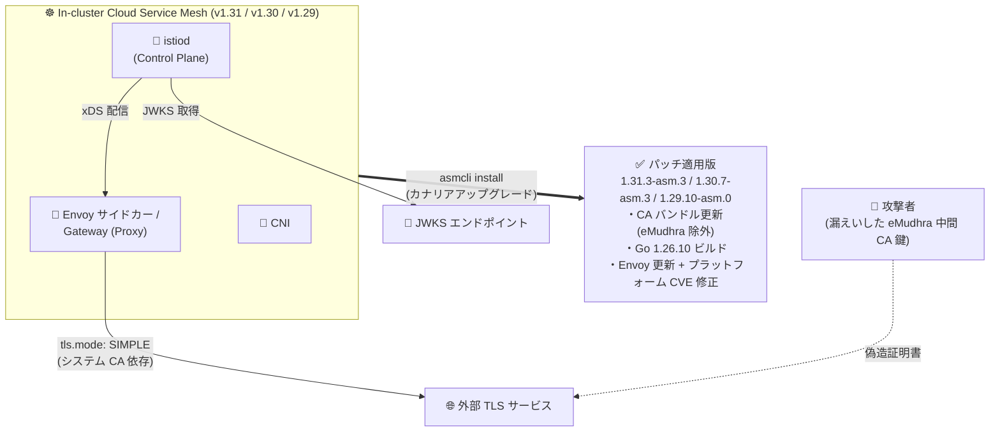

# Cloud Service Mesh: セキュリティパッチ 1.31.3-asm.3 / 1.30.7-asm.3 / 1.29.10-asm.0 リリース (GCP-2026-076 対応)

**リリース日**: 2026-11-02

**サービス**: Cloud Service Mesh

**機能**: セキュリティパッチバージョン 1.31.3-asm.3 / 1.30.7-asm.3 / 1.29.10-asm.0 (Security Bulletin GCP-2026-076 対応)

**ステータス**: セキュリティアップデート (パッチリリース)

📊 [このアップデートのインフォグラフィックを見る](https://takech9203.github.io/google-cloud-news-summary/20261102-cloud-service-mesh-security-patches-gcp-2026-076.html)

## 概要

In-cluster (クラスタ内コントロールプレーン) の Cloud Service Mesh に対して、3 つのサポート対象マイナーバージョンすべてをカバーするセキュリティパッチ **1.31.3-asm.3** (Envoy v1.39.5-dev)、**1.30.7-asm.3** (Envoy v1.38.8-dev)、**1.29.10-asm.0** (Envoy v1.37.10-dev) がリリースされました。これらのパッチは、Security Bulletin **GCP-2026-076** (上流の [ISTIO-SECURITY-2026-008](https://istio.io/latest/news/security/istio-security-2026-008/)、CVE-2026-111943) を解決します。

GCP-2026-076 は、2026 年 10 月に秘密鍵の漏えいが公表された **eMudhra 中間認証局 (CA) 証明書**への信頼を Istio ベースイメージから削除するものです。漏えいした鍵を持つ攻撃者は、パブリックに信頼されたルートにチェーンする任意ドメインの証明書を偽造できる可能性がありました。Certificate Transparency (CT) を強制するブラウザは保護されますが、Envoy・Go・ztunnel は CT を強制しないため、システム CA バンドルを信頼する構成のメッシュが影響を受けます。パッチでは CA バンドルの更新に加え、`istiod`、`istioctl`、`pilot-agent` が Go 1.26.10 でビルドされ、漏えいした中間鍵を含む証明書チェーンを拒否するようになります。

さらに、これらのパッチバージョンでは、**CVE-2026-111497 (High、スコア 9.8)**、**CVE-2026-116587 (High、スコア 7.5)**、**CVE-2026-85091 (Medium、スコア 8.3)**、CVE-2026-86409、CVE-2026-5450、CVE-2026-5928 ほか複数の Low を含むプラットフォーム CVE が、Proxy (データプレーン)・Control Plane・Distroless イメージ・CNI の各コンポーネントで修正されています (対象コンポーネントはバージョンにより異なります)。In-cluster Cloud Service Mesh v1.31 / v1.30 / v1.29 を運用するすべてのクラスタ管理者が対象です。Managed Cloud Service Mesh は自動的に更新されるため、顧客側の対応は不要です。

**アップデート前の課題**

- Istio ベースイメージの CA バンドルが、秘密鍵の漏えいが公表された eMudhra 中間 CA 証明書 (および emSign ルート) を信頼しており、攻撃者が偽造した証明書を受け入れるリスクがあった
- Envoy・Go・ztunnel は Certificate Transparency を強制しないため、ブラウザと異なり CT ログによる偽造証明書の検出ができなかった
- `DestinationRule` の `tls.mode: SIMPLE` でカスタム CA を指定しない外部 TLS 接続や、`RequestAuthentication` による JWKS 取得など、システム CA バンドルに依存する経路が偽造証明書を信頼する可能性があった
- Proxy / Control Plane / Distroless / CNI の各イメージに、CVSS 9.8 の High を含む未修正のプラットフォーム CVE が存在していた

**アップデート後の改善**

- ベースイメージの CA バンドルが更新され、漏えいした eMudhra 中間 CA への信頼が削除された
- `istiod`、`istioctl`、`pilot-agent` が Go 1.26.10 でビルドされ、漏えいした中間鍵を含む証明書チェーンをコード側でも拒否するようになった
- 3 つのサポート対象マイナーバージョン (1.31 / 1.30 / 1.29) すべてにパッチが提供され、どの系列からでも即座に修正版へ移行できるようになった
- 同梱の Envoy も更新され (v1.39.5-dev / v1.38.8-dev / v1.37.10-dev)、High 2 件・Medium を含む一連のプラットフォーム CVE が修正された

## アーキテクチャ図



漏えいした eMudhra 中間 CA の鍵で偽造された証明書は、システム CA バンドルを信頼する外部 TLS 接続 (`tls.mode: SIMPLE`) や JWKS 取得の経路で受け入れられるリスクがありました。パッチ適用版へアップグレードすることで、CA バンドルの更新と Go 1.26.10 による証明書チェーン拒否が有効になります。

## サービスアップデートの詳細

### 主要機能

1. **GCP-2026-076 (ISTIO-SECURITY-2026-008 / CVE-2026-111943) の解決**
   - 秘密鍵の漏えいが公表された eMudhra 中間 CA 証明書 (および Sectigo によるクロス署名) への信頼を Istio ベースイメージから削除
   - Ubuntu ベースイメージの CA バンドルを更新し、「emSign ECC Root CA - G3」を削除。Distroless イメージも更新済みベースで再ビルド
   - `istiod`、`istioctl`、`pilot-agent` を Go 1.26.10 でビルドし、漏えいした中間鍵を含む証明書チェーンを拒否 (Google Cloud のセキュリティ ブリテンでの Severity は Medium)

2. **3 つのパッチバージョンの同時提供**
   - 1.31.3-asm.3 (Envoy v1.39.5-dev)、1.30.7-asm.3 (Envoy v1.38.8-dev)、1.29.10-asm.0 (Envoy v1.37.10-dev)
   - In-cluster Cloud Service Mesh v1.31 / v1.30 / v1.29 が影響対象。v1.28 以前はサポート終了 (EOL) のため、サポート対象バージョンへのアップグレードが必要

3. **プラットフォーム CVE の修正**
   - CVE-2026-111497 (High、9.8)、CVE-2026-116587 (High、7.5)、CVE-2026-85091 (Medium、8.3)、CVE-2026-86409、CVE-2026-5450、CVE-2026-5928 ほか複数の Low を修正
   - 対象コンポーネントは Proxy / Control Plane / Distroless / CNI で、修正範囲はバージョンにより異なる

## 技術仕様

### パッチバージョンと対象

| 項目 | 詳細 |
|------|------|
| 1.31.3-asm.3 | Envoy v1.39.5-dev を同梱。GCP-2026-076 を解決 |
| 1.30.7-asm.3 | Envoy v1.38.8-dev を同梱。GCP-2026-076 を解決 |
| 1.29.10-asm.0 | Envoy v1.37.10-dev を同梱。GCP-2026-076 を解決 |
| 影響対象 | In-cluster Cloud Service Mesh v1.31 / v1.30 / v1.29 |
| Managed Cloud Service Mesh | 自動更新されるため顧客対応不要 |
| v1.28 以前 | EOL のためサポート対象バージョンへの移行が必要 |
| Severity (GCP-2026-076) | Medium |

### 影響を受ける構成 (上流 ISTIO-SECURITY-2026-008 より)

メッシュ内部の mTLS (Istio 独自の CA による相互 TLS) は影響を受けません。リスクがあるのは、Istio がシステム CA バンドルを信頼する以下のような構成です。

| 構成 | リスク内容 |
|------|-----------|
| `DestinationRule` で `tls.mode: SIMPLE` かつカスタム CA 未指定 | 外部サービスへの TLS 接続で偽造証明書を信頼する可能性 |
| `RequestAuthentication` による JWKS 取得 | JWKS エンドポイントへの接続で偽造証明書を信頼する可能性 |
| `XDS_ROOT_CA=SYSTEM` | xDS 接続の検証にシステム CA を使用している場合 |

## 設定方法

### 前提条件

1. In-cluster Cloud Service Mesh v1.29 以降を運用していること (1.31.3-asm.3 へは v1.29+ から直接アップグレード可能)
2. v1.28 以前の場合は EOL のため、まずサポート対象バージョンへの移行を計画すること
3. Managed Cloud Service Mesh の場合は自動更新のため対応不要

### 手順

#### ステップ 1: パッチ適用版の asmcli でコントロールプレーンをアップグレード

```bash
./asmcli install \
  --project_id PROJECT_ID \
  --cluster_name CLUSTER_NAME \
  --cluster_location CLUSTER_LOCATION \
  --fleet_id FLEET_PROJECT_ID \
  --output_dir DIR_PATH \
  --enable_all \
  --ca mesh_ca
```

`asmcli install` は既存のコントロールプレーンと並行して新しいリビジョンのコントロールプレーンをインストールします (カナリアアップグレード)。アップグレード中の CA 変更はダウンタイムの原因となるため、既存と同じ CA を指定します。

#### ステップ 2: ワークロードを新リビジョンへ移行して再起動

```bash
# 名前空間に新しいリビジョンラベルを付与
kubectl label namespace NAMESPACE istio-injection- istio.io/rev=REVISION --overwrite

# サイドカーを新バージョンで再注入するためワークロードを再起動
kubectl rollout restart deployment -n NAMESPACE
```

名前空間を新リビジョンに関連付けて Pod を再起動すると、新しいバージョンのサイドカー (パッチ適用済み Envoy) が注入されます。問題が発生した場合は、ラベルを旧リビジョンに戻すことでロールバックできます。

#### ステップ 3 (代替): すぐにアップグレードできない場合の緩和策

上流の Istio セキュリティ ブリテンでは、アップグレードできない場合の緩和策として以下が示されています。

```yaml
# 外部サービス向け DestinationRule で明示的に CA を指定する例
apiVersion: networking.istio.io/v1
kind: DestinationRule
metadata:
  name: external-service
spec:
  host: external.example.com
  trafficPolicy:
    tls:
      mode: SIMPLE
      caCertificates: /etc/certs/custom-ca.pem  # システム CA への依存を排除
```

外部サービス向けの `DestinationRule` に `caCertificates` または `credentialName` を設定してシステム CA バンドルへの依存を排除するか、漏えいした中間 CA の CRL を `caCrl` に構成します。

## メリット

### ビジネス面

- **サプライチェーンリスクの低減**: パブリック CA の鍵漏えいという外部起因のインシデントに対し、パッチ適用のみで偽造証明書を拒否でき、コンプライアンス要件 (脆弱性対応 SLA) を満たしやすい
- **全サポートバージョンへの同時提供**: 1.29 / 1.30 / 1.31 のどの系列でも最小の変更 (パッチアップグレード) で対応でき、メジャーアップグレードを急ぐ必要がない

### 技術面

- **多層防御**: CA バンドルからの削除 (全バージョン) に加え、1.30 / 1.31 では Go 1.26.10 のビルドレベルでも漏えい鍵を含むチェーンを拒否
- **プラットフォーム CVE の一括修正**: CVSS 9.8 の High を含む複数の CVE が Proxy / Control Plane / Distroless / CNI にわたり修正され、イメージスキャンの指摘事項を削減できる
- **カナリアアップグレード対応**: リビジョンベースのアップグレードにより、ワークロード単位で段階的に移行・ロールバックが可能

## デメリット・制約事項

### 制限事項

- v1.28 以前はサポート終了 (EOL) のためパッチは提供されず、サポート対象バージョンへのアップグレードが必須
- 上流 Istio では 1.29 系は Go 1.25 (パッチ提供終了) でビルドされるため、Go レベルの拒否機構はなく更新済み CA バンドルのみに依存する。1.29 利用者は 1.30+ への移行計画が推奨される
- Envoy には組み込みの distrust リストがないため、サイドカー / ゲートウェイの保護は更新済み CA バンドルに依存する

### 考慮すべき点

- サイドカーにパッチを反映するには、名前空間のリビジョン切り替え後にワークロードの再起動 (再注入) が必要
- GKE 上の ISTIOD コントロールプレーンを使う In-cluster Cloud Service Mesh は非推奨 (deprecated) となっており、中長期的には Managed Cloud Service Mesh への移行も検討に値する
- メッシュ内部の mTLS は影響を受けないが、`tls.mode: SIMPLE` の外部接続や JWKS 取得など、システム CA に依存する構成を棚卸しして影響範囲を確認すべき

## ユースケース

### ユースケース 1: 外部 API と TLS 連携するメッシュの緊急パッチ適用

**シナリオ**: In-cluster Cloud Service Mesh 1.31 上のマイクロサービスが、`DestinationRule` (`tls.mode: SIMPLE`、カスタム CA なし) で外部 SaaS API に接続している。偽造証明書による中間者攻撃のリスクを排除したい。

**実装例**:
```bash
./asmcli install --project_id my-project --cluster_name prod-cluster \
  --cluster_location asia-northeast1 --fleet_id my-fleet \
  --output_dir ./asm-1313 --enable_all --ca mesh_ca
# → 1.31.3-asm.3 を新リビジョンとして導入し、名前空間を段階的に切り替え
```

**効果**: 更新済み CA バンドルと Go 1.26.10 により、漏えいした eMudhra 中間 CA にチェーンする偽造証明書が拒否され、外部 TLS 接続の安全性が回復する。

### ユースケース 2: すぐにアップグレードできないクラスタの暫定防御

**シナリオ**: 変更凍結期間中でコントロールプレーンのアップグレードができないが、GCP-2026-076 のリスクを即時に緩和したい。

**効果**: 外部サービス向け `DestinationRule` に `caCertificates` / `credentialName` を設定してシステム CA への依存を排除する (または漏えい中間 CA の CRL を `caCrl` に構成する) ことで、アップグレード前でも偽造証明書の受け入れを防止できる。凍結解除後に正式にパッチへアップグレードする。

## 関連サービス・機能

- **Managed Cloud Service Mesh**: Google がコントロールプレーンを管理する形態。本脆弱性は自動更新で解決されるため顧客対応不要。In-cluster (ISTIOD on GKE) は非推奨のため移行先の候補
- **GKE (Google Kubernetes Engine)**: In-cluster Cloud Service Mesh の主要な実行基盤。クラスタ側の Security Bulletin も併せて確認が必要
- **Certificate Authority Service / cert-manager**: 外部接続でシステム CA に依存しないよう、明示的な CA 管理を行うための選択肢
- **Artifact Analysis / Container Scanning**: 今回修正されたプラットフォーム CVE のようなイメージ脆弱性を継続的に検出する仕組み

## 参考リンク

- 📊 [インフォグラフィック](https://takech9203.github.io/google-cloud-news-summary/20261102-cloud-service-mesh-security-patches-gcp-2026-076.html)
- [Security Bulletin GCP-2026-076](https://cloud.google.com/service-mesh/docs/security-bulletins#gcp-2026-076)
- [ISTIO-SECURITY-2026-008 (Istio 公式)](https://istio.io/latest/news/security/istio-security-2026-008/)
- [Cloud Service Mesh のアップグレード](https://cloud.google.com/service-mesh/docs/upgrade/upgrade)
- [Cloud Service Mesh リリースノート](https://cloud.google.com/service-mesh/docs/release-notes)

## まとめ

In-cluster Cloud Service Mesh v1.29 / v1.30 / v1.31 を運用している場合は、eMudhra 中間 CA の鍵漏えい (GCP-2026-076) と CVSS 9.8 を含むプラットフォーム CVE に対応するため、1.31.3-asm.3 / 1.30.7-asm.3 / 1.29.10-asm.0 への速やかなアップグレードを推奨します。特に `tls.mode: SIMPLE` の外部 TLS 接続や JWKS 取得などシステム CA に依存する構成があるメッシュは優先度が高く、すぐにアップグレードできない場合は `DestinationRule` での明示的な CA 指定による緩和を検討してください。Managed Cloud Service Mesh は自動更新のため対応不要です。

---

**タグ**: #CloudServiceMesh #セキュリティ #Istio #CVE #GCP-2026-076 #Envoy #GKE #サービスメッシュ
