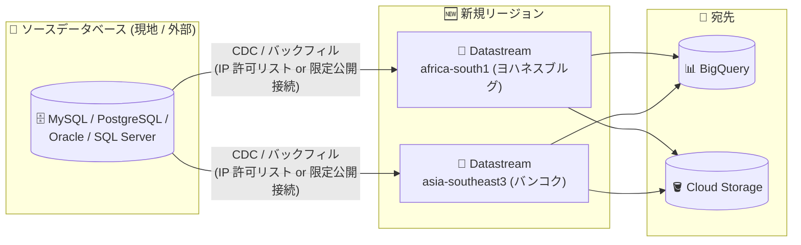

# Datastream: africa-south1 (ヨハネスブルグ) と asia-southeast3 (バンコク) リージョンで利用可能に

**リリース日**: 2026-11-02

**サービス**: Datastream

**機能**: africa-south1 (ヨハネスブルグ) および asia-southeast3 (バンコク) リージョンでの提供開始

**ステータス**: 一般提供 (GA)

📊 [このアップデートのインフォグラフィックを見る](https://takech9203.github.io/google-cloud-news-summary/20261102-datastream-africa-south1-asia-southeast3.html)

## 概要

Google Cloud のサーバーレス変更データキャプチャ (CDC) / レプリケーションサービスである Datastream が、新たに africa-south1 (ヨハネスブルグ、南アフリカ) と asia-southeast3 (バンコク、タイ) の 2 リージョンで利用可能になりました。これにより、アフリカ大陸および東南アジア (タイ) のユーザーは、データソースに近いリージョンで Datastream のストリームを作成し、低レイテンシでのデータレプリケーションを実現できるようになります。

Datastream は、MySQL、PostgreSQL (AlloyDB for PostgreSQL を含む)、Oracle、SQL Server、MongoDB、Spanner などのデータベースから BigQuery や Cloud Storage へ、ほぼリアルタイムでデータを同期するフルマネージドサービスです。今回のリージョン追加により、データレジデンシー (データ主権) 要件が厳しい地域の企業や、現地のオンプレミス / 他クラウドのデータベースから Google Cloud へデータを取り込みたい企業にとって、選択肢が大きく広がります。

両リージョンには Datastream 用のパブリック IP アドレス (IP 許可リスト) も割り当てられており、公式ドキュメントの「IP allowlists and regions」ページで確認できます。

**アップデート前の課題**

このアップデート以前は、ヨハネスブルグやバンコク近辺のユーザーには以下の制約がありました。

- africa-south1 / asia-southeast3 リージョンでは Datastream のリソース (接続プロファイル、ストリーム) を作成できず、近隣の他リージョン (例: europe-west 系や asia-southeast1 など) を利用する必要があった
- ソースデータベースが南アフリカやタイにある場合、遠隔リージョン経由のレプリケーションとなり、ネットワークレイテンシが増加していた
- データを国内リージョンに留める必要があるデータレジデンシー要件を持つ組織は、Datastream の採用自体が難しかった

**アップデート後の改善**

- africa-south1 (ヨハネスブルグ) と asia-southeast3 (バンコク) で Datastream のストリームを直接作成できるようになった
- ソースに近いリージョンで CDC 処理を行うことで、レプリケーションのレイテンシを低減し、ソースへの影響を最小化できる
- 各リージョン専用のパブリック IP アドレス (IP 許可リスト) が公開され、外部データベースのファイアウォール設定が可能になった
- 国内 / 地域内でデータ処理を完結させたいデータレジデンシー要件への対応が容易になった

## アーキテクチャ図



新たに追加された 2 リージョンで Datastream のストリームを作成し、現地のソースデータベースから BigQuery や Cloud Storage へほぼリアルタイムにデータをレプリケートする構成を示しています。

## サービスアップデートの詳細

### 主要機能

1. **africa-south1 (ヨハネスブルグ) での提供開始**
   - 南アフリカ・ヨハネスブルグリージョンで Datastream のリソース (接続プロファイル、限定公開接続構成、ストリーム) を作成可能
   - Datastream 用パブリック IP アドレス: 34.35.2.230、34.35.23.160、34.35.28.2、34.35.49.66、34.35.131.221

2. **asia-southeast3 (バンコク) での提供開始**
   - タイ・バンコクリージョンで Datastream のリソースを作成可能
   - Datastream 用パブリック IP アドレス: 34.15.139.209、34.15.150.17、34.15.151.88、34.15.157.119、34.15.161.236

3. **既存機能をフルに利用可能**
   - CDC (継続的な変更キャプチャ) とバックフィル (既存データの履歴スナップショット) の両方式に対応
   - IP 許可リストによるパブリック接続のほか、VPC ピアリングを用いた限定公開接続などの接続方式を利用可能

## 技術仕様

### 新規リージョンの詳細

| 項目 | 詳細 |
|------|------|
| リージョン名 (アフリカ) | africa-south1 (ヨハネスブルグ、南アフリカ) |
| リージョン名 (アジア) | asia-southeast3 (バンコク、タイ) |
| africa-south1 の IP 許可リスト | 34.35.2.230 / 34.35.23.160 / 34.35.28.2 / 34.35.49.66 / 34.35.131.221 |
| asia-southeast3 の IP 許可リスト | 34.15.139.209 / 34.15.150.17 / 34.15.151.88 / 34.15.157.119 / 34.15.161.236 |
| 対応ソース | Oracle、MySQL、PostgreSQL (AlloyDB 含む)、SQL Server、MongoDB、Spanner、Salesforce ほか |
| 対応宛先 | BigQuery、Cloud Storage (Dataflow テンプレート経由で Cloud SQL / Spanner などにも対応) |

### IP 許可リストを使用する場合のファイアウォール設定

ソースデータベースが Google Cloud 外部にある場合、そのネットワークのファイアウォールに、利用リージョンの Datastream パブリック IP アドレスからの受信を許可するルールを追加します。プロトコルは TCP で、ポートのデフォルト値は以下のとおりです。

| ソースデータベース | デフォルトポート |
|------|------|
| Oracle | 1521 |
| MySQL | 3306 |
| PostgreSQL | 5432 |
| SQL Server | 1433 |
| MongoDB | 27017 |

## 設定方法

### 前提条件

1. Datastream API が有効化された Google Cloud プロジェクト
2. ソースデータベースへのネットワーク接続 (IP 許可リスト、または VPC ピアリングによる限定公開接続)
3. ソースデータベース側の CDC 設定 (バイナリログ / ロジカルレプリケーションなどの有効化)

### 手順

#### ステップ 1: 新リージョンに接続プロファイルを作成

```bash
# 例: asia-southeast3 (バンコク) に MySQL ソースの接続プロファイルを作成
gcloud datastream connection-profiles create my-mysql-profile \
  --location=asia-southeast3 \
  --type=mysql \
  --mysql-hostname=203.0.113.10 \
  --mysql-port=3306 \
  --mysql-username=datastream-user \
  --mysql-password-file=./password.txt \
  --static-ip-connectivity \
  --display-name="MySQL Source (Bangkok)"
```

ソースデータベース側のファイアウォールでは、asia-southeast3 の Datastream パブリック IP アドレス 5 つからの TCP 接続を許可しておきます。

#### ステップ 2: 宛先の接続プロファイルとストリームを作成

```bash
# 例: BigQuery 宛先の接続プロファイルを africa-south1 に作成
gcloud datastream connection-profiles create my-bq-profile \
  --location=africa-south1 \
  --type=bigquery \
  --display-name="BigQuery Destination"

# ストリームを作成 (ソース / 宛先の接続プロファイルを指定)
gcloud datastream streams create my-stream \
  --location=africa-south1 \
  --source=my-source-profile \
  --destination=my-bq-profile \
  --display-name="CDC to BigQuery" \
  --mysql-source-config=mysql_source_config.json \
  --bigquery-destination-config=bigquery_destination_config.json \
  --backfill-all
```

ストリームを開始すると、バックフィルと CDC が並行して実行され、宛先がほぼリアルタイムに同期されます。

## メリット

### ビジネス面

- **データレジデンシー対応**: 南アフリカ・タイ国内 (地域内) のリージョンでデータ処理を完結でき、規制・コンプライアンス要件を満たしやすくなる
- **現地市場でのクラウド活用促進**: アフリカ・東南アジア市場の企業が、ほぼリアルタイム分析基盤 (Datastream + BigQuery) を現地リージョンで構築できる

### 技術面

- **低レイテンシ**: ソースデータベースに近いリージョンで CDC を実行することで、レプリケーション遅延とネットワークコストを低減できる
- **既存アーキテクチャの踏襲**: 他リージョンと同じ機能セット (CDC、バックフィル、スキーマドリフト対応、安全な接続方式) をそのまま利用可能
- **接続設定が明確**: 両リージョンのパブリック IP アドレスが公開されており、外部データベースのファイアウォール設定を確実に行える

## デメリット・制約事項

### 制限事項

- Datastream のリソース (接続プロファイル、ストリーム) はリージョナルリソースのため、既存ストリームを新リージョンへ直接移行する機能はない。移行する場合は、新リージョンで同一構成のストリームを作成して切り替える手順が必要
- IP 許可リストによるパブリック接続を使う場合、利用リージョンの IP アドレスをソース側ファイアウォールで許可する設定が必須

### 考慮すべき点

- 宛先 (BigQuery データセットなど) のロケーションとの組み合わせによっては、リージョン間のデータ転送が発生する点に注意
- 新リージョンで利用を開始する際は、クォータと上限 (ストリームあたり最大 10,000 テーブルなど) を事前に確認する

## ユースケース

### ユースケース 1: 南アフリカ国内でのリアルタイム分析基盤

**シナリオ**: ヨハネスブルグの金融機関が、オンプレミスの Oracle データベースの取引データを国内リージョンに留めたまま BigQuery でほぼリアルタイムに分析したい。

**実装例**:
```
1. ファイアウォールで africa-south1 の Datastream IP (34.35.x.x の 5 アドレス) を許可
2. africa-south1 に Oracle ソースの接続プロファイルを作成
3. BigQuery 宛先へのストリームを作成し、CDC + バックフィルを開始
```

**効果**: データを国外に出すことなく、バッチ処理に依存しない低レイテンシの分析基盤を構築できる。

### ユースケース 2: タイ国内の EC サイトのデータ同期

**シナリオ**: バンコクの EC 事業者が、Cloud SQL for MySQL 上の注文データを BigQuery に同期し、在庫・売上ダッシュボードをほぼリアルタイムに更新したい。

**効果**: asia-southeast3 内で CDC が完結するため低レイテンシで同期でき、イベントドリブンな在庫連携 (Cloud Storage への変更イベント出力) にも拡張できる。

## 料金

Datastream の料金は、ソースから宛先へストリーミングされるデータ量 (GB 単位) に基づく従量課金です。リージョン追加自体による追加料金はありません。最新の料金単価は料金ページを参照してください。

- 料金ページ: https://cloud.google.com/datastream/pricing

## 利用可能リージョン

今回追加された 2 リージョンを含め、Datastream が利用可能なリージョンと各リージョンのパブリック IP アドレスの一覧は、公式ドキュメントの「IP allowlists and regions」ページで確認できます。

- **africa-south1** (ヨハネスブルグ) - 今回追加
- **asia-southeast3** (バンコク) - 今回追加
- その他、東京 (asia-northeast1)、大阪 (asia-northeast2) を含む全世界 40 以上のリージョン

## 関連サービス・機能

- **BigQuery**: Datastream の主要な宛先。ほぼリアルタイムの分析基盤を構築できる
- **Cloud Storage**: 変更イベントストリームの書き込み先。イベントドリブンアーキテクチャの起点として利用可能
- **Dataflow**: Datastream と連携するテンプレートが提供されており、Cloud SQL や Spanner など多様な宛先へのロードが可能
- **Cloud SQL / AlloyDB for PostgreSQL / Spanner**: Datastream のソース (および Dataflow 経由の宛先) として利用される Google Cloud のデータベースサービス
- **Cloud Monitoring**: ストリームやオブジェクト単位のメトリクスを監視できる

## 参考リンク

- 📊 [インフォグラフィック](https://takech9203.github.io/google-cloud-news-summary/20261102-datastream-africa-south1-asia-southeast3.html)
- [公式リリースノート](https://docs.cloud.google.com/release-notes#November_02_2026)
- [IP allowlists and regions](https://docs.cloud.google.com/datastream/docs/ip-allowlists-and-regions)
- [Datastream 概要ドキュメント](https://docs.cloud.google.com/datastream/docs/overview)
- [IP 許可リストの設定](https://docs.cloud.google.com/datastream/docs/ip-allowlists)
- [料金ページ](https://cloud.google.com/datastream/pricing)

## まとめ

Datastream が africa-south1 (ヨハネスブルグ) と asia-southeast3 (バンコク) で利用可能になり、アフリカおよび東南アジアのユーザーがデータレジデンシー要件を満たしながら低レイテンシの CDC / レプリケーションを実現できるようになりました。該当地域にデータソースを持つ場合は、新リージョンの IP 許可リストを確認した上で、ソースに近いリージョンへのストリーム作成 (または移行) を検討することを推奨します。

---

**タグ**: Datastream, CDC, リージョン拡大, africa-south1, asia-southeast3, BigQuery, データレプリケーション
