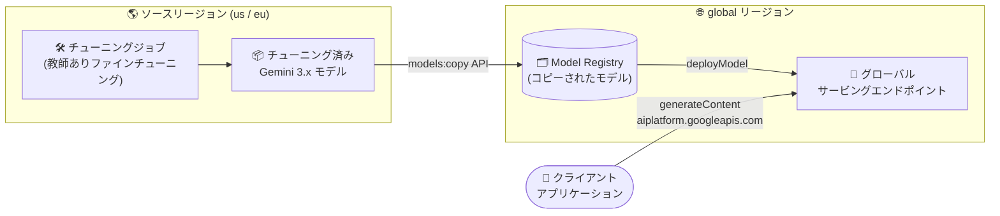

# Gemini Enterprise Agent Platform: チューニング済み Gemini 3.x モデルのグローバルエンドポイント提供 (GA)

**リリース日**: 2026-11-02

**サービス**: Gemini Enterprise Agent Platform

**機能**: チューニング済み Gemini 3.x モデルのグローバルエンドポイントでのサービング

**ステータス**: GA (一般提供)

📊 [このアップデートのインフォグラフィックを見る](https://takech9203.github.io/google-cloud-news-summary/20261102-gemini-enterprise-tuned-gemini-global-endpoints-ga.html)

## 概要

Gemini Enterprise Agent Platform において、ファインチューニング (教師ありファインチューニング) 済みの Gemini 3.x モデルをグローバルエンドポイントでサービングする機能が一般提供 (GA) になりました。Model Registry の `models:copy` API を使用してチューニング済み Gemini 3.x モデルを `global` リージョンにコピーし、グローバルサービングエンドポイントにデプロイして、`aiplatform.googleapis.com` に直接推論リクエストを送信できます。

これまでチューニング済み Gemini 3.x モデルのサービングは `us` / `eu` のマルチリージョンエンドポイントに限定されていましたが、今回の GA により、リージョンを意識しないグローバルなエンドポイントで独自モデルを提供できるようになります。グローバルに展開するアプリケーションから単一のエンドポイントでチューニング済みモデルを利用したい組織や、ベースモデルと同じグローバルエンドポイント構成に統一したい開発チームが対象です。

**アップデート前の課題**

- チューニング済み Gemini 3.x モデルのサービングは `us` / `eu` のマルチリージョンエンドポイント (`aiplatform.{REGION}.rep.googleapis.com`) に限定されており、グローバルエンドポイントを利用できなかった
- ベースの Gemini モデルをグローバルエンドポイントで利用している場合でも、チューニング済みモデルだけはリージョンを指定した別のエンドポイント構成が必要だった

**アップデート後の改善**

- `models:copy` API でチューニング済み Gemini 3.x モデルを `global` リージョンへコピーできるようになった
- グローバルサービングエンドポイントを作成してチューニング済みモデルをデプロイできるようになった
- 推論リクエストを `aiplatform.googleapis.com` に直接送信でき、ベースモデルと同様のグローバルエンドポイント構成で独自モデルを運用できるようになった

## アーキテクチャ図



`us` / `eu` リージョンで作成したチューニング済み Gemini 3.x モデルを `models:copy` API で `global` リージョンにコピーし、グローバルエンドポイントにデプロイすることで、クライアントは `aiplatform.googleapis.com` へ直接推論リクエストを送信できます。

## サービスアップデートの詳細

### 主要機能

1. **`models:copy` API によるグローバルリージョンへのモデルコピー**
   - Model Registry の `models:copy` API で、`us` / `eu` などのソースリージョンにあるチューニング済みモデルを `global` リージョンへコピーできる
   - Google Cloud コンソールの Model Registry からも、新規モデルまたは既存モデルの新バージョンとしてコピー可能

2. **グローバルサービングエンドポイントへのデプロイ**
   - `locations/global` 配下にエンドポイントを作成し、コピーしたモデルを `deployModel` でデプロイできる
   - デプロイ時は `automaticResources` でレプリカ数 (min/max) を指定する

3. **`aiplatform.googleapis.com` への直接推論リクエスト**
   - グローバルエンドポイントへの推論は、マルチリージョン用の `.rep.googleapis.com` 形式ではなく `aiplatform.googleapis.com` を直接使用する
   - エンドポイント形式: `https://aiplatform.googleapis.com/v1/projects/PROJECT_ID/locations/global/endpoints/ENDPOINT_ID:generateContent`

### サービングエンドポイントの対応状況

公式ドキュメントに記載されている Gemini 3.x モデルのチューニング/サービング対応は以下のとおりです。

| 項目 | 対応 |
|------|------|
| チューニングジョブの実行 | `us` / `eu` マルチリージョンエンドポイントのみ |
| チューニング済みモデルのサービング | `us` / `eu` マルチリージョンエンドポイント、および `global` |
| 対象モデル例 | Gemini 3.5 Flash、Gemini 3.5 Flash-Lite、Gemini 3.1 Flash-Lite など |

## 技術仕様

### モデルコピーで引き継がれない情報

`models:copy` でコピーされたモデルには、以下の情報は引き継がれません。

| 項目 | 内容 |
|------|------|
| バージョンエイリアス | コピー先では引き継がれない |
| カスタムモデル ID | コピー後に新しい ID を指定可能 |
| モデル評価 | 既存の評価結果はコピーされない |
| 暗号化スペック | コピー先リージョン用の暗号鍵を指定する必要がある |
| デプロイメント・バッチ推論 | コピーされない (再デプロイが必要) |

### グローバルリージョンの制約

- `global` リージョンは Customer-Managed Encryption Keys (CMEK) をサポートしない
- `global` リージョンは Data Residency Zones (DRZ) をサポートしない
- グローバルモデルのチューニング済みモデルアーティファクト (アダプター) は、Cloud Storage にグローバルバケットロケーションがないため US リージョンに保存される

## 設定方法

### 前提条件

1. `us` または `eu` マルチリージョンエンドポイントで教師ありファインチューニングを実行し、チューニング済み Gemini 3.x モデルを作成済みであること
2. gcloud CLI で認証済みであること (`gcloud auth login` など)

### 手順

#### ステップ 1: モデルをグローバルリージョンにコピー

```bash
curl -X POST \
  -H "Authorization: Bearer $(gcloud auth print-access-token)" \
  -H "Content-Type: application/json; charset=utf-8" \
  -d '{
    "sourceModel": "projects/SRC_PROJECT_ID/locations/SRC_LOCATION/models/MODEL_ID"
  }' \
  "https://aiplatform.googleapis.com/v1/projects/PROJECT_ID/locations/global/models:copy"
```

Model Registry の `models:copy` API で、ソースリージョンのチューニング済みモデルを `global` リージョンにコピーします。

#### ステップ 2: グローバルエンドポイントを作成

```bash
curl -X POST \
  -H "Authorization: Bearer $(gcloud auth print-access-token)" \
  -H "Content-Type: application/json" \
  "https://aiplatform.googleapis.com/v1/projects/PROJECT_ID/locations/global/endpoints" \
  -d '{ "displayName": "tuned_global_endpoint" }'
```

`locations/global` 配下にサービング用のエンドポイントを作成します。

#### ステップ 3: モデルをグローバルエンドポイントにデプロイ

```bash
curl -X POST \
  -H "Authorization: Bearer $(gcloud auth print-access-token)" \
  -H "Content-Type: application/json" \
  "https://aiplatform.googleapis.com/v1/projects/PROJECT_ID/locations/global/endpoints/ENDPOINT_ID:deployModel" \
  -d '{
    "deployedModel": {
      "model": "projects/PROJECT_ID/locations/global/models/MODEL_ID",
      "displayName": "tuned_deploy_model",
      "automaticResources": {"minReplicaCount": 1, "maxReplicaCount": 1}
    }
  }'
```

コピーしたモデルをグローバルエンドポイントにデプロイします。

#### ステップ 4: 推論リクエストを送信

```bash
# グローバルエンドポイントへの推論リクエスト形式
# https://aiplatform.googleapis.com/v1/projects/PROJECT_ID/locations/global/endpoints/ENDPOINT_ID:generateContent
```

グローバルエンドポイントでのサービングでは、マルチリージョン用の `.rep.googleapis.com` ではなく `aiplatform.googleapis.com` を使用します。なお、Gemini 3 以降のチューニング済みモデルでは、チューニングしたタスクに対して thinking level を `MINIMAL` に設定することが、パフォーマンスとコスト効率の観点から推奨されています。

## メリット

### ビジネス面

- **グローバル展開の簡素化**: 世界中のクライアントから単一のグローバルエンドポイントでチューニング済みモデルを利用でき、リージョンごとのエンドポイント管理が不要になる
- **本番利用の安心感**: GA となったことで、本番ワークロードでグローバルエンドポイントサービングを採用しやすくなった

### 技術面

- **ベースモデルと統一されたエンドポイント構成**: ベースの Gemini モデルと同様に `aiplatform.googleapis.com` へ直接リクエストでき、アプリケーション側のエンドポイント切り替えロジックを簡素化できる
- **再チューニング不要のモデル移行**: `models:copy` により、学習をやり直すことなく既存のチューニング済みモデルをグローバルリージョンで提供できる

## デメリット・制約事項

### 制限事項

- `global` リージョンは CMEK (顧客管理の暗号鍵) に対応していない
- `global` リージョンは Data Residency Zones (DRZ) に対応していない
- チューニング済みモデルのアーティファクト (アダプター) は US リージョンに保存される
- チューニングジョブ自体は引き続き `us` / `eu` マルチリージョンエンドポイントでのみ実行可能
- チューニング済み Gemini モデルは共有パブリックエンドポイントにのみデプロイ可能 (専用パブリックエンドポイント、Private Service Connect エンドポイント、プライベートエンドポイントは非対応)

### 考慮すべき点

- モデルコピーではバージョンエイリアス、既存のモデル評価、デプロイメントなどは引き継がれないため、コピー後に必要な設定を再構成する必要がある
- データレジデンシー要件 (データの保存場所の制約) がある場合は、グローバルエンドポイントではなく `us` / `eu` マルチリージョンエンドポイントでのサービングを検討する
- 教師ありファインチューニングは Covered Service ではなく、SLA の SLO 対象外である

## ユースケース

### ユースケース 1: グローバル展開するアプリケーションでの独自モデル提供

**シナリオ**: 自社ドメイン向けにファインチューニングした Gemini 3.5 Flash モデルを、世界各地のユーザーが利用するアプリケーションから呼び出したい。

**実装例**:
```bash
# 1. us リージョンのチューニング済みモデルを global にコピー (models:copy)
# 2. global エンドポイントを作成しデプロイ (deployModel)
# 3. アプリケーションからの推論先を以下に設定
#    https://aiplatform.googleapis.com/v1/projects/PROJECT_ID/locations/global/endpoints/ENDPOINT_ID:generateContent
```

**効果**: リージョンごとのエンドポイントを個別に管理することなく、単一のグローバルエンドポイントで独自モデルを提供できる。

### ユースケース 2: ベースモデルからチューニング済みモデルへの段階的移行

**シナリオ**: すでにグローバルエンドポイント経由でベースの Gemini 3.x モデルを利用しているアプリケーションに、チューニング済みモデルを導入したい。

**効果**: ベースモデルと同じ `aiplatform.googleapis.com` ベースのエンドポイント構成のままモデルだけを差し替えられるため、アプリケーション側の変更を最小限に抑えられる。

## 料金

チューニング済みモデルの推論は、チューニング元の基盤モデルと同じトークン単価で課金されます。チューニングは基盤モデル上の小さなアダプターとして実装されるため、エンドポイント自体の費用は発生しません。

チューニング (学習) の費用は、学習データセットのトークン数にエポック数を掛けたトレーニングトークン数に基づいて課金されます。

詳細は [Gemini Enterprise Agent Platform の料金ページ](https://cloud.google.com/gemini-enterprise-agent-platform/generative-ai/pricing) を参照してください。

## 利用可能リージョン

- **チューニングジョブ**: `us` / `eu` マルチリージョンエンドポイントのみ
- **チューニング済みモデルのサービング**: `us` / `eu` マルチリージョンエンドポイント、および `global`

## 関連サービス・機能

- **Model Registry**: チューニング済みモデルの管理と `models:copy` API によるリージョン間・プロジェクト間コピーを提供
- **教師ありファインチューニング (Supervised Fine-Tuning)**: 今回グローバルサービングが可能になったチューニング済みモデルを作成する機能
- **Cloud Storage**: チューニング済みモデルのアーティファクト (アダプター) の保存先 (グローバルモデルでは US リージョンに保存)
- **モデルオブザーバビリティ**: デプロイしたエンドポイントのトラフィックをモニタリング可能

## 参考リンク

- 📊 [インフォグラフィック](https://takech9203.github.io/google-cloud-news-summary/20261102-gemini-enterprise-tuned-gemini-global-endpoints-ga.html)
- [公式リリースノート](https://docs.cloud.google.com/gemini-enterprise-agent-platform/release-notes)
- [教師ありファインチューニングの概要](https://cloud.google.com/gemini-enterprise-agent-platform/models/tuning/supervised-tuning)
- [チューニング済みモデルのコピーと別リージョンでのサービング](https://cloud.google.com/gemini-enterprise-agent-platform/models/tuning/supervised-tuning/use#copy-tuned-model)
- [Model Registry のモデルコピー](https://docs.cloud.google.com/gemini-enterprise-agent-platform/machine-learning/model-registry/copy-model)
- [料金ページ](https://cloud.google.com/gemini-enterprise-agent-platform/generative-ai/pricing)

## まとめ

チューニング済み Gemini 3.x モデルをグローバルエンドポイントでサービングできるようになったことで、ベースモデルと同じ構成で独自モデルをグローバルに提供できるようになりました。既存のチューニング済みモデルは `models:copy` API でコピーするだけで再学習なしに移行できるため、グローバル展開中のアプリケーションではまず検証環境での移行を試すことを推奨します。ただし CMEK / DRZ 非対応やアダプターの US リージョン保存など、データレジデンシー要件がある場合は従来の `us` / `eu` マルチリージョンエンドポイントの継続利用を検討してください。

---

**タグ**: #GeminiEnterpriseAgentPlatform #Gemini #FineTuning #ModelRegistry #GlobalEndpoint #GA #生成AI
