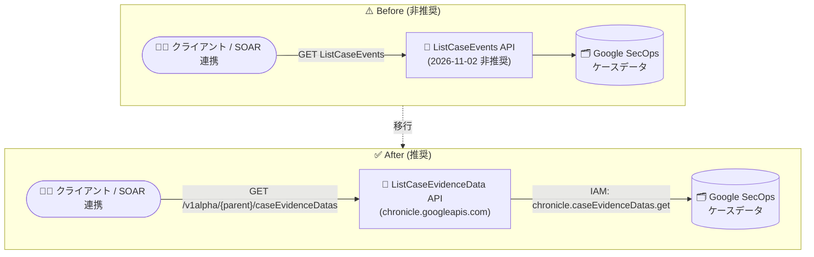

# Google SecOps: ListCaseEvents API エンドポイントの非推奨化

**リリース日**: 2026-11-02

**サービス**: Google SecOps

**機能**: ListCaseEvents API エンドポイントの非推奨化 (ListCaseEvidenceData API への移行)

**ステータス**: 非推奨 (Deprecated)

📊 [このアップデートのインフォグラフィックを見る](https://takech9203.github.io/google-cloud-news-summary/20261102-google-secops-listcaseevents-deprecation.html)

## 概要

Google SecOps (旧 Chronicle) において、ケースに紐づくイベントを一覧取得する **ListCaseEvents API エンドポイントが 2026 年 11 月 2 日付で非推奨** となりました。今後は、代替として **ListCaseEvidenceData API エンドポイント** (`projects.locations.instances.cases.caseEvidenceDatas.list`) を使用する必要があります。

Google SecOps の公式 Deprecations ページでは、ListCaseEvents API エンドポイントについて非推奨日が 2026 年 9 月 30 日、シャットダウン日が 2026 年 11 月 2 日と記載されており、ListCaseEvidenceData API への移行が明示されています。ListCaseEvents を利用した自動化スクリプト、SOAR 連携、外部ツール統合を運用しているユーザーは、速やかに移行対応が必要です。

Google SecOps では近年、レガシー Backstory API / Ingestion API から Chronicle API (`chronicle.googleapis.com`) への移行や、`fetchavailablelogtypes` エンドポイントの廃止など、API 体系の刷新が段階的に進められており、今回の変更もその一環です。ケース関連データへのアクセスは、Google Cloud のリソース階層 (`projects/{project}/locations/{location}/instances/{instance}/cases/{caseId}`) に沿った新しい API に統一されていきます。

**アップデート前の課題**

- ケースのイベントデータ取得に旧来の ListCaseEvents エンドポイントが使用されており、新しい Chronicle API 体系 (CaseEvidenceData リソース) と並存していた
- 旧エンドポイントに依存した統合・スクリプトは、API 刷新後のリソースモデル (evidenceType によるフィルタリングなど) を活用できなかった

**アップデート後の改善 (移行後)**

- ケースの証跡データ (Case Evidence Data) 取得が ListCaseEvidenceData API に一本化され、Google Cloud 標準のリソース命名規則・IAM 権限モデルに準拠したアクセスが可能になった
- AIP-160 準拠のフィルタ構文 (`evidenceType = THREAT_HUNT` など) やページネーション (`pageSize` / `pageToken`)、ソート (`orderBy`) が利用できる

## アーキテクチャ図



ケースのイベント一覧取得は、非推奨となった ListCaseEvents から、Google Cloud リソース階層と IAM 権限に準拠した ListCaseEvidenceData API エンドポイントへ移行します。

## サービスアップデートの詳細

### 主要なポイント

1. **ListCaseEvents API エンドポイントの非推奨化**
   - 2026 年 11 月 2 日のリリースノートで、ListCaseEvents API エンドポイントの非推奨が発表された
   - 公式 Deprecations ページでは、非推奨日: 2026 年 9 月 30 日、シャットダウン日: 2026 年 11 月 2 日と記載されている

2. **代替 API: ListCaseEvidenceData**
   - `projects.locations.instances.cases.caseEvidenceDatas.list` メソッドを使用する
   - 指定したケースに紐づく証跡データ (Case Evidence Data) を一覧取得できる
   - 単一の証跡データを取得する `get` メソッドも提供されている

3. **Google SecOps API 刷新の一環**
   - レガシー Backstory API / Ingestion API の Chronicle API への移行 (2027 年 7 月 20 日 EOL)、`fetchavailablelogtypes` エンドポイントの廃止などと同様、API 体系の近代化が進行中

## 技術仕様

### ListCaseEvidenceData API (caseEvidenceDatas.list)

| 項目 | 詳細 |
|------|------|
| HTTP リクエスト | `GET https://{endpoint}/v1alpha/{parent}/caseEvidenceDatas` |
| パスパラメータ `parent` | ケースのリソース名。形式: `projects/{project}/locations/{location}/instances/{instance}/cases/{caseId}` |
| クエリパラメータ `filter` | AIP-160 準拠のフィルタ文字列。`evidenceType` を含む必要がある (例: `evidenceType = THREAT_HUNT`) |
| クエリパラメータ `pageSize` | 返却件数の上限。デフォルト 1000、最大 1000 (超過分は 1000 に丸められる) |
| クエリパラメータ `pageToken` | 前回レスポンスの `nextPageToken` を指定して次ページを取得 |
| クエリパラメータ `orderBy` | ソート対象フィールド。デフォルトは `caseEvidenceDataId` 順 |
| レスポンス | `caseEvidenceDatas[]`、`nextPageToken`、`totalSize` |
| OAuth スコープ | `https://www.googleapis.com/auth/cloud-platform` または `https://www.googleapis.com/auth/chronicle` |
| 必要な IAM 権限 | `chronicle.caseEvidenceDatas.get` (parent リソースに対して) |

### レスポンスの JSON 構造

```json
{
  "caseEvidenceDatas": [
    { "object": "(CaseEvidenceData)" }
  ],
  "nextPageToken": "string",
  "totalSize": 0
}
```

## 移行方法

### 前提条件

1. Google SecOps インスタンスが Google Cloud プロジェクトにバインドされていること
2. 呼び出し元のプリンシパルに、対象ケース (parent リソース) への `chronicle.caseEvidenceDatas.get` IAM 権限が付与されていること
3. OAuth スコープ `cloud-platform` または `chronicle` で認証していること

### 手順

#### ステップ 1: ListCaseEvents を呼び出している箇所の特定

自動化スクリプト、SOAR プレイブック、外部連携ツールの中で、ListCaseEvents API エンドポイントを呼び出している箇所を洗い出します。

#### ステップ 2: ListCaseEvidenceData API への書き換え

```bash
# ケースの証跡データを一覧取得する例
curl -s \
  -H "Authorization: Bearer $(gcloud auth print-access-token)" \
  "https://chronicle.googleapis.com/v1alpha/projects/PROJECT_ID/locations/LOCATION/instances/INSTANCE_ID/cases/CASE_ID/caseEvidenceDatas?filter=evidenceType%20%3D%20THREAT_HUNT&pageSize=1000"
```

`filter` には `evidenceType` の指定が必須である点、レスポンスのスキーマが `caseEvidenceDatas[]` 形式に変わる点に注意して、レスポンス処理ロジックを更新します。

#### ステップ 3: ページネーション処理の実装

`totalSize` が `pageSize` を超える場合は、レスポンスの `nextPageToken` を次のリクエストの `pageToken` に指定して全件を取得します。ページ送り時は、他のパラメータを最初のリクエストと一致させる必要があります。

## デメリット・制約事項

### 制限事項

- ListCaseEvidenceData の `filter` には `evidenceType` の指定が必須
- `pageSize` の最大値は 1000 (超過した値は 1000 に丸められる)

### 考慮すべき点

- 公式 Deprecations ページではシャットダウン日が 2026 年 11 月 2 日と記載されており、ListCaseEvents に依存したワークフローは即時の移行対応が必要
- リクエスト/レスポンスのスキーマが変わるため、単純な URL 置換ではなく、フィルタ指定とレスポンス解析ロジックの修正が必要
- 新 API は IAM 権限 (`chronicle.caseEvidenceDatas.get`) に基づくアクセス制御のため、サービスアカウントの権限見直しが必要になる場合がある

## 関連サービス・機能

- **Chronicle API (chronicle.googleapis.com)**: Google SecOps の統合 REST API。ケース、アラート、証跡データなどのリソースを Google Cloud 標準のリソース階層で提供
- **Cloud IAM**: 新 API のアクセス制御は IAM 権限 (`chronicle.caseEvidenceDatas.get` など) に基づく
- **レガシー API の移行**: レガシー Backstory API / Ingestion API も Chronicle API への移行が進行中 (2027 年 7 月 20 日 EOL)。API 連携全体の棚卸しを推奨

## 参考リンク

- 📊 [インフォグラフィック](https://takech9203.github.io/google-cloud-news-summary/20261102-google-secops-listcaseevents-deprecation.html)
- [公式リリースノート](https://cloud.google.com/release-notes#November_02_2026)
- [ListCaseEvidenceData API リファレンス (caseEvidenceDatas.list)](https://cloud.google.com/chronicle/docs/reference/rest/v1alpha/projects.locations.instances.cases.caseEvidenceDatas/list)
- [Google SecOps Deprecations (非推奨一覧)](https://cloud.google.com/chronicle/docs/deprecations)
- [Chronicle API リファレンス](https://cloud.google.com/chronicle/docs/reference/rest)

## まとめ

Google SecOps の ListCaseEvents API エンドポイントが非推奨となり、公式 Deprecations ページではシャットダウン日が 2026 年 11 月 2 日と記載されています。ケースイベントの取得を API 経由で行っているスクリプトや SOAR 連携は、ListCaseEvidenceData API (`caseEvidenceDatas.list`) への移行を直ちに実施してください。移行の際は、`evidenceType` フィルタの必須指定、ページネーション、IAM 権限 (`chronicle.caseEvidenceDatas.get`) の 3 点を確認することを推奨します。

---

**タグ**: Google SecOps, Chronicle, API, Deprecated, ListCaseEvents, ListCaseEvidenceData, SOAR, セキュリティ
