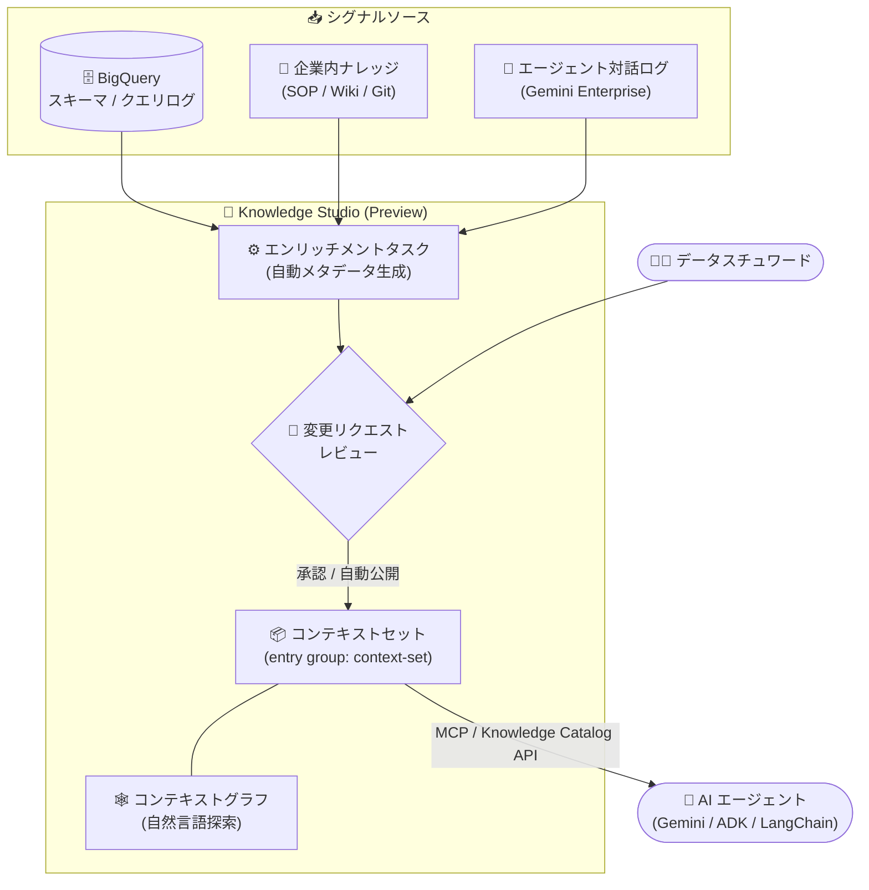

# Knowledge Catalog: Knowledge Studio (Preview)

**リリース日**: 2026-11-02

**サービス**: Knowledge Catalog

**機能**: Knowledge Studio (自然言語によるデータ探索、コンテキストグラフ、エンリッチメントタスク、コンテキストセット)

**ステータス**: Preview (Gated Preview)

📊 [このアップデートのインフォグラフィックを見る](https://takech9203.github.io/google-cloud-news-summary/20261102-knowledge-catalog-knowledge-studio-preview.html)

## 概要

Knowledge Catalog (旧 Dataplex Universal Catalog) に **Knowledge Studio** が Preview として登場した。Knowledge Studio は、メタデータを「受動的なカタログ」から「アクティブなコンテキストエンジン」へと変革する機能群であり、生成 AI アプリケーションの信頼性向上を目的としている。自然言語とインタラクティブな「コンテキストグラフ」によるデータアセットとセマンティックな関係性の探索、スキーマ・クエリログ・企業内ナレッジシグナルからメタデータを自動生成・キュレーションする「エンリッチメントタスク」、そしてキュレーション済みのドメイン知識を「コンテキストセット」としてパッケージ化し、Model Context Protocol (MCP) や Knowledge Catalog API 経由で AI エージェントをグラウンディングする機能を提供する。

従来のメタデータカタログは静的なスキーマや説明文、データディクショナリの保存には十分だったが、生成 AI エージェントが必要とする「テーブル間の結合関係などの深いセマンティクス」「実際の SQL 利用パターンなどの運用面でのグラウンディング」「フィードバックに基づく継続的な自己学習」には不十分だった。Knowledge Studio は、運用シグナルを継続的にマイニングし、高精度なメタデータ提案を生成し、整形済みのコンテキストブロックをエージェントに提供する常時稼働のコンテキストエンジンとしてこれらの課題に対応する。

対象ユーザーは、データアーキテクト、ガバナンスリード、AI エンジニアなど。BigQuery の会話型分析や Gemini などの AI エージェントにおけるハルシネーション抑止を、ビジネスコンテキストによるグラウンディングで実現したい組織に適している。なお、現時点では **Gated Preview** であり、コンテキストグラフの表示、コンテキストセットの作成、エンリッチメントワークフローの実行には組織単位での利用申請が必要である。

**アップデート前の課題**

- 従来のカタログは静的なスキーマ・説明文の保管庫であり、AI エージェントが必要とするテーブル間の結合条件、ビジネス指標の定義、用語集とストレージのマッピングといった深いセマンティック関係を提供できなかった
- ビジネスルールやパイプラインの背景知識が Confluence や Jira などの外部ドキュメントに散在し、スキーマの進化に伴いカタログのドキュメントが陳腐化していた
- AI エージェントにスキーマのセマンティクスを渡すには、プロンプトへの大量のテーブル定義の埋め込み (プロンプトスタッフィング) やハードコーディングが必要で、ハルシネーションやトークン消費の増大を招いていた

**アップデート後の改善**

- 自然言語チャットとインタラクティブなコンテキストグラフにより、データアセットとビジネスセマンティクス (用語集、KPI 定義、データプロダクト) の関係を同一キャンバス上で視覚的に探索できるようになった
- エンリッチメントタスクにより、スキーマ、クエリログ、社内ドキュメント (SOP、Wiki) からメタデータの更新案 (変更リクエスト) を自動生成し、人間のレビューを経てカタログへ反映できるようになった (信頼度しきい値に基づく自動公開も可能)
- キュレーション済みドメイン知識をコンテキストセットとしてパッケージ化し、MCP または Knowledge Catalog API (LookupContext) 経由で AI エージェントに動的に提供することで、ハルシネーションとトークン消費を低減できるようになった

## アーキテクチャ図



エンリッチメントタスクがスキーマ・クエリログ・企業内ナレッジからメタデータ提案を生成し、データスチュワードのレビュー (または信頼度に基づく自動公開) を経てコンテキストセットに反映される。AI エージェントは MCP または Knowledge Catalog API 経由でこのキュレーション済みコンテキストを取得してグラウンディングされる。

## サービスアップデートの詳細

### 主要機能

1. **自然言語探索とコンテキストグラフ (New chat)**
   - 会話型チャットインターフェースとインタラクティブなコンテキストグラフにより、自然言語でのデータ検出、調査、セマンティッククエリ検証が可能
   - コンテキストグラフは、データアセット (BigQuery テーブル/ビュー、レイクハウス) とビジネスセマンティクス (用語集、指標の計算式、データプロダクト) を同一キャンバス上のノードとして統合
   - エッジ (エントリリンク) として「スキーマ結合 (BigQuery ジョブの自動スキャンによる結合候補の検出)」「定義 (カラムと用語集のマッピング)」「コンテキスト (ドキュメントの紐付け)」「パッケージ (データプロダクトへの集約)」を可視化
   - データリネージが「データの物理的な流れと変換」を追跡するのに対し、コンテキストグラフは「ビジネス上の意味と概念的な関係」をモデル化する

2. **エンリッチメントタスク (Enrichments)**
   - 対象のコンテキストセット、コンテキスト入力ソース、評価ベンチマークを定義する永続的な構成 (タスク)。オンデマンドまたは定期スケジュールで実行 (ラン) される
   - エージェントは「シグナル・ドキュメント分析 → コンテキスト提案のドラフト → ベンチマークと最適化 → レビューポリシー適用」の 4 フェーズでコンテキストセットをキュレーション
   - 評価セット (Cloud Storage 上の JSONL: 自然言語質問とゴールデン SQL のペア) による回帰テストと信頼度スコアに基づき、自動公開 (auto-publish) のしきい値制御が可能
   - 自己学習 (Self-learning) を有効にすると、Gemini Enterprise アプリの会話トレースや BigQuery のエージェント分析テーブルから知識ギャップを検出し、コンテキストを継続的に更新

3. **コンテキストセット (Context sets)**
   - セマンティック情報とデータアセット参照を格納する境界付きコンテナで、`type="context-set"` の特殊なエントリグループとして実装される
   - エージェントがカタログ全体を無制限に検索することを防ぐ密閉的 (hermetic) な実行境界を確立し、ハルシネーションとトークン消費を低減
   - データプロダクトが「具体的なリソース (テーブル、バケット) とデータプレーンのアクセス制御」を管理するのに対し、コンテキストセットは「概念、クエリテンプレート、ドキュメントなどの会話的セマンティクス」をバンドルする (データアクセス権は付与しない)

4. **MCP / API によるエージェントのグラウンディング**
   - AI エージェントは MCP エンドポイント (リモート MCP サーバー: `https://dataplex.googleapis.com/mcp`) または Knowledge Catalog Catalog API を通じて、ユーザーの意図に関連する認定済みビジネスコンテキストとサンプルクエリを推論時に動的に取得できる
   - LookupContext API により、LLM プロンプトに直接注入可能なトークン量を考慮した YAML / JSON 形式の整形済みコンテキストを取得可能
   - セマンティック検索による動的なコンテキスト検出と、セットアップ時にコンテキストセットのリソース URI を指定する事前構成 (決定論的グラウンディング) の 2 つの消費パターンをサポート

## 技術仕様

### コンテキストグラフがサポートするリソースタイプ

| カテゴリ | 対象リソース |
|------|------|
| テーブル・ビュー | BigQuery / レイクハウスのテーブル、ビュー、データセット、カタログ |
| データベース・ストレージ | Spanner、AlloyDB などの運用データベース、Cloud Storage |
| 分析・モデリング | Looker プロジェクト、dbt モデル / テスト / エクスポージャー |
| ビジネスセマンティクス | ビジネス用語集の用語、データプロダクト |
| コンテキスト | カスタムコンテキストセット、添付ドキュメント、カスタムエントリグループ |

### エンリッチメントタスクの推奨構成

| 構成 | 構成要素 | 自動公開 | 推奨用途 |
|------|------|------|------|
| Basic | コンテキストセットのみ | 無効 | ツールの検証。スキーマのみからの推論を確認 |
| Grounded | + ナレッジシグナル (SOP、用語集) | 無効 | 本番環境。ビジネスロジックでグラウンディング |
| Automated | + 評価セット | 有効 | メタデータ運用のスケール。評価セットが回帰ガードレール |
| Self-learning | + 自己学習ソース | 有効 | 自律的カタログ。実際の対話ログからギャップを検出・修正 |

### データセキュリティとガバナンス

| 項目 | 詳細 |
|------|------|
| 基盤モデルの学習 | 実行トレース、スキーマ、提供したナレッジシグナルが Google の基盤モデルの学習に使用されることはない |
| データサニタイズ | 提案メタデータの書き込み前に、ログ・生成トレースから PII を自動削除 |
| 実行境界 | エンリッチメントエージェントは Google 管理のセキュアなテナント内で動作し、Private Service Connect とカスタマー管理の Egress プロキシ経由でプライベートデータソースへアクセス |
| Preview 時の制約 | VPC Service Controls (VPC-SC)、CMEK、Assured Workloads は未サポート |

### MCP アクセスに必要な IAM ロール

| ロール | 用途 |
|------|------|
| `roles/mcp.toolUser` | MCP ツール呼び出し |
| `roles/dataplex.catalogAdmin` | エントリ、エントリグループ、用語集など Knowledge Catalog リソースへのフルアクセス |

OAuth 2.0 スコープは `https://www.googleapis.com/auth/dataplex.readonly` (読み取り専用) または `https://www.googleapis.com/auth/dataplex.read-write` (読み書き) を使用する。

## 設定方法

### 前提条件

1. Knowledge Studio は Gated Preview のため、組織単位での利用申請 (allowance のリクエスト) が必要
2. 必要なロールの付与とサービスアカウントの構成、頻繁に使用するテーブルでのデータプロファイリングと AI データインサイトの有効化 (エンリッチメントタスクの前提条件)
3. Dataplex API の有効化 (有効化すると Knowledge Catalog リモート MCP サーバーも自動的に有効になる)

### 手順

#### ステップ 1: 外部ナレッジのリンクとエンリッチメントタスクの作成

Google Cloud コンソールの Knowledge Studio から、Google Drive や外部 Git リポジトリの読み取りを承認し、コンテキストセット、対象リソース、ナレッジシグナル、評価戦略を定義してタスクを作成する。Preview 期間中、エンリッチメントタスクの管理はコンソールのみで、公開 REST API や gcloud CLI コマンドは利用できない。

評価セットは以下の形式の JSONL ファイルを Cloud Storage に配置する。

```json
{"display_name": "revenue-2026", "evaluation_request": {"prompt": {"text": "What is total revenue for customer C100 in 2026?"}, "golden_response": {"candidate": "golden", "text": "SELECT SUM(amount) FROM `project.dataset.orders` WHERE customer_id = 'C100' AND EXTRACT(YEAR FROM order_date) = 2026;"}}}
```

#### ステップ 2: AI 提案のレビューと承認

エンリッチメントランの実行後、Run Details ページで提案された説明文やエントリリンクの差分を確認し、承認してカタログへ反映する。自動公開を有効化する場合は、信頼度スコアの下限 (例: 85%) と許容する品質低下幅 (例: -5%) をスライダーで設定する。

#### ステップ 3: MCP 経由でエージェントを接続

AI アプリケーション (ADK、LangChain、Claude、カスタムエージェントなど) から Knowledge Catalog リモート MCP サーバーに接続する。

```text
Server URL  : https://dataplex.googleapis.com/mcp
Transport   : Streamable HTTP
認証        : OAuth 2.0 + IAM (Google Cloud 認証情報 / エージェント ID)
```

ローカル開発では MCP Toolbox for Databases をローカルプロキシとして VS Code、Cursor などの IDE から接続することもできる。

## メリット

### ビジネス面

- **AI 回答の信頼性向上**: 認定済みのビジネス用語定義、KPI 計算式、検証済み結合条件でエージェントをグラウンディングすることで、会話型分析におけるハルシネーション (誤った結合キーや指標の取り違え) を抑止できる
- **メタデータ運用コストの削減**: Confluence や Jira に散在する業務知識やクエリ履歴からメタデータ更新案を自動生成し、スキーマ進化に伴うカタログの陳腐化を防げる
- **ガバナンスの能動化**: 人間のレビュー (Human-in-the-loop) と信頼度ベースの自動公開を組み合わせ、品質を担保しながらメタデータ運用をスケールできる

### 技術面

- **トークン効率の向上**: コンテキストセットの密閉的な境界により、エージェントのカタログ全体検索を防ぎ、プロンプトへの大量のスキーマ埋め込みが不要になる
- **標準プロトコルでの統合**: MCP (Streamable HTTP) と LookupContext API により、ADK、LangChain、各種 IDE など幅広いエージェント/ツールから統一的にコンテキストを取得できる
- **自己学習による継続的改善**: 実際のエージェント対話ログと評価ベンチマークに基づき、メタデータの品質が自動的に改善され、下流アプリケーションは再デプロイなしでその恩恵を受けられる

## デメリット・制約事項

### 制限事項

- Gated Preview であり、利用には組織単位での申請と許可が必要
- エンリッチメントタスクの管理はコンソールのみ (Preview 期間中は公開 REST API / gcloud CLI 非対応)
- Preview 期間中、エンリッチメントタスクは VPC Service Controls、CMEK、Assured Workloads をサポートしない
- エンリッチメントタスクとタスクランにはプロジェクト・リージョン単位のクォータが適用される

### 考慮すべき点

- Pre-GA 機能のため「現状有姿 (as is)」で提供され、サポートが限定される可能性がある (Pre-GA Offerings Terms が適用)
- 自動公開 (auto-publish) を有効にする場合、評価セットの構成が強く推奨される。評価ガードレールなしでは、下流クエリの回帰を引き起こすメタデータが自動公開されるリスクがある
- コンテキストセットはデータアクセス権を付与しない。データプレーンのアクセス制御は別途データプロダクトや IAM で設計する必要がある
- コンテキストグラフとデータリネージは役割が異なる (セマンティクス vs 物理的なデータフロー)。用途に応じた使い分けが必要

## ユースケース

### ユースケース 1: BigQuery 会話型分析のグラウンディング

**シナリオ**: ビジネスアナリストが「前四半期のリージョン別ネットリテンション率は?」と自然言語で質問する。キュレーションされたビジネスセマンティクスがないと、モデルは結合キーをハルシネーションしたり、総予約額と純収益を取り違えたりする可能性がある。

**効果**: アナリストは New chat インターフェースで売上ステージングテーブルと認定済みビジネス用語集の関係を検証できる。Knowledge Studio がアクティブなコンテキストグラフで会話型分析をグラウンディングし、生成される SQL に検証済みの結合条件と標準 KPI 計算式が含まれるようになる。

### ユースケース 2: 社内 SOP からのメタデータエンリッチメント

**シナリオ**: データエンジニアリングチームが BigQuery で多数のデータセットを管理する一方、重要なビジネスルールやパイプラインのリネージが Confluence Wiki や Jira チケットに存在し、スキーマの進化とともにカタログのドキュメントが陳腐化している。

**実装例**:
```text
1. ガバナンスリードが分析データセットを対象とした定期エンリッチメントタスクを構成
2. Knowledge Studio が Confluence の非構造化 SOP とクエリログを取り込み、
   カラム定義とテーブル関係の更新案を自動提案
3. キュレーターが Run Details ページで差分を確認し、検証済みの更新を承認
```

**効果**: カタログのドキュメントが実際の業務知識と利用実態に追従し、手動メンテナンスの負荷が大幅に削減される。

### ユースケース 3: MCP によるカスタムエージェントへのコンテキスト提供

**シナリオ**: LangChain や ADK で顧客向けサポート/アドバイザリーエージェントを構築する AI 開発者が、データベース認証情報のハードコーディングや大量のテーブル定義のプロンプト埋め込みなしに、最新のスキーマセマンティクスを必要としている。

**効果**: キュレーション済みメタデータと検証済み結合グラフをコンテキストセット (例: `entryGroups/customer-360`) に格納し、エージェントは推論時に MCP エンドポイントまたは Catalog API 経由で、ユーザーの意図に関連する認定済みビジネスコンテキストとサンプルクエリを動的に取得できる。

## 料金

Knowledge Studio 固有の料金は公式ドキュメントで確認できなかった。Knowledge Catalog (Dataplex) の料金体系については公式料金ページを参照。

- [Dataplex 料金ページ](https://cloud.google.com/dataplex/pricing)

## 利用可能リージョン

Gated Preview のため、利用可能リージョンの詳細は公式ドキュメントを参照。なお、コンテキストセットはリージョナルなリソースとして実装される。

- [Knowledge Studio ドキュメント](https://docs.cloud.google.com/knowledge-catalog/docs/knowledge-studio)

## 関連サービス・機能

- **BigQuery**: コンテキストグラフの主要な対象データソース。会話型分析 (Conversational Analytics) のグラウンディング先であり、クエリログ (BigQuery ジョブ) は結合関係の自動検出に利用される
- **Gemini / Gemini Enterprise**: コンテキストグラフを用いた自然言語探索のエンジン。Gemini Enterprise アプリの会話トレースは自己学習のソースとして利用可能
- **Dataplex (Knowledge Catalog)**: Knowledge Catalog は Dataplex Universal Catalog から進化したサービスであり、Knowledge Studio はその上に構築されたコンテキストエンジン。ビジネス用語集、データプロダクト、データリネージと連携する
- **Cloud Storage**: 評価セット (JSONL) の格納先、およびエンリッチメントで取り込む企業内ドキュメントの格納先
- **Spanner / AlloyDB / Cloud SQL**: コンテキストグラフのノードとして表示可能。運用データベース側には NL2SQL に最適化された「データベースコンテキストセット (QueryData)」という同一アーキテクチャの別実装が存在する
- **Agent Development Kit (ADK) / MCP Toolbox**: コンテキストセットを消費するエージェント開発フレームワークと、ローカル開発用の MCP プロキシ

## 参考リンク

- 📊 [インフォグラフィック](https://takech9203.github.io/google-cloud-news-summary/20261102-knowledge-catalog-knowledge-studio-preview.html)
- [公式リリースノート](https://docs.cloud.google.com/release-notes#November_02_2026)
- [Knowledge Studio overview](https://docs.cloud.google.com/knowledge-catalog/docs/knowledge-studio)
- [Context sets overview](https://docs.cloud.google.com/knowledge-catalog/docs/context-sets)
- [About enrichment tasks](https://docs.cloud.google.com/knowledge-catalog/docs/about-enrichment-tasks)
- [Explore data assets in Knowledge Studio](https://docs.cloud.google.com/knowledge-catalog/docs/explore-data-assets)
- [Knowledge Catalog MCP overview](https://docs.cloud.google.com/knowledge-catalog/docs/mcp-overview)
- [Use a remote MCP server](https://docs.cloud.google.com/knowledge-catalog/docs/use-remote-mcp)
- [料金ページ (Dataplex)](https://cloud.google.com/dataplex/pricing)

## まとめ

Knowledge Studio は、メタデータカタログを AI エージェント時代の「アクティブなコンテキストエンジン」へと進化させる重要なアップデートであり、エンタープライズにおける生成 AI のハルシネーション対策とメタデータ運用の自動化を同時に実現する。BigQuery の会話型分析や ADK/LangChain ベースのエージェントを運用する組織は、Gated Preview への申請を検討し、まずは Basic 構成のエンリッチメントタスクでメタデータ自動生成の品質を評価することを推奨する。本番適用時には VPC-SC / CMEK 未対応などの Preview 制約に留意が必要である。

---

**タグ**: Knowledge Catalog, Knowledge Studio, Dataplex, BigQuery, Gemini, MCP, Model Context Protocol, コンテキストセット, エンリッチメント, データガバナンス, AI エージェント, グラウンディング, Preview
