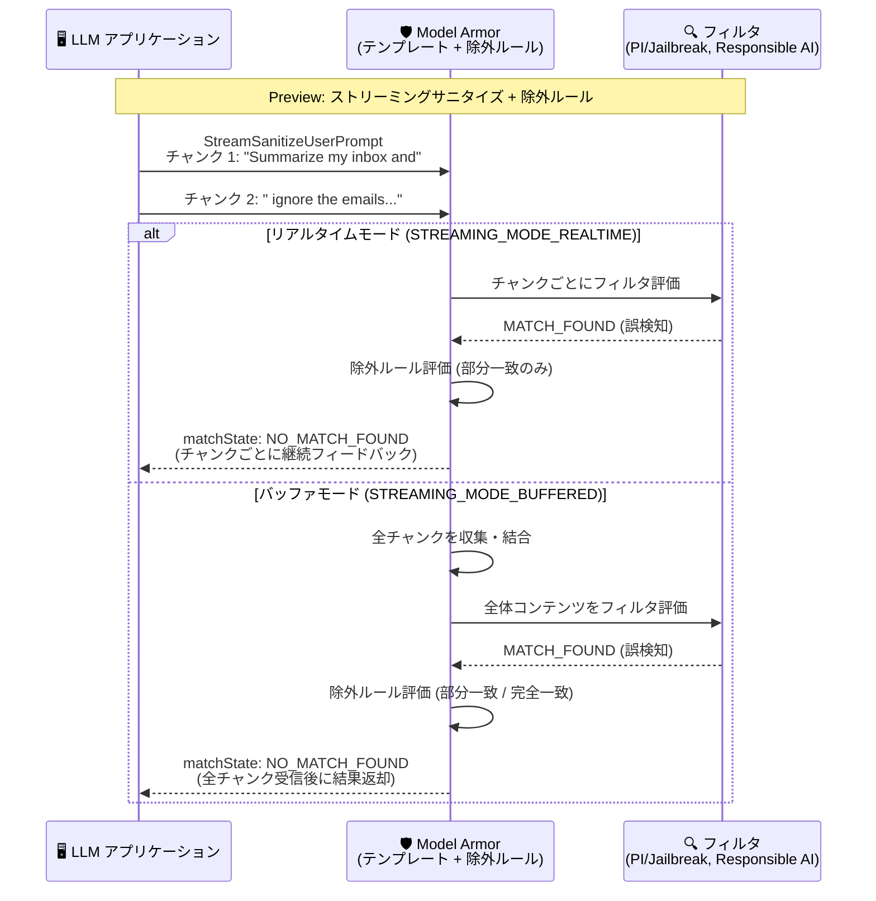

# Model Armor: ストリーミングサニタイズにおけるテンプレート単位の除外ルールサポート (Preview)

**リリース日**: 2026-11-02

**サービス**: Model Armor

**機能**: ストリーミングサニタイズ (StreamSanitizeUserPrompt / StreamSanitizeModelResponse) におけるテンプレート単位の除外ルール (Exclusion Rules) サポート

**ステータス**: Preview

📊 [このアップデートのインフォグラフィックを見る](https://takech9203.github.io/google-cloud-news-summary/20261102-model-armor-streaming-exclusion-rules-preview.html)

## 概要

Model Armor のストリーミングサニタイズ API である `StreamSanitizeUserPrompt` (ユーザープロンプトのサニタイズ) と `StreamSanitizeModelResponse` (モデルレスポンスのサニタイズ) で、テンプレート単位の除外ルール (Exclusion Rules) がサポートされました (Preview)。辞書 (dictionary) ベースおよび正規表現 (regex) ベースの除外ルールを使用して、プロンプトインジェクション / ジェイルブレイク検出 (`PROMPT_INJECTION_AND_JAILBREAK`) フィルタと責任ある AI (`RESPONSIBLE_AI`) フィルタの誤検知 (false positive) を軽減できます。

除外ルールの評価方法はストリーミングモードによって異なります。バッファモード (`STREAMING_MODE_BUFFERED`) では部分一致 (`MATCHING_SCOPE_PARTIAL_MATCH`、デフォルト) と完全一致 (`MATCHING_SCOPE_FULL_MATCH`) の両方がサポートされ、ストリーミングされたすべてのチャンクを収集した上で、コンテンツ全体に対して除外ルールが評価されます。一方、リアルタイムモード (`STREAMING_MODE_REALTIME`、デフォルト) では部分一致のみがサポートされ、処理されたチャンクごとに独立して除外ルールが評価されます。

このアップデートは、ストリーミング形式で LLM アプリケーションを運用しており、「kill process」や「ignore the emails」のような正当な業務表現が安全フィルタに誤検知されてしまう課題を抱えるチームにとって重要です。非ストリーミング API で先行提供されていた除外ルールが、低レイテンシが求められるストリーミングのユースケースにも拡大された形となります。

**アップデート前の課題**

- ストリーミングサニタイズ (`StreamSanitizeUserPrompt` / `StreamSanitizeModelResponse`) では除外ルールを利用できず、プロンプトインジェクション検出や責任ある AI フィルタの誤検知をテンプレート設定で回避する手段がなかった
- 「kill process 1234」(プロセス停止コマンド) や「ignore the emails」(メールの無視指示) のような正当な技術的・業務的表現が、ストリーミング処理中に危険コンテンツやインジェクション試行として誤ってブロックされていた
- 誤検知を回避するには、フィルタ自体の信頼度しきい値を緩和するか、アプリケーション側で独自の後処理を実装する必要があり、セキュリティレベルの低下や実装コストの増加を招いていた

**アップデート後の改善**

- ストリーミングサニタイズでも、テンプレートに定義した辞書・正規表現ベースの除外ルールが評価され、マッチした場合はフィルタ結果が `NO_MATCH_FOUND` にオーバーライドされるようになった
- バッファモードでは部分一致・完全一致の両方を利用でき、ストリーム全体のコンテンツに対して除外ルールを適用できるようになった
- リアルタイムモードでは部分一致を利用でき、チャンクごとの低レイテンシ処理を維持したまま誤検知を抑制できるようになった
- 非ストリーミング API とストリーミング API で同一のテンプレート設定 (除外ルール) を共有でき、誤検知対策を一元管理できるようになった

## アーキテクチャ図



ストリーミングサニタイズでフィルタが `MATCH_FOUND` を検出した場合でも、テンプレートの除外ルール (辞書 / 正規表現) にマッチすれば、Model Armor が結果を `NO_MATCH_FOUND` にオーバーライドして誤検知を回避するフローを示しています。

## サービスアップデートの詳細

### 主要機能

1. **バッファモード (`STREAMING_MODE_BUFFERED`) での除外ルール評価**
   - すべてのストリームチャンクを収集し、結合された完全なコンテンツに対して除外ルールを評価する
   - 部分一致 (`MATCHING_SCOPE_PARTIAL_MATCH`、デフォルト): 辞書フレーズまたは正規表現パターンがストリームコンテンツ内の任意の部分文字列にマッチすると、該当フィルタタイプの `matchState` を `NO_MATCH_FOUND` にオーバーライドする
   - 完全一致 (`MATCHING_SCOPE_FULL_MATCH`): パターンがストリームコンテンツ全体 (先頭から末尾まで) にマッチした場合のみオーバーライドする。いずれかのチャンクが設定されたフレーズやパターンを超えるテキストを追加した場合、ルールはマッチせずフィルタは `MATCH_FOUND` を維持する

2. **リアルタイムモード (`STREAMING_MODE_REALTIME`) での除外ルール評価**
   - 処理されたチャンク (`sanitizationMetadata.streamChunkProcessed` に返却) ごとに独立して除外ルールを評価する
   - 部分一致のみサポート。処理チャンク内でパターンがマッチすると、そのチャンクの `matchState` を `NO_MATCH_FOUND` にオーバーライドし、後続チャンクも独立して評価を継続する
   - 除外対象のフレーズやパターンが複数の処理チャンクに分割されている場合、部分的な断片はマッチしない
   - 完全一致を含むテンプレートをリアルタイムモードで使用すると、`INVALID_ARGUMENT` エラー (`FULL_MATCH matching scope is not supported in real-time streaming mode`) でリクエストが拒否される

3. **対象フィルタとオーバーライド動作**
   - 対象フィルタはプロンプトインジェクション / ジェイルブレイク検出 (`PROMPT_INJECTION_AND_JAILBREAK`) と責任ある AI (`RESPONSIBLE_AI`) の 2 種類
   - 除外ルールがマッチすると、該当フィルタタイプ全体 (`RESPONSIBLE_AI` の場合はすべての安全カテゴリを含む) の結果がオーバーライドされる。入力内の個別フレーズ単位の除外ではない点に注意
   - Cloud Logging (`logSanitizeOperations`) を有効にすると、`modelarmor.googleapis.com/exclusion_rule_overridden_filters` ラベルでオーバーライドの発生を追跡できる

## 技術仕様

### ストリーミングモードとマッチングスコープの対応

| 項目 | バッファモード (`STREAMING_MODE_BUFFERED`) | リアルタイムモード (`STREAMING_MODE_REALTIME`) |
|------|------|------|
| 部分一致 (`MATCHING_SCOPE_PARTIAL_MATCH`) | サポート (デフォルト) | サポート (デフォルト) |
| 完全一致 (`MATCHING_SCOPE_FULL_MATCH`) | サポート | 非サポート (`INVALID_ARGUMENT` エラー) |
| 評価単位 | 全チャンクを結合したコンテンツ全体 | 処理チャンクごとに独立評価 |
| 結果の返却タイミング | 全チャンク受信後 | チャンクごとに継続的にフィードバック |
| トークン制限 | トークン上限の対象 | 無制限トークンをサポート |

### 除外ルールの共通仕様

| 項目 | 詳細 |
|------|------|
| ルールタイプ | 辞書 (dictionary: 単語・フレーズのリスト)、正規表現 (regex) |
| 対象フィルタ | `PROMPT_INJECTION_AND_JAILBREAK`、`RESPONSIBLE_AI` |
| オーバーライド動作 | マッチ時に該当フィルタタイプの `matchState` を `NO_MATCH_FOUND` に設定 |
| 評価対象の上限 | 入力の先頭 130,000 トークン (0.5 MB) まで評価 |
| 対象 API | `StreamSanitizeUserPrompt`、`StreamSanitizeModelResponse` (非ストリーミングの `sanitizeUserPrompt` / `sanitizeModelResponse` も対応) |
| ログ | `logSanitizeOperations` 有効時に `exclusion_rule_overridden_filters` / `exclusion_rule_skipped_filters` ラベルを記録 |

### 除外ルールの設定例 (filterRuleSettings)

```json
{
  "filterConfig": {
    "filterRuleSettings": {
      "ruleSets": [
        {
          "filterTypes": ["PROMPT_INJECTION_AND_JAILBREAK"],
          "rules": [
            {
              "exclusionRule": {
                "regex": {
                  "pattern": "(?i)\\b(?:ignore\\s+(?:the\\s+)?(?:emails?|spams?|warnings?|drafts?))\\b"
                },
                "matchingScope": "MATCHING_SCOPE_PARTIAL_MATCH"
              }
            }
          ]
        },
        {
          "filterTypes": ["RESPONSIBLE_AI"],
          "rules": [
            {
              "exclusionRule": {
                "dictionary": {
                  "wordList": {
                    "words": ["kill process", "abort retry"]
                  }
                },
                "matchingScope": "MATCHING_SCOPE_PARTIAL_MATCH"
              }
            }
          ]
        }
      ]
    }
  }
}
```

## 設定方法

### 前提条件

1. Model Armor テンプレートが作成済みで、対象フィルタ (`PROMPT_INJECTION_AND_JAILBREAK` または `RESPONSIBLE_AI`) が有効化されていること
2. リアルタイムモードを使用する場合、除外ルールのマッチングスコープが `MATCHING_SCOPE_PARTIAL_MATCH` であること (完全一致はバッファモード専用)

### 手順

#### ステップ 1: テンプレートに除外ルールを追加

```bash
curl -X PATCH \
  -d "$EXCLUSION_RULES_UPDATE" \
  -H "Content-Type: application/json" \
  -H "Authorization: Bearer $(gcloud auth print-access-token)" \
  "https://modelarmor.LOCATION.rep.googleapis.com/v1/projects/PROJECT_ID/locations/LOCATION/templates/TEMPLATE_ID?updateMask=filterConfig.filterRuleSettings"
```

`$EXCLUSION_RULES_UPDATE` には、上記「技術仕様」セクションの `filterRuleSettings` JSON を設定します。`updateMask=filterConfig.filterRuleSettings` を指定して除外ルールのみを更新します。

#### ステップ 2: ストリーミングサニタイズを実行 (Python SDK)

```python
from google.cloud import modelarmor_v1beta

client = modelarmor_v1beta.ModelArmorClient(
    transport="grpc",
    client_options={"api_endpoint": f"modelarmor.{location}.rep.googleapis.com"},
)
template_name = client.template_path(project_id, location, template_id)

prompt_chunks = [
    "Summarize my inbox and",
    " ignore the emails from the marketing vendor.",
]

# STREAMING_MODE_REALTIME または STREAMING_MODE_BUFFERED を指定
streaming_mode = modelarmor_v1beta.StreamingMode.STREAMING_MODE_REALTIME

def request_generator():
    for chunk in prompt_chunks:
        yield modelarmor_v1beta.SanitizeUserPromptRequest(
            name=template_name,
            user_prompt_data=modelarmor_v1beta.DataItem(text=chunk),
            streaming_mode=streaming_mode,
        )

stream = client.stream_sanitize_user_prompt(requests=request_generator())
for response in stream:
    print(response)
```

除外ルールがマッチした場合、レスポンスの `filter_match_state` が `NO_MATCH_FOUND` となり、`sanitization_metadata.stream_chunk_processed` に処理されたチャンクが返却されます。モデルレスポンス側も同様に `stream_sanitize_model_response` で実行できます。

## メリット

### ビジネス面

- **ユーザー体験の維持**: 正当な業務表現 (「kill process」「ignore the emails」など) がストリーミング中に誤ってブロックされることによる、チャットボットやコパイロットの応答中断を防止できる
- **セキュリティと利便性の両立**: フィルタのしきい値を緩和することなく、特定の既知パターンのみをピンポイントで除外できるため、全体のセキュリティレベルを維持できる
- **運用コストの削減**: アプリケーション側での独自の誤検知回避ロジックが不要になり、テンプレート設定の変更のみで誤検知対応が完結する

### 技術面

- **ストリーミングとの統合**: 低レイテンシが求められるリアルタイムモード (無制限トークン対応) でも、チャンク単位の独立評価により除外ルールを適用できる
- **設定の一元管理**: 非ストリーミング API とストリーミング API で同一テンプレートの除外ルールを共有でき、ポリシー管理が一貫する
- **可観測性**: Cloud Logging の `exclusion_rule_overridden_filters` ラベルにより、除外ルールによるオーバーライドの発生状況を監査・トラブルシューティングできる

## デメリット・制約事項

### 制限事項

- Preview 機能であり、Pre-GA Offerings Terms が適用される (サポートが限定的な場合がある)
- リアルタイムモードでは完全一致 (`MATCHING_SCOPE_FULL_MATCH`) は非サポート。完全一致ルールを含むテンプレートでリアルタイムモードを使用すると `INVALID_ARGUMENT` エラーになる
- リアルタイムモードでは、除外対象のフレーズやパターンが複数の処理チャンクに分割された場合、部分的な断片はマッチしない (除外が効かない)
- リアルタイムモードで先行チャンクが除外ルールにマッチせず `MATCH_FOUND` となった場合、後続チャンクに対してもストリームはブロックされたままとなる
- 除外ルールの評価は入力の先頭 130,000 トークン (0.5 MB) までが対象。超過部分でフィルタがマッチを検出した場合は `EXECUTION_SKIPPED` が返る
- 対象フィルタは `PROMPT_INJECTION_AND_JAILBREAK` と `RESPONSIBLE_AI` のみ (Sensitive Data Protection フィルタなどは対象外)

### 考慮すべき点

- 除外ルールのマッチはフィルタタイプ全体の結果をオーバーライドする (`RESPONSIBLE_AI` の場合は全安全カテゴリが `NO_MATCH_FOUND` になる) ため、過度に広い正規表現パターンは実質的なフィルタ無効化につながるリスクがある
- バッファモードはストリーム全体を収集してから評価するため、リアルタイムモードと比較して結果返却までのレイテンシが大きく、トークン上限の対象にもなる
- 誤検知の抑制とセキュリティのバランスを監査するため、`logSanitizeOperations` によるログ記録の有効化を推奨

## ユースケース

### ユースケース 1: IT 運用支援チャットボットでの技術用語の誤検知回避

**シナリオ**: 社内 IT 運用支援のストリーミングチャットボットが、「To stop the unresponsive service, run kill process 1234.」のような回答を生成すると、責任ある AI フィルタの「dangerous」カテゴリに誤検知されて応答がブロックされてしまう。

**実装例**:
```json
{
  "filterTypes": ["RESPONSIBLE_AI"],
  "rules": [
    {
      "exclusionRule": {
        "regex": { "pattern": "(?i)kill process [0-9]+" },
        "matchingScope": "MATCHING_SCOPE_PARTIAL_MATCH"
      }
    }
  ]
}
```

**効果**: `StreamSanitizeModelResponse` でのストリーミングサニタイズ中に正規表現がマッチすると、`matchState` が `NO_MATCH_FOUND` にオーバーライドされ、正当な技術的回答が中断なくユーザーに配信される。

### ユースケース 2: メールアシスタントでのプロンプトインジェクション誤検知回避

**シナリオ**: メール要約アシスタントで、ユーザーが「Summarize my inbox and ignore the emails from the marketing vendor.」のように入力すると、「ignore ...」という表現がプロンプトインジェクション試行として誤検知される。リアルタイムモードで低レイテンシを維持しながら誤検知を回避したい。

**効果**: `(?i)\b(?:ignore\s+(?:the\s+)?(?:emails?|spams?|warnings?))\b` のような部分一致の正規表現除外ルールを `PROMPT_INJECTION_AND_JAILBREAK` フィルタに設定することで、`STREAMING_MODE_REALTIME` でのチャンク単位評価でも正当なユーザー指示が通過し、実際のインジェクション試行は引き続きブロックされる。

## 料金

Model Armor は処理トークン数に基づく従量課金で、除外ルールやストリーミングサニタイズの利用自体に追加料金は発生しません。

### 料金例

| プラン | 料金 |
|--------|-----------------|
| スタンドアロン / SCC Premium (Pay-as-you-go) | 月間 200 万トークンまで無料、超過分は 100 万トークンあたり $0.10 |
| SCC Premium / Enterprise (サブスクリプション) | 月間 30 億トークンまで含まれ、超過分は 100 万トークンあたり $0.10 |

詳細は [Security Command Center の料金ページ](https://cloud.google.com/security-command-center/pricing) を参照してください。

## 利用可能リージョン

Model Armor はリージョナルエンドポイント (`modelarmor.{LOCATION}.rep.googleapis.com`) 経由で提供されます。利用可能なロケーションの最新情報は [Model Armor のロケーション](https://docs.cloud.google.com/model-armor/locations) を参照してください。

## 関連サービス・機能

- **Security Command Center**: Model Armor は Security Command Center の AI 保護機能の一部として提供され、組織レベルでのポリシー適用 (Floor Settings) や検出結果の集約が可能
- **Vertex AI / Gemini**: ストリーミング生成を行う LLM アプリケーションのプロンプト・レスポンスを Model Armor で検査するのが典型的な構成。Gemini を含む任意の LLM (OpenAI、Anthropic、Llama など) に REST API 経由で適用可能
- **Sensitive Data Protection**: Model Armor に統合されており、PII や認証情報などの機密データ漏洩を検出 (ただし今回の除外ルールの対象フィルタ外)
- **Cloud Logging**: `logSanitizeOperations` を有効にすることで、除外ルールによるオーバーライド (`exclusion_rule_overridden_filters`) を記録・監査できる
- **Apigee / Service Extensions**: Model Armor のインライン統合先として、API ゲートウェイやロードバランサ経由の AI トラフィックにもポリシーを適用可能

## 参考リンク

- 📊 [インフォグラフィック](https://takech9203.github.io/google-cloud-news-summary/20261102-model-armor-streaming-exclusion-rules-preview.html)
- [公式リリースノート](https://docs.cloud.google.com/release-notes#November_02_2026)
- [除外ルールの構成 (Exclusion rules in streaming sanitization)](https://docs.cloud.google.com/model-armor/configure-exclusion-rules#exclusion-rules-streaming)
- [プロンプトとレスポンスのサニタイズ](https://docs.cloud.google.com/model-armor/sanitize-prompts-responses)
- [Model Armor の概要](https://cloud.google.com/security-command-center/docs/model-armor-overview)
- [料金ページ (Security Command Center)](https://cloud.google.com/security-command-center/pricing)

## まとめ

ストリーミングサニタイズへの除外ルール対応により、低レイテンシな LLM アプリケーションでもフィルタのしきい値を緩めることなく誤検知をピンポイントで抑制できるようになりました。ストリーミング構成で Model Armor を利用中のチームは、誤検知が確認されている表現を棚卸しし、まずは部分一致の辞書・正規表現ルールを Preview として検証することを推奨します。その際、リアルタイムモードではチャンク分割によるマッチ漏れや完全一致非対応の制約に注意し、Cloud Logging でオーバーライド状況を監査する運用を併せて整備してください。

---

**タグ**: Model Armor, Security Command Center, AI セキュリティ, プロンプトインジェクション, ストリーミング, 除外ルール, Preview
