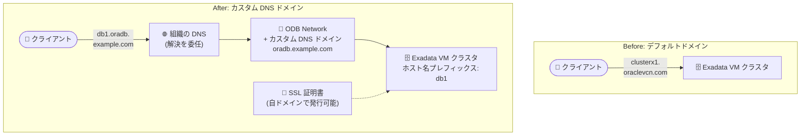

# Oracle Database@Google Cloud: ODB Network 向けカスタム DNS ドメインが GA

**リリース日**: 2026-11-02

**サービス**: Oracle Database@Google Cloud

**機能**: ODB Network 向けカスタム DNS ドメインの作成・管理

**ステータス**: GA (一般提供)

📊 [このアップデートのインフォグラフィックを見る](https://takech9203.github.io/google-cloud-news-summary/20261102-oracle-database-custom-dns-domains-ga.html)

## 概要

Oracle Database@Google Cloud で、ODB Network に対するカスタム DNS ドメインの作成が一般提供 (GA) になりました。カスタム DNS ドメインを使用することで、Oracle Database リソースの名前を自組織の命名規則に沿って制御し、組織内で DNS 解決を委任 (delegate) できるようになります。さらに、カスタムドメイン内に存在するホストに対して SSL 証明書を発行することも可能です。

従来、Exadata VM クラスタのエンドポイントにはデフォルトの `oraclevcn.com` ドメインが使用されていました。今回のアップデートにより、カスタム DNS ドメインがこのデフォルトドメインを置き換え、データベースのエンドポイントを企業の名前空間 (例: `oradb.example.com`) に揃えることができます。これにより、接続性の管理とコンプライアンス対応が容易になります。たとえば、ODB Network に `oradb.example.com` というカスタム DNS ドメインを作成すると、クラスタに `db1.oradb.example.com` という名前を付けられます。

本機能は、企業の DNS 命名ポリシーや証明書管理ポリシーが厳格な組織、オンプレミスから Oracle Exadata ワークロードを移行する際に既存のホスト名体系を維持したい組織にとって特に有用です。なお、カスタム DNS ドメインは **Exadata VM クラスタでのみ**使用できます。

**アップデート前の課題**

- Exadata VM クラスタのホスト名にはデフォルトの `oraclevcn.com` ドメインが使用され、組織の命名規則に合わせたドメイン名を設定できなかった
- データベースエンドポイントが企業の名前空間と一致しないため、組織内の DNS 解決の委任や管理が複雑になっていた
- 自組織のドメイン配下にないホスト名に対しては、企業の証明書ポリシーに沿った SSL 証明書の発行・管理が難しかった

**アップデート後の改善**

- ODB Network ごとにカスタム DNS ドメインを作成し、Exadata VM クラスタのリソース名を自組織の命名規則で制御できるようになった
- データベースエンドポイントが企業の名前空間に揃い、組織内での DNS 解決の委任が可能になった
- カスタムドメイン内のホストに対して SSL 証明書を発行できるようになり、コンプライアンス対応が容易になった
- Google Cloud コンソール、gcloud CLI、API のいずれからもドメインの作成・一覧表示・詳細確認・削除が可能になった

## アーキテクチャ図



デフォルトの `oraclevcn.com` ドメインに代わり、ODB Network に作成したカスタム DNS ドメインを Exadata VM クラスタに割り当てることで、企業の名前空間に沿ったエンドポイント名での接続と SSL 証明書の発行が可能になります。

## サービスアップデートの詳細

### 主要機能

1. **カスタム DNS ドメインの作成**
   - ODB Network に対して任意のドメイン名 (例: `oradb.example.com`) を持つカスタム DNS ドメインを作成可能
   - 複数のカスタム DNS ドメインを作成できるが、各ドメインは 1 つの ODB Network にのみ関連付け可能
   - コンソール、gcloud CLI (`gcloud oracle-database odb-networks odb-dns-zones create`)、REST API に対応

2. **リソース名の制御と DNS 解決の委任**
   - Exadata VM クラスタのホスト名を組織の命名規則に沿って設定可能 (例: `db1.oradb.example.com`)
   - 組織内で DNS 解決を委任でき、企業の DNS 運用に統合しやすくなる
   - カスタム DNS ドメインは Exadata VM クラスタのデフォルト `oraclevcn.com` ドメインを置き換える

3. **SSL 証明書の発行**
   - カスタムドメイン内に存在するホストに対して SSL 証明書を発行可能
   - 企業の証明書管理ポリシーやコンプライアンス要件への対応が容易になる

4. **ドメインのライフサイクル管理**
   - ドメインの一覧表示 (`odb-dns-zones list`)、詳細確認 (`odb-dns-zones describe`)、削除 (`odb-dns-zones delete`) に対応
   - リソースが使用中のドメインは削除不可 (先にリソースの削除が必要)

## 技術仕様

### ドメインの命名規則

| 項目 | 詳細 |
|------|------|
| リソース ID | 最大 63 文字。小文字・数字・ハイフンのみ。先頭は小文字、末尾は小文字または数字 |
| ドメイン名 | 英数字で構成。サブドメインは最大 3 つまで (ピリオドで区切る) |
| 文字数制限 | プレフィックスとドメインの合計が 110 文字未満 |
| 予約ドメイン | `oraclevcn.com` は予約済みのため、カスタムドメインには使用不可 |
| 関連付け | 1 つのカスタム DNS ドメインは 1 つの ODB Network にのみ関連付け可能 |
| 対象リソース | Exadata VM クラスタのみ |

### Exadata VM クラスタでのホスト名プレフィックス

| 項目 | 詳細 |
|------|------|
| 使用可能文字 | 英字・数字・ハイフンのみ。先頭は英字 |
| 最大長 | 12 文字 |
| 設定箇所 | Exadata VM クラスタ作成時の「DNS domain」セクションでドメインとプレフィックスを指定 |

### API リソース

カスタム DNS ドメインは `odbDnsZones` リソースとして管理されます。

```
https://oracledatabase.googleapis.com/v1/projects/{project}/locations/{region}/odbNetworks/{odb_network}/odbDnsZones/{odb_dns_zone}
```

## 設定方法

### 前提条件

1. Marketplace 注文に関連付けられた課金アカウントのプロジェクトに ODB Network が作成済みであること (Shared VPC 構成の場合はホストプロジェクトを使用)
2. カスタム DNS ドメインを使用する対象が Exadata VM クラスタであること

### 手順

#### ステップ 1: カスタム DNS ドメインの作成

```bash
gcloud oracle-database odb-networks odb-dns-zones create DOMAIN_ID \
  --project=PROJECT_ID \
  --location=REGION \
  --odb-network=ODB_NETWORK_ID \
  --domain=oradb.example.com
```

ODB Network に対してカスタム DNS ドメインを作成します。`DOMAIN_ID` はドメインの一意な ID、`--domain` には命名規則に沿ったドメイン名を指定します。作成後、ドメインは ODB Network 詳細ページの「Custom DNS domain」一覧に表示されます。

#### ステップ 2: ドメインの確認

```bash
# ドメインの一覧表示
gcloud oracle-database odb-networks odb-dns-zones list \
  --project=PROJECT_ID \
  --location=REGION \
  --odb-network=ODB_NETWORK_ID

# ドメインの詳細確認
gcloud oracle-database odb-networks odb-dns-zones describe DOMAIN_ID \
  --project=PROJECT_ID \
  --location=REGION \
  --odb-network=ODB_NETWORK_ID
```

作成したドメインの一覧と詳細を確認します。

#### ステップ 3: Exadata VM クラスタ作成時にドメインを指定

Exadata VM クラスタの作成時に、「DNS domain」セクションで以下を設定します。

1. **Domain name**: 作成したカスタム DNS ドメインを選択
2. **Hostname prefix**: VM のホスト名生成に使用するプレフィックスを指定 (最大 12 文字)

プレフィックスを入力すると、完全なホストとドメインの URL がフィールドの横に表示されます。gcloud では `gcloud oracle-database cloud-vm-clusters create` コマンドの `--odb-dns-zone` フラグで指定できます。

#### ステップ 4: 不要になったドメインの削除

```bash
gcloud oracle-database odb-networks odb-dns-zones delete DOMAIN_ID \
  --project=PROJECT_ID \
  --location=REGION \
  --odb-network=ODB_NETWORK_ID
```

リソースが使用中のドメインは削除できません。先にそのリソースを削除してから、ドメインを削除してください。

## メリット

### ビジネス面

- **コンプライアンス対応の強化**: データベースエンドポイントを企業の名前空間に揃えることで、命名規則や証明書ポリシーなどの社内統制に準拠しやすくなる
- **移行の円滑化**: オンプレミスの Oracle Exadata 環境からの移行時に、既存のホスト名体系やドメイン構成を維持しやすくなり、アプリケーションの接続文字列変更を最小限に抑えられる

### 技術面

- **DNS 解決の委任**: 組織内で DNS 解決を委任できるため、企業の DNS 運用 (社内 DNS、Cloud DNS との統合) に Oracle Database のエンドポイントを組み込みやすくなる
- **SSL 証明書の発行**: 自組織のドメイン配下のホスト名に対して SSL 証明書を発行でき、エンドツーエンドの暗号化と証明書の一元管理が可能になる
- **マルチインターフェース対応**: コンソール、gcloud CLI、REST API のいずれからも作成・管理が可能で、IaC や自動化パイプラインに統合しやすい

## デメリット・制約事項

### 制限事項

- カスタム DNS ドメインは **Exadata VM クラスタでのみ**使用可能 (Autonomous AI Database などでは使用不可)
- 各カスタム DNS ドメインは 1 つの ODB Network にのみ関連付け可能
- `oraclevcn.com` ドメインは予約済みのため、カスタムドメインとして使用不可
- サブドメインは最大 3 つまで、プレフィックスとドメインの合計は 110 文字未満
- リソースが使用中のドメインは削除できない (先にリソースの削除が必要)

### 考慮すべき点

- ホスト名プレフィックスは最大 12 文字のため、命名規則の設計時に長さの制約を考慮する必要がある
- Shared VPC 構成の場合、ドメイン管理の操作にはホストプロジェクトの ID を使用する必要がある
- 既存クラスタの運用に組み込む場合は、組織の DNS 側でカスタムドメインの解決 (委任設定) を適切に構成する必要がある

## ユースケース

### ユースケース 1: 企業命名規則に沿ったデータベースエンドポイントの統一

**シナリオ**: 社内の全データベースエンドポイントを `*.oradb.example.com` の形式で統一する命名ポリシーを持つ企業が、Oracle Database@Google Cloud 上の Exadata VM クラスタにも同じ規則を適用したい。

**実装例**:
```bash
# カスタム DNS ドメインを作成
gcloud oracle-database odb-networks odb-dns-zones create prod-oradb-domain \
  --project=my-host-project \
  --location=asia-northeast1 \
  --odb-network=prod-odb-network \
  --domain=oradb.example.com

# クラスタ作成時にドメインとプレフィックス (例: db1) を指定
# → ホスト名は db1.oradb.example.com となる
```

**効果**: デフォルトの `oraclevcn.com` に依存せず、社内命名規則に完全準拠したエンドポイントでデータベースを運用でき、接続管理と監査対応が容易になる。

### ユースケース 2: オンプレミス Exadata からの移行でのホスト名体系の維持

**シナリオ**: オンプレミスの Exadata 環境で `*.oradb.corp.example.com` のドメインを使用している企業が、Oracle Database@Google Cloud へ移行する際にアプリケーション側の接続設定変更を最小化したい。

**効果**: カスタム DNS ドメインで既存のドメイン体系を再現し、組織の DNS で解決を委任することで、アプリケーションの接続文字列をほぼ変更せずに移行できる。既存ドメイン向けの SSL 証明書運用もそのまま継続できる。

## 料金

カスタム DNS ドメイン機能自体の追加料金に関する公式情報は、リリースノートおよびドキュメントには記載されていません。Oracle Database@Google Cloud の料金は Google Cloud Marketplace 経由のプライベートオファーに基づきます。詳細は料金ページを参照してください。

- [Oracle Database@Google Cloud の概要・料金](https://cloud.google.com/oracle/database)

## 利用可能リージョン

リージョン固有の制限はリリースノートに記載されていません。Oracle Database@Google Cloud が利用可能なリージョンについては、[サポートされているリージョンとゾーン](https://docs.cloud.google.com/oracle/database/docs/regions-and-zones) を参照してください。

## 関連サービス・機能

- **Cloud DNS**: Google Cloud 上の DNS マネージドサービス。組織内の DNS 解決の委任構成において、カスタムドメインのゾーン管理やフォワーディングと組み合わせて利用できる
- **ODB Network / ODB Subnet**: カスタム DNS ドメインの作成単位となるネットワークリソース。Exadata VM クラスタにはクライアントサブネットとバックアップサブネットが必要
- **Shared VPC**: Shared VPC 構成では、ホストプロジェクトで ODB Network およびカスタム DNS ドメインを管理する
- **Exadata VM クラスタ**: カスタム DNS ドメインを使用できる唯一のリソース。クラスタ作成時にドメインとホスト名プレフィックスを指定する

## 参考リンク

- 📊 [インフォグラフィック](https://takech9203.github.io/google-cloud-news-summary/20261102-oracle-database-custom-dns-domains-ga.html)
- [公式リリースノート](https://docs.cloud.google.com/release-notes#November_02_2026)
- [Create and manage custom DNS domains](https://docs.cloud.google.com/oracle/database/docs/create-manage-custom-dns)
- [Create an ODB Network](https://docs.cloud.google.com/oracle/database/docs/create-odb-network)
- [Create Exadata VM Clusters](https://docs.cloud.google.com/oracle/database/docs/create-clusters)
- [gcloud oracle-database cloud-vm-clusters create リファレンス](https://docs.cloud.google.com/sdk/gcloud/reference/oracle-database/cloud-vm-clusters/create)

## まとめ

Oracle Database@Google Cloud のカスタム DNS ドメインが GA となり、Exadata VM クラスタのエンドポイントを企業の名前空間に揃え、組織内での DNS 解決の委任と SSL 証明書の発行が可能になりました。デフォルトの `oraclevcn.com` ドメインが要件に合わなかった企業や、オンプレミスからの移行でホスト名体系を維持したい企業は、新規クラスタ作成時にカスタム DNS ドメインの採用を検討することを推奨します。

---

**タグ**: Oracle Database@Google Cloud, Exadata, DNS, ODB Network, GA, ネットワーク, Cloud DNS
