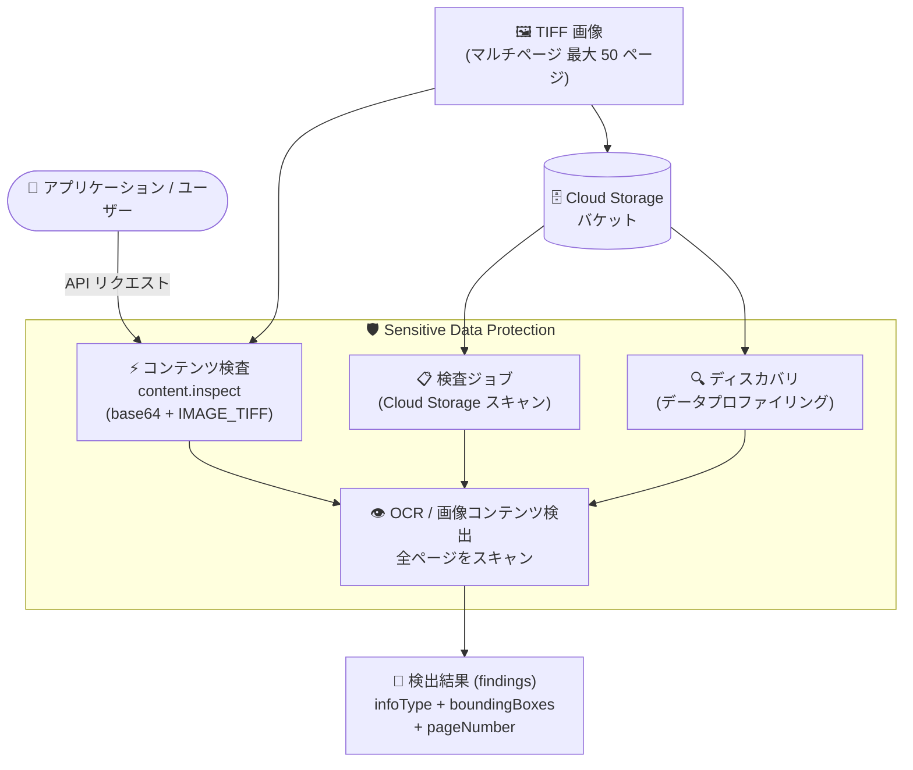

# Sensitive Data Protection: TIFF 画像の検査サポート (最大 50 ページのマルチページ TIFF 対応)

**リリース日**: 2026-11-02

**サービス**: Sensitive Data Protection

**機能**: TIFF 画像の機密データ検査 (マルチページ TIFF 対応)

**ステータス**: 一般提供

📊 [このアップデートのインフォグラフィックを見る](https://takech9203.github.io/google-cloud-news-summary/20261102-sensitive-data-protection-tiff-image-inspection.html)

## 概要

Sensitive Data Protection が TIFF 画像内の機密データ検査に対応しました。最大 50 ページのマルチページ TIFF 画像もサポートされ、すべてのページが検査対象となり、全ページの検出結果 (findings) が単一のレスポンスで返されます。各検出結果の `imageLocation` には `pageNumber` フィールドが含まれ、どのページで機密データが検出されたかを特定できます (ページ番号は 0 始まり)。

TIFF 画像は、コンテンツ検査 (`content.inspect` API)、Cloud Storage に対する検査ジョブ (inspection jobs)、ディスカバリ (discovery) の 3 つのモードすべてでサポートされます。TIFF はスキャン・FAX・医療画像・帳票アーカイブなどで広く使われる形式であり、これらのレガシードキュメントに含まれる PII (個人識別情報) の検出が可能になります。

スキャン済み帳票や FAX 受信文書を Cloud Storage にアーカイブしている企業、コンプライアンス要件により格納データの棚卸しが必要な組織にとって、検査対象ファイル形式のカバレッジが大きく広がるアップデートです。

**アップデート前の課題**

- TIFF 形式の画像は Sensitive Data Protection の画像検査 (OCR) の対象外であり、スキャン文書や FAX などの TIFF アーカイブ内の機密データを直接検出できなかった
- TIFF ファイルを検査するには、事前に JPEG/PNG などのサポート形式へ変換する前処理パイプラインが必要だった
- マルチページ構造を持つ TIFF では、ページ単位に分割して個別に検査する必要があった

**アップデート後の改善**

- TIFF 画像 (拡張子 `tif`/`tiff`) をそのまま検査できるようになり、形式変換の前処理が不要になった
- 最大 50 ページのマルチページ TIFF を 1 リクエストで検査でき、全ページの検出結果が単一レスポンスで返される
- 検出結果の `pageNumber` フィールドにより、機密データが含まれるページを正確に特定できる
- コンテンツ検査・Cloud Storage 検査ジョブ・ディスカバリの 3 モードすべてで TIFF がサポートされ、オンデマンド検査から組織全体の継続的なデータプロファイリングまで一貫してカバーできる

## アーキテクチャ図



TIFF 画像は、API への直接送信 (コンテンツ検査)、Cloud Storage バケットの検査ジョブ、組織・プロジェクト単位のディスカバリの 3 つの経路で検査されます。全ページがスキャンされ、検出結果にはページ番号付きの位置情報が含まれます。

## サービスアップデートの詳細

### 主要機能

1. **マルチページ TIFF 画像の検査**
   - 最大 50 ページのマルチページ TIFF 画像を検査可能
   - すべてのページが検査され、全ページの検出結果が単一のレスポンスで返される
   - 各検出結果の `imageLocation` に `pageNumber` フィールド (0 始まり) が含まれ、検出ページを特定できる

2. **3 つの検査モードでのサポート**
   - **コンテンツ検査**: `content.inspect` メソッドに base64 エンコードした TIFF を `IMAGE_TIFF` タイプで送信し、同期的に検査
   - **Cloud Storage 検査ジョブ**: バケット内の `tif`/`tiff` ファイルを検査ジョブの対象として網羅的にスキャン
   - **ディスカバリ**: データプロファイリングの画像ファイルクラスタに TIFF が含まれ、組織・フォルダ・プロジェクト単位の継続的スキャンに対応

3. **既存の画像スキャンモードとの統合**
   - 他の画像形式 (JPEG、BMP、PNG など) と同様に OCR、画像コンテンツ検出、画像コンテンツ分類のスキャンモードが適用される
   - 検出結果には infoType、尤度 (likelihood)、バウンディングボックス座標が含まれる

## 技術仕様

### TIFF 検査の仕様と制限

| 項目 | 詳細 |
|------|------|
| 対象拡張子 | `tif`, `tiff` |
| 最大ページ数 | 50 ページ (超過するとリクエストは失敗) |
| スキャンモード | OCR、画像コンテンツ検出、画像コンテンツ分類 |
| 位置情報 | `imageLocation` (バウンディングボックス + `pageNumber`、0 始まり) |
| 秘匿化 (redaction) | TIFF は非対応 (検査のみ。`image.redact` は TIFF 以外の画像形式のみ) |
| 画像ベースのルール | `ExcludeByImageFindings` / `AdjustByImageFindings` は TIFF 非対応 (設定に含むとリクエストが失敗) |
| 利用可能ロケーション | 画像スキャンをサポートするロケーションのみ |
| ディスカバリでの画像スキャン上限 | 4 MiB 未満の画像が OCR 対象 (TIFF は加えて TIFF 制限が適用) |
| サンプリング | OCR モードでは `bytes_limit_per_file` などのバイト数制限は適用されない |

### コンテンツ検査のリクエスト例

```json
{
  "item": {
    "byteItem": {
      "data": "BASE64_ENCODED_IMAGE",
      "type": "IMAGE_TIFF"
    }
  }
}
```

レスポンスでは、各検出結果の `imageLocation` にページ番号が含まれます。

```json
{
  "result": {
    "findings": [
      {
        "infoType": {
          "name": "EMAIL_ADDRESS",
          "sensitivityScore": { "score": "SENSITIVITY_MODERATE" }
        },
        "likelihood": "LIKELY",
        "location": {
          "contentLocations": [
            {
              "imageLocation": {
                "boundingBoxes": [
                  { "top": 213, "left": 128, "width": 345, "height": 40 }
                ],
                "pageNumber": 1
              }
            }
          ]
        }
      }
    ]
  }
}
```

この例では、画像の 2 ページ目 (pageNumber: 1) で EMAIL_ADDRESS が検出されています。

## 設定方法

### 前提条件

1. Google Cloud プロジェクトで DLP API (Sensitive Data Protection) が有効化されていること
2. 画像スキャンをサポートするロケーションを使用すること
3. TIFF 画像が 50 ページ以下であること

### 手順

#### ステップ 1: TIFF 画像を base64 エンコード

```bash
# Linux
base64 input.tiff > output.txt

# macOS
base64 -i input.tiff -o output.txt
```

コンテンツ検査では、画像を base64 エンコードした ASCII テキストとしてリクエストに含めます。

#### ステップ 2: content.inspect メソッドにリクエストを送信

```bash
curl -X POST \
  -H "Authorization: Bearer $(gcloud auth print-access-token)" \
  -H "Content-Type: application/json" \
  "https://dlp.googleapis.com/v2/projects/PROJECT_ID/content:inspect" \
  -d '{
    "item": {
      "byteItem": {
        "data": "BASE64_ENCODED_IMAGE",
        "type": "IMAGE_TIFF"
      }
    }
  }'
```

byte item の `type` に `IMAGE_TIFF` を指定します。infoTypes を指定しない場合は、デフォルトの infoTypes (最も一般的な機密情報タイプ) が検索されます。

Cloud Storage 上の TIFF をまとめて検査する場合は、バケットを対象とした検査ジョブを作成します。ディスカバリでは、画像ファイルクラスタの一部として TIFF が自動的にスキャン対象となります。

## メリット

### ビジネス面

- **レガシードキュメントのコンプライアンス対応**: スキャン文書、FAX、帳票アーカイブなど TIFF 形式で保存された過去の資産に含まれる PII を検出でき、GDPR や各種規制対応の棚卸しが容易になる
- **前処理コストの削減**: TIFF から他形式への変換パイプラインが不要になり、検査ワークフローの構築・運用コストを削減できる

### 技術面

- **ページ単位の位置特定**: `pageNumber` とバウンディングボックスにより、マルチページ文書内のどこに機密データがあるかを正確に特定でき、後続の対応 (隔離、マスキング処理など) を効率化できる
- **3 モード一貫サポート**: オンデマンドの API 検査、Cloud Storage のバッチ検査ジョブ、組織全体の継続的ディスカバリのすべてで同じ TIFF サポートが利用でき、ユースケースに応じた使い分けが可能

## デメリット・制約事項

### 制限事項

- 1 つの TIFF 画像の最大ページ数は 50 ページ。超過する TIFF は検査できず、リクエストが失敗する
- TIFF 画像は検査 (inspect) のみ対応で、秘匿化 (redact) はできない (`image.redact` は TIFF 以外の画像形式のみ対応)
- 画像ベースの除外ルール・調整ルール (`ExcludeByImageFindings`、`AdjustByImageFindings`) は TIFF 非対応。検査構成にこれらのルールが含まれるとリクエストが失敗する
- 他の画像形式と同様、画像スキャンをサポートするロケーションでのみ検査可能

### 考慮すべき点

- ディスカバリでは 4 MiB 未満の画像が OCR 対象となるため、大きな TIFF ファイルの扱いに注意が必要
- OCR モードではファイルあたりのバイト数制限 (サンプリング) 設定が適用されないため、大量の画像を検査する際はコストを見積もっておく
- コンテンツ検査にはリクエストサイズ上限 (0.5 MB) があるため、大きなファイルは Cloud Storage に格納して検査ジョブでスキャンすることが推奨される

## ユースケース

### ユースケース 1: スキャン文書アーカイブの PII 棚卸し

**シナリオ**: 金融機関が過去の契約書・申込書をマルチページ TIFF として Cloud Storage にアーカイブしている。規制対応のため、どのファイルに個人情報が含まれるかを棚卸ししたい。

**実装例**:
```
1. Cloud Storage バケットを対象とした検査ジョブを作成
   (CloudStorageRegexFileSet で *.tif / *.tiff を対象に指定可能)
2. infoTypes に PERSON_NAME、EMAIL_ADDRESS、PHONE_NUMBER などを指定
3. 検査結果を BigQuery に保存し、pageNumber 付きの findings を分析
```

**効果**: 形式変換なしで TIFF アーカイブ全体を網羅的にスキャンし、機密データを含むファイルとページを特定できる。

### ユースケース 2: FAX 受信文書のリアルタイム検査

**シナリオ**: 医療機関が FAX 経由で受信した TIFF 文書を業務システムに取り込む前に、機密情報の有無を判定して取り扱い区分を自動付与したい。

**効果**: `content.inspect` に `IMAGE_TIFF` で送信することで、取り込みパイプライン内で同期的に機密データを検出し、ページ単位で検出位置を把握した上で後続処理 (隔離、アクセス制御など) を自動化できる。

### ユースケース 3: 組織全体のシャドーデータ検出

**シナリオ**: 組織内の複数プロジェクトに散在する Cloud Storage バケットに、管理されていない TIFF スキャン文書が存在する可能性がある。

**効果**: ディスカバリ (データプロファイリング) の画像ファイルクラスタに TIFF が含まれるため、組織・フォルダ単位の継続的スキャンで TIFF 内の機密データも含めたデータプロファイルを自動生成し、Security Command Center への連携でリスクを可視化できる。

## 料金

Sensitive Data Protection の既存の料金体系が適用されます。検査・変換は処理バイト数ベース、ディスカバリは選択した料金モードに基づいて課金されます。

### 料金例

| カテゴリ | 料金 (USD) |
|--------|-----------------|
| 検査・変換 (1 GB まで) | 無料 |
| Google Cloud ストレージシステムの検査 | $1/GB から (ボリュームディスカウントあり) |
| インラインコンテンツ検査 | $3/GB から (ボリュームディスカウントあり) |
| ディスカバリ (従量課金モード) | $0.03/GB |
| ディスカバリ (サブスクリプションモード) | $2,500/ユニット |

OCR モードではファイルあたりのバイト数制限 (サンプリング) が適用されない点に注意してください。詳細は [料金ページ](https://cloud.google.com/sensitive-data-protection/pricing) を参照してください。

## 利用可能リージョン

TIFF 画像の検査は、他の画像形式と同様に画像スキャンをサポートするロケーションでのみ利用可能です。対応ロケーションの一覧は [ロケーションに関するドキュメント](https://cloud.google.com/sensitive-data-protection/docs/locations#image-limitations) を参照してください。

## 関連サービス・機能

- **Cloud Storage**: 検査ジョブおよびディスカバリの対象ストレージ。TIFF アーカイブのスキャン元となる
- **BigQuery**: 検査ジョブの検出結果の保存先として利用でき、pageNumber を含む findings を SQL で分析可能
- **Security Command Center**: 検査結果やデータプロファイルを連携し、組織のセキュリティリスクとして可視化
- **Pub/Sub**: 検査ジョブ完了やデータプロファイル生成の通知を受け取り、後続ワークフローを自動化

## 参考リンク

- 📊 [インフォグラフィック](https://takech9203.github.io/google-cloud-news-summary/20261102-sensitive-data-protection-tiff-image-inspection.html)
- [公式リリースノート](https://cloud.google.com/release-notes)
- [画像内の機密データの検査 (Inspecting images)](https://cloud.google.com/sensitive-data-protection/docs/inspecting-images)
- [ストレージとデータベースの検査 (Cloud Storage)](https://cloud.google.com/sensitive-data-protection/docs/inspecting-storage#inspecting-gcs)
- [サポートされるファイル形式とスキャンモード](https://cloud.google.com/sensitive-data-protection/docs/supported-file-types)
- [使用制限 (TIFF スキャンの制限)](https://cloud.google.com/sensitive-data-protection/limits#tiff-limits)
- [料金ページ](https://cloud.google.com/sensitive-data-protection/pricing)

## まとめ

Sensitive Data Protection が TIFF 画像 (最大 50 ページのマルチページ対応) の検査をサポートしたことで、スキャン文書や FAX など TIFF 形式のレガシーアーカイブに含まれる機密データを、形式変換なしに検出できるようになりました。コンテンツ検査・Cloud Storage 検査ジョブ・ディスカバリの 3 モードすべてで利用できるため、まずは既存の検査ジョブやディスカバリ構成の対象に TIFF ファイルが含まれているかを確認し、必要に応じてスキャン範囲を見直すことを推奨します。秘匿化 (redaction) は TIFF 非対応である点と、50 ページ制限には注意が必要です。

---

**タグ**: Sensitive Data Protection, DLP, TIFF, 画像検査, OCR, Cloud Storage, ディスカバリ, データプロファイリング, PII, セキュリティ
