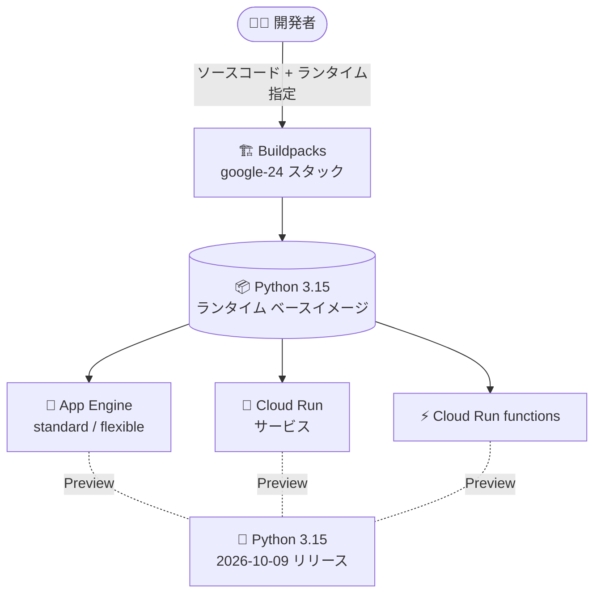

# App Engine / Cloud Run / Cloud Run functions: Python 3.15 ランタイムが Preview で利用可能に

**リリース日**: 2026-11-02

**サービス**: App Engine standard environment (Python) / App Engine flexible environment (Python) / Cloud Run / Cloud Run functions

**機能**: Python 3.15 ランタイムのサポート (Preview)

**ステータス**: Preview

📊 [このアップデートのインフォグラフィックを見る](https://takech9203.github.io/google-cloud-news-summary/20261102-serverless-python-3-15-runtime-preview.html)

## 概要

Google Cloud のサーバーレス プラットフォーム 4 サービス (App Engine スタンダード環境、App Engine フレキシブル環境、Cloud Run、Cloud Run functions) で、**Python 3.15 ランタイムのサポートが Preview** として同時に発表されました。Python 3.15 は 2026 年 10 月 9 日にリリースされた最新の安定版であり、リリースからわずか 1 か月弱で Google Cloud のサーバーレス環境全体に展開されたことになります。

Python 3.15 には、サーバーレス ワークロードと特に相性の良い改善が多く含まれています。代表的なのは **PEP 810 (明示的な遅延インポート)** で、`lazy import` 構文によりモジュールの読み込みを初回使用時まで遅延でき、コールドスタート時間の短縮に直結します。そのほか **PEP 686 (UTF-8 モードのデフォルト化)**、**PEP 798 (内包表記でのアンパック)**、**frozendict / sentinel 組み込み型**、オーバーヘッドがほぼゼロの新しいサンプリング プロファイラ **Tachyon (PEP 799)** などが追加されています。

対象ユーザーは、Python でサーバーレス アプリケーションや関数を開発しているすべての開発者です。Preview 段階のため本番環境での利用は推奨されませんが、既存アプリケーションの互換性検証や新機能の評価を早期に開始できます。

**アップデート前の課題**

- 従来、Google Cloud のサーバーレス環境で利用できる最新の Python ランタイムは Python 3.14 までであり、Python 3.15 (2026 年 10 月リリース) の新機能や性能改善を利用できなかった
- `lazy import` によるコールドスタート短縮や新しいサンプリング プロファイラなど、Python 3.15 固有の改善をマネージド ランタイムで検証する手段がなかった
- Python 3.15 を試すには、カスタム コンテナ イメージを自前でビルド・運用する必要があった

**アップデート後の改善**

- 4 つのサーバーレス サービスすべてで、マネージド ランタイムとして Python 3.15 を指定してデプロイできるようになった (Preview)
- カスタム イメージを用意することなく、Python 3.15 の新機能 (遅延インポート、UTF-8 デフォルト、改善されたエラーメッセージなど) を評価できるようになった
- GA に先立ち、既存の Python アプリケーションの 3.15 互換性テストをマネージド環境で開始できるようになった

## アーキテクチャ図



開発者はソースコードとランタイム指定をデプロイするだけで、Google 管理の Python 3.15 ベースイメージ上でアプリケーションが実行されます。同一のランタイム基盤が 4 つのサーバーレス サービスに共通して提供されます。

## サービスアップデートの詳細

### 主要機能

1. **4 サービス同時の Python 3.15 対応 (Preview)**
   - App Engine スタンダード環境、App Engine フレキシブル環境、Cloud Run、Cloud Run functions の 4 サービスで同時に Preview 提供
   - Google 管理のランタイム ベースイメージとして提供され、OS・言語レベルのセキュリティ パッチは Google が適用

2. **Python 3.15 の主な新機能**
   - **PEP 810 - 明示的な遅延インポート**: `lazy import json` のように記述すると初回使用時までモジュール読み込みを遅延。起動時間の短縮に有効で、サーバーレスのコールドスタート対策として特に有用
   - **PEP 686 - UTF-8 モードがデフォルトに**: `encoding` 未指定の I/O がロケールに依存せず UTF-8 になり、環境差異による文字化けバグを削減
   - **PEP 798 - 内包表記でのアンパック**: `[*L for L in lists]` でのフラット化や `{**d for d in dicts}` での辞書マージが可能に
   - **PEP 814 `frozendict` / PEP 661 `sentinel`**: 不変マッピングと一意なセンチネル値が組み込みで利用可能に
   - **PEP 799 - 新しい `profiling` パッケージ**: 統計的サンプリング プロファイラ「Tachyon」を搭載。実行中プロセスに PID でアタッチでき、フレームグラフ出力にも対応
   - **エラーメッセージの改善**: `AttributeError` でネストした属性の提案や他言語由来のメソッド名 (`.push` → `.append` など) の提案が追加

3. **ランタイム ライフサイクルに沿った提供**
   - Preview 期間を経て GA に昇格するのが通例 (例: Python 3.11 は Preview 発表から約 2 か月で GA)
   - GA 後はセキュリティ アップデート ポリシーに従いパッチが自動適用され、Python コミュニティのサポート終了に合わせて非推奨化・廃止が設定される

## 技術仕様

### Python ランタイムのサポート スケジュール (Cloud Run / Cloud Run functions)

| ランタイム | ランタイム ID | スタック | 非推奨予定日 | 廃止予定日 |
|------|------|------|------|------|
| Python 3.15 (Preview) | python315 (命名規則に基づく) | google-24 系 | 未定 | 未定 |
| Python 3.14 | python314 | google-24 (デフォルト) / google-24-full | 2030-10-10 | 2031-04-10 |
| Python 3.13 | python313 | google-22 (デフォルト) / google-22-full | 2029-10-10 | 2030-04-10 |
| Python 3.12 | python312 | google-22 (デフォルト) / google-22-full | 2028-10-02 | 2029-04-02 |

※ Python 3.15 の非推奨・廃止日は未発表です。Python 3.14 (Ubuntu 24.04 / google-24 スタック) と同様の提供形態になると見込まれますが、最新情報は各サービスのランタイム サポート ページを確認してください。

### App Engine スタンダード環境の Python サポート状況

| ランタイム | 実行環境 | サポート終了 | 非推奨 |
|------|------|------|------|
| Python 3.14 | Ubuntu 24.04 | 2030-10-10 | 2031-10-10 |
| Python 3.13 | Ubuntu 22.04 | 2029-10-10 | 2030-10-10 |
| Python 3.12 | Ubuntu 22.04 | 2028-10-02 | 2029-10-02 |

App Engine は Python アプリを gVisor でセキュア化されたコンテナ内で実行し、パッチバージョンは自動更新されます (マイナーバージョンは自動更新されません)。

## 設定方法

### 前提条件

1. Google Cloud プロジェクトと gcloud CLI (最新版) がセットアップ済みであること
2. Preview ランタイムの利用となるため、本番ワークロード以外での検証を推奨

### 手順

#### ステップ 1: App Engine で Python 3.15 を指定する

```yaml
# app.yaml (スタンダード環境)
runtime: python315
```

スタンダード環境では `app.yaml` の `runtime` にバージョンを指定します (`runtime: pythonVERSION` 形式)。

#### ステップ 2: Cloud Run functions で Python 3.15 を指定する

```bash
# Preview ランタイムのため gcloud beta を使用
gcloud beta run deploy my-function \
  --source . \
  --function my_entrypoint \
  --base-image python315
```

Cloud Run functions では `--base-image` フラグでランタイム ベースイメージを指定します。Preview 中のランタイムをデプロイする場合は beta コマンドの利用が案内されています。

#### ステップ 3: 互換性の確認

```bash
# ローカルで Python 3.15 の互換性を事前確認
python3.15 -X dev -m pytest
```

デプロイ前にローカルで Python 3.15 を使ってテストを実行し、非推奨 API の削除 (ast、ctypes、pathlib などの一部 API) の影響がないか確認します。

## メリット

### ビジネス面

- **早期検証によるスムーズな移行**: GA 前に互換性検証を始められるため、将来のランタイム アップグレードを計画的に進められ、非推奨化対応の駆け込み作業を回避できる
- **運用負荷の軽減**: マネージド ランタイムとして提供されるため、Python 3.15 を試すためにカスタム イメージのビルド・パッチ適用体制を構築する必要がない

### 技術面

- **コールドスタートの短縮余地**: PEP 810 の遅延インポートにより、起動時に不要なモジュール読み込みを先送りでき、サーバーレスで重要な起動時間を改善できる
- **本番プロファイリングの強化**: 新しいサンプリング プロファイラ Tachyon はオーバーヘッドがほぼゼロで、パフォーマンス分析の選択肢が広がる
- **文字コード起因の不具合削減**: UTF-8 がデフォルトになることで、ローカルと本番コンテナのロケール差異による不具合を防げる

## デメリット・制約事項

### 制限事項

- Preview 段階のため、SLA の対象外であり本番ワークロードでの利用は推奨されない
- Python 3.15 の非推奨・廃止スケジュールはまだ公表されていない
- Python 3.15 では `profile` モジュールの非推奨化や `ast`・`ctypes`・`pathlib` などの一部 API 削除があり、既存コードの修正が必要になる場合がある

### 考慮すべき点

- 3.14 で導入されたインクリメンタル GC が 3.15 で世代別 GC に戻されるなど、メモリ挙動が変わる可能性があるため、メモリ使用量の回帰テストを推奨
- 依存ライブラリ (特に C 拡張を含むもの) が Python 3.15 対応版を提供しているか事前確認が必要
- App Engine フレキシブル環境・スタンダード環境・Cloud Run でランタイム指定方法が異なるため、各サービスのドキュメントに従うこと

## ユースケース

### ユースケース 1: コールドスタートに敏感な API の起動時間改善検証

**シナリオ**: Cloud Run functions で提供している低頻度呼び出しの API で、コールドスタート時のレイテンシが課題になっている。

**実装例**:
```python
# main.py (Python 3.15)
lazy import pandas  # 初回使用時まで読み込みを遅延

import functions_framework

@functions_framework.http
def handler(request):
    if request.args.get("report"):
        df = pandas.DataFrame(...)  # ここで初めて pandas がロードされる
        ...
    return "ok"
```

**効果**: 重いライブラリの読み込みを実際に必要なリクエストまで遅延させ、大半のリクエストでのコールドスタート時間を短縮できる。

### ユースケース 2: GA 前の互換性検証パイプライン

**シナリオ**: App Engine スタンダード環境 (Python 3.13) で稼働中の社内アプリについて、将来のアップグレードに備えて Python 3.15 互換性を継続的に検証したい。

**効果**: ステージング用サービスを `runtime: python315` でデプロイして CI から回帰テストを実行することで、GA 時点で即座に本番アップグレードできる状態を維持できる。

## 料金

Python 3.15 ランタイムの利用自体に追加料金はありません。各サービスの既存の料金体系 (vCPU / メモリ / リクエスト数などに基づく従量課金) がそのまま適用されます。

- [Cloud Run の料金](https://cloud.google.com/run/pricing)
- [App Engine の料金](https://cloud.google.com/appengine/pricing)

## 利用可能リージョン

リージョン固有の制限は発表されていません。各サービスが提供されているリージョンで利用できます。

## 関連サービス・機能

- **Cloud Build / Buildpacks**: ソースコードから Python 3.15 ベースイメージを使ったコンテナを自動ビルドする仕組み。ランタイム指定は Buildpacks 経由で解決される
- **Artifact Registry**: ランタイム ベースイメージ (`us-central1-docker.pkg.dev/serverless-runtimes/...`) の配布元。カスタム ビルドでも同イメージを利用可能
- **Cloud Monitoring / Cloud Logging**: ランタイム アップグレード前後のレイテンシ・メモリ使用量の比較検証に活用

## 参考リンク

- 📊 [インフォグラフィック](https://takech9203.github.io/google-cloud-news-summary/20261102-serverless-python-3-15-runtime-preview.html)
- [公式リリースノート (2026-11-02)](https://docs.cloud.google.com/release-notes#November_02_2026)
- [Cloud Run: ランタイム サポート スケジュール](https://docs.cloud.google.com/run/docs/runtime-support)
- [Cloud Run functions: ランタイム サポート](https://docs.cloud.google.com/functions/docs/runtime-support)
- [App Engine スタンダード環境: ランタイム サポート スケジュール](https://docs.cloud.google.com/appengine/docs/standard/lifecycle/support-schedule)
- [App Engine スタンダード環境: Python 3 ランタイム](https://docs.cloud.google.com/appengine/docs/standard/python3/runtime)
- [Cloud Run functions: Python ランタイム](https://docs.cloud.google.com/run/docs/runtimes/python)
- [What's New In Python 3.15 (python.org)](https://docs.python.org/3/whatsnew/3.15.html)

## まとめ

Python 3.15 ランタイムが Google Cloud のサーバーレス 4 サービスで一斉に Preview 提供され、遅延インポートによるコールドスタート改善など、サーバーレスと相性の良い新機能をマネージド環境で評価できるようになりました。本番利用は GA を待つべきですが、依存ライブラリの互換性確認と Python 3.15 の新機能検証を今のうちに始めておくことで、GA 後の移行をスムーズに進められます。

---

**タグ**: #AppEngine #CloudRun #CloudRunFunctions #Python #Runtime #Serverless #Preview
