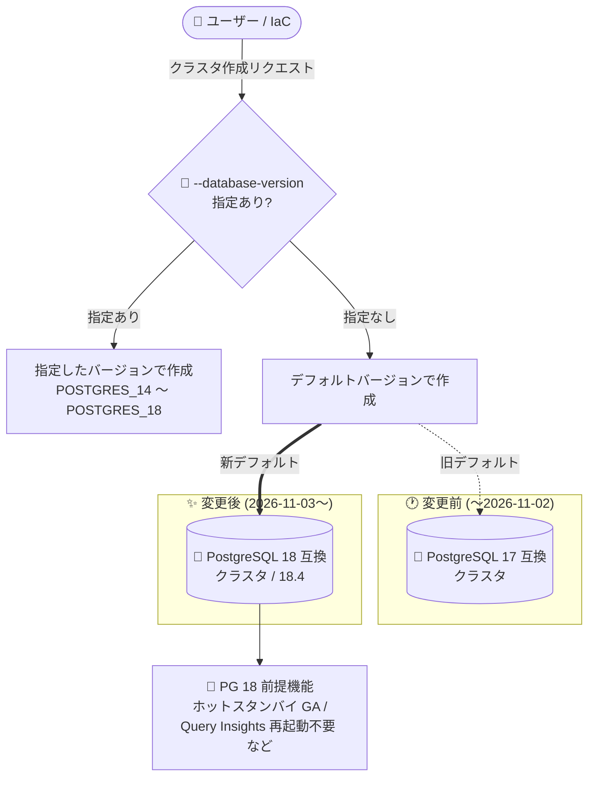

# AlloyDB for PostgreSQL: 新規クラスタのデフォルトが PostgreSQL 18 に変更

**リリース日**: 2026-11-03

**サービス**: AlloyDB for PostgreSQL

**機能**: 新規クラスタ作成時のデフォルトメジャーバージョンが PostgreSQL 18 に変更

**ステータス**: Change (デフォルト動作の変更)

📊 [このアップデートのインフォグラフィックを見る](https://takech9203.github.io/google-cloud-news-summary/20261103-alloydb-postgresql-18-default-version.html)

## 概要

AlloyDB for PostgreSQL において、新規クラスタ作成時のデフォルトの PostgreSQL メジャーバージョンが **PostgreSQL 18** に変更されました。クラスタ作成時にメジャーバージョンを明示的に指定しない場合、これまでは PostgreSQL 17 が選択されていましたが、今後は PostgreSQL 18 互換のクラスタが作成されます。

AlloyDB における PostgreSQL 18 互換は 2026 年 3 月に GA (一般提供) となっており、約 7 か月あまりの提供実績を経て、今回デフォルトバージョンに昇格した形です。PostgreSQL 18 では、AlloyDB 固有の機能強化 (ホットスタンバイによる HA 強化、Advanced Query Insights の再起動不要化、Iceberg データへの直接アクセスなど) の多くが前提とするバージョンでもあり、新規クラスタは最初から最新の機能セットを利用できる状態で開始できます。

この変更は新規クラスタ作成時のデフォルト値のみに影響します。既存クラスタのバージョンが自動的に変わることはなく、クラスタはライフタイムを通じて作成時のメジャーバージョンを維持します (ユーザーがメジャーバージョンアップグレードを実施した場合を除く)。

**アップデート前の課題**

- バージョンを指定せずにクラスタを作成すると、最新ではない PostgreSQL 17 互換のクラスタが作成されていた (2026 年 3 月 25 日からのデフォルト)
- PostgreSQL 18 を前提とする新機能 (ホットスタンバイ GA、Advanced Query Insights の再起動不要化など) を使うには、作成時に明示的に `--database-version=POSTGRES_18` を指定する必要があった
- デフォルトのまま作成したクラスタは、後日メジャーバージョンアップグレードの計画・実施が必要になるタイミングが相対的に早かった

**アップデート後の改善**

- バージョン未指定で作成した新規クラスタが、最新の GA メジャーバージョンである PostgreSQL 18 (マイナーバージョン 18.4) で開始されるようになった
- PostgreSQL 18 を必要とする AlloyDB の新機能群を、追加設定なしでデフォルトのまま利用できるようになった
- コミュニティのサポートライフサイクルに沿った、より長いサポート期間 (通常サポート + 3 年間の延長サポート) を新規クラスタがデフォルトで享受できるようになった

## アーキテクチャ図



クラスタ作成時にメジャーバージョンを指定しない場合の既定値が PostgreSQL 17 から PostgreSQL 18 に変わり、PostgreSQL 18 を前提とする AlloyDB の機能強化をデフォルトで利用できます。

## サービスアップデートの詳細

### 主要機能

1. **新規クラスタのデフォルトバージョンが PostgreSQL 18 に**
   - クラスタ作成時に `--database-version` を指定しない場合、PostgreSQL 18 互換のクラスタが作成される
   - 現時点の PostgreSQL 18 対応マイナーバージョンは 18.4 (インスタンス作成時は常にそのメジャーバージョン内の最新マイナーバージョンで起動)
   - 既存クラスタには影響なし。クラスタはユーザーがアップグレードしない限り作成時のメジャーバージョンを維持する

2. **PostgreSQL 18 のサポートタイムライン**
   - AlloyDB での通常サポート開始: 2026 年 3 月 18 日 (GA アナウンスは 3 月 25 日)
   - AlloyDB Omni での PostgreSQL 18 サポート GA: 2026 年 4 月 9 日
   - 延長サポート開始日・非推奨日は未設定 (現行の最新メジャーバージョンのため)

3. **PostgreSQL 18 を前提・活用する AlloyDB 機能**
   - ホットスタンバイ (HA 強化): PostgreSQL 18 で GA、新規インスタンスで自動有効化。フェイルオーバー時間の短縮とフェイルオーバー後の性能安定化を実現
   - Advanced Query Insights: PostgreSQL 18 以降では設定の有効化・変更にインスタンス再起動が不要 (17 以前は再起動が必要)
   - Iceberg データへの直接アクセス (Preview): PostgreSQL 18 以降で利用可能
   - AlloyDB Express (Preview): PostgreSQL 18 で提供

## 技術仕様

### AlloyDB がサポートする PostgreSQL バージョン (2026 年 11 月時点)

| PostgreSQL 互換メジャーバージョン | AlloyDB マイナーバージョン | 通常サポート開始 | 延長サポート開始 | 非推奨日 |
|----------------------------------|---------------------------|------------------|------------------|----------|
| PostgreSQL 18 (**デフォルト**) | 18.4 | 2026-03-18 | - | - |
| PostgreSQL 17 | 17.10 | 2025-09-22 | 2030-02-01 | 2033-02-01 |
| PostgreSQL 16 | 16.14 | 2024-10-23 | 2029-02-01 | 2032-02-01 |
| PostgreSQL 15 | 15.18 | 2024-01-19 | 2028-02-01 | 2031-02-01 |
| PostgreSQL 14 | 14.23 | 2022-12-12 | 2027-02-01 | 2030-02-01 |

### バージョンポリシーの要点

| 項目 | 詳細 |
|------|------|
| メジャーバージョンの選択 | クラスタ作成時に選択。以降はユーザーがアップグレードしない限り維持される |
| マイナーバージョン | Google Cloud が四半期ごとを目安に自動適用 (メンテナンスロールアウト時) |
| 通常サポート | コミュニティがサポートする期間 (5 年以上) はマイナー更新・セキュリティ修正を提供 |
| 延長サポート | コミュニティ EOL 後も 3 年間クラスタを継続稼働可能 |
| 非推奨後の扱い | 延長サポート終了時点で稼働中のクラスタは、デフォルトバージョンへ自動アップグレードされる |
| PostgreSQL 18 の制限 | スタンバイサーバーからの論理レプリケーションは非サポート |

## 設定方法

### 前提条件

1. AlloyDB API が有効化された Google Cloud プロジェクト
2. クラスタ作成権限 (例: `roles/alloydb.admin`)

### 手順

#### ステップ 1: バージョン未指定で作成 (PostgreSQL 18 が選択される)

```bash
gcloud alloydb clusters create my-cluster \
  --password=PASSWORD \
  --region=asia-northeast1 \
  --project=PROJECT_ID \
  --network=NETWORK
```

`--database-version` を省略すると、今回の変更によりデフォルトで PostgreSQL 18 互換のクラスタが作成されます。

#### ステップ 2: 従来のバージョンを明示的に指定する場合

```bash
gcloud alloydb clusters create my-cluster-pg17 \
  --database-version=POSTGRES_17 \
  --password=PASSWORD \
  --region=asia-northeast1 \
  --project=PROJECT_ID \
  --network=NETWORK
```

アプリケーションや拡張機能の互換性検証が完了していない場合は、`--database-version` に `POSTGRES_14` 〜 `POSTGRES_17` を明示指定することで従来バージョンを引き続き選択できます。

#### ステップ 3: 既存クラスタを PostgreSQL 18 にアップグレードする場合 (任意)

既存クラスタ (PostgreSQL 14 / 15 / 16 / 17) は、インプレースのメジャーバージョンアップグレードで PostgreSQL 18 へ移行できます。詳細は [インプレースメジャーバージョンアップグレード](https://docs.cloud.google.com/alloydb/docs/upgrade-db-inplace-major-version) を参照してください。

## メリット

### ビジネス面

- **サポート期間の最大化**: 新規クラスタが最新メジャーバージョンで開始されるため、次のメジャーバージョンアップグレードまでの猶予が最も長くなり、運用コストと移行リスクを低減できる
- **最新機能への即時アクセス**: ホットスタンバイによる高可用性強化など、PostgreSQL 18 前提の機能をデフォルトで利用でき、追加の意思決定が不要

### 技術面

- **運用の簡素化**: Advanced Query Insights の設定変更に再起動が不要 (PostgreSQL 18 以降) など、PostgreSQL 18 クラスタは運用面の改善を標準で享受できる
- **エコシステムとの整合**: 最新の AlloyDB 新機能 (Iceberg 直接アクセス、AlloyDB Express など) が PostgreSQL 18 を前提に提供されており、将来の機能採用がスムーズになる

## デメリット・制約事項

### 制限事項

- PostgreSQL 18 では、スタンバイサーバーからの論理レプリケーションがサポートされない (17 / 16 も同様)
- 既存クラスタのバージョンは自動では変更されない。PostgreSQL 18 へ移行するにはユーザー自身によるメジャーバージョンアップグレードが必要

### 考慮すべき点

- **IaC・自動化スクリプトへの影響**: Terraform や gcloud スクリプトでバージョンを明示指定していない場合、今後作成されるクラスタは PostgreSQL 18 になる。環境間 (既存 PG 17 クラスタとの混在など) でバージョン差異が生じないよう、バージョンの明示指定を推奨
- **互換性検証**: 利用中の拡張機能、ドライバ、アプリケーションが PostgreSQL 18 で動作することを、新規クラスタ作成前に確認する
- **バージョン統一方針**: 開発・ステージング・本番でバージョンを揃える運用の場合、デフォルト変更のタイミングに注意が必要

## ユースケース

### ユースケース 1: 新規アプリケーションのデータベース基盤構築

**シナリオ**: 新規サービス向けに AlloyDB クラスタを構築する。特定バージョンへの依存はなく、できるだけ長くメジャーバージョンアップグレードを避けたい。

**実装例**:
```bash
gcloud alloydb clusters create new-app-cluster \
  --password=PASSWORD \
  --region=asia-northeast1 \
  --project=PROJECT_ID
```

**効果**: バージョン未指定のままで PostgreSQL 18 クラスタが作成され、最長のサポートライフサイクルとホットスタンバイなどの最新機能を標準で利用できる。

### ユースケース 2: IaC テンプレートのバージョン固定

**シナリオ**: Terraform で複数環境の AlloyDB クラスタを管理しており、既存環境は PostgreSQL 17 で稼働している。デフォルト変更により新環境だけ PostgreSQL 18 になることを避けたい。

**実装例**:
```hcl
resource "google_alloydb_cluster" "main" {
  cluster_id       = "app-cluster"
  location         = "asia-northeast1"
  database_version = "POSTGRES_17" # 明示指定でデフォルト変更の影響を回避
  # ...
}
```

**効果**: デフォルトバージョンの変更に左右されず、環境間でメジャーバージョンを統一できる。PostgreSQL 18 への移行は検証完了後に計画的に実施できる。

## 料金

本アップデートはデフォルトバージョンの変更であり、料金体系への影響はありません。AlloyDB の料金は従来どおり vCPU・メモリ・ストレージ・ネットワークの使用量に基づきます。詳細は [AlloyDB 料金ページ](https://cloud.google.com/alloydb/pricing) を参照してください。

## 利用可能リージョン

デフォルトバージョンの変更は AlloyDB for PostgreSQL が提供されるすべてのリージョンに適用されます。リージョン一覧は [AlloyDB のロケーション](https://docs.cloud.google.com/alloydb/docs/locations) を参照してください。

## 関連サービス・機能

- **Database Migration Service**: 既存の PostgreSQL データベースを AlloyDB (PostgreSQL 18 クラスタを含む) へ移行する際に使用
- **AlloyDB Omni**: セルフマネージド版 AlloyDB。PostgreSQL 18 対応は 2026 年 4 月 9 日に GA (サポート期間は 2031 年 4 月 9 日まで)
- **Cloud SQL for PostgreSQL**: マネージド PostgreSQL の代替選択肢。バージョン戦略を比較検討する際の対象
- **AlloyDB ホットスタンバイ / Advanced Query Insights**: PostgreSQL 18 を前提に強化された HA・可観測性機能

## 参考リンク

- 📊 [インフォグラフィック](https://takech9203.github.io/google-cloud-news-summary/20261103-alloydb-postgresql-18-default-version.html)
- [公式リリースノート](https://docs.cloud.google.com/release-notes#November_03_2026)
- [AlloyDB データベースバージョンポリシー](https://docs.cloud.google.com/alloydb/docs/db-version-policies)
- [クラスタの作成](https://docs.cloud.google.com/alloydb/docs/cluster-create)
- [インプレースメジャーバージョンアップグレード](https://docs.cloud.google.com/alloydb/docs/upgrade-db-inplace-major-version)
- [料金ページ](https://cloud.google.com/alloydb/pricing)

## まとめ

AlloyDB for PostgreSQL の新規クラスタのデフォルトが PostgreSQL 18 に変更され、バージョン未指定で作成するクラスタは最新機能と最長のサポートライフサイクルを標準で利用できるようになりました。IaC やスクリプトでバージョンを明示指定していない場合は、新規作成されるクラスタのバージョンが変わるため、アプリケーションと拡張機能の PostgreSQL 18 互換性を確認し、必要に応じてバージョンを明示指定する運用に見直すことを推奨します。

---

**タグ**: AlloyDB, PostgreSQL, PostgreSQL 18, データベース, バージョンポリシー, デフォルト変更
