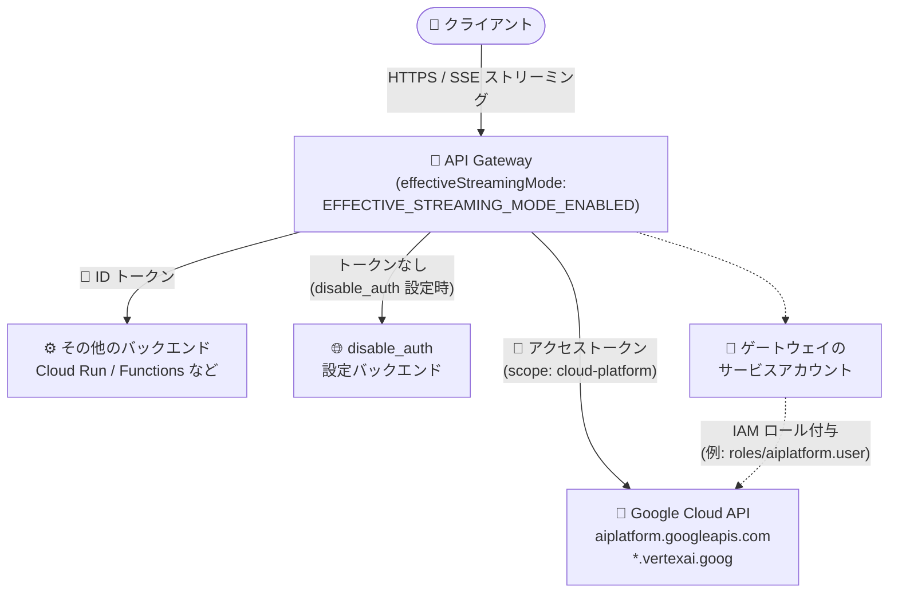

# API Gateway: ストリーミングゲートウェイから Google Cloud API の呼び出しが可能に

**リリース日**: 2026-11-03

**サービス**: API Gateway

**機能**: ストリーミングゲートウェイによる Google Cloud API (aiplatform.googleapis.com など) の呼び出し対応

**ステータス**: Feature (ストリーミング機能自体は Public Preview)

📊 [このアップデートのインフォグラフィックを見る](https://takech9203.github.io/google-cloud-news-summary/20261103-api-gateway-streaming-gateways-google-cloud-apis.html)

## 概要

API Gateway のストリーミングゲートウェイが、`aiplatform.googleapis.com` などの Google Cloud API をバックエンドとして呼び出せるようになりました。`effectiveStreamingMode` が `EFFECTIVE_STREAMING_MODE_ENABLED` のゲートウェイは、ホスト名が `.googleapis.com` または `.vertexai.goog` で終わるバックエンドに対して、ゲートウェイのサービスアカウントの**アクセストークン**で認証します。それ以外のバックエンドには従来どおり **ID トークン**が送信されます。

Google Cloud API はアクセストークンを要求し、API Gateway が他のバックエンドに送信する ID トークンを拒否するため、これまでゲートウェイ経由での Google Cloud API 呼び出しは 401 エラーで失敗していました。今回のアップデートにより、Gemini モデル (Agent Platform) のストリーミングレスポンスを API Gateway 経由でクライアントに中継するといった構成が、トークン変換用の中間プロキシなしで実現できます。

既存のストリーミングゲートウェイは、API Gateway が次回ゲートウェイアップデートをロールアウトした時点でこの動作に切り替わります。すぐに切り替えたい場合は、ゲートウェイを新しい API config に更新することで即時に適用されます。

**アップデート前の課題**

- Google Cloud API (例: `aiplatform.googleapis.com`、`bigquery.googleapis.com`) はアクセストークンを要求するが、API Gateway はバックエンドに ID トークンのみを送信していたため、ゲートウェイから Google Cloud API を直接呼び出すと 401 エラーで失敗していた
- Vertex AI / Agent Platform の Gemini モデルなどを API Gateway の背後に置くには、ID トークンをアクセストークンに変換する中間プロキシ (Cloud Run など) を自前で用意する必要があった

**アップデート後の改善**

- ストリーミングゲートウェイが `.googleapis.com` / `.vertexai.goog` で終わるホストのバックエンドに対して、ゲートウェイのサービスアカウントのアクセストークンで自動的に認証するようになった
- Gemini モデル (Agent Platform) からのストリーミングレスポンスを、API Gateway を経由してそのままクライアントに配信できるようになった
- 同一ゲートウェイ上のその他のバックエンドは引き続き ID トークンを受け取るため、既存のバックエンド認証構成に影響を与えずに Google Cloud API バックエンドを追加できる

## アーキテクチャ図



ストリーミングゲートウェイはバックエンドのホスト名に応じてトークンの種類を自動的に切り替えます。`.googleapis.com` / `.vertexai.goog` で終わるホストにはサービスアカウントのアクセストークン、それ以外には従来どおり ID トークンを送信します。

## サービスアップデートの詳細

### 主要機能

1. **Google Cloud API バックエンドへのアクセストークン認証**
   - ホスト名が `.googleapis.com` または `.vertexai.goog` で終わるバックエンドに対して、ゲートウェイのサービスアカウントのアクセストークンで認証する
   - アクセストークンのスコープは `https://www.googleapis.com/auth/cloud-platform` のみ。別の OAuth スコープを要求する API メソッドは呼び出せない
   - 対象バックエンドでは `jwt_audience` (OpenAPI 2.0) / `jwtAudience` (OpenAPI 3.x) フィールドは効果を持たない

2. **既存バックエンドとの共存**
   - 同一ゲートウェイ上のその他のバックエンド (Cloud Run、Cloud Run functions など) は引き続き ID トークンを受け取る
   - `disable_auth` (OpenAPI 2.0) / `disableAuth` (OpenAPI 3.x) を設定したバックエンドにはトークンが送信されない

3. **既存ゲートウェイの切り替えタイミング**
   - アクセストークンをまだ送信していない既存のストリーミングゲートウェイは、API Gateway が次回ゲートウェイアップデートをロールアウトした時点で新しい動作に切り替わる
   - 即時に切り替えるには、ゲートウェイを新しい API config に更新する

## 技術仕様

### トークン送信の動作

| バックエンド | ストリーミングゲートウェイが送信するトークン |
|------|------|
| ホストが `.googleapis.com` / `.vertexai.goog` で終わる | ゲートウェイのサービスアカウントのアクセストークン (scope: `cloud-platform` のみ) |
| その他のバックエンド | ID トークン (従来どおり) |
| `disable_auth` / `disableAuth` 設定済みバックエンド | トークンなし |
| 非ストリーミングゲートウェイ (`EFFECTIVE_STREAMING_MODE_DISABLED`) | Google Cloud API 呼び出しは非対応 (401 エラーになる場合がある) |

### ゲートウェイのストリーミング関連フィールド

| フィールド | 属性 | 値 |
|------|------|------|
| `streamingMode` | IMMUTABLE, OPTIONAL | `STREAMING_MODE_UNSPECIFIED` (デフォルト: サービスがモードを選択) / `STREAMING_MODE_ENABLED` |
| `effectiveStreamingMode` | OUTPUT_ONLY | `EFFECTIVE_STREAMING_MODE_DISABLED` / `EFFECTIVE_STREAMING_MODE_ENABLED` |

`streamingMode` は作成時に指定したリクエスト値を記録するのみで、実際にゲートウェイが動作しているモードは出力専用の `effectiveStreamingMode` で確認します。Model Router を構成した API config から作成されたゲートウェイは常にストリーミングゲートウェイになります。

## 設定方法

### 前提条件

1. ストリーミングが有効なゲートウェイ (`effectiveStreamingMode: EFFECTIVE_STREAMING_MODE_ENABLED`) であること。ストリーミングモードは作成時に決まり、後から変更できない
2. ゲートウェイのサービスアカウントに、呼び出し先の API が要求する IAM ロールを付与していること (例: Agent Platform (`aiplatform.googleapis.com`) の場合は `roles/aiplatform.user`)

### 手順

#### ステップ 1: ストリーミングを有効にしてゲートウェイを作成

```bash
gcloud api-gateway gateways create GATEWAY_ID \
  --api=API_ID \
  --api-config=CONFIG_ID \
  --location=GCP_REGION \
  --enable-streaming
```

ストリーミングはゲートウェイ作成時にのみ指定できます。明示的に無効化するフラグはなく、`--enable-streaming` を省略した場合は API config とプラットフォームのデフォルトからモードが解決されます。

#### ステップ 2: ストリーミングモードを確認

```bash
gcloud api-gateway gateways describe GATEWAY_ID \
  --location=GCP_REGION
```

出力に `effectiveStreamingMode: EFFECTIVE_STREAMING_MODE_ENABLED` が含まれていれば、ストリーミングが有効です。

#### ステップ 3: サービスアカウントに IAM ロールを付与

```bash
# 例: Agent Platform (aiplatform.googleapis.com) を呼び出す場合
gcloud projects add-iam-policy-binding PROJECT_ID \
  --member="serviceAccount:SA_EMAIL_ADDRESS" \
  --role="roles/aiplatform.user"
```

ゲートウェイの API config に関連付けたサービスアカウントに、呼び出し先 API が要求するロールを付与します。

#### ステップ 4: 既存ゲートウェイを即時切り替える場合

```bash
gcloud api-gateway gateways update GATEWAY_ID \
  --api=API_ID \
  --api-config=NEW_CONFIG_ID \
  --location=GCP_REGION
```

既存のストリーミングゲートウェイは次回のゲートウェイアップデートのロールアウトで自動的に切り替わりますが、新しい API config に更新することで即時に適用できます。

## メリット

### ビジネス面

- **中間プロキシの排除によるコスト・運用負荷の削減**: ID トークンをアクセストークンに変換するためだけの中間サービス (Cloud Run プロキシなど) が不要になり、構成がシンプルになる
- **生成 AI API の統一的な公開**: API Gateway の認証・API キー管理・レート制御の仕組みを使って、Gemini モデルなどの Google Cloud API をクライアントに公開できる

### 技術面

- **自動的なトークン種別の切り替え**: バックエンドのホスト名に基づいてアクセストークン / ID トークンが自動で使い分けられ、API config 側での特別なトークン設定が不要
- **ストリーミングとの組み合わせ**: SSE や HTTP チャンク転送と組み合わせて、Gemini モデルのトークン単位のストリーミングレスポンスをゲートウェイ経由でそのまま配信できる
- **最小権限の IAM 制御**: どの API を呼び出せるかはゲートウェイのサービスアカウントへの IAM ロール付与で制御でき、権限管理を一元化できる

## デメリット・制約事項

### 制限事項

- アクセストークンのスコープは `https://www.googleapis.com/auth/cloud-platform` のみのため、別の OAuth スコープを要求する API メソッドは呼び出せない
- 非ストリーミングゲートウェイ (`EFFECTIVE_STREAMING_MODE_DISABLED`) は Google Cloud API の呼び出しに対応しておらず、呼び出しは 401 エラーで失敗する場合がある
- ストリーミングモードは作成時に固定され、既存ゲートウェイの変更はできない (ストリーミング対応にするには新規作成が必要)
- ストリーミングゲートウェイは HTTP(S) Load Balancing / Serverless NEG と互換性がなく、Public Preview 期間中はカスタムドメインも利用できない
- Terraform でのストリーミング有効化は未対応 (将来のリリースで対応予定)

### 考慮すべき点

- 既存のストリーミングゲートウェイは、API Gateway の次回ゲートウェイアップデートのロールアウト時に自動的に新しい認証動作へ切り替わる。切り替えタイミングを自分で制御したい場合は、新しい API config への更新で即時適用する
- 対象バックエンドでは `jwt_audience` / `jwtAudience` フィールドが効果を持たなくなるため、既存の API config でこれらを設定している場合は動作の変化に注意する
- ゲートウェイのサービスアカウントに付与する IAM ロールは、呼び出し先 API が要求する最小限のロールに絞る
- ストリーミングの deadline はレスポンス全体に対する実時間の上限 (デフォルト 15 秒、最大 3,600 秒) であり、長いストリーミングレスポンスでは適切な値に調整が必要

## ユースケース

### ユースケース 1: Gemini モデルのストリーミングレスポンスをゲートウェイ経由で配信

**シナリオ**: モバイルアプリや Web アプリから Gemini モデル (Agent Platform) を利用する際に、API キー管理やレート制御を API Gateway で行いつつ、モデルの回答をトークン単位でストリーミング表示したい。

**実装例**:
```yaml
# OpenAPI 2.0 の抜粋: Google Cloud API をバックエンドに指定
paths:
  /generate:
    post:
      operationId: generateContent
      x-google-backend:
        address: https://aiplatform.googleapis.com/v1/projects/PROJECT_ID/locations/LOCATION/publishers/google/models/MODEL_ID:streamGenerateContent
```

**効果**: ゲートウェイがサービスアカウントのアクセストークンで `aiplatform.googleapis.com` に認証するため、トークン変換用の中間プロキシなしで、SSE によるストリーミングレスポンスをクライアントへ直接中継できる。

### ユースケース 2: 既存ゲートウェイに Google Cloud API バックエンドを追加

**シナリオ**: Cloud Run バックエンドを公開している既存のストリーミングゲートウェイに、BigQuery などの Google Cloud API を呼び出す新しいパスを追加したい。

**効果**: `.googleapis.com` で終わるホストにはアクセストークン、Cloud Run には従来どおり ID トークンが自動的に送り分けられるため、既存バックエンドの認証構成を変更することなく Google Cloud API バックエンドを追加できる。

## 料金

このアップデートに伴う API Gateway 自体の料金体系の変更はアナウンスされていません。API Gateway の料金は API 呼び出し数に基づく従量課金です。バックエンドとして呼び出す Google Cloud API (Vertex AI / Agent Platform など) の利用料金は別途発生します。

詳細は [API Gateway 料金ページ](https://cloud.google.com/api-gateway/pricing) を参照してください。

## 利用可能リージョン

リージョンごとの提供状況は公式ドキュメントで明示されていません。API Gateway の対応リージョンは [公式ドキュメント](https://cloud.google.com/api-gateway/docs/deployment-model) を参照してください。

## 関連サービス・機能

- **Vertex AI / Agent Platform (`aiplatform.googleapis.com`)**: 今回のアップデートの主要な呼び出し先。Gemini モデルのストリーミングレスポンスをゲートウェイ経由で配信できる。ゲートウェイのサービスアカウントに `roles/aiplatform.user` などのロール付与が必要
- **BigQuery (`bigquery.googleapis.com`)**: アクセストークンを要求する Google Cloud API の例として、ストリーミングゲートウェイからの呼び出しが可能
- **IAM**: ゲートウェイのサービスアカウントに対するロール付与で、呼び出せる Google Cloud API を制御する
- **Cloud Run / Cloud Run functions / App Engine**: 従来どおり ID トークンによる認証でゲートウェイから呼び出すバックエンドサービス

## 参考リンク

- 📊 [インフォグラフィック](https://takech9203.github.io/google-cloud-news-summary/20261103-api-gateway-streaming-gateways-google-cloud-apis.html)
- [公式リリースノート](https://docs.cloud.google.com/release-notes#November_03_2026)
- [Securing backend services (公式ドキュメント)](https://docs.cloud.google.com/api-gateway/docs/securing-backend-services)
- [Configure streaming for LLM responses and other traffic (公式ドキュメント)](https://docs.cloud.google.com/api-gateway/docs/streaming-configure)
- [Gateway リソースリファレンス (REST API)](https://docs.cloud.google.com/api-gateway/docs/reference/rest/v1/projects.locations.gateways)
- [料金ページ](https://cloud.google.com/api-gateway/pricing)

## まとめ

ストリーミングゲートウェイが Google Cloud API をアクセストークンで直接呼び出せるようになったことで、Gemini モデルなどの生成 AI API を API Gateway の背後に置く構成が中間プロキシなしで実現できます。既存のストリーミングゲートウェイは次回のゲートウェイアップデートで自動的に切り替わるため、`jwt_audience` を利用している構成では事前に影響を確認し、必要な IAM ロール (例: `roles/aiplatform.user`) をゲートウェイのサービスアカウントに付与しておくことを推奨します。

---

**タグ**: API Gateway, ストリーミング, Vertex AI, Agent Platform, 認証, アクセストークン, サービスアカウント, IAM, 生成 AI
