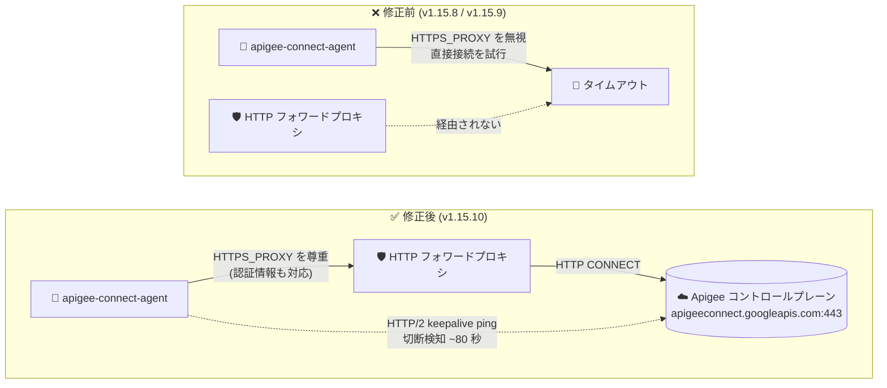

# Apigee hybrid: v1.15.10 パッチリリース (apigee-connect-agent のプロキシ対応修正とセキュリティ修正)

**リリース日**: 2026-11-03

**サービス**: Apigee hybrid

**機能**: v1.15.10 パッチリリース (Announcement / Fixed / Security)

**ステータス**: Announcement (パッチリリース)

📊 [このアップデートのインフォグラフィックを見る](https://takech9203.github.io/google-cloud-news-summary/20261103-apigee-hybrid-v1-15-10.html)

## 概要

2026 年 11 月 3 日、Google は Apigee hybrid ソフトウェアの更新版 v1.15.10 をリリースしました。これは v1.15 系のパッチリリースであり、コンテナイメージは Apigee hybrid Helm チャートに統合されているため、Helm チャートを使ってパッチへアップグレードするとイメージも自動的に更新されます。通常、手動でのイメージ変更は不要です。

本リリースの最重要ポイントは、`apigee-connect-agent` が環境変数 `HTTPS_PROXY` を無視し、Egress に HTTP フォワードプロキシを必須とするクラスタでコントロールプレーンとのテザー (接続) を確立できなくなる問題 (Bug ID: 578314600) の修正です。この問題は hybrid 1.14.9、1.15.8、1.15.9、1.16.11、1.16.12、1.17.1、1.17.2 に影響する既知の問題として公開されており、v1.15.10 (および 1.16.13、1.17.3) で修正されました。プロキシ経由でしか外部に出られない閉域ネットワーク環境で Apigee hybrid を運用しているユーザーにとって、必須のアップデートです。

さらに、侵害された emSign ルート証明書と、そのクロス署名に使われる Comodo AAA Services ルート証明書を全コンテナのシステムおよび Java (`cacerts`) トラストストアから削除する修正 (Bug ID: 576707253) と、`apigee-asm-ingress`、`apigee-asm-istiod`、`apigee-envoy`、`apigee-fluent-bit`、`apigee-hybrid-cassandra` など多数のコンポーネントにわたる CVE 対応のセキュリティ修正が含まれています。

**アップデート前の課題**

- 影響バージョン (1.15.8、1.15.9 など) では、`overrides.yaml` に `httpProxy` を設定していても、`apigee-connect-agent` に導入されたカスタム TCP キープアライブダイヤラーが gRPC 組み込みの HTTP CONNECT プロキシ処理をバイパスし、`apigeeconnect.googleapis.com:443` へ直接接続しようとしていた
- Egress がフォワードプロキシに制限されたクラスタでは接続がタイムアウトし、「no connections available from the Apigee connect agent(s)」エラーで管理プレーン操作 (デプロイ等) が失敗していた
- 侵害された emSign ルート証明書とクロス署名用 Comodo AAA Services ルート証明書がコンテナ内のトラストストアに残存しており、これらを連鎖させた不正な証明書を信頼してしまうリスクがあった
- 各コンポーネントのコンテナイメージに複数の既知 CVE が未修正のまま残っていた

**アップデート後の改善**

- `apigee-connect-agent` が `HTTPS_PROXY` (プロキシ認証情報を含む) を尊重するようになり、HTTP フォワードプロキシ必須のクラスタでもテザーを確立できるようになった
- コントロールプレーン接続に HTTP/2 キープアライブ ping を使用するようになり、サイレントに切断されたコネクションを従来の約 2 時間から約 80 秒で検知して再接続できるようになった
- 侵害された emSign ルートと Comodo AAA Services ルートが全コンテナのシステム / Java トラストストアから削除され、証明書ベースの攻撃リスクが低減した
- `apigee-asm-ingress`、`apigee-asm-istiod`、`apigee-envoy`、`apigee-fluent-bit`、`apigee-hybrid-cassandra`、`apigee-kube-rbac-proxy`、`apigee-operators`、`apigee-prom-prometheus`、`apigee-udca`、`apigee-watcher` の多数の CVE が修正された

## アーキテクチャ図



Egress がフォワードプロキシに制限されたクラスタにおける `apigee-connect-agent` の接続経路の Before/After を示しています。v1.15.10 では `HTTPS_PROXY` を経由してコントロールプレーンに到達でき、HTTP/2 キープアライブ ping により切断検知も約 2 時間から約 80 秒に短縮されます。

## サービスアップデートの詳細

### 主要機能

1. **apigee-connect-agent のフォワードプロキシ対応修正 (Bug ID: 578314600)**
   - `overrides.yaml` の `httpProxy` 設定により pod に設定される `HTTPS_PROXY` 環境変数を、エージェントが正しく尊重するように修正 (プロキシ認証情報も含めて対応)
   - 根本原因は、Bug 513032450 で導入されたカスタム TCP キープアライブダイヤラーが gRPC 組み込みの HTTP CONNECT プロキシ処理をバイパスしていたこと
   - 修正後はコントロールプレーン接続に HTTP/2 キープアライブ ping を使用し、サイレントドロップされた接続を約 80 秒 (従来は約 2 時間) で検知して再確立
   - 影響バージョン: hybrid 1.14.9 / 1.15.8 / 1.15.9 / 1.16.11 / 1.16.12 / 1.17.1 / 1.17.2。修正版は 1.15.10 / 1.16.13 / 1.17.3 (公式の回避策は修正版へのアップグレードで、1.16.12 と 1.17.2 は使用しないこと)

2. **侵害されたルート証明書のトラストストアからの削除 (Bug ID: 576707253)**
   - 侵害された emSign ルート証明書群を、全コンテナのシステムトラストストアおよび Java (`cacerts`) トラストストアから削除
   - emSign ルートへのクロス署名に使われる Comodo AAA Services ルート証明書も併せて削除
   - API プロキシのターゲット接続等で、これらのルートに連鎖する証明書が信頼されなくなる

3. **コンポーネント横断のセキュリティ (CVE) 修正**
   - サービスメッシュ、ログ収集、データストアなど広範なコンテナイメージの脆弱性を修正 (詳細は技術仕様の表を参照)

## 技術仕様

### 修正対象の CVE (コンポーネント別)

| コンポーネント | 修正された脆弱性 |
|------|------|
| apigee-asm-ingress | CVE-2026-116585, CVE-2026-116586, CVE-2026-63209 |
| apigee-asm-istiod | CVE-2026-116585, CVE-2026-116586, CVE-2026-40179, CVE-2026-42151, CVE-2026-42154, CVE-2026-44903, CVE-2026-63209 |
| apigee-envoy | CVE-2026-5450, CVE-2026-5928 |
| apigee-fluent-bit | CVE-2026-111497, CVE-2026-8286, CVE-2026-8924, CVE-2026-8927, CVE-2026-92392 |
| apigee-hybrid-cassandra | CVE-2026-56857, CVE-2026-56866, CVE-2026-78659, CVE-2026-78660, CVE-2026-78663, CVE-2026-78667, CVE-2026-78669, CVE-2026-94439, CVE-2026-94440, CVE-2026-94444, CVE-2026-94447, CVE-2026-94448, CVE-2026-97030, CVE-2026-97031, CVE-2026-97032 |
| apigee-kube-rbac-proxy | apigee-hybrid-cassandra と同一の CVE 群 |
| apigee-operators | CVE-2026-63209 |
| apigee-prom-prometheus | 上記 Cassandra の CVE 群 + CVE-2026-81870 |
| apigee-udca | CVE-2026-116585, CVE-2026-116586, CVE-2026-116587 |
| apigee-watcher | CVE-2026-63209 |

### リリース形態

| 項目 | 詳細 |
|------|------|
| バージョン | v1.15.10 (v1.15 系パッチリリース) |
| イメージ更新 | Helm チャートに統合。Helm でのアップグレードによりコンテナイメージも自動更新 (手動変更は通常不要) |
| Helm チャートリポジトリ | `oci://us-docker.pkg.dev/apigee-release/apigee-hybrid-helm-charts` |
| 修正 Bug ID | 578314600 (connect-agent プロキシ対応)、576707253 (ルート証明書削除) |
| 578314600 の影響バージョン | 1.14.9, 1.15.8, 1.15.9, 1.16.11, 1.16.12, 1.17.1, 1.17.2 |
| 578314600 の修正バージョン | 1.15.10, 1.16.13, 1.17.3 |

### フォワードプロキシ設定 (参考)

Apigee hybrid でフォワードプロキシを使用する場合は、`overrides.yaml` に以下のように設定します。

```yaml
envs:
  - name: test
    httpProxy:
      scheme: HTTP   # 大文字の HTTP が必須
      host: 10.12.0.47
      port: 3128
```

## 設定方法

### 前提条件

1. Apigee hybrid v1.15 系を運用中であること (v1.15 より古い場合は先に v1.15 へのアップグレードが必要)
2. Helm v3.14.2 以降、対応バージョンの kubectl / cert-manager
3. アップグレード前に Helm チャートディレクトリと Cassandra データベースのバックアップを取得しておくこと

### 手順

#### ステップ 1: v1.15.10 の Helm チャートを取得

```bash
export CHART_REPO=oci://us-docker.pkg.dev/apigee-release/apigee-hybrid-helm-charts
export CHART_VERSION=1.15.10

helm pull $CHART_REPO/apigee-operator --version $CHART_VERSION --untar
helm pull $CHART_REPO/apigee-datastore --version $CHART_VERSION --untar
helm pull $CHART_REPO/apigee-env --version $CHART_VERSION --untar
helm pull $CHART_REPO/apigee-ingress-manager --version $CHART_VERSION --untar
helm pull $CHART_REPO/apigee-org --version $CHART_VERSION --untar
helm pull $CHART_REPO/apigee-redis --version $CHART_VERSION --untar
helm pull $CHART_REPO/apigee-telemetry --version $CHART_VERSION --untar
helm pull $CHART_REPO/apigee-virtualhost --version $CHART_VERSION --untar
```

Google Artifact Registry から v1.15.10 のチャート一式をローカルに取得します。

#### ステップ 2: CRD を更新

```bash
# dry-run で検証
kubectl apply -k apigee-operator/etc/crds/default/ \
  --server-side --force-conflicts --validate=false --dry-run=server

# 問題がなければ適用
kubectl apply -k apigee-operator/etc/crds/default/ \
  --server-side --force-conflicts --validate=false
```

CRD のインストールは `kubectl apply -k` + `--server-side` が唯一サポートされる方法です。namespace が `apigee` 以外の場合は、事前に `apigee-operator/etc/crds/default/kustomization.yaml` の namespace を変更します。

#### ステップ 3: 各チャートを順番にアップグレード

```bash
helm upgrade operator apigee-operator/ \
  --install --namespace apigee --atomic -f overrides.yaml
# 以降、datastore → telemetry → redis → ingress-manager → org → env → virtualhost の順に実行
```

パッチリリースのため、Helm アップグレードによりコンテナイメージが自動的に v1.15.10 のものへ更新されます。詳細な手順とロールバック方法は公式のアップグレードガイドを参照してください。

## メリット

### ビジネス面

- **閉域環境での運用安定性**: フォワードプロキシ必須のエンタープライズ / 規制業種のネットワーク環境で、管理プレーン操作 (プロキシのデプロイ、構成変更) が失敗するリスクを解消
- **セキュリティコンプライアンス**: 侵害されたルート証明書の排除と広範な CVE 修正により、脆弱性監査・コンプライアンス要件への対応が容易になる

### 技術面

- **障害検知の高速化**: HTTP/2 キープアライブ ping により、サイレントに切断されたコントロールプレーン接続の検知が約 2 時間から約 80 秒に短縮され、自動再接続までの時間が大幅に改善
- **運用負荷の軽減**: パッチはコンテナイメージが Helm チャートに統合されているため、Helm アップグレードのみで完結し、手動のイメージ差し替えが不要
- **プロキシ認証対応**: `HTTPS_PROXY` の認証情報 (ユーザー名 / パスワード) を含めて正しく処理される

## デメリット・制約事項

### 制限事項

- v1.15 系のパッチであり、v1.15 より古いバージョンからはまず v1.15 へのメジャーアップグレードが必要
- Bug 578314600 の修正を得るには、1.16 系では 1.16.13、1.17 系では 1.17.3 が必要 (1.16.12 と 1.17.2 は使用しないよう公式に案内されている)

### 考慮すべき点

- emSign / Comodo AAA Services ルートの削除により、これらのルートに連鎖する証明書を使うターゲットバックエンドとの TLS 接続は失敗するようになる。該当するバックエンドがないか事前に確認が必要
- アップグレード前に Helm チャートディレクトリと Cassandra のバックアップ取得が推奨される
- アップグレード処理中は新しい環境 (environment) を作成しないこと

## ユースケース

### ユースケース 1: フォワードプロキシ必須の閉域クラスタでの管理プレーン接続復旧

**シナリオ**: 金融機関のオンプレミス Kubernetes クラスタで Apigee hybrid v1.15.9 を運用しており、Egress はすべて社内 HTTP フォワードプロキシ経由に制限されている。API プロキシのデプロイが「no connections available from the Apigee connect agent(s)」エラーで失敗する。

**実装例**:
```bash
# v1.15.10 へ Helm アップグレード後、connect agent の状態を確認
kubectl get pods -n apigee | grep apigee-connect-agent
kubectl logs -n apigee -l app=apigee-connect-agent --tail=50
```

**効果**: `apigee-connect-agent` が `HTTPS_PROXY` 経由でコントロールプレーンへのテザーを確立し、デプロイ等の管理プレーン操作が正常に動作する。

### ユースケース 2: 脆弱性スキャン指摘への一括対応

**シナリオ**: コンテナ脆弱性スキャナーが Apigee hybrid の Cassandra、Envoy、fluent-bit などのイメージに多数の CVE を検出し、セキュリティチームから対応期限が設定されている。

**効果**: v1.15.10 への Helm アップグレードのみで、10 コンポーネント以上にわたる CVE 修正と侵害ルート証明書の削除が一括適用され、個別イメージの差し替え作業なしに指摘を解消できる。

## 料金

Apigee hybrid のソフトウェアアップデート自体に追加料金は発生しません。Apigee の料金はサブスクリプション (Standard / Enterprise / Enterprise Plus) または従量課金 (Pay-as-you-go) に基づきます。詳細は [Apigee 料金ページ](https://cloud.google.com/apigee/pricing) を参照してください。

## 利用可能リージョン

Apigee hybrid のランタイムはユーザー管理の Kubernetes クラスタ (GKE、他クラウド、オンプレミス) 上で動作するため、ランタイムのリージョン制約はクラスタの配置に依存します。対応プラットフォームは [Supported platforms](https://docs.cloud.google.com/apigee/docs/hybrid/supported-platforms) を参照してください。

## 関連サービス・機能

- **Apigee Connect**: ランタイムプレーンとコントロールプレーン (`apigeeconnect.googleapis.com`) を接続するテザー機構。今回の修正 (578314600) の対象
- **Apigee hybrid フォワードプロキシ設定**: `overrides.yaml` の `httpProxy` / `envs[].httpProxy` によるプロキシ経由の Egress 制御。今回の修正で connect agent もこの構成下で正しく動作する
- **Google Artifact Registry**: Apigee hybrid Helm チャートのホスティング先 (`oci://us-docker.pkg.dev/apigee-release/apigee-hybrid-helm-charts`)
- **cert-manager**: Apigee hybrid の証明書管理に使用。アップグレード時にサポートバージョンの確認が必要

## 参考リンク

- 📊 [インフォグラフィック](https://takech9203.github.io/google-cloud-news-summary/20261103-apigee-hybrid-v1-15-10.html)
- [公式リリースノート](https://docs.cloud.google.com/release-notes#November_03_2026)
- [Apigee hybrid リリースノート](https://docs.cloud.google.com/apigee/docs/hybrid/release-notes)
- [Apigee 既知の問題 (578314600)](https://docs.cloud.google.com/apigee/docs/release/known-issues)
- [Apigee hybrid v1.15 へのアップグレード](https://docs.cloud.google.com/apigee/docs/hybrid/v1.15/upgrade)
- [フォワードプロキシの構成 (v1.15)](https://docs.cloud.google.com/apigee/docs/hybrid/v1.15/forward-proxy)
- [Apigee リリースプロセス (コンテナイメージサポート)](https://docs.cloud.google.com/apigee/docs/release/apigee-release-process#apigee-hybrid-container-images)
- [料金ページ](https://cloud.google.com/apigee/pricing)

## まとめ

Apigee hybrid v1.15.10 は、フォワードプロキシ必須環境での管理プレーン接続断という重大な既知の問題 (578314600) の修正と、侵害ルート証明書の削除を含む広範なセキュリティ修正をまとめたパッチリリースです。特に v1.15.8 / v1.15.9 をプロキシ経由の閉域クラスタで運用している場合は接続障害の影響を直接受けるため、速やかな適用を強く推奨します。それ以外の環境でも CVE 修正の観点から、計画的な Helm アップグレードを検討してください。

---

**タグ**: Apigee hybrid, パッチリリース, セキュリティ, CVE, フォワードプロキシ, Apigee Connect, Helm, 証明書, Kubernetes
