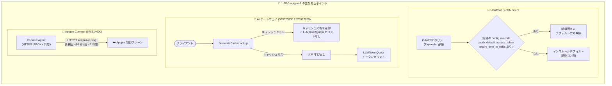

# Apigee X: ランタイムアップデート 1-18-0-apigee-8 (セキュリティ修正 + 複数のバグ修正)

**リリース日**: 2026-11-03

**サービス**: Apigee X

**機能**: ランタイムバージョン 1-18-0-apigee-8 (セキュリティ修正、OAuthV2 トークン有効期限のオーバーライド、MCP プロキシ認識改善、LLMTokenQuota 修正、Apigee Connect 接続性改善)

**ステータス**: Announcement / Security / Fixed

📊 [このアップデートのインフォグラフィックを見る](https://takech9203.github.io/google-cloud-news-summary/20261103-apigee-x-update-1-18-0-apigee-8.html)

## 概要

2026 年 11 月 3 日、Google Cloud は Apigee のランタイム更新バージョン **1-18-0-apigee-8** をリリースした。ロールアウトは同日に開始され、すべての Google Cloud ゾーンへの展開完了までに 4 営業日以上かかる場合がある。ロールアウトが完了するまで、インスタンスによっては本リリースの機能や修正が利用できない可能性がある。

本リリースには、Apigee インフラストラクチャに対するセキュリティ修正に加えて、4 件の機能改善・バグ修正が含まれる。特に注目すべきは、(1) OAuthV2 ポリシーでアクセストークンのデフォルト有効期限を組織単位でオーバーライドできる構成トークンの追加、(2) MCP (Model Context Protocol) プロキシの basepath に依存しない認識、(3) SemanticCacheLookup がキャッシュから応答を返した場合に LLMTokenQuota がトークンをカウントしなくなった修正、(4) Apigee Connect エージェントの HTTP/2 キープアライブによる接続断検出の大幅な高速化 (約 2 時間 → 約 80 秒) である。

AI/LLM プロキシ (MCP、セマンティックキャッシュ、トークンクォータ) 関連の修正が多く含まれており、Apigee を AI ゲートウェイとして利用している組織、および HTTP フォワードプロキシ経由で制御プレーンに接続するネットワーク構成の組織にとって重要なアップデートである。

**アップデート前の課題**

- OAuthV2 ポリシーで `<ExpiresIn>` を省略した場合、インストールデフォルト (通常 30 日) のトークン有効期限が適用され、組織単位でこのデフォルト値を変更する手段がなかった
- `<ProxyOperationMode>MCP` を宣言したプロキシでも、basepath によっては MCP プロキシとして認識されないケースがあった
- SemanticCacheLookup がキャッシュから応答を返した場合でも、LLMTokenQuota がトークンをカウントしてしまい、実際には LLM を呼び出していないリクエストがクォータを消費していた
- Apigee Connect エージェントは制御プレーン接続がサイレントに切断された場合、検出までに約 2 時間かかり、プロキシ必須 (proxy-only) のクラスタで接続が長時間失われる可能性があった

**アップデート後の改善**

- 構成オーバーライドトークン `oauth_default_access_token_expiry_time_in_millis` (デプロイメント契約経由で組織単位に設定) により、ポリシーが `<ExpiresIn>` を省略した場合のデフォルトアクセストークン有効期限 (ミリ秒) をオーバーライド可能になった。未設定時の動作は従来通り変更なし
- `<ProxyOperationMode>MCP` を宣言したプロキシは、basepath に関係なく MCP プロキシとして認識されるようになった
- LLMTokenQuota は、SemanticCacheLookup がキャッシュから返した応答のトークンをカウントせず、それらに対して `ai_llm_response_token_count` も記録しなくなった
- Apigee Connect エージェントが制御プレーン接続に HTTP/2 キープアライブ ping を使用し、サイレントな接続断を約 80 秒で検出 (従来は約 2 時間)。`HTTPS_PROXY` (プロキシ認証情報を含む) も尊重されるため、プロキシ専用クラスタが接続を確実に再確立できるようになった

## アーキテクチャ図



本リリースの 3 つの主要な修正領域を示す。OAuthV2 のデフォルトトークン有効期限の組織単位オーバーライド、セマンティックキャッシュヒット時のトークンクォータ非消費、Apigee Connect の接続断検出の高速化がポイントである。

## サービスアップデートの詳細

### セキュリティ修正

1. **Apigee インフラストラクチャのセキュリティ修正** (Bug ID: N/A)
   - Apigee インフラストラクチャに対するセキュリティ修正が適用された
   - 個別の CVE 番号は公表されていない
   - あわせてインフラストラクチャおよびライブラリの更新も含まれる

### 主要なバグ修正・機能改善

1. **OAuthV2 デフォルトアクセストークン有効期限のオーバーライド (574037227)**
   - 構成オーバーライドトークン `oauth_default_access_token_expiry_time_in_millis` が追加された
   - デプロイメント契約 (deployment contract) 経由で組織 (per-org) 単位に設定する
   - OAuthV2 ポリシーが `<ExpiresIn>` 要素を省略した場合に適用されるデフォルトのアクセストークン有効期限 (ミリ秒) をオーバーライドする
   - 未設定の場合は従来通りの動作 (インストールデフォルト、通常 30 日) で変更なし

2. **MCP プロキシ認識の改善 (573326336)**
   - `<ProxyOperationMode>MCP` を宣言したプロキシが、basepath に関係なく MCP プロキシとして認識されるようになった
   - 以前は basepath によって MCP プロキシとして扱われないケースがあった

3. **LLMTokenQuota とセマンティックキャッシュの整合性 (576697209)**
   - SemanticCacheLookup ポリシーがキャッシュから応答を返した場合、LLMTokenQuota はそのトークンをカウントしなくなった
   - キャッシュヒットした応答については `ai_llm_response_token_count` も記録されない
   - 実際に LLM を呼び出していないリクエストがトークンクォータを消費する問題が解消された

4. **Apigee Connect エージェントの接続性改善 (578314600)**
   - 制御プレーン接続に HTTP/2 キープアライブ ping を使用するようになった
   - サイレントに切断された接続を約 80 秒で検出 (従来は約 2 時間)
   - `HTTPS_PROXY` 環境変数 (プロキシ認証情報を含む) を尊重するため、HTTP フォワードプロキシ経由でしか外部通信できない (proxy-only) クラスタでも接続を確実に再確立できる

## 技術仕様

### リリース情報

| 項目 | 詳細 |
|------|------|
| リリースバージョン | 1-18-0-apigee-8 |
| リリース日 | 2026 年 11 月 3 日 |
| ロールアウト期間 | 全 Google Cloud ゾーンへ 4 営業日以上かけて展開 |
| 対象 | Apigee X (Google 管理のランタイム) |
| 適用方法 | Google 側で自動適用 (ユーザー操作不要) |

### 修正一覧

| Bug ID | 種別 | 内容 |
|--------|------|------|
| N/A | Security | Apigee インフラストラクチャのセキュリティ修正 |
| 574037227 | Fixed | `oauth_default_access_token_expiry_time_in_millis` 構成オーバーライドトークンの追加 |
| 573326336 | Fixed | MCP プロキシを basepath に関係なく認識 |
| 576697209 | Fixed | セマンティックキャッシュヒット時に LLMTokenQuota がトークンをカウントしない |
| 578314600 | Fixed | Apigee Connect エージェントの HTTP/2 キープアライブと HTTPS_PROXY 対応 |
| N/A | Fixed | インフラストラクチャおよびライブラリの更新 |

### OAuthV2 の `<ExpiresIn>` とデフォルト有効期限の関係

公式ドキュメントによると、OAuthV2 ポリシーの `<ExpiresIn>` 要素はアクセストークンの有効期限をミリ秒単位で指定する。省略した場合は「システムレベルで構成されたデフォルト値」が適用される。本リリースで、このシステムデフォルトを組織単位でオーバーライドする手段が提供された。

```xml
<!-- ExpiresIn を明示的に指定する場合 (従来通り推奨) -->
<OAuthV2 name="GenerateAccessToken">
  <Operation>GenerateAccessToken</Operation>
  <ExpiresIn>3600000</ExpiresIn> <!-- 1 時間 (ミリ秒) -->
  <SupportedGrantTypes>
    <GrantType>client_credentials</GrantType>
  </SupportedGrantTypes>
</OAuthV2>

<!-- ExpiresIn を省略した場合:
     従来: インストールデフォルト (通常 30 日)
     今後: 組織に oauth_default_access_token_expiry_time_in_millis が
           設定されていればその値が適用される -->
```

## メリット

### ビジネス面

- **セキュリティポスチャの向上**: ポリシー側の記述漏れで長期有効 (30 日) のトークンが発行されるリスクを、組織レベルの設定で一括して低減できる。「長いトークン有効期限」は Apigee の公式アンチパターンとしても知られている
- **AI ゲートウェイのコスト管理の正確化**: セマンティックキャッシュで応答したリクエストがトークンクォータを消費しなくなったため、キャッシュ導入によるコスト削減効果がクォータとアナリティクスに正しく反映される

### 技術面

- **運用の安定性向上**: Apigee Connect の接続断検出が約 2 時間から約 80 秒に短縮され、制御プレーンとの接続性 (デプロイ、管理操作) のダウンタイムが大幅に減少
- **エンタープライズネットワークとの親和性**: `HTTPS_PROXY` (認証付きプロキシを含む) を尊重するため、フォワードプロキシ経由でのみ外部接続を許可する企業ネットワークでも Apigee Connect が確実に動作
- **MCP プロキシ設計の自由度向上**: basepath の制約なしに `<ProxyOperationMode>MCP` 宣言だけで MCP プロキシとして認識されるため、既存の URL 設計を崩さずに MCP 対応が可能

## デメリット・制約事項

### 制限事項

- ロールアウト完了まで 4 営業日以上かかる場合があり、完了までは自組織のインスタンスで本リリースの修正が利用できない可能性がある
- `oauth_default_access_token_expiry_time_in_millis` はデプロイメント契約経由での設定であり、ユーザーがコンソールからセルフサービスで設定する手順は現時点でリリースノートに記載されていない (設定方法の詳細は Google Cloud サポート/ドキュメントで確認が必要)
- セキュリティ修正の詳細 (CVE 番号など) は公表されていない

### 考慮すべき点

- 既存の OAuthV2 ポリシーで `<ExpiresIn>` を明示的に指定している場合、本オーバーライドの影響は受けない (ポリシーの指定が優先)
- 組織単位のデフォルト有効期限を変更した場合、`<ExpiresIn>` を省略しているすべてのプロキシの新規発行トークンに影響するため、適用前に影響範囲の確認が必要
- LLMTokenQuota の修正により、セマンティックキャッシュのヒット率が高い環境ではクォータ消費量・`ai_llm_response_token_count` のメトリクスが従来より減少する。レポートやアラートの基準値を見直すことを推奨

## ユースケース

### ユースケース 1: 組織全体でのトークン有効期限ガバナンス

**シナリオ**: 多数の API プロキシを運用する組織で、一部のプロキシが OAuthV2 ポリシーの `<ExpiresIn>` を指定し忘れており、30 日間有効なアクセストークンが発行されていた。セキュリティ監査で短縮を求められている。

**効果**: `oauth_default_access_token_expiry_time_in_millis` を組織単位で設定することで、個々のプロキシを修正せずにデフォルト有効期限を一括で短縮できる。`<ExpiresIn>` を明示しているプロキシの動作は変わらないため、段階的なガバナンス強化が可能。

### ユースケース 2: セマンティックキャッシュ併用時の正確なトークンクォータ運用

**シナリオ**: Apigee を LLM ゲートウェイとして利用し、SemanticCacheLookup/SemanticCachePopulate でコスト削減しつつ、LLMTokenQuota でアプリごとのトークン消費量を制限している。従来はキャッシュヒットでもクォータが消費され、キャッシュ導入のメリットがクォータに反映されなかった。

**効果**: キャッシュヒットした応答はクォータを消費しなくなり、実際の LLM 利用量に基づいた正確なクォータ制御が可能になる。キャッシュヒット率の高いアプリはより多くのリクエストを処理できる。

### ユースケース 3: フォワードプロキシ必須環境での Apigee Connect 安定運用

**シナリオ**: セキュリティポリシー上、すべての外部通信を認証付き HTTP フォワードプロキシ経由に制限している企業で、Apigee Connect の制御プレーン接続がサイレントに切断されると最大 2 時間接続が失われ、プロキシのデプロイや管理操作が滞っていた。

**効果**: HTTP/2 キープアライブ ping により接続断を約 80 秒で検出し、`HTTPS_PROXY` (認証情報付き) を尊重して自動的に再接続するため、proxy-only クラスタでも制御プレーン接続が安定する。

## 料金

本アップデートはランタイムのセキュリティ修正・バグ修正であり、料金への直接的な影響はない。Apigee の料金体系 (サブスクリプション / Pay-as-you-go) の詳細は料金ページを参照。

なお、LLMTokenQuota は Extensible ポリシーであり、ライセンスによってはコストや使用量に影響する場合がある。

- [Apigee 料金ページ](https://cloud.google.com/apigee/pricing)

## 利用可能リージョン

すべての Google Cloud ゾーンに順次ロールアウトされる。ロールアウトは 2026 年 11 月 3 日に開始され、完了までに 4 営業日以上かかる場合がある。

## 関連サービス・機能

- **OAuthV2 ポリシー**: アクセストークンの生成・検証を行う Apigee のコアポリシー。本リリースでデフォルト有効期限の組織単位オーバーライドが可能になった
- **Apigee MCP (Model Context Protocol)**: 既存の Apigee API を MCP ツールとしてエージェント型アプリケーションに公開する機能。本リリースで MCP プロキシの認識が basepath 非依存になった
- **SemanticCacheLookup / SemanticCachePopulate ポリシー**: Vertex AI の Text Embeddings API と Vector Search を使い、意味的に類似したプロンプトへの応答をキャッシュから返すポリシー
- **LLMTokenQuota ポリシー**: LLM 応答のトークン消費量をカウント・制限するポリシー。AI ワークロードのコスト管理に使用
- **Apigee Connect**: 管理プレーン (制御プレーン) とランタイムプレーン間のセキュアな通信を担うコンポーネント。MART エンドポイントをインターネットに公開せずに接続できる
- **Apigee hybrid**: 同日に v1.15.10 がリリースされ、同じ Apigee Connect の修正 (578314600) が含まれている

## 参考リンク

- 📊 [インフォグラフィック](https://takech9203.github.io/google-cloud-news-summary/20261103-apigee-x-update-1-18-0-apigee-8.html)
- [公式リリースノート](https://docs.cloud.google.com/release-notes#November_03_2026)
- [OAuthV2 ポリシーリファレンス](https://docs.cloud.google.com/apigee/docs/api-platform/reference/policies/oauthv2-policy)
- [MCP in Apigee 概要](https://docs.cloud.google.com/apigee/docs/api-platform/apigee-mcp/apigee-mcp-overview)
- [LLMTokenQuota ポリシーリファレンス](https://docs.cloud.google.com/apigee/docs/api-platform/reference/policies/llm-token-quota-policy)
- [セマンティックキャッシュポリシーのチュートリアル](https://docs.cloud.google.com/apigee/docs/api-platform/tutorials/using-semantic-caching-policies)
- [Apigee 料金ページ](https://cloud.google.com/apigee/pricing)

## まとめ

Apigee 1-18-0-apigee-8 は、セキュリティ修正に加えて、OAuth トークン有効期限のガバナンス強化、AI ゲートウェイ機能 (MCP、セマンティックキャッシュ、トークンクォータ) の整合性改善、Apigee Connect の接続性改善を含む実用的なメンテナンスリリースである。Google 管理のランタイムのため適用作業は不要だが、セマンティックキャッシュと LLMTokenQuota を併用している場合はメトリクスの変化を、`<ExpiresIn>` を省略した OAuthV2 ポリシーを持つ組織は新しいオーバーライド設定の活用を確認することを推奨する。

---

**タグ**: Apigee X, セキュリティ, OAuthV2, MCP, LLMTokenQuota, SemanticCache, Apigee Connect, API 管理, AI ゲートウェイ
