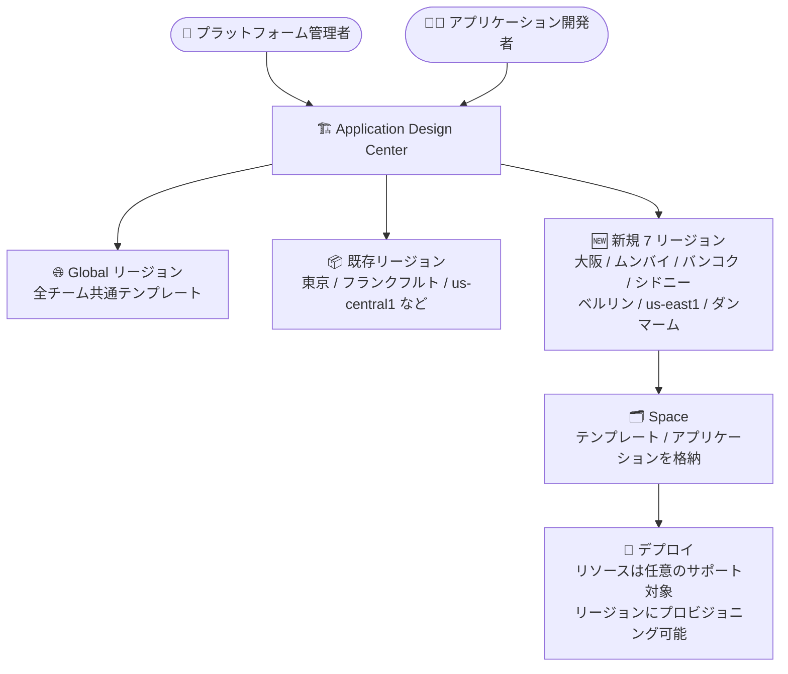

# Application Design Center: 7 リージョンへの提供拡大 (大阪・ムンバイ・バンコク・シドニーなど)

**リリース日**: 2026-11-03

**サービス**: Application Design Center

**機能**: 利用可能リージョンの拡大 (7 リージョン追加)

**ステータス**: 提供開始 (リージョン拡大)

📊 [このアップデートのインフォグラフィックを見る](https://takech9203.github.io/google-cloud-news-summary/20261103-application-design-center-regional-expansion.html)

## 概要

Application Design Center (App Design Center) が新たに 7 つのリージョンで利用可能になりました。追加されたのは、大阪 (asia-northeast2)、ムンバイ (asia-south1)、バンコク (asia-southeast3)、シドニー (australia-southeast1)、ベルリン (europe-west10)、サウスカロライナ州モンクスコーナー (us-east1)、ダンマーム (me-central2) の各リージョンです。

Application Design Center は、プラットフォームチームと開発チームが Google Cloud 上のアプリケーションを設計・デプロイするためのサービスです。プラットフォームチームが組織標準に準拠したテンプレートを作成・共有することで、開発者はガバナンスを維持しながら迅速にアプリケーションをデプロイできます。テンプレートやアプリケーションはグローバルリージョンまたはサポート対象のリージョンに保存でき、チームやワークロードの要件に基づいてリージョンを選択・管理できます。

今回の拡大により、日本では東京 (asia-northeast1) に加えて大阪 (asia-northeast2) が利用可能になり、国内 2 リージョン構成でのテンプレート・アプリケーション管理が可能になりました。データレジデンシー要件を持つ組織や、既存ワークロードに近いリージョンで設計資産を管理したい組織にとって重要なアップデートです。

**アップデート前の課題**

- 日本では東京 (asia-northeast1) のみが利用可能で、大阪リージョンにテンプレートやアプリケーションを保存できなかった
- インド (ムンバイ)、タイ (バンコク)、オーストラリア (シドニー)、ドイツ (ベルリン)、サウジアラビア (ダンマーム)、米国 us-east1 の各リージョンを主に利用する組織は、設計資産を他リージョンまたはグローバルリージョンに保存する必要があった
- 厳格なデータレジデンシー要件を持つ組織では、ワークロードと同一ロケーションでの設計資産管理ができないケースがあった

**アップデート後の改善**

- 大阪 (asia-northeast2) を含む 7 リージョンでテンプレート・アプリケーションの保存が可能になった
- 日本 (東京/大阪)、インド (デリー/ムンバイ)、オーストラリア (メルボルン/シドニー)、ドイツ (フランクフルト/ベルリン) で国内複数リージョンの選択肢が得られた
- タイ (バンコク) とサウジアラビア (ダンマーム) のユーザーが国内リージョンで App Design Center を利用できるようになった

## アーキテクチャ図

テンプレートとアプリケーションの保存先として新たに 7 リージョンが選択可能になりました。Space はリージョンごとに管理されますが、デプロイされる Google Cloud リソース自体は任意のサポート対象リージョンにプロビジョニングできます。

## サービスアップデートの詳細

### 主要機能

1. **7 リージョンの追加**
   - 大阪 (asia-northeast2)、ムンバイ (asia-south1)、バンコク (asia-southeast3)、シドニー (australia-southeast1)、ベルリン (europe-west10)、モンクスコーナー (us-east1)、ダンマーム (me-central2) が追加
   - 各リージョンにテンプレート・コンポーネント・アプリケーションドラフトを保存可能

2. **リージョンごとの Space 管理**
   - App Design Center のセットアップ時に、利用可能な各リージョンにデフォルトの Space が作成される
   - コンソールのリージョンリストからリージョンを切り替えて、各リージョンのテンプレート・アプリケーション・カタログを表示・管理できる
   - 「Manage regions」でリージョン横断の Space サマリー (テンプレート数・アプリケーション数) を確認可能

3. **保存リージョンとデプロイ先の分離**
   - アプリケーションは作成元の Space から管理され続けるが、基盤となる Google Cloud リソースは任意のサポート対象リージョンにプロビジョニング可能
   - グローバルリージョンは、全開発チームへのテンプレート共有や、複数リージョンにまたがるアプリケーションに利用できる

## 技術仕様

### 今回追加されたリージョン

| リージョン | リージョン名 | エリア |
|------|------|------|
| 大阪 (日本) | asia-northeast2 | アジア太平洋 |
| ムンバイ (インド) | asia-south1 | アジア太平洋 |
| バンコク (タイ) | asia-southeast3 | アジア太平洋 |
| シドニー (オーストラリア) | australia-southeast1 | アジア太平洋 |
| ベルリン (ドイツ) | europe-west10 | ヨーロッパ |
| モンクスコーナー (サウスカロライナ州) | us-east1 | 南北アメリカ |
| ダンマーム (サウジアラビア) | me-central2 | 中東 |

### リージョン管理に必要なロール

| タスク | 必要なロール |
|------|------|
| リージョン横断での Space の選択・表示・管理 | Application Design Center Admin (`roles/designcenter.admin`) |
| 初期セットアップ・新規 Space の作成 | Application Design Center Admin (`roles/designcenter.admin`) |

ロールは app-enabled フォルダまたは管理プロジェクトに対して付与します。

## 設定方法

### 前提条件

1. App Design Center の [初期セットアップ](https://docs.cloud.google.com/application-design-center/docs/setup) が完了していること
2. app-enabled フォルダまたは管理プロジェクトに対して Application Design Center Admin (`roles/designcenter.admin`) ロールを持っていること

### 手順

#### ステップ 1: リージョンの選択

1. App Design Center のナビゲーションメニューで「Region」リストをクリックし、利用可能なリージョンを表示する
2. 利用するリージョン名 (例: asia-northeast2) をクリックして、そのリージョンの Space を開く

#### ステップ 2: リージョン横断の確認・切り替え

1. 「Region」リストから「Manage regions」を選択すると、各リージョンのテンプレート数・アプリケーション数のサマリーが表示される
2. 別リージョンのリソースを表示するには、「Actions」列の「Switch to this region」をクリックする

## メリット

### ビジネス面

- **データレジデンシー対応**: テンプレート・アプリケーションの設計資産を国内リージョン (日本なら東京/大阪) に保存でき、データ所在地要件への対応が容易になる
- **新興市場でのガバナンス強化**: タイ・サウジアラビアなどのリージョンでも、組織標準に準拠したテンプレートベースのアプリケーションデリバリーを国内リージョンで実現できる

### 技術面

- **ワークロードとの近接性**: 既存ワークロードが稼働するリージョンと同じロケーションで設計資産を管理できる
- **柔軟なデプロイ**: Space の保存リージョンに関わらず、デプロイするリソースは任意のサポート対象リージョンにプロビジョニングできるため、マルチリージョン構成の設計も妨げない

## デメリット・制約事項

### 考慮すべき点

- Space 内で作成したテンプレート・アプリケーションはその Space 内でのみ利用可能。他の Space と共有するには、カタログにテンプレートを追加してカタログを共有する必要がある
- 「Manage regions」のサマリーテーブルには、過去に開いたことのあるリージョンのみが表示される
- 複数リージョンにまたがるアプリケーションや全チーム共通のテンプレートには、引き続きグローバルリージョンの利用が推奨される

## ユースケース

### ユースケース 1: 日本国内でのデータレジデンシー要件対応

**シナリオ**: 国内の金融機関が、アプリケーション設計資産を日本国内に保存するポリシーのもとで App Design Center を活用したい。

**効果**: 東京 (asia-northeast1) に加えて大阪 (asia-northeast2) が利用可能になり、国内リージョンのみでテンプレート管理とアプリケーションデプロイの運用を構成できる。関西圏のワークロードに近いリージョンでの管理も可能になる。

### ユースケース 2: 新規提供国でのプラットフォームエンジニアリング展開

**シナリオ**: タイやサウジアラビアに拠点を持つグローバル企業が、現地開発チーム向けにセルフサービス型のアプリケーションデプロイ基盤を整備したい。

**効果**: バンコク (asia-southeast3) やダンマーム (me-central2) で現地リージョンに Space を構成し、プラットフォームチームが検証済みテンプレートをカタログ経由で共有することで、現地チームがガバナンスを維持したままアプリケーションを迅速にデプロイできる。

## 料金

リージョン追加自体による料金変更の情報はリリースノートに記載されていません。料金の詳細は公式の料金ページを参照してください。

- [Application Design Center の料金](https://docs.cloud.google.com/products/application-design-center/pricing)

## 利用可能リージョン

今回の追加により、App Design Center はグローバルリージョンに加えて、アジア太平洋・ヨーロッパ・南北アメリカ・中東アフリカの各リージョンで利用できます。利用可能なリージョンの全一覧は [App Design Center locations](https://cloud.google.com/application-design-center/docs/locations) を参照してください。

今回追加された 7 リージョン:

- 大阪 (asia-northeast2)
- ムンバイ (asia-south1)
- バンコク (asia-southeast3)
- シドニー (australia-southeast1)
- ベルリン (europe-west10)
- モンクスコーナー、サウスカロライナ州 (us-east1)
- ダンマーム (me-central2)

## 関連サービス・機能

- **App Hub**: App Design Center と同様にアプリケーション中心の管理を提供するサービスで、アプリケーションをグローバルまたはリージョナルとして定義する
- **Security Command Center**: テンプレートにセキュリティフレームワークをアタッチし、デザインキャンバス上でアプリケーション設計をセキュリティポリシーに対して検証できる (Preview)
- **Cloud Storage**: App Design Center のセットアップ時に、アプリケーション情報を保存するバケットが作成される
- **Gemini Cloud Assist**: 自然言語チャットによるアプリケーション設計の支援に利用できる

## 参考リンク

- 📊 [インフォグラフィック](https://takech9203.github.io/google-cloud-news-summary/20261103-application-design-center-regional-expansion.html)
- [公式リリースノート](https://cloud.google.com/application-design-center/docs/release-notes)
- [App Design Center locations](https://cloud.google.com/application-design-center/docs/locations)
- [リージョンの選択と管理 (Manage spaces)](https://docs.cloud.google.com/application-design-center/docs/manage-spaces#select-region)
- [Application Design Center 概要](https://docs.cloud.google.com/application-design-center/docs/overview)
- [料金ページ](https://docs.cloud.google.com/products/application-design-center/pricing)

## まとめ

Application Design Center が大阪を含む 7 リージョンに拡大され、日本国内では東京・大阪の 2 リージョン構成でテンプレート・アプリケーションの管理が可能になりました。データレジデンシー要件やワークロードとの近接性を重視する組織は、コンソールのリージョンリストから新リージョンの Space を確認し、設計資産の保存先リージョンを見直すことを推奨します。

---

**タグ**: Application Design Center, リージョン拡大, 大阪, asia-northeast2, データレジデンシー, プラットフォームエンジニアリング, テンプレート
