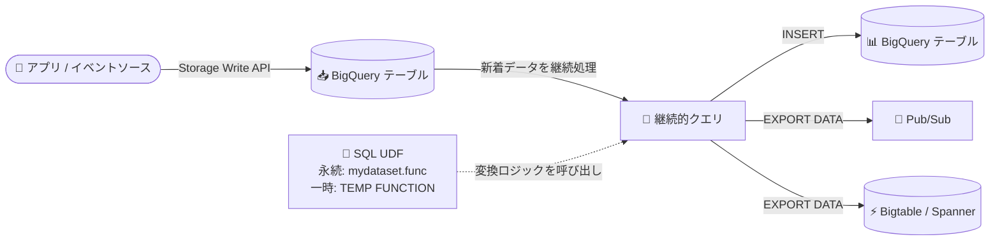

# BigQuery: 継続的クエリ (Continuous Queries) で SQL UDF がサポート

**リリース日**: 2026-11-03

**サービス**: BigQuery

**機能**: 継続的クエリにおける永続 / 一時 SQL ユーザー定義関数 (UDF) のサポート

**ステータス**: 一般提供 (Feature)

📊 [このアップデートのインフォグラフィックを見る](https://takech9203.github.io/google-cloud-news-summary/20261103-bigquery-continuous-queries-sql-udf.html)

## 概要

BigQuery の継続的クエリ (Continuous Queries) で、永続 (persistent) および一時 (temporary) の SQL ユーザー定義関数 (UDF) が利用可能になりました。これにより、リアルタイムデータ処理におけるカスタム変換ロジックを UDF としてカプセル化し、複数の継続的クエリ間で再利用できるようになります。

継続的クエリは、BigQuery テーブルに到着するデータを継続的に処理し、結果を BigQuery テーブル、Pub/Sub、Bigtable、Spanner などへリアルタイムに出力する機能です。従来、継続的クエリでは UDF の利用がサポートされておらず、カスタム変換ロジックはクエリ本文に直接記述する必要がありました。今回のアップデートにより、SQL UDF を使ってロジックを部品化し、ストリーミングパイプラインの保守性と再利用性を高めることができます。

なお、継続的クエリでサポートされるのは **SQL UDF のみ** です。JavaScript UDF や Python UDF は引き続き継続的クエリでは利用できません。

**アップデート前の課題**

- 継続的クエリでは UDF の利用がサポートされておらず、ドキュメント上も明示的に非サポートの SQL 機能として記載されていた
- カスタム変換ロジック (データクレンジング、正規化、マスキングなど) を継続的クエリごとにクエリ本文へ直接記述する必要があり、同じロジックの重複記述が発生していた
- UDF を参照するビューも継続的クエリの対象にできなかったため、既存のバッチクエリ資産 (UDF ベースの変換ロジック) をリアルタイム処理に流用しづらかった

**アップデート後の改善**

- `CREATE FUNCTION` で作成した永続 SQL UDF を継続的クエリから呼び出せるようになり、データセットに集約した共通変換ロジックをバッチ / リアルタイムの両方で再利用できるようになった
- `CREATE TEMP FUNCTION` による一時 SQL UDF も利用可能になり、単一の継続的クエリ内で複雑な式を関数として整理できるようになった
- 変換ロジックの一元管理により、ロジック変更時の修正箇所が UDF 定義のみで済み、ストリーミングパイプラインの保守性が向上した

## アーキテクチャ図



継続的クエリが BigQuery テーブルへの新着データをリアルタイムに処理する際、SQL UDF にカプセル化した変換ロジックを呼び出し、結果を BigQuery / Pub/Sub / Bigtable / Spanner へ出力する構成です。

## サービスアップデートの詳細

### 主要機能

1. **永続 SQL UDF のサポート**
   - `CREATE FUNCTION dataset.function_name(...)` で作成した SQL UDF を継続的クエリから呼び出し可能
   - データセット単位で UDF を管理し、複数の継続的クエリや通常のバッチクエリ間でロジックを共有できる
   - UDF 定義を更新するだけで、参照するパイプラインのロジックを一元的に変更可能 (継続的クエリ自体の SQL は実行中に変更できないため、反映にはジョブの再起動が必要)

2. **一時 SQL UDF のサポート**
   - `CREATE TEMP FUNCTION` を継続的クエリの SQL 内で定義して利用可能
   - 単一クエリ内に閉じた複雑な式の整理や、デプロイ単位を自己完結させたい場合に有効

3. **SQL UDF のみサポート (スコープの明確化)**
   - 継続的クエリでサポートされるのは SQL 式で定義された UDF のみ
   - JavaScript UDF は継続的クエリでは利用不可

## 技術仕様

### 継続的クエリにおける UDF サポート

| 項目 | 詳細 |
|------|------|
| サポートされる UDF | SQL UDF (永続 / 一時) |
| サポートされない UDF | JavaScript UDF |
| 永続 UDF の参照 | データセット修飾名で呼び出し (例: `mydataset.my_func(col)`) |
| 一時 UDF の定義 | 継続的クエリの SQL 内で `CREATE TEMP FUNCTION` を使用 |
| 実行要件 | Enterprise / Enterprise Plus エディションの予約 (CONTINUOUS 割り当てタイプ) |
| 課金モデル | 容量ベース課金のみ (オンデマンド課金は非対応) |

### SQL UDF の例 (継続的クエリでの利用イメージ)

```sql
-- 永続 SQL UDF: 共通の変換ロジックをデータセットに定義
CREATE OR REPLACE FUNCTION mydataset.mask_email(email STRING)
RETURNS STRING
AS (
  CONCAT(SUBSTR(email, 1, 2), '***@', SPLIT(email, '@')[SAFE_OFFSET(1)])
);

-- 継続的クエリから永続 UDF を呼び出してリアルタイム変換
INSERT INTO mydataset.masked_events (event_id, masked_email, event_time)
SELECT
  event_id,
  mydataset.mask_email(email) AS masked_email,
  event_time
FROM mydataset.raw_events;
```

## 設定方法

### 前提条件

1. Enterprise または Enterprise Plus エディションで、`CONTINUOUS` 割り当てタイプの予約 (Reservation) を作成済みであること
2. 継続的クエリを長時間 (最大 150 日) 実行する場合はサービスアカウントでの実行を構成すること (ユーザーアカウントでは最大 2 日)
3. 永続 UDF を使う場合、クエリ対象データと同じリージョンのデータセットに UDF を作成しておくこと

### 手順

#### ステップ 1: 永続 SQL UDF を作成する

```sql
CREATE OR REPLACE FUNCTION mydataset.normalize_amount(amount NUMERIC, currency STRING)
RETURNS NUMERIC
AS (
  CASE currency
    WHEN 'JPY' THEN amount
    WHEN 'USD' THEN amount * 150
    ELSE NULL
  END
);
```

変換ロジックを SQL 式としてデータセットに登録します。

#### ステップ 2: 継続的クエリから UDF を呼び出す

```bash
bq query --use_legacy_sql=false \
  --job_timeout_ms=0 \
  --continuous=true \
  'INSERT INTO mydataset.normalized_sales (id, amount_jpy, ts)
   SELECT id, mydataset.normalize_amount(amount, currency), ts
   FROM mydataset.raw_sales'
```

`--continuous=true` を指定して継続的クエリとして実行し、SQL UDF でリアルタイム変換を行います。

## メリット

### ビジネス面

- **開発・保守コストの削減**: 変換ロジックを UDF として一元管理することで、仕様変更時の修正箇所を最小化し、パイプラインの変更リードタイムを短縮できる
- **バッチとリアルタイムのロジック統一**: 既存のバッチクエリで使用している SQL UDF をリアルタイム処理でも共有でき、集計結果の不整合リスクを低減できる

### 技術面

- **ロジックのカプセル化と再利用**: 複雑な変換式を関数化し、複数の継続的クエリから呼び出すことでクエリの可読性が向上する
- **ガバナンスの向上**: 永続 UDF はデータセット単位で権限管理・共有でき、チーム横断で標準化された変換ロジックを提供できる

## デメリット・制約事項

### 制限事項

- 継続的クエリで利用できるのは SQL UDF のみで、JavaScript UDF は利用できない
- 継続的クエリの実行には Enterprise / Enterprise Plus エディションの予約 (CONTINUOUS 割り当てタイプ) が必須で、オンデマンド課金では実行できない
- CONTINUOUS 割り当ての予約は最大 500 スロットに制限される (上限緩和は問い合わせが必要)
- 実行中の継続的クエリの SQL は変更できないため、UDF 定義を更新しても実行中ジョブには反映されず、ジョブの再起動が必要

### 考慮すべき点

- 永続 UDF はクエリを実行するリージョンごとに作成・維持する必要がある (クロスリージョンのデータセットレプリケーションで同期する方法もある)
- 一時的な障害時には継続的クエリの自動再処理により出力に重複データが発生する可能性があるため、UDF の変換結果を受け取る下流システムは冪等に設計する
- UDF に複雑なロジックを詰め込みすぎると、ストリーミング処理のスループットやスロット消費に影響する可能性があるため、処理内容はシンプルに保つ

## ユースケース

### ユースケース 1: PII マスキングの標準化によるリアルタイムデータ共有

**シナリオ**: EC サイトのイベントストリームを BigQuery に取り込み、個人情報 (メールアドレス、電話番号) をマスキングした上で分析用テーブルと Pub/Sub 経由の下流システムにリアルタイム配信したい。マスキングルールは全社共通で管理したい。

**実装例**:
```sql
INSERT INTO analytics.masked_events (event_id, masked_email, event_time)
SELECT
  event_id,
  security_ds.mask_email(email),  -- 全社共通の永続 SQL UDF
  event_time
FROM raw.events;
```

**効果**: マスキングロジックを `security_ds` データセットの UDF に集約することで、ルール変更時も UDF の更新 (+ ジョブ再起動) だけで全パイプラインに適用でき、コンプライアンス対応が容易になる。

### ユースケース 2: バッチとリアルタイムで共通の KPI 変換ロジックを利用

**シナリオ**: 日次バッチ集計で使用している売上正規化 UDF (通貨換算、税抜処理など) を、リアルタイムダッシュボード向けの継続的クエリでも使用し、バッチとリアルタイムで数値の定義を一致させたい。

**効果**: 同一の SQL UDF を両方のパイプラインで参照することで、集計定義の二重管理を排除し、ダッシュボードと日次レポートの数値不整合を防止できる。

## 料金

SQL UDF の利用自体に追加料金はありません。継続的クエリは容量ベース課金 (BigQuery Editions) のみに対応しており、Enterprise または Enterprise Plus エディションの予約で消費したスロットに対して課金されます。オンデマンド課金 (スキャン量ベース) は利用できません。

- 継続的クエリはスロットの自動スケーリングに対応しており、アイドル時は最小限 (通常 1 スロット程度) の消費に抑えられる
- 新規ジョブの受付には継続的クエリ 1 ジョブあたり 10 スロットのしきい値が必要

詳細は [BigQuery の料金ページ](https://cloud.google.com/bigquery/pricing) を参照してください。

## 利用可能リージョン

継続的クエリがサポートされるリージョンについては、[BigQuery のロケーション (continuous query locations)](https://docs.cloud.google.com/bigquery/docs/locations#continuous-query-loc) を参照してください。永続 UDF はクエリを実行するリージョンに存在する必要があります。

## 関連サービス・機能

- **Pub/Sub**: 継続的クエリの `EXPORT DATA` 先。UDF で変換したデータをリアルタイムに下流アプリケーションへ配信できる
- **Bigtable / Spanner**: 継続的クエリの出力先として、低レイテンシなサービングレイヤー (リバース ETL) を構築できる
- **BigQuery Reservations (Editions)**: 継続的クエリの実行に必須の CONTINUOUS 割り当てタイプの予約を管理する
- **BigQuery ML / 生成 AI 関数**: 継続的クエリでは `AI.GENERATE` や `ML.TRANSLATE` などもサポートされており、SQL UDF と組み合わせたリアルタイム AI パイプラインを構築できる

## 参考リンク

- 📊 [インフォグラフィック](https://takech9203.github.io/google-cloud-news-summary/20261103-bigquery-continuous-queries-sql-udf.html)
- [公式リリースノート](https://docs.cloud.google.com/release-notes#November_03_2026)
- [継続的クエリの概要 (公式ドキュメント)](https://docs.cloud.google.com/bigquery/docs/continuous-queries-introduction)
- [ユーザー定義関数 (UDF) のドキュメント](https://docs.cloud.google.com/bigquery/docs/user-defined-functions)
- [料金ページ](https://cloud.google.com/bigquery/pricing)

## まとめ

継続的クエリで SQL UDF が利用可能になったことで、これまでクエリごとに重複記述していたリアルタイム変換ロジックをカプセル化・再利用できるようになり、バッチとストリーミングで変換定義を統一できます。BigQuery 上でストリーミングパイプラインを運用しているチームは、共通ロジックの UDF 化によるパイプラインの整理を検討することを推奨します。JavaScript UDF は対象外である点にのみ注意が必要です。

---

**タグ**: BigQuery, Continuous Queries, UDF, SQL, ストリーミング, リアルタイム処理, データパイプライン
