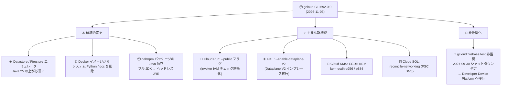

# Cloud SDK: gcloud CLI 592.0.0 リリース (破壊的変更とマルチサービスアップデート)

**リリース日**: 2026-11-03

**サービス**: Cloud SDK (gcloud CLI)

**機能**: バージョン 592.0.0 リリース

**ステータス**: GA (一部機能は Beta / Preview)

📊 [このアップデートのインフォグラフィックを見る](https://takech9203.github.io/google-cloud-news-summary/20261103-cloud-sdk-592-0-0.html)

## 概要

2026 年 11 月 3 日、Google Cloud CLI (gcloud) のバージョン 592.0.0 がリリースされた。本リリースには、Datastore / Firestore エミュレータの Java 25 以上必須化や Debian ベース Docker イメージからのシステム Python・C コンパイラの削除といった **破壊的変更 (Breaking Changes)** が含まれており、CI/CD パイプラインやローカル開発環境で gcloud の Docker イメージやエミュレータを利用しているチームは特に注意が必要である。

機能追加の面でも幅広いサービスにわたる更新が含まれる。代表的なものとして、Cloud Run サービスを Invoker IAM チェック無効化によって公開する `--public` フラグ (Beta)、既存 GKE クラスタの Dataplane V2 移行を開始する `--enable-dataplane-v2` フラグ、Cloud KMS の ECDH 鍵カプセル化メカニズム (KEM) アルゴリズム対応、Cloud SQL の PSC DNS ネットワーキング再調整コマンドなどがある。また、**Firebase Test Lab の非推奨化** (`gcloud firebase test` コマンドグループの Deprecated 化、2027 年 9 月 30 日に完全シャットダウン予定) という重要なアナウンスも含まれている。

本レポートは、gcloud CLI を日常的に利用する開発者、CI/CD パイプラインの管理者、および各サービスの運用担当者を対象に、592.0.0 の変更点を整理する。

**アップデート前の課題**

- Datastore / Firestore エミュレータは Java 21 で動作していたが、最新エミュレータの保守対象 Java バージョンが分散していた
- gcloud の Debian ベース Docker イメージにはシステム Python (python3) と gcc が同梱されており、イメージサイズの肥大化と脆弱性対応面でのオーバーヘッドがあった
- Cloud Run サービスを公開するには IAM ポリシーで `allUsers` に `roles/run.invoker` を付与する方法が一般的で、ドメイン制限共有の組織ポリシー下では公開設定が煩雑だった (`--no-invoker-iam-check` 相当の操作が必要)
- 既存 GKE クラスタを Dataplane V1 から Dataplane V2 へ移行するには、クラスタの再作成とワークロードの移設が必要だった
- `gcloud datastream private-connections create` でユーザー指定の `--labels` が暗黙的に無視される不具合があった
- Cloud Shell への `scp` はパスワードレス認証に対応しておらず、SSH 公開鍵のアップロードが前提だった

**アップデート後の改善**

- エミュレータの実行環境が Java 25 以上に統一され、deb/rpm パッケージの Java 依存もフル JDK からヘッドレス JRE に軽量化された
- Docker イメージから不要なシステム Python / gcc が削除され、gcloud / gsutil / bq は常にバンドル版 Python で動作するようになった (amd64 / arm64 共通)
- `gcloud beta run deploy --public` により、Invoker IAM チェックと IAP を無効化してサービスを公開する操作が 1 フラグで可能になった
- `gcloud container clusters update --enable-dataplane-v2` により、既存クラスタをインプレースで GKE Dataplane V2 へ移行開始できるようになった (Preview)
- Datastream の `--labels` ドロップ問題、Backup DR の `--backup-rules-from-file` の不具合、Compute Engine のトラブルシューティングリンク欠落などが修正された
- Cloud Shell の `scp` / `ssh` が TCP トンネル経由のパスワードレス認証に対応した

## アーキテクチャ図



592.0.0 リリースの変更点を「破壊的変更」「主要な新機能」「非推奨化」の 3 カテゴリに整理した全体像。CI/CD で gcloud Docker イメージやエミュレータを使う場合は破壊的変更の影響確認が最優先となる。

## サービスアップデートの詳細

### 破壊的変更 (Breaking Changes)

1. **Datastore / Firestore エミュレータ: Java 25 以上が必須に**
   - `gcloud beta emulators datastore start` および `gcloud emulators firestore start` は、Java 25 未満の環境での実行サポートが削除された
   - 対応策: Java 25 以上へアップグレードするか、Java 21 サポートが必要な場合は旧バージョンの gcloud CLI を使い続ける

2. **Docker イメージ: システム Python と C コンパイラを削除**
   - Debian ベースの Docker イメージからシステム Python と gcc が削除され、gcloud / gsutil / bq は linux/amd64・linux/arm64 の両方で常にバンドル版 Python で動作する
   - 削除パッケージはイメージごとに異なる: `:latest` / `:slim` / `:debian_component_based` では `python3`, `python3-dev`, `python3-pip`, `python3-crcmod`, `gcc`。`:emulators` では `python3`, `python3-crcmod`。`:stable` では linux/arm64 のみ `python3-dev`, `python3-crcmod`
   - `CLOUDSDK_PYTHON=python3` (または `CLOUDSDK_GSUTIL_PYTHON` / `CLOUDSDK_BQ_PYTHON`) を設定していると、PATH 上に python3 が存在しないため **すべての gcloud / gsutil / bq 呼び出しが失敗する**。該当環境変数は unset すること
   - ワークフローでシステム Python が必要な場合は `apt-get install python3` をイメージに追加する (C 拡張のコンパイルが必要なら `build-essential python3-dev` も)

3. **Google Cloud CLI パッケージの Java 依存変更**
   - `google-cloud-cli-datastore-emulator`、`google-cloud-cli-firestore-emulator`、`google-cloud-cli-pubsub-emulator`、`google-cloud-cli-app-engine-java`、`google-cloud-cli-bqms` の deb / rpm パッケージの Java 依存が、フル JDK からヘッドレス JRE (Java 25 を優先) に変更された
   - Datastore / Firestore エミュレータのパッケージは Java 25 以上が必須

### 非推奨化: Firebase Test Lab

- `gcloud firebase test` コマンドグループが Deprecated となった。Firebase Test Lab 自体が非推奨となり、**2027 年 9 月 30 日に完全シャットダウン** される予定
- テストワークフローを維持するには、Google Cloud の Developer Device Platform への移行が案内されている ([移行ガイド](https://docs.cloud.google.com/developer-device-platform/device-run/migrate) / [FAQ](https://docs.cloud.google.com/developer-device-platform/troubleshooting))

### 主要な新機能・変更点 (サービス別)

1. **Cloud Run: `--public` フラグ (Beta)**
   - `gcloud beta run deploy`、`gcloud beta run services update`、`gcloud beta run multi-region-services update` に `--public` フラグが追加された
   - Invoker IAM チェックと Identity-Aware Proxy (IAP) を無効化することでサービスを公開する。`allUsers` への IAM ロール付与が制限されるドメイン制限共有の組織ポリシー下でも、推奨方式 (Invoker IAM チェック無効化) で公開設定ができる

2. **Kubernetes Engine: Dataplane V2 移行とネットワーキング強化**
   - `gcloud container clusters update --enable-dataplane-v2`: 既存クラスタの GKE Dataplane V2 移行を開始 (Preview 機能。VPC ネイティブクラスタ、バージョン 1.35.3-gke.1155000 以降などの要件あり)
   - `gcloud container node-pools update --datapath-provider`: ノードプール単位でデータパスプロバイダを更新 (移行の手動加速やロールバックに利用)
   - `--enable-ambient-networking` フラグが `clusters create` / `create-auto` / `clusters update` で GA に昇格

3. **Cloud KMS: ECDH 鍵カプセル化メカニズム**
   - KEM アルゴリズム `kem-ecdh-p256` と `kem-ecdh-p384` がサポートされた

4. **Cloud SQL: PSC DNS ネットワーキングの再調整**
   - `gcloud sql instances reconcile-networking` が追加され、Private Service Connect (PSC) の DNS ネットワーキング設定をインスタンスに対して再調整できるようになった

5. **Cloud Firestore エミュレータ v1.23.0**
   - Datastore モードでの merge join と複数不等式インデックス選択 (`--require-indexes`) をサポート
   - Firestore Pipelines API の `add_window_fields` ステージ (sum / average / count / minimum / maximum / first / last / array_agg / array_agg_distinct / rank ウィンドウ関数) をサポート
   - すべてのデータベースエディションで Enterprise データ型を許可。トランザクション競合検出などの不具合修正も含む
   - 最小必須 Java バージョンが 25 に更新

6. **データベース・分析系の更新**
   - **AlloyDB**: `gcloud alloydb connect` の Auth Proxy インストール手順を v1.17.2 に更新。オートスケーラー関連フラグ群 (`--enable-autoscaler` ほか) が GA に昇格、`--autoscaler-target-connections-count` 追加
   - **Cloud Bigtable**: `--automated-backup-keep-hot-duration` フラグで、指定期間ホット状態を維持してから標準バックアップに移行する自動バックアップを作成可能に
   - **BigLake**: Hive カタログの CMEK 対応 (`--kms-key` / `--clear-kms-key`)、Iceberg カタログの Workday OIDC 認証対応 (いずれも Beta)
   - **Cloud Dataplex**: データドキュメンテーション生成を誘導する `--custom-instructions` フラグと `--sql-dialect` フラグを datascans に追加
   - **Cloud Dataproc**: Dynamic Workload Scheduler (DWS) スケジュールクラスタ作成用の `--scheduling-timeout` / `--requested-run-duration` フラグを追加
   - **Cloud Datastream**: `private-connections create` で `--labels` が暗黙的に破棄される不具合を修正

7. **運用・セキュリティ系の更新**
   - **Cloud Backup DR**: `applied-auto-protection-policies`、`auto-protection-bindings`、`auto-protection-policies`、`binding-matching-resources` の各コマンドが GA に昇格。`--location` フラグのデフォルト値 (`-`) が削除され必須化
   - **BeyondCorp**: `--dispatch-info-output-type` フラグ追加。`gcloud beta beyondcorp app` / `client-connector` コマンドグループは削除
   - **Network Security**: SecurityProfile / SecurityProfileGroup の YAML スキーマが WildFire Analysis をサポート (Beta / GA)
   - **Cloud Infrastructure Manager**: `--tf-version-constraint` または構成が有償 Terraform バージョン (1.6.0 以降) を指定した場合に警告を表示
   - **Cloud Workstations**: クラスタ作成・更新に `--direct-access-ports` フラグ追加 (Beta)
   - **Cloud Shell**: `scp` が TCP トンネル経由のパスワードレス認証に対応、`ssh` はパスワードレス接続時に SSH 公開鍵アップロードをスキップ

8. **その他のサービス更新**
   - **Agent Registry**: `skills create` / `update` から `--scanning-state` フラグを削除 (`--scanning-policy` を使用)
   - **App Engine**: Java SDK を v5.2.0 に更新。`gcloud beta app migrate-to-run` に `--from-image` / `--destination-repository` を追加。`app.yaml` の `vpc_access` 設定に対応し、Standard 環境での Direct VPC egress が可能に
   - **App Hub**: `applications create` の `--scope-type` に `MULTI_REGIONAL` を追加
   - **Artifact Registry**: `attachments download` で添付ファイル名が `--destination` 書き込み前に検証されない問題を修正
   - **Compute Engine**: オペレーションエラーメッセージからトラブルシューティングドキュメントのリンクが欠落する問題を修正。`--reservation-subblock` フラグが GA / Beta に昇格

## 技術仕様

### 破壊的変更の影響範囲

| 項目 | 変更前 | 変更後 (592.0.0) |
|------|--------|------------------|
| Datastore / Firestore エミュレータの Java 要件 | Java 21 で動作可能 | Java 25 以上が必須 |
| Docker イメージのシステム Python | `:latest` 等に python3 / gcc 同梱 | 削除。バンドル版 Python のみで動作 |
| `CLOUDSDK_PYTHON=python3` 設定時の挙動 (Docker) | システム Python を使用 | すべての呼び出しが失敗 (unset が必要) |
| emulator / app-engine-java 等パッケージの Java 依存 | フル JDK | ヘッドレス JRE (Java 25 優先) |
| `gcloud firebase test` | 利用可能 | Deprecated (2027-09-30 シャットダウン予定) |

### Cloud Run `--public` フラグと従来方式の比較

| 方式 | コマンド例 | ドメイン制限共有ポリシー下 |
|------|-----------|--------------------------|
| Invoker IAM チェック無効化 (推奨) | `gcloud beta run deploy SERVICE --public` | 利用可能 |
| `allUsers` への IAM ロール付与 | `gcloud run services add-iam-policy-binding SERVICE --member=allUsers --role=roles/run.invoker` | 不可の場合あり |

なお、Invoker IAM チェックの無効化は組織ポリシーのマネージド制約 `constraints/run.managed.requireInvokerIam` で制限できる。

## 設定方法

### 前提条件

1. gcloud CLI がインストールされていること (`gcloud components update` で 592.0.0 に更新可能)
2. エミュレータを利用する場合は Java 25 以上がインストールされていること

### 手順

#### ステップ 1: gcloud CLI を 592.0.0 に更新

```bash
gcloud components update
gcloud version
```

バージョンが `Google Cloud SDK 592.0.0` になっていることを確認する。なお 590.0.0 / 590.0.1 で update が止まる既知の問題がある場合は、`gcloud components --flags-file=<(echo 'update:')` のワークアラウンドが案内されている (591.0.0 リリースノート参照)。

#### ステップ 2: Docker イメージ利用環境の確認 (破壊的変更対応)

```bash
# CI/CD 等で CLOUDSDK_PYTHON を設定している場合は削除する
unset CLOUDSDK_PYTHON CLOUDSDK_GSUTIL_PYTHON CLOUDSDK_BQ_PYTHON

# システム Python が必要な場合は Dockerfile に追加
# FROM gcr.io/google.com/cloudsdktool/google-cloud-cli:latest
# RUN apt-get update && apt-get install -y python3
```

gcloud / gsutil / bq 自体はバンドル版 Python で動作するため、通常は追加インストール不要。

#### ステップ 3: Cloud Run サービスの公開 (新機能の例)

```bash
# 新規デプロイ時に公開 (Invoker IAM チェックと IAP を無効化)
gcloud beta run deploy my-service \
  --image=us-docker.pkg.dev/cloudrun/container/hello \
  --region=asia-northeast1 \
  --public
```

#### ステップ 4: 既存 GKE クラスタの Dataplane V2 移行 (新機能の例)

```bash
# 移行を開始 (Preview)
gcloud container clusters update CLUSTER_NAME \
  --location=LOCATION \
  --enable-dataplane-v2

# 移行状況の確認 (MIGRATE_TO_ADVANCED_DATAPATH → ADVANCED_DATAPATH)
gcloud container clusters describe CLUSTER_NAME \
  --location=LOCATION \
  --format='value(networkConfig.datapathProvider)'
```

移行には VPC ネイティブクラスタであること、クラスタバージョン 1.35.3-gke.1155000 以降、ノードプール 1.35.1-gke.1516000 以降などの要件がある。移行中はノードが再作成されるため、低トラフィック時間帯での実施が推奨される。

## メリット

### ビジネス面

- **セキュリティフットプリントの削減**: Docker イメージからの不要パッケージ削除とヘッドレス JRE への移行により、脆弱性対応対象とイメージサイズが削減される
- **移行計画の早期立案**: Firebase Test Lab の非推奨化が CLI レベルで明示されたことで、2027 年 9 月のシャットダウンに向けた Developer Device Platform への移行計画を早期に開始できる

### 技術面

- **公開設定の簡素化**: Cloud Run の `--public` フラグにより、組織ポリシー下でも 1 フラグで推奨方式の公開設定が可能
- **インプレース移行**: GKE Dataplane V2 への移行がクラスタ再作成なしで開始でき、Cilium ベースのネットワークポリシーや観測性の恩恵を既存クラスタで受けられる
- **不具合修正**: Datastream のラベル破棄、Backup DR の update mask エラー、Compute Engine のエラーメッセージ内リンク欠落など、運用に影響する問題が解消された

## デメリット・制約事項

### 制限事項

- Datastore / Firestore エミュレータは Java 25 未満では動作しない (旧 gcloud バージョンの維持が必要)
- GKE Dataplane V2 移行は Preview であり、routes ベースクラスタは移行不可。移行開始後はクラスタ全体のネットワーキング設定が完了までロックされ、移行完了後は Dataplane V1 に戻せない (完了前のロールバックは可能)
- Cloud Run の `--public` フラグは Beta コンポーネント (`gcloud beta`) での提供

### 考慮すべき点

- CI/CD で gcloud Docker イメージの `:latest` 系タグを使っている場合、592.0.0 への自動更新でシステム Python 依存のスクリプトが突然失敗する可能性がある。イメージタグの固定または Dockerfile での python3 追加を検討する
- `CLOUDSDK_PYTHON` 系環境変数を設定しているパイプラインは必ず見直す
- Cloud Backup DR の `applied-auto-protection-policies list` では `--location` が必須化されたため、既存スクリプトの修正が必要
- Agent Registry の `--scanning-state` フラグを使用しているスクリプトは `--scanning-policy` への書き換えが必要

## ユースケース

### ユースケース 1: CI/CD パイプラインの 592.0.0 対応監査

**シナリオ**: gcloud Docker イメージ (`google-cloud-cli:latest`) を使う CI/CD パイプラインで、デプロイスクリプトがシステム Python に依存している。

**実装例**:
```bash
# パイプライン内で影響箇所を確認
grep -rE 'CLOUDSDK_(PYTHON|GSUTIL_PYTHON|BQ_PYTHON)|python3 ' ci/

# 必要に応じて Dockerfile を修正
cat <<'EOF' >> Dockerfile
RUN apt-get update && apt-get install -y --no-install-recommends python3 \
    && rm -rf /var/lib/apt/lists/*
EOF
```

**効果**: 592.0.0 への更新によるパイプライン停止を未然に防止できる。

### ユースケース 2: 既存 GKE クラスタの Dataplane V2 移行

**シナリオ**: Dataplane V1 で稼働中の本番 VPC ネイティブクラスタに Cilium ベースのネットワークポリシーと Dataplane V2 観測性を導入したいが、クラスタ再作成は避けたい。

**効果**: `--enable-dataplane-v2` によるインプレース移行で、ワークロードを新クラスタへ移設することなく Dataplane V2 の機能を利用開始できる。メンテナンスウィンドウに従って段階的にノードプールがパッチされるため、ダウンタイムの計画も立てやすい。

### ユースケース 3: Firebase Test Lab からの移行計画

**シナリオ**: モバイルアプリの CI で `gcloud firebase test android run` を利用しており、2027 年 9 月 30 日のシャットダウンまでに移行が必要。

**効果**: Developer Device Platform の移行ガイドに沿って早期に PoC を実施することで、テストワークフローの継続性を確保できる。

## 料金

gcloud CLI (Cloud SDK) 自体は無料で利用できる。本リリースで追加された各フラグ・コマンドの利用料金は、対象となる各サービス (Cloud Run、GKE、Cloud KMS、Cloud SQL など) の料金体系に従う。

- [Google Cloud の料金](https://cloud.google.com/pricing)

## 利用可能リージョン

gcloud CLI はクライアントツールのためリージョンの制約はない。各機能の利用可能リージョンは対象サービスのドキュメントを参照。

## 関連サービス・機能

- **Cloud Run**: `--public` フラグは Invoker IAM チェックの無効化機能 (`--no-invoker-iam-check`) および IAP と連動する
- **GKE Dataplane V2**: Cilium / eBPF ベースのデータプレーン。移行後はネットワークポリシーのインプレース適用と Dataplane V2 観測性が利用可能
- **Developer Device Platform**: Firebase Test Lab の後継として案内されている実機テストプラットフォーム
- **Private Service Connect (PSC)**: Cloud SQL の `reconcile-networking` コマンドが対象とする接続方式
- **Dynamic Workload Scheduler (DWS)**: Dataproc の新フラグが対象とする GPU/TPU 等のキャパシティ確保の仕組み

## 参考リンク

- 📊 [インフォグラフィック](https://takech9203.github.io/google-cloud-news-summary/20261103-cloud-sdk-592-0-0.html)
- [公式リリースノート (Cloud SDK)](https://cloud.google.com/sdk/docs/release-notes)
- [公式リリースノート (Google Cloud 全体 2026-11-03)](https://docs.cloud.google.com/release-notes#November_03_2026)
- [Cloud Run: 公開サービスの許可 (Invoker IAM チェック)](https://docs.cloud.google.com/run/docs/authenticating/public)
- [GKE Dataplane V2 への移行について](https://docs.cloud.google.com/kubernetes-engine/docs/concepts/about-migrating-dataplane-v2)
- [GKE: 既存クラスタの Dataplane V2 移行手順](https://docs.cloud.google.com/kubernetes-engine/docs/how-to/migrate-dataplane-v2)
- [Developer Device Platform 移行ガイド](https://docs.cloud.google.com/developer-device-platform/device-run/migrate)
- [gcloud CLI リリースノート購読 (Google グループ)](https://groups.google.com/forum/#!forum/google-cloud-sdk-announce)

## まとめ

gcloud CLI 592.0.0 は、エミュレータの Java 25 必須化と Docker イメージからのシステム Python / gcc 削除という、CI/CD 環境に直接影響する破壊的変更を含むリリースである。まずは `CLOUDSDK_PYTHON` 系環境変数とシステム Python 依存の有無を監査し、あわせて Firebase Test Lab の非推奨化 (2027 年 9 月 30 日シャットダウン) に向けた移行計画の検討を推奨する。Cloud Run の `--public` フラグや GKE Dataplane V2 のインプレース移行など、運用を簡素化する新機能の評価も価値がある。

---

**タグ**: Cloud SDK, gcloud CLI, Breaking Changes, Cloud Run, GKE, Dataplane V2, Cloud KMS, Cloud SQL, Firebase Test Lab, Firestore Emulator, Datastore Emulator, Docker
