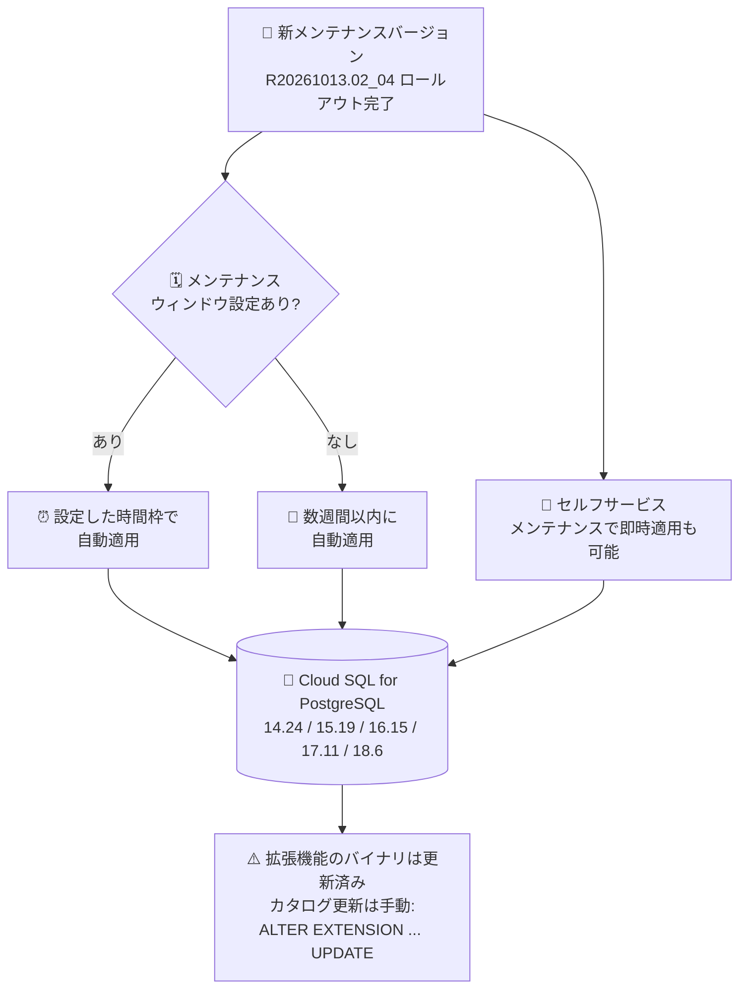

# Cloud SQL for PostgreSQL: マイナーバージョンと拡張機能アップグレードのロールアウト完了

**リリース日**: 2026-11-03

**サービス**: Cloud SQL for PostgreSQL

**機能**: マイナーバージョンおよび拡張機能のアップグレード

**ステータス**: Change (ロールアウト完了)

📊 [このアップデートのインフォグラフィックを見る](https://takech9203.github.io/google-cloud-news-summary/20261103-cloud-sql-postgresql-minor-version-extension-upgrades.html)

## 概要

Cloud SQL for PostgreSQL において、PostgreSQL マイナーバージョンおよび複数の拡張機能のアップグレードのロールアウトが完了しました。マイナーバージョンは 14.24 / 15.19 / 16.15 / 17.11 / 18.6 に更新され、新しいメンテナンスバージョンは `[PostgreSQL version].R20261013.02_04` です。

特に PostgreSQL 18 系では 18.4 から 18.6 へ更新され、PostgreSQL bug #19616 のバックポート修正が含まれています。この修正により、サブトランザクションを持つアボート済みトランザクションがメモリ退避 (memory eviction) 中にトランケートされた際に、論理デコーディングがストリーミングされていないトランザクションに対して `STREAM_ABORT` メッセージを誤って出力する問題が解消されます。論理レプリケーションや CDC (Change Data Capture) を利用しているユーザーにとって重要な修正です。

あわせて、hll、pg_qualstats、pglogical、pgTAP、pgtt、PL/Proxy、PostGIS、roaringbitmap の 8 つの拡張機能も新しいバージョンにアップグレードされました。メンテナンスウィンドウを設定している場合は設定した時間枠に従って、設定していない場合は今後数週間以内に更新が適用されます。

**アップデート前の課題**

- PostgreSQL 18.4 では、サブトランザクションを含むアボート済みトランザクションのメモリ退避時に、論理デコーディングが不正な `STREAM_ABORT` メッセージを出力する不具合 (PostgreSQL bug #19616) があった
- PostGIS は PostgreSQL 13〜17 で 3.5.2、PostgreSQL 18 で 3.6.0 と、メジャーバージョン間で拡張機能バージョンが分かれていた
- pglogical も PostgreSQL 17 以前 (2.4.5) と PostgreSQL 18 (2.4.6) でバージョンが分かれており、各拡張機能のバグ修正・改善が未適用だった

**アップデート後の改善**

- PostgreSQL 18.6 への更新により bug #19616 のバックポート修正が適用され、論理デコーディングの信頼性が向上した
- PostGIS が PostgreSQL 13 以降で 3.6.4 に、pglogical が 2.4.8 に統一され、メジャーバージョン間の拡張機能バージョンの差異が解消された
- roaringbitmap (pg_roaringbitmap) が 0.5 から 1.2 へ大きく更新されるなど、各拡張機能の最新のバグ修正・機能改善を利用できるようになった

## アーキテクチャ図



新しいメンテナンスバージョンの適用経路を示しています。メンテナンスウィンドウまたはセルフサービスメンテナンスで適用された後、拡張機能のデータベースカタログ更新はユーザーによる `ALTER EXTENSION` の実行が必要です。

## サービスアップデートの詳細

### 主要機能

1. **PostgreSQL マイナーバージョンの更新**
   - 14.23 → 14.24
   - 15.18 → 15.19
   - 16.14 → 16.15
   - 17.10 → 17.11
   - 18.4 → 18.6 (PostgreSQL bug #19616 のバックポート修正を含む)

2. **論理デコーディングの不具合修正 (PostgreSQL 18.6)**
   - サブトランザクションを持つアボート済みトランザクションがメモリ退避中にトランケートされた場合に、ストリーミングされていないトランザクションへ `STREAM_ABORT` メッセージが出力される問題を修正
   - 論理レプリケーション (pglogical、ネイティブ論理レプリケーション) や Datastream などの CDC パイプラインの安定性に寄与

3. **拡張機能のアップグレード (8 種類)**
   - 下記「技術仕様」の表を参照

## 技術仕様

### マイナーバージョンの更新内容

| PostgreSQL メジャーバージョン | 更新前 | 更新後 |
|------|------|------|
| 14 | 14.23 | 14.24 |
| 15 | 15.18 | 15.19 |
| 16 | 16.14 | 16.15 |
| 17 | 17.10 | 17.11 |
| 18 | 18.4 | 18.6 |

### 拡張機能の更新内容

| 拡張機能 | 更新前 | 更新後 | 備考 |
|------|------|------|------|
| hll (postgresql-hll) | 2.18 | 2.20 | HyperLogLog データ型 |
| pg_qualstats | 2.1.2 | 2.1.4 | 述語の統計収集 (不足インデックスの発見) |
| pglogical | 2.4.5 (PG 17 以前) / 2.4.6 (PG 18) | 2.4.8 | 論理レプリケーション |
| pgTAP | 1.3.0 | 1.3.4 | ユニットテストフレームワーク |
| pgtt | 4.0 | 4.6.0 | グローバル一時テーブル (PostgreSQL 12 以降) |
| PL/Proxy | 2.11.0 | 2.12.0 | データベースプロキシ言語 |
| PostGIS | 3.5.2 (PG 13〜17) / 3.6.0 (PG 18) | 3.6.4 | 地理空間拡張 (PostgreSQL 13 以降) |
| roaringbitmap (pg_roaringbitmap) | 0.5 | 1.2 | 圧縮ビットマップ型 (PostgreSQL 12 以降) |

### メンテナンスバージョン

| 項目 | 詳細 |
|------|------|
| 新メンテナンスバージョン | `[PostgreSQL version].R20261013.02_04` |
| 適用タイミング (ウィンドウ設定あり) | 設定したメンテナンスウィンドウの時間枠 |
| 適用タイミング (ウィンドウ設定なし) | 今後数週間以内 |
| 即時適用 | セルフサービスメンテナンスで可能 |

## 設定方法

### 前提条件

1. Cloud SQL for PostgreSQL インスタンス (PostgreSQL 14〜18) を利用していること
2. メンテナンスバージョンの確認・更新には `cloudsql.instances.update` 権限が必要

### 手順

#### ステップ 1: 現在のメンテナンスバージョンを確認する

```bash
gcloud sql instances describe INSTANCE_NAME \
  --format="value(maintenanceVersion)"
```

現在適用されているメンテナンスバージョンを確認します。`R20261013.02_04` より古い場合、今後のメンテナンスで更新されます。

#### ステップ 2: (任意) セルフサービスメンテナンスで即時適用する

```bash
# 適用可能なメンテナンスバージョンを確認
gcloud sql instances describe INSTANCE_NAME \
  --format="value(availableMaintenanceVersions)"

# セルフサービスメンテナンスを実行
gcloud sql instances patch INSTANCE_NAME \
  --maintenance-version=POSTGRES_X_Y.R20261013.02_04
```

スケジュールされたメンテナンスを待たずに、任意のタイミングで最新のメンテナンスバージョンを適用できます。リードレプリカがある場合は、レプリカが先に更新されます。

#### ステップ 3: 拡張機能のカタログを手動で更新する

```sql
-- インストール済み拡張機能のバージョンを確認
SELECT * FROM pg_extension;

-- 拡張機能を最新バージョンに更新 (例: PostGIS)
ALTER EXTENSION postgis UPDATE;
ALTER EXTENSION pglogical UPDATE;
```

メンテナンス更新は拡張機能のバイナリを自動的にインストールしますが、データベースカタログは自動更新されません。`ALTER EXTENSION ... UPDATE` を実行して、新しいバージョンを有効化する必要があります。

## メリット

### ビジネス面

- **データパイプラインの信頼性向上**: 論理デコーディングの不具合修正により、CDC やレプリケーションを基盤とするデータ連携の安定性が高まる
- **運用負荷の軽減**: マネージドサービスとしてマイナーバージョン・拡張機能の更新が自動的にロールアウトされ、パッチ適用作業が不要

### 技術面

- **論理デコーディングの修正 (bug #19616)**: PostgreSQL 18 で不正な `STREAM_ABORT` メッセージが出力される問題が解消され、サブスクライバー側での予期しない動作を防止
- **拡張機能バージョンの統一**: PostGIS 3.6.4、pglogical 2.4.8 など、PostgreSQL メジャーバージョン間で拡張機能バージョンが揃い、バージョン差異による挙動の違いを考慮する必要が減少
- **roaringbitmap の大幅更新**: 0.5 から 1.2 への更新により、大規模な整数集合の効率的な保存・集合演算に関する改善を利用可能

## デメリット・制約事項

### 制限事項

- メンテナンス更新はインスタンスの再起動を伴うため、短時間のダウンタイムが発生する (Enterprise edition は平均 30 秒未満の接続断、Enterprise Plus edition はニアゼロダウンタイム)
- 拡張機能のデータベースカタログは自動更新されない。`ALTER EXTENSION ... UPDATE` の手動実行が必要
- pgtt と roaringbitmap の新バージョンは PostgreSQL 12 以降、PostGIS 3.6.4 は PostgreSQL 13 以降が対象

### 考慮すべき点

- メンテナンスウィンドウを設定していない場合、更新は今後数週間以内の任意のタイミングで実行される。業務影響を避けるにはメンテナンスウィンドウの設定を推奨
- PostGIS のようなメジャー寄りの更新 (3.5.2 → 3.6.4) では、アプリケーションで利用している関数の挙動変更がないか事前にリリースノートを確認するとよい
- エクスポートなどのインスタンス操作が実行中の場合やディスク使用率が 97% を超えている場合、メンテナンスはスキップされる

## ユースケース

### ユースケース 1: 論理レプリケーションを利用した CDC パイプラインの安定化

**シナリオ**: PostgreSQL 18 インスタンスで論理デコーディングを利用し、Datastream や pglogical で下流システムへデータを連携している。アボートされたトランザクションの処理で不正な `STREAM_ABORT` メッセージが問題となる可能性がある。

**実装例**:
```bash
# セルフサービスメンテナンスで 18.6 を即時適用
gcloud sql instances patch INSTANCE_NAME \
  --maintenance-version=POSTGRES_18_6.R20261013.02_04
```

**効果**: bug #19616 の修正により、ストリーミングレプリケーションプロトコル上の不正なメッセージが排除され、サブスクライバーやコネクタの予期しないエラーを防止できる。

### ユースケース 2: 地理空間ワークロードでの PostGIS 最新化

**シナリオ**: PostgreSQL 15 上で PostGIS 3.5.2 を利用して地理空間データを処理しており、3.6 系の修正・改善を取り込みたい。

**効果**: メンテナンス適用後に `ALTER EXTENSION postgis UPDATE;` を実行することで、PostgreSQL 13〜18 の全バージョンで PostGIS 3.6.4 に統一でき、環境間のバージョン差異を解消できる。

## 料金

本アップデートはメンテナンス更新であり、追加料金は発生しません。Cloud SQL の料金体系に変更はありません。

- [Cloud SQL 料金ページ](https://cloud.google.com/sql/pricing)

## 利用可能リージョン

Cloud SQL for PostgreSQL が利用可能なすべてのリージョンでロールアウトが完了しています。実際の適用タイミングはインスタンスごとのメンテナンスウィンドウ設定に依存します。

## 関連サービス・機能

- **Cloud SQL セルフサービスメンテナンス**: スケジュールを待たずに最新メンテナンスバージョンを任意のタイミングで適用できる機能
- **メンテナンスウィンドウ / 拒否期間 (deny maintenance period)**: 更新タイミングの制御により業務影響を最小化
- **Datastream**: PostgreSQL の論理デコーディングを利用する CDC サービス。bug #19616 修正の恩恵を受ける
- **AlloyDB for PostgreSQL**: 同日に新規クラスタのデフォルトが PostgreSQL 18 に変更されており、PostgreSQL 18 系の採用が進んでいる

## 参考リンク

- 📊 [インフォグラフィック](https://takech9203.github.io/google-cloud-news-summary/20261103-cloud-sql-postgresql-minor-version-extension-upgrades.html)
- [公式リリースノート](https://docs.cloud.google.com/release-notes#November_03_2026)
- [セルフサービスメンテナンスの実行](https://docs.cloud.google.com/sql/docs/postgres/self-service-maintenance)
- [メンテナンスウィンドウの確認と設定](https://docs.cloud.google.com/sql/docs/postgres/set-maintenance-window)
- [PostgreSQL 拡張機能の構成](https://docs.cloud.google.com/sql/docs/postgres/extensions)
- [Cloud SQL メンテナンスの概要](https://docs.cloud.google.com/sql/docs/postgres/maintenance)
- [料金ページ](https://cloud.google.com/sql/pricing)

## まとめ

Cloud SQL for PostgreSQL のマイナーバージョンと 8 つの拡張機能のアップグレードが完了し、特に PostgreSQL 18.6 では論理デコーディングの重要な不具合修正 (bug #19616) が含まれています。論理レプリケーションや CDC を利用している場合はセルフサービスメンテナンスでの早期適用を検討し、適用後は `ALTER EXTENSION ... UPDATE` による拡張機能カタログの手動更新を忘れずに実施してください。

---

**タグ**: Cloud SQL, PostgreSQL, マイナーバージョン, 拡張機能, メンテナンス, 論理レプリケーション, PostGIS, pglogical
