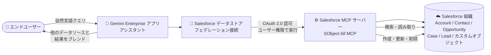

# Gemini Enterprise: Salesforce フェデレーテッドデータストアが GA

**リリース日**: 2026-11-03

**サービス**: Gemini Enterprise

**機能**: Salesforce フェデレーテッドデータストア (データフェデレーション接続)

**ステータス**: GA (一般提供)

📊 [このアップデートのインフォグラフィックを見る](https://takech9203.github.io/google-cloud-news-summary/20261103-gemini-enterprise-salesforce-federated-data-store.html)

## 概要

Gemini Enterprise において、データフェデレーションを使用した Salesforce データソースの接続が一般提供 (GA) になりました。Gemini Enterprise アプリのアシスタントから、Salesforce の取引先 (Account)、取引先責任者 (Contact)、商談 (Opportunity)、ケース (Case)、リード (Lead)、カスタムオブジェクトを横断的に検索し、そのコンテンツに基づいた (グラウンディングされた) 回答を得られます。さらに、自然言語の指示でレコードの作成・更新・削除まで実行できます。

このアップデートの最大のポイントは「データをインジェスト (インデックス登録) する必要がない」ことです。フェデレーション方式では、クエリ実行時に Gemini Enterprise が Salesforce の MCP サーバーに直接問い合わせを行い、リアルタイムに結果を取得します。データが Gemini Enterprise 側のインデックスにコピーされないため、ストレージ消費や同期の待ち時間を気にすることなく、常に最新の Salesforce データを扱えます。CRM データを AI アシスタントから直接操作したい営業・カスタマーサポート部門を抱える企業が主な対象ユーザーです。

**アップデート前の課題**

- Salesforce のデータを Gemini Enterprise で検索するには、データをインジェスト (インデックス登録) してコピーを保持する必要があり、ストレージを消費し、同期にも時間がかかった
- インジェスト型では同期サイクルの間にデータの鮮度が落ち、常に変化する商談やケースなどの CRM データの最新状態を反映できなかった
- 検索結果の確認後にレコードを変更するには、Salesforce の画面に切り替えて手動で操作する必要があった

**アップデート後の改善**

- データフェデレーションにより、インジェスト不要で Salesforce のレコードをリアルタイムに検索できるようになった (GA として本番利用可能)
- Gemini Enterprise のアシスタントから自然言語でレコードの作成・更新・削除が可能になり、Salesforce 画面への切り替えが不要になった
- データのコピーを保持しないため、Gemini Enterprise 側のストレージ消費や同期管理が不要になった

## アーキテクチャ図

ユーザーのクエリは Gemini Enterprise から Salesforce の MCP サーバーに直接送信され、データをインジェストせずにリアルタイムで検索・操作が行われます。結果は他の接続済みデータソースとブレンドされて表示されます。

## サービスアップデートの詳細

### 主要機能

1. **データフェデレーションによるリアルタイム検索 (GA)**
   - クエリ実行時に Salesforce MCP サーバーへ直接問い合わせ、常に最新のレコードを検索
   - 取引先、取引先責任者、商談、ケース、リードに加え、カスタムオブジェクトにも対応
   - 複数のデータソースを接続している場合は、結果をブレンドして包括的な検索結果を表示

2. **読み取りアクション (デフォルトで有効)**
   - `Soql Query`: 標準・カスタムオブジェクトに対する SOQL クエリの実行
   - `Find`: Salesforce レコード全体の全文検索
   - `Get Object Schema`: オブジェクト一覧や特定オブジェクトのフィールド・選択リスト値の取得
   - `Get Related Records` / `List Recent Sobject Records` / `Get User Info`: 関連レコード、最近参照・変更したレコード、現在のユーザー情報の取得

3. **書き込みアクション (デフォルトで無効、管理者が有効化)**
   - `Create Sobject Record`: 任意のオブジェクトタイプのレコード作成
   - `Update Sobject Record` / `Update Related Record`: 既存レコードや関連レコードのフィールド更新
   - `Delete Sobject Record` / `Delete Related Record`: レコードの削除 (削除されたレコードは Salesforce のごみ箱へ移動)

4. **ユーザー権限に基づく実行**
   - アクションはコネクタを認可したユーザーの権限で実行される
   - ユーザーは Salesforce 上で元々読み取り・変更できるレコードのみ操作可能 (権限昇格は発生しない)

## 技術仕様

### 認証方式

| 項目 | 詳細 |
|------|------|
| OAuth 2.0 (Google Managed) (デフォルト) | Salesforce AppExchange から「Gemini Enterprise - Salesforce Connector」マネージドパッケージをインストール。クライアント ID / シークレットは不要 |
| OAuth 2.0 (Bring Your Own App) | Salesforce 組織に外部クライアントアプリを作成し、コンシューマキー (Client ID) とコンシューマシークレット (Client Secret) を使用 |
| 認可スコープ | ユーザーが Salesforce サインインページで `mcp_api` と `refresh_token` スコープを許可 |
| 接続先 URI | 組織の My Domain URL (例: `https://example.my.salesforce.com`)。サンドボックスの場合はサンドボックスの My Domain |

### フェデレーションとインジェストの比較

| 項目 | データフェデレーション (今回 GA) | データインジェスト (インデックス登録) |
|------|------|------|
| データのコピー | なし (リアルタイム問い合わせ) | Gemini Enterprise のインデックスにコピー |
| データの鮮度 | 常に最新 | 同期サイクルに依存 |
| ストレージ消費 | なし | 消費する (エディションごとのプール容量) |
| 検索品質 | インデックス化されないため低くなる可能性がある | インデックス化により高品質 |

### その他の仕様

| 項目 | 詳細 |
|------|------|
| 前提の Salesforce 側設定 | Salesforce 管理者が接続対象組織で SObject All MCP サーバーを有効化 |
| 必要な IAM ロール | データストア作成ユーザーに Discovery Engine 編集者 (`roles/discoveryengine.editor`) |
| ロケーション | マルチリージョンを選択。`us` / `eu` 選択時は暗号化設定 (Google 管理キーまたは Cloud KMS キー / CMEK) を構成 |
| 静的 IP | データストア単位の静的 IP 設定は非対応。ログイン IP ポリシーは Salesforce 側のアプリで設定 |
| サンドボックス | 対応 (詳細オプションで「Use Sandbox」を選択) |

## 設定方法

### 前提条件

1. データストアを作成するユーザーに Discovery Engine 編集者ロール (`roles/discoveryengine.editor`) を付与する
2. Salesforce 管理者が、接続する組織で SObject All MCP サーバーを有効化する
3. 認証方式を準備する (Google Managed の場合は AppExchange のマネージドパッケージをインストール、Bring Your Own App の場合は外部クライアントアプリを作成してキーを取得)
4. 組織の My Domain URL を確認する (Salesforce の [設定] → [私のドメイン])

### 手順

#### ステップ 1: Salesforce データストアを作成する

1. Google Cloud コンソールで [Gemini Enterprise] ページに移動し、[Data stores] → [Create data store] をクリック
2. ソースで「Salesforce」を検索して選択
3. 認証設定で認証方式 (Google Managed または Bring Your Own App) を選択し、Instance URI に My Domain URL を入力
4. [Entities to search] で「Salesforce MCP」を選択

#### ステップ 2: アクションと構成を設定する

1. [Actions] セクションで、有効にする作成・更新・削除アクションを選択 (読み取り専用に保つ場合は未選択のまま)
2. マルチリージョン、コネクタ名、(us/eu の場合) 暗号化設定を構成
3. 課金セクションで General pricing または Configurable pricing を選択し、[Create] をクリック

#### ステップ 3: アプリに接続して認可する

1. データストアの状態が「Creating」から「Active」になったことを確認
2. 既存のアプリに接続するか、新しいアプリを作成して接続
3. 各ユーザーが Salesforce サインインページで Gemini Enterprise を認可 (`mcp_api` と `refresh_token` スコープを許可) してからクエリを実行

#### ステップ 4 (任意): 後からアクションを有効化する

データストアの [Actions] タブで `Create Sobject Record` などの書き込みアクションを選択し、[Enable actions] をクリックすると、作成後でもいつでも有効化できます。

## メリット

### ビジネス面

- **CRM ワークフローの効率化**: 営業・サポート担当者が Salesforce 画面に切り替えることなく、アシスタントとの対話だけでレコードの検索・作成・更新・削除まで完結できる
- **常に最新のデータに基づく回答**: フェデレーションによりリアルタイムのレコードを参照するため、商談やケースの最新状態に基づいた意思決定ができる
- **導入の容易さ**: Google Managed OAuth ではマネージドパッケージのインストールのみで接続でき、独自 OAuth アプリの作成・管理が不要

### 技術面

- **インジェスト不要**: データのコピー・同期パイプラインの構築が不要で、ストレージ消費やインデックス更新の管理から解放される
- **権限の一貫性**: アクションは認可したユーザー自身の Salesforce 権限で実行されるため、既存のアクセス制御がそのまま適用される
- **段階的なアクション解放**: 書き込みアクションはデフォルトで無効であり、管理者が組織のガバナンス方針に合わせて段階的に有効化できる

## デメリット・制約事項

### 制限事項

- フェデレーション方式はデータをインデックス化しないため、インジェスト (インデックス登録) 方式と比べて検索品質が低くなる可能性がある
- データストア単位の静的 IP 設定 (static IP egress) は非対応。ログイン IP ポリシーは Salesforce 側のアプリで設定する必要がある
- SObject All MCP サーバーが有効になるまでアクションは利用できず、OAuth アプリが構成されるまでユーザーはコネクタを認可できない

### 考慮すべき点

- クエリ文字列は Salesforce MCP サーバー (サードパーティ検索バックエンド) に送信され、サードパーティがクエリをユーザーの ID と関連付ける可能性がある。送信後のデータは Salesforce 側の利用規約・プライバシーポリシーに従う
- 精度向上のため LLM がクエリをリライトする場合があり、セッションのクエリ履歴の一部が Salesforce に送信されるクエリに含まれる可能性がある
- 複数のフェデレーテッド検索データソースを有効にしている場合、クエリがそれらすべてに送信される可能性がある
- 削除アクションを有効化する場合は、誤削除時の復旧手順 (Salesforce のごみ箱) を含めた運用ルールを整備しておく

## ユースケース

### ユースケース 1: 営業担当者の商談管理

**シナリオ**: 営業担当者が外出先から Gemini Enterprise アシスタントに「A 社の進行中の商談の状況を教えて」と質問し、回答を確認した上で「商談フェーズを『交渉中』に更新して」と指示する。

**効果**: Salesforce 画面を開かずに対話だけで商談の確認から更新まで完結し、CRM 入力の手間と更新漏れを削減できる。フェデレーションにより常に最新の商談データに基づいた回答が得られる。

### ユースケース 2: カスタマーサポートのケース対応

**シナリオ**: サポート担当者が「この顧客の未解決ケースを一覧して」と検索し、社内ドキュメント (他の接続済みデータソース) とブレンドされた検索結果から対応方針を確認、その場で新規ケースのレコードを作成する。

**効果**: Salesforce のケース情報と社内ナレッジを横断した回答を 1 つのアシスタントで取得でき、対応時間を短縮できる。読み取りは全ユーザーに開放しつつ、作成アクションのみ有効化するなど段階的な権限設計も可能。

## 料金

Salesforce フェデレーテッドデータストア自体の追加料金は Release Notes には記載されていません。Gemini Enterprise の利用にはエディション (Business / Standard / Plus / Pay-as-you-go / Frontline) に応じたサブスクリプションとユーザーライセンスが必要です。フェデレーション方式ではデータを Gemini Enterprise のインデックスにコピーしないため、エディションごとのストレージ/インデックス容量 (例: Standard は 30 GiB、Plus は 75 GiB のプール) を消費しない点が特徴です。

詳細は以下を参照してください。

- [Gemini Enterprise のエディション比較](https://docs.cloud.google.com/gemini/enterprise/docs/editions)
- [Gemini Enterprise のライセンス](https://docs.cloud.google.com/gemini/enterprise/docs/licenses)

## 利用可能リージョン

データストア作成時にマルチリージョン (global / us / eu) を選択します。`us` または `eu` を選択した場合は暗号化設定 (Google 管理キーまたは CMEK) の構成が必要です。詳細は[データレジデンシーに関するドキュメント](https://docs.cloud.google.com/gemini/enterprise/docs/locations)を参照してください。

## 関連サービス・機能

- **Gemini Enterprise アプリ (アシスタント)**: データストアを接続することで、検索・回答・アクションのユーザーインターフェースを提供する
- **その他のサードパーティコネクタ (Jira、Confluence、ServiceNow、SharePoint など)**: 複数のデータソースを接続すると、Salesforce の結果とブレンドされた横断検索 (blended search) が可能
- **Cloud KMS (CMEK)**: us / eu ロケーション選択時に顧客管理の暗号鍵でデータストアを保護できる
- **IAM (Discovery Engine ロール)**: データストア作成には Discovery Engine 編集者ロールが必要で、アクセス制御の基盤となる

## 参考リンク

- 📊 [インフォグラフィック](https://takech9203.github.io/google-cloud-news-summary/20261103-gemini-enterprise-salesforce-federated-data-store.html)
- [公式リリースノート](https://docs.cloud.google.com/release-notes#November_03_2026)
- [Salesforce データストアのセットアップ](https://docs.cloud.google.com/gemini/enterprise/docs/connectors/salesforce/set-up-data-store)
- [Salesforce コネクタの概要 (サポートされるアクション)](https://docs.cloud.google.com/gemini/enterprise/docs/connectors/salesforce)
- [コネクタとデータストアの概要 (フェデレーションとインジェストの比較)](https://docs.cloud.google.com/gemini/enterprise/docs/connectors/introduction-to-connectors-and-data-stores)
- [Gemini Enterprise のエディション比較](https://docs.cloud.google.com/gemini/enterprise/docs/editions)

## まとめ

Salesforce フェデレーテッドデータストアの GA により、データをインジェストすることなく Gemini Enterprise から Salesforce の CRM データをリアルタイムに検索・操作できるようになりました。営業・サポート部門の AI アシスタント活用を進める企業は、まず読み取り専用で接続して検索品質と運用を評価し、ガバナンス方針に合わせて作成・更新・削除アクションを段階的に有効化することを推奨します。

---

**タグ**: #GeminiEnterprise #Salesforce #データフェデレーション #MCP #エンタープライズ検索 #GA #AIエージェント
