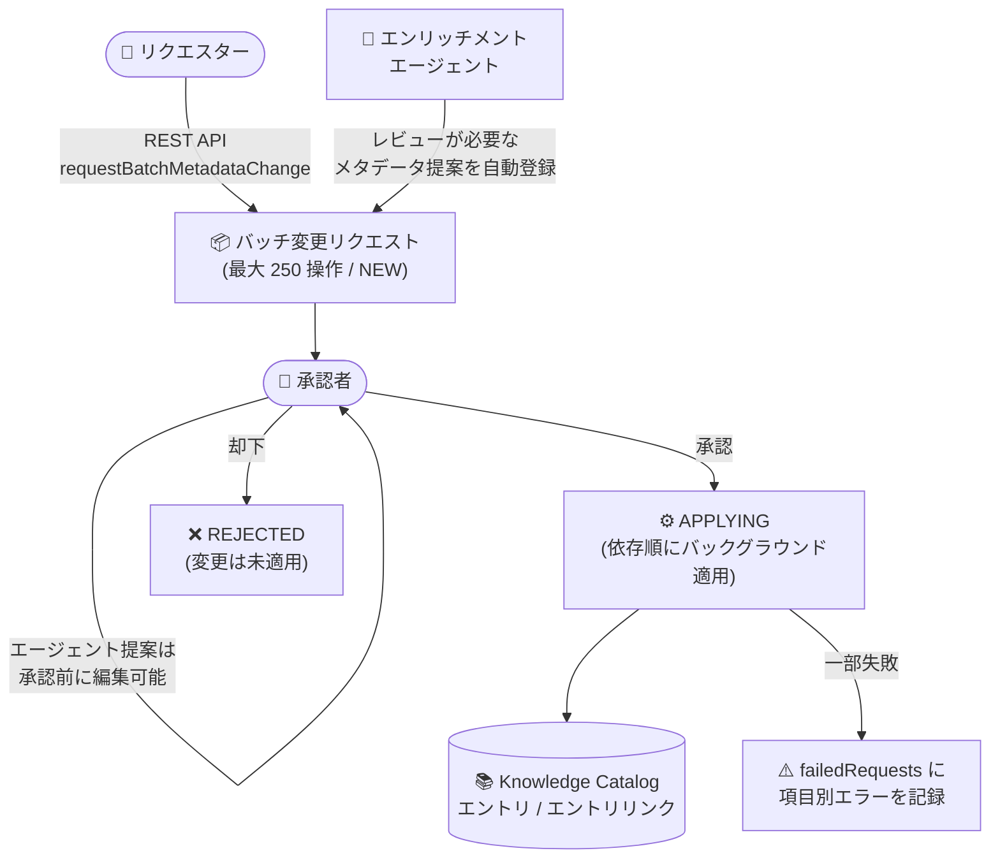

# Knowledge Catalog: ガバナンスワークフローのバッチメタデータ変更リクエスト (Preview)

**リリース日**: 2026-11-03

**サービス**: Knowledge Catalog (旧 Dataplex Universal Catalog)

**機能**: バッチメタデータ変更リクエスト (Batch metadata change requests)

**ステータス**: Preview

📊 [このアップデートのインフォグラフィックを見る](https://takech9203.github.io/google-cloud-news-summary/20261103-knowledge-catalog-batch-metadata-change-requests.html)

## 概要

Knowledge Catalog (旧 Dataplex Universal Catalog) のガバナンスワークフローが、バッチメタデータ変更リクエストに対応しました (Preview)。エントリ (Entry) およびエントリリンク (Entry link) に対する作成・更新・削除の操作を最大 250 件まで 1 つの変更リクエストにまとめて提出し、承認者によるレビューと承認を経てカタログへ一括反映できます。

このアップデートの大きなポイントは、エンリッチメントエージェント (enrichment agent) との統合です。エージェントが生成したメタデータ提案のうち自動公開 (auto-publishing) ではなく人間によるレビューが必要なものは、自動的にバッチ変更リクエストとして登録されます。承認者は承認前にバッチ提案の内容を編集 (キュレーション) できるため、AI が生成したメタデータを人間が検証・修正してから公開する「human-in-the-loop」のガバナンスプロセスを構築できます。

対象ユーザーは、エントリグループへの直接の書き込み権限を持たないデータ利用者や、AI によるメタデータ自動生成を統制の取れた形で導入したいデータスチュワード・プラットフォーム管理者です。

**アップデート前の課題**

- 従来のガバナンスワークフローのメタデータ変更リクエストは単一リソース単位であり、多数のエントリを変更する場合はリクエストを個別に提出し、承認者も 1 件ずつレビュー・承認する必要があった
- エンリッチメントエージェントが大量に生成するメタデータ提案を、承認フローに乗せて効率的にレビューする仕組みがなかった
- 単一リソースの変更リクエストでは、エントリリンクの更新 (Update) 操作がサポートされていなかった

**アップデート後の改善**

- 最大 250 件の作成・更新・削除操作を 1 つの変更リクエストにまとめて提出でき、承認者は 1 回の承認で一括適用できるようになった
- エンリッチメントエージェントの実行結果が自動的にバッチ変更リクエストとして登録され、承認者は承認前に提案内容を編集 (キュレーション) できるようになった
- バッチリクエストではエントリリンクの作成・更新・削除すべての操作がサポートされた

## アーキテクチャ図



ユーザーの REST API 呼び出しまたはエンリッチメントエージェントの実行によってバッチ変更リクエストが作成され、承認者のレビュー (エージェント提案は編集可能) を経て、依存関係順に Knowledge Catalog へ一括適用されます。

## サービスアップデートの詳細

### 主要機能

1. **最大 250 操作の一括変更リクエスト**
   - エントリとエントリリンクに対する作成・更新・削除の操作を最大 250 件まで 1 つの変更リクエストにグループ化できる
   - `entryGroups.requestBatchMetadataChange` メソッドを使用して REST API 経由で提出する
   - 提出時にリクエストの構文と、参照されるエントリタイプ・アスペクトタイプ・エントリリンクタイプ・親エントリの存在が検証される

2. **エンリッチメントエージェント提案のキュレーション**
   - エンリッチメントエージェントの実行で人間のレビューが必要なメタデータ提案が生成されると、エージェントが自動的にバッチ変更リクエストを作成する
   - 承認者は、リクエストが `NEW` または `FAILED` 状態の間、承認前にリクエストのペイロードを編集できる
   - エージェントは信頼度 (confidence) に基づいて自己承認するか、承認者へレビューを依頼するかを選択できる
   - エージェント起点のリクエストには `batchChangeMetadataRequest.description.job.name` にエンリッチメント実行 ID が含まれる

3. **依存関係を考慮した自動適用**
   - 承認されると、「エントリリンク削除 → エントリ削除 → エントリ作成・更新 → エントリリンク作成・更新」の依存順で操作が適用される
   - 適用はバックグラウンドで実行され、リクエストは `APPLYING` 状態を経て `APPROVED` または `FAILED` に遷移する
   - 一部の操作が失敗した場合、`batchChangeMetadataResponse.failedRequests` に失敗した操作の位置とエラー詳細が記録される

## 技術仕様

### サポートされる操作 (バッチ変更リクエスト)

| リソース | 作成 | 更新 | 削除 |
|------|------|------|------|
| エントリ (Entry) | ○ | ○ | ○ |
| エントリリンク (Entry link) | ○ | ○ | ○ |

(参考: 単一リソースの変更リクエストではエントリリンクの更新は非サポート)

### リクエストのステータス遷移

| ステータス | バッチ変更リクエストでの意味 |
|------|------|
| NEW | レビュー待ち。ユーザー提出分は作成者が、エージェント提出分はレビュアーが編集可能 |
| APPLYING | 承認済みで、バックグラウンドで適用中 |
| APPROVED | 承認済みで、バッチ内の少なくとも 1 件の変更が成功。項目レベルのエラーはレスポンスに記録 |
| FAILED | バッチ内のすべての変更が適用不可。リクエストを更新すると NEW に戻り再承認が可能 |
| REJECTED | 承認者が却下。変更は適用されない |

### 必要な IAM ロール

| 操作 | ロール |
|------|------|
| バッチ変更リクエストの提出 | Dataplex Catalog Viewer (`roles/dataplex.catalogViewer`) ※対象エントリグループに付与 |
| リクエストの承認 | Dataplex Workflow Approver (`roles/dataplex.workflowApprover`) に加え、提案された変更に必要な書き込み・タイプ使用権限 |
| ワークフローの管理 | Dataplex Workflow Admin (`roles/dataplex.workflowAdmin`) |

カスタムロールを使用する場合は、対象エントリグループに対する `dataplex.entryGroups.get` と `dataplex.entryGroups.requestChanges` 権限が必要です。

### バッチ構築時の参照ルール

- 同一バッチ内で削除するエントリを参照するエントリリンクの作成・更新はできない。また、削除対象エントリを `parentEntry` に指定できない
- 新規エントリが同一バッチ内の別エントリを `parentEntry` として参照する場合、親エントリの作成操作を子より先に列挙する
- `parent` フィールドを省略した場合は `changePayload.name` のエントリグループが使用される。指定する場合は `changePayload.name` と一致している必要がある
- `justification` (変更理由) は最大 1,024 文字

## 設定方法

### 前提条件

1. Dataplex API が有効化されていること
2. 提出者に対象エントリグループの Dataplex Catalog Viewer ロール、承認者に Dataplex Workflow Approver ロールと必要な書き込み権限が付与されていること

### 手順

#### ステップ 1: バッチ変更リクエストの提出

```bash
curl -X POST \
  -H "Authorization: Bearer $(gcloud auth print-access-token)" \
  -H "Content-Type: application/json" \
  -d '{
    "name": "projects/PROJECT_ID/locations/LOCATION/entryGroups/ENTRY_GROUP_ID",
    "changePayload": {
      "name": "projects/PROJECT_ID/locations/LOCATION/entryGroups/ENTRY_GROUP_ID",
      "changes": [
        {
          "createEntryRequest": {
            "parent": "projects/PROJECT_ID/locations/LOCATION/entryGroups/ENTRY_GROUP_ID",
            "entryId": "ENTRY_ID",
            "entry": {
              "entryType": "projects/PROJECT_ID/locations/LOCATION/entryTypes/ENTRY_TYPE_ID"
            }
          }
        }
      ]
    },
    "justification": "JUSTIFICATION"
  }' \
  "https://dataplex.googleapis.com/v1/projects/PROJECT_ID/locations/LOCATION/entryGroups/ENTRY_GROUP_ID:requestBatchMetadataChange"
```

`changes` 配列に最大 250 件の操作を列挙できます。レスポンスには作成された変更リクエストのリソース名が返されます。

#### ステップ 2: 保留中リクエストの確認

```bash
curl -X GET \
  -H "Authorization: Bearer $(gcloud auth print-access-token)" \
  "https://dataplex.googleapis.com/v1/projects/PROJECT_ID/locations/LOCATION/changeRequests?filter=state=NEW"
```

バッチリクエストは `changeType` が `BATCH_CHANGE_METADATA` となります。コンソールでは「Governance Workflows」ページの「Pending Approvals」タブから確認できます。

#### ステップ 3: リクエストの承認・却下

```bash
# 承認
curl -X POST \
  -H "Authorization: Bearer $(gcloud auth print-access-token)" \
  -H "Content-Type: application/json" \
  -d '{}' \
  "https://dataplex.googleapis.com/v1/projects/PROJECT_ID/locations/LOCATION/changeRequests/CHANGE_REQUEST_ID:approve"
```

承認後、リクエストは `APPLYING` 状態となり、バックグラウンドで適用されます。最終状態 (`APPROVED` または `FAILED`) は `changeRequests.get` をポーリングして確認します。

## メリット

### ビジネス面

- **ガバナンスの効率化**: 大量のメタデータ変更を 1 回のレビュー・承認で処理でき、データスチュワードの承認作業の負担を大幅に削減できる
- **AI 活用の統制**: エンリッチメントエージェントが生成したメタデータを人間が検証・編集してから公開する human-in-the-loop プロセスを標準機能として実現でき、AI 生成メタデータの品質と説明責任を担保できる
- **監査性の向上**: 変更理由 (justification)、作成者、承認者、ステータスがリクエスト単位で記録され、ワークフロー管理者は全状態の監査証跡を閲覧できる

### 技術面

- **API 呼び出しの集約**: 個別の変更リクエストを多数発行する代わりに、1 回の API 呼び出しで最大 250 操作を提出できる
- **依存関係の自動解決**: 削除 → 作成・更新の依存順で自動適用されるため、適用順序を呼び出し側で制御する必要がない
- **項目レベルのエラー可視化**: 一部の操作が失敗しても `failedRequests` で失敗箇所とエラー内容を特定でき、リカバリーが容易

## デメリット・制約事項

### 制限事項

- Preview 段階であり、Pre-GA Offerings Terms が適用される (サポートが限定される可能性がある)
- 1 リクエストあたりの操作数は最大 250 件
- バッチ変更リクエストの提出は REST API (Dataplex API) 経由のみ
- ガバナンスワークフローは Assured Workloads プロジェクト、CMEK、VPC Service Controls をサポートしない
- バッチ変更リクエストにはトランザクション整合性や自動ロールバックがなく、承認後は各操作が個別に評価・適用される

### 考慮すべき点

- 同時実行は「last writer wins」モデルであり、最後に承認された変更が以前の更新を上書きする。複数の保留中リクエストが同一リソースに共存できる点に注意
- 自分自身のリクエストは承認できない (エンリッチメントエージェントは信頼度に基づく自己承認が可能)
- リクエストは手動削除、対象リソースの削除、または 90 日の有効期限で完全に削除され、以後の照会は 404 エラーになる
- 承認時の同期検証で失敗した場合、`INVALID_ARGUMENT`/`NOT_FOUND` は `FAILED` 状態へ、`PERMISSION_DENIED` は `NEW` 状態のまま残るという挙動の違いがある

## ユースケース

### ユースケース 1: エンリッチメントエージェント提案のキュレーション

**シナリオ**: データプラットフォームチームがエンリッチメントタスクを定期実行し、BigQuery テーブルの説明やビジネスコンテキストを AI で自動生成している。ただし、信頼度が低い提案はそのまま公開せず、データスチュワードのレビューを必須にしたい。

**実装例**:
```
1. エンリッチメントタスクを auto-publishing 無効 (レビュー必須) で構成
2. エージェント実行後、バッチ変更リクエストが NEW 状態で自動登録される
3. 承認者が Governance Workflows ページでリクエストを開き、提案内容を編集
4. 問題のない提案のみに修正したうえで承認 → カタログへ一括反映
```

**効果**: AI によるメタデータ生成のスケールメリットを享受しつつ、公開前の人間による検証で品質を担保できる。

### ユースケース 2: 権限を持たないチームによる大規模メタデータ登録

**シナリオ**: データ基盤の移行プロジェクトで、移行チームが数百件のカスタムエントリとエントリリンク (リネージ関係など) をカタログに登録したいが、エントリグループへの直接の書き込み権限は中央ガバナンスチームのみが保持している。

**効果**: 移行チームは Catalog Viewer 権限のみで最大 250 操作をまとめた変更リクエストを提出でき、ガバナンスチームは 1 回の承認で一括適用できる。個別リクエストの往復が不要になり、移行作業のリードタイムを短縮できる。

## 料金

ガバナンスワークフローのバッチメタデータ変更リクエスト自体の個別料金は Release Notes およびドキュメントに記載されていません。Knowledge Catalog (Dataplex) の料金体系はメタデータストレージや API 呼び出しなどに基づきます。詳細は [Dataplex 料金ページ](https://cloud.google.com/dataplex/pricing) を参照してください。

## 利用可能リージョン

リージョン固有の制限は Release Notes に記載されていません。エントリグループが存在するロケーション (例: `us-central1`) を指定して API を呼び出します。最新の対応状況は公式ドキュメントを参照してください。

## 関連サービス・機能

- **Knowledge Catalog エンリッチメントタスク / エンリッチメントエージェント (Preview)**: データセットのスキーマ、クエリログ、社内ドキュメントを解析してメタデータ提案を自動生成する機能。レビューが必要な提案は本機能のバッチ変更リクエストとして登録される
- **ビジネス用語集 (Business Glossary)**: 単一リソースの変更リクエストでは用語集カテゴリ・用語の作成・更新・削除の提案も可能
- **BigQuery universal catalog / Dataplex**: Knowledge Catalog は Dataplex Universal Catalog の後継であり、BigQuery をはじめとするデータ資産のメタデータを一元管理する
- **IAM (Identity and Access Management)**: リクエスター・承認者・ワークフロー管理者の役割分担を `roles/dataplex.catalogViewer`、`roles/dataplex.workflowApprover`、`roles/dataplex.workflowAdmin` などで制御

## 参考リンク

- 📊 [インフォグラフィック](https://takech9203.github.io/google-cloud-news-summary/20261103-knowledge-catalog-batch-metadata-change-requests.html)
- [公式リリースノート](https://docs.cloud.google.com/release-notes#November_03_2026)
- [About governance workflows](https://docs.cloud.google.com/knowledge-catalog/docs/about-governance-workflows)
- [Request batch metadata changes](https://docs.cloud.google.com/knowledge-catalog/docs/request-batch-metadata-changes)
- [Manage requests](https://docs.cloud.google.com/knowledge-catalog/docs/manage-requests)
- [Request single-resource metadata changes](https://docs.cloud.google.com/knowledge-catalog/docs/metadata-change-workflows)
- [料金ページ (Dataplex)](https://cloud.google.com/dataplex/pricing)

## まとめ

Knowledge Catalog のガバナンスワークフローにバッチメタデータ変更リクエストが追加され、最大 250 件のエントリ・エントリリンク操作を 1 つのリクエストとして提出・承認できるようになりました。特にエンリッチメントエージェントの提案を承認前に編集できる点は、AI 生成メタデータを統制の取れた形で大規模導入するうえで重要な基盤となります。メタデータのキュレーション運用を担うチームは、Preview 段階のうちに `requestBatchMetadataChange` API と承認フローを検証し、既存のカタログ運用プロセスへの組み込みを検討することを推奨します。

---

**タグ**: #KnowledgeCatalog #Dataplex #BigQueryUniversalCatalog #DataGovernance #Metadata #GovernanceWorkflows #EnrichmentAgent #Preview
