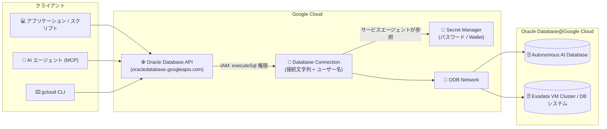

# Oracle Database@Google Cloud: Database Connections (GA)

**リリース日**: 2026-11-03

**サービス**: Oracle Database@Google Cloud

**機能**: Database Connections (SQL 実行機能)

**ステータス**: GA (一般提供)

📊 [このアップデートのインフォグラフィックを見る](https://takech9203.github.io/google-cloud-news-summary/20261103-oracle-database-database-connections-ga.html)

## 概要

Oracle Database@Google Cloud に **Database Connections** 機能が一般提供 (GA) となりました。Database Connection は、特定の Oracle データベースとデータベースユーザーへの「再利用可能でセキュアなポインタ」として機能する Google Cloud リソースです。これを作成しておくことで、Google Cloud の API (`oracledatabase.googleapis.com`)、gcloud CLI、さらには MCP (Model Context Protocol) サーバー経由で、ODB Network 上の Oracle データベースに接続し SQL 文を実行できます。

接続対象は ODB Network 経由で到達可能な Oracle データベース全般で、Autonomous AI Database、Exadata VM Cluster 上のデータベース、DB システムに対応します。接続情報 (接続文字列、ユーザー名) は Database Connection リソースに保持され、パスワードや mTLS 用の Oracle Wallet は Secret Manager で管理されます。SQL 実行の認可は IAM 権限 (`oracledatabase.databaseConnections.executeSql`) で制御されるため、アプリケーション、自動化スクリプト、AI エージェントからのデータベースアクセスを Google Cloud のセキュリティモデルに統合できます。

**アップデート前の課題**

- Oracle Database@Google Cloud のデータベースに対して SQL を実行するには、ODB Network に到達可能なネットワーク内に Oracle クライアント環境を用意して接続する必要があった
- データベース認証情報 (パスワードや Wallet) の管理・配布を各クライアント側で行う必要があった
- AI エージェントや自動化ツールから Oracle データベースを操作するための Google Cloud API / MCP ベースの標準的な手段がなかった

**アップデート後の改善**

- Database Connection を一度作成すれば、gcloud / REST API / MCP サーバー経由で SQL 文 (SELECT / DML / DDL) を直接実行できるようになった
- パスワードと Oracle Wallet を Secret Manager で一元管理し、サービスエージェントが実行時に安全に参照する構成になった
- SQL 実行権限を IAM 権限として分離できるため、「SQL 実行のみ可能なロール」「接続管理のみ可能なロール」といった最小権限設計が可能になった
- MCP ツール (`database_connection_executesql` など) を通じて、AI エージェントから Oracle データベースを操作するユースケースが公式にサポートされた

## アーキテクチャ図



アプリケーション・AI エージェント・CLI は Google Cloud API 経由で Database Connection を利用して SQL を実行します。認証情報は Secret Manager から Google 管理のサービスエージェントが読み取り、ODB Network を通じて Oracle データベースへ接続します。

## サービスアップデートの詳細

### 主要機能

1. **Database Connection リソース**
   - Oracle データベースとデータベースユーザーへの再利用可能でセキュアなポインタ
   - 接続文字列は Oracle Easy Connect 形式または TNS 記述子をサポート (例: `hostname.domain.com:1521/SERVICE_NAME`)
   - パスワードは Secret Manager のシークレットバージョンで指定し、mTLS/TLS 接続には base64 エンコードした Oracle Wallet ZIP をシークレットとして指定可能
   - 作成・更新・テスト・削除の管理操作に対応 (接続テスト用の `test` 操作あり)

2. **SQL 実行 (executeSql)**
   - SELECT クエリに加え、DML・DDL 文の実行をサポート (自動コミット)
   - バインド変数 (`params`) をサポートし、SQL インジェクション対策として文字列連結ではなくバインド変数の使用が推奨される
   - gcloud (`gcloud oracle-database database-connections execute-sql`) と REST API (`:executeSql`) の両方で利用可能

3. **MCP サーバー統合**
   - `https://oracledatabase.googleapis.com/mcp` エンドポイントで MCP ツールを提供
   - `create_database_connection`、`list_database_connections`、`get_database_connection`、`database_connection_executesql` などのツールにより、AI エージェントから接続管理と SQL 実行が可能
   - `database_connection_executesql` は `destructive_hint: true` としてマークされており、エージェント利用時は読み取り専用/最小権限のデータベースユーザーの使用が推奨される

## 技術仕様

### SQL 実行の仕様と制限

| 項目 | 詳細 |
|------|------|
| トランザクション | 各呼び出しが独立したトランザクション (自動コミット)。複数呼び出しにまたがるトランザクションは不可 |
| API エラー | 認証失敗・DB 利用不可・ネットワークエラー・タイムアウトは HTTP 4xx/5xx として返却 |
| ORA エラー | 無効なクエリ (例: `ORA-00942`) は HTTP 200 で成功しつつ `metadata.status: ERROR` となるため、`metadata.status` と `metadata.message` の確認が必要 |
| 結果サイズ上限 | レスポンスあたり 10 MB (10,485,760 バイト)。超過時は切り捨てられ `status: PARTIAL` が返る |
| タイムアウト | SQL 文のタイムアウトは 30 秒、API デッドラインは 60 秒。超過時は `QUERY_TIMEOUT` |
| 接続対象 | ODB Network 経由で到達可能な Autonomous AI Database、Exadata VM Cluster データベース、DB システム |

### 必要な IAM 権限

| 権限 | 用途 |
|------|------|
| `oracledatabase.databaseConnections.create / update / delete / get / list / test` | Database Connection の管理 |
| `oracledatabase.databaseConnections.executeSql` | SQL 文の実行 (データアクセス権限。接続に設定された DB ユーザーの権限の範囲でデータの読み取り・変更が可能) |
| `oracledatabase.odbNetworks.use / get` | ODB Network の利用・参照 |

`roles/oracledatabase.admin` (Oracle Database@Google Cloud Admin) にはすべての必要権限が含まれます。最小権限の原則に従い、以下のようなカスタムロールの作成が推奨されています。

- **SQL ランナー** (アプリ/エージェント向け): `databaseConnections.get` / `list` / `executeSql`
- **接続マネージャー**: `databaseConnections.*` + `odbNetworks.use` / `odbNetworks.get`

### サービスエージェントへのシークレットアクセス付与

Database Connection の作成・更新・テスト・SQL 実行時には、Google 管理のサービスエージェント (`service-PROJECT_NUMBER@gcp-sa-oci.iam.gserviceaccount.com`) が Secret Manager からパスワードシークレットと Wallet シークレットを読み取ります。各シークレットに `roles/secretmanager.secretAccessor` を付与する必要があります。

```bash
gcloud secrets add-iam-policy-binding SECRET_ID \
  --member="serviceAccount:service-PROJECT_NUMBER@gcp-sa-oci.iam.gserviceaccount.com" \
  --role="roles/secretmanager.secretAccessor" \
  --project=SECRET_PROJECT_ID
```

## 設定方法

### 前提条件

1. `AVAILABLE` 状態の ODB Network が存在し、接続先 Oracle データベースに到達可能であること
2. データベースユーザーのパスワード (および mTLS 接続の場合は base64 エンコードした Oracle Wallet ZIP) を Secret Manager に格納済みであること
3. サービスエージェントに各シークレットへの `roles/secretmanager.secretAccessor` を付与済みであること
4. 操作ユーザーに必要な `oracledatabase.databaseConnections.*` 権限が付与されていること

### 手順

#### ステップ 1: Database Connection を作成

```bash
gcloud oracle-database database-connections create my-connection \
  --location=us-east4 \
  --connection-string="your-db-host.example.com:1521/YOUR_SERVICE_NAME" \
  --username=APP_USER \
  --password-secret-version=projects/PROJECT_ID/secrets/db-password/versions/1 \
  --odb-network=projects/PROJECT_ID/locations/us-east4/odbNetworks/my-odb-network
```

mTLS 接続 (Autonomous Database など) の場合は `--wallet-secret-version` で Wallet シークレットを指定します。

#### ステップ 2: SQL 文を実行

```bash
# シンプルなクエリ
gcloud oracle-database database-connections execute-sql my-connection \
  --location=us-east4 \
  --sql-statement="SELECT 1 FROM DUAL"

# バインド変数付きのクエリ
gcloud oracle-database database-connections execute-sql my-connection \
  --location=us-east4 \
  --sql-statement="SELECT * FROM employees WHERE department_id = :dept_id AND status = :status" \
  --params='name=dept_id,value=10' \
  --params='name=status,value="ACTIVE"'
```

REST API では `:executeSql` メソッドを使用します。

```bash
curl -X POST \
  -H "Authorization: Bearer $(gcloud auth print-access-token)" \
  -H "Content-Type: application/json" \
  "https://oracledatabase.googleapis.com/v1/projects/PROJECT_ID/locations/REGION/databaseConnections/CONNECTION_ID:executeSql" \
  -d '{ "sqlStatement": "SELECT * FROM employees WHERE department_id = :dept_id", "params": [{ "name": "dept_id", "value": "10" }] }'
```

## メリット

### ビジネス面

- **AI エージェント活用の加速**: MCP サーバー統合により、AI エージェントが Oracle データベースのデータを安全に参照・操作するエージェンティックなワークフローを構築できる
- **運用負荷の軽減**: 接続情報と認証情報を Google Cloud リソースとして一元管理でき、クライアントごとの接続設定・認証情報配布が不要になる

### 技術面

- **IAM による統一的なアクセス制御**: SQL 実行権限を IAM で管理でき、「SQL ランナー」「接続マネージャー」のような最小権限のカスタムロール設計が可能
- **Secret Manager との統合**: パスワードと Oracle Wallet をシークレットとして管理し、実行時に Google 管理のサービスエージェントが参照するため、認証情報がクライアントに露出しない
- **バインド変数サポート**: SQL インジェクションを防ぐパラメータ化クエリを gcloud / API / MCP すべてでサポート

## デメリット・制約事項

### 制限事項

- 各 SQL 実行は自動コミットされ、複数呼び出しにまたがるマルチステートメントトランザクションは実行できない
- レスポンスの結果サイズは 10 MB が上限で、超過分は切り捨てられる (`status: PARTIAL`)
- SQL 文のタイムアウトは 30 秒、API デッドラインは 60 秒であり、長時間実行されるクエリやバッチ処理には不向き

### 考慮すべき点

- `oracledatabase.databaseConnections.executeSql` はデータアクセス権限であり、接続に設定した DB ユーザーの権限の範囲でデータの読み取り・変更が可能なため、権限付与は慎重に行う必要がある
- MCP ツール `database_connection_executesql` は DML/DDL を自動コミットで実行できるため、プロンプトインジェクション等で操作されたエージェントによるデータ変更・削除リスクを考慮し、エージェント用接続には読み取り専用または最小権限の DB ユーザーを使用することが推奨される
- ORA エラーは HTTP 200 で返却され `metadata.status: ERROR` となるため、アプリケーション側で `metadata.status` の確認を実装する必要がある
- Shared VPC で ODB Network と Database Connection が別プロジェクトにある場合、両方のプロジェクトのサービスエージェントにシークレットアクセス権の付与が必要

## ユースケース

### ユースケース 1: AI エージェントからの Oracle データ参照

**シナリオ**: 社内の AI エージェントが、Oracle Database@Google Cloud 上の業務データ (在庫、受注など) を参照して質問に回答する。

**実装例**:
```
1. 読み取り専用の DB ユーザーを作成し、その認証情報で Database Connection を作成
2. エージェントのサービスアカウントに「SQL ランナー」カスタムロール
   (databaseConnections.get / list / executeSql) を付与
3. エージェントから MCP ツール database_connection_executesql を呼び出し、
   バインド変数付きの SELECT 文を実行
```

**効果**: Oracle クライアントの構築や認証情報の配布なしに、IAM で統制された形でエージェントが Oracle データを活用できる。

### ユースケース 2: 自動化スクリプトによる運用クエリの実行

**シナリオ**: Cloud Scheduler や CI/CD パイプラインから、定型的な確認クエリや軽量な DDL/DML を Oracle データベースに対して実行する。

**実装例**:
```bash
gcloud oracle-database database-connections execute-sql ops-connection \
  --location=us-east4 \
  --sql-statement="SELECT COUNT(*) FROM orders WHERE status = :status" \
  --params='name=status,value="PENDING"'
```

**効果**: 踏み台 VM や SQL*Plus 環境を維持することなく、gcloud / API だけで運用タスクを自動化できる。

## 料金

Database Connections 機能固有の料金情報は、本レポート作成時点のドキュメントでは確認できませんでした。パスワード・Wallet の保管には Secret Manager を使用するため、Secret Manager の料金が適用されます。最新の料金は公式ページを参照してください。

- [Oracle Database@Google Cloud 料金](https://cloud.google.com/oracle/database/pricing)
- [Secret Manager 料金](https://cloud.google.com/secret-manager/pricing)

## 関連サービス・機能

- **Secret Manager**: データベースパスワードと Oracle Wallet (mTLS 用) の保管に使用。サービスエージェントが実行時に参照する
- **IAM**: Database Connection の管理権限と SQL 実行権限 (`executeSql`) を制御。カスタムロールによる最小権限設計が可能
- **ODB Network**: Oracle Database@Google Cloud のデータベースへのプライベートネットワーク接続を提供。Database Connection の接続経路として必須
- **MCP (Model Context Protocol) サーバー**: `oracledatabase.googleapis.com/mcp` 経由で接続管理・SQL 実行ツールを AI エージェントに提供

## 参考リンク

- 📊 [インフォグラフィック](https://takech9203.github.io/google-cloud-news-summary/20261103-oracle-database-database-connections-ga.html)
- [公式リリースノート](https://cloud.google.com/release-notes)
- [Create Database Connections (公式ドキュメント)](https://cloud.google.com/oracle/database/docs/create-database-connection)
- [Execute SQL statements (公式ドキュメント)](https://cloud.google.com/oracle/database/docs/execute-sql)
- [gcloud oracle-database database-connections execute-sql リファレンス](https://cloud.google.com/sdk/gcloud/reference/oracle-database/database-connections/execute-sql)
- [Oracle Database@Google Cloud 料金](https://cloud.google.com/oracle/database/pricing)

## まとめ

Database Connections の GA により、Oracle Database@Google Cloud のデータベースに対する SQL 実行が Google Cloud の API・IAM・Secret Manager のエコシステムに統合され、特に MCP 経由の AI エージェント連携が公式にサポートされました。Oracle Database@Google Cloud を利用中のチームは、エージェントや自動化スクリプトからのアクセス経路として本機能の採用を検討し、最小権限の DB ユーザーとカスタム IAM ロールを組み合わせたアクセス設計から始めることを推奨します。

---

**タグ**: #OracleDatabase #GoogleCloud #DatabaseConnections #MCP #SecretManager #IAM #GA
