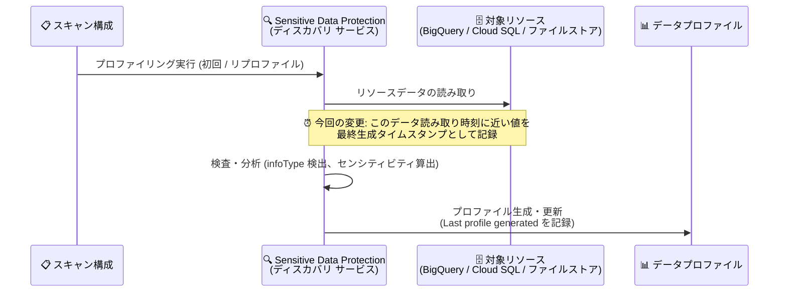

# Sensitive Data Protection: データプロファイルの最終生成タイムスタンプの精度向上

**リリース日**: 2026-11-03

**サービス**: Sensitive Data Protection

**機能**: データプロファイルの最終生成タイムスタンプ (Last profile generated) の精度向上

**ステータス**: Change (変更)

📊 [このアップデートのインフォグラフィックを見る](https://takech9203.github.io/google-cloud-news-summary/20261103-sensitive-data-protection-profile-timestamp-precision.html)

## 概要

Sensitive Data Protection のディスカバリ サービスが生成するデータプロファイルにおいて、「最終生成タイムスタンプ (Last profile generated / profileLastGenerated)」の記録精度が向上しました。今回の変更により、このタイムスタンプは実際にリソースのデータが読み取られた時刻に近い値として記録されるようになります。

データプロファイルは、BigQuery テーブル、Cloud SQL テーブル、Cloud Storage などのファイルストア、Vertex AI リソースに含まれる機密データのセンシティビティとデータリスクを可視化するメタデータです。「最終生成タイムスタンプ」はプロファイルの鮮度を判断する基準となるフィールドであり、データガバナンスやコンプライアンス監査において「この評価結果はいつ時点のデータに基づくものか」を示す重要な情報です。

この変更は、データプロファイルを BigQuery にエクスポートして鮮度を監視しているチームや、Security Command Center と連携してリスク評価を行っている組織にとって、プロファイルの時点をより正確に解釈できるようになる改善です。

**アップデート前の課題**

- 「最終生成タイムスタンプ」が、実際にリソースのデータを読み取った時刻と乖離する場合があった
- プロファイリング処理は読み取りから完了まで時間を要することがあり (リプロファイルは完了まで最大 24 時間かかる場合がある)、タイムスタンプだけでは「どの時点のデータ状態を反映した評価か」を正確に判断しにくかった
- プロファイルの鮮度を基準にデータ変更の反映有無を推定する運用では、評価時点の解釈に幅が生じていた

**アップデート後の改善**

- 最終生成タイムスタンプが、リソースデータの読み取り時刻に近い精度で記録されるようになった
- データプロファイルが「いつ時点のデータ」を反映しているかをより正確に把握できるようになった
- プロファイルの鮮度監視や監査証跡としての信頼性が向上した

## アーキテクチャ図



ディスカバリ サービスのプロファイリング処理フローを示しています。今回の変更により、最終生成タイムスタンプはプロファイルの出力時点ではなく、対象リソースのデータが読み取られた時刻に近い値として記録されます。

## サービスアップデートの詳細

### 主要機能

1. **最終生成タイムスタンプの精度向上**
   - データプロファイルの「Last profile generated (最終生成日時)」フィールドが、リソースデータの読み取り時刻に近い値で記録される
   - プロファイルが反映しているデータの時点をより正確に解釈できる

2. **対象となるタイムスタンプ フィールド**
   - プロジェクト データプロファイル、テーブル データプロファイル、ファイルストア データプロファイルの各メタデータに含まれる「最終生成日時」が対象
   - Google Cloud コンソールのダッシュボード表示、API レスポンス、BigQuery エクスポートのいずれでも参照されるフィールド

3. **既存ワークフローへの影響**
   - ユーザー側の設定変更は不要。既存のスキャン構成のまま、新しく生成・更新されるプロファイルに適用される
   - プロファイリングの頻度や課金体系に変更はない

## 技術仕様

### データプロファイルの主なタイムスタンプ関連メタデータ

| フィールド | 説明 |
|------|------|
| Profile first created | プロファイルが最初に作成された日時 |
| Last profile generated | プロファイルが最後に生成された日時 (今回精度が向上) |
| Latest update in BigQuery | 対象テーブルが最後に変更された日時 (BigQuery テーブル プロファイルの場合) |

### プロファイリングの頻度 (参考)

| 設定 | 動作 |
|------|------|
| 初回スキャン | スキャン構成作成後に実行 |
| デフォルトのリプロファイル | 30 日待機後、スキーマ・行・検査テンプレートの変更があれば再生成 (ディスカバリ タイプにより条件が異なる) |
| カスタム頻度 | 再生成しない / 毎日 / 毎週 / 毎月 から選択可能 |

リプロファイルの開始から完了までは最大 24 時間かかる場合があります。今回の変更により、完了タイミングに左右されず、データ読み取り時点に近いタイムスタンプが記録されます。

## メリット

### ビジネス面

- **監査・コンプライアンス対応の精度向上**: 「この機密データ評価はいつ時点のデータに基づくか」を正確に示せるため、監査証跡としての信頼性が高まる
- **データガバナンスの判断精度向上**: プロファイルの鮮度を基準としたレビューや棚卸しにおいて、評価時点の解釈のずれを減らせる

### 技術面

- **鮮度監視の正確化**: データプロファイルを BigQuery にエクスポートして鮮度を SQL で監視している場合、読み取り時点に基づくより正確な分析が可能になる
- **データ変更との突き合わせが容易に**: テーブルの最終更新日時 (Latest update in BigQuery など) とプロファイルのタイムスタンプを比較し、変更がプロファイルに反映済みかを判断しやすくなる
- **設定変更不要**: 既存のスキャン構成のまま自動的に適用される

## デメリット・制約事項

### 考慮すべき点

- タイムスタンプの解釈が「プロファイル生成完了時刻」から「データ読み取り時刻に近い値」に変わるため、このフィールドを厳密に利用している監視クエリやレポートがある場合は、変更後の値の意味を確認しておくことが望ましい
- 過去に生成済みのプロファイルのタイムスタンプが遡って修正されるものではなく、今後生成・更新されるプロファイルに適用される

## ユースケース

### ユースケース 1: BigQuery エクスポートによるプロファイル鮮度の監視

**シナリオ**: データプロファイルを BigQuery データセットに保存し、機密データ評価の鮮度を定期的に監視している。

**実装例**:
```sql
-- 最終生成から 30 日以上経過したテーブル プロファイルを抽出
SELECT
  table_id,
  profile_last_generated,
  TIMESTAMP_DIFF(CURRENT_TIMESTAMP(), profile_last_generated, DAY) AS days_since_profiled
FROM
  `my-project.dlp_profiles.table_profiles`
WHERE
  TIMESTAMP_DIFF(CURRENT_TIMESTAMP(), profile_last_generated, DAY) > 30
ORDER BY
  days_since_profiled DESC;
```

**効果**: タイムスタンプがデータ読み取り時点に近くなったことで、「評価がどの時点のデータに基づくか」を正確に判定でき、鮮度アラートの精度が向上する。

### ユースケース 2: データ変更とプロファイル反映状況の突き合わせ

**シナリオ**: 機密データを含む BigQuery テーブルに大規模なデータ投入を行った後、その変更が最新のデータプロファイルに反映されているかを確認したい。

**効果**: テーブルの最終更新日時とプロファイルの最終生成タイムスタンプ (データ読み取り時点に近い値) を比較することで、変更後のデータが評価済みかどうかをより確実に判断できる。

## 料金

今回の変更による料金への影響はありません。データプロファイリング (ディスカバリ) の料金は、サブスクリプション モードまたは従量課金モードに基づきます。詳細は料金ページを参照してください。

- [Sensitive Data Protection の料金](https://cloud.google.com/sensitive-data-protection/pricing)

## 関連サービス・機能

- **BigQuery**: データプロファイルの保存先として指定でき、プロファイルの履歴管理や SQL による分析が可能。タイムスタンプ精度向上の恩恵を最も受けやすい連携先
- **Security Command Center**: データプロファイルを公開することで、データのセンシティビティに基づくリソースの優先度付けが可能
- **Cloud SQL / Cloud Storage / Vertex AI**: BigQuery と並ぶディスカバリ (データプロファイリング) の対象リソース

## 参考リンク

- 📊 [インフォグラフィック](https://takech9203.github.io/google-cloud-news-summary/20261103-sensitive-data-protection-profile-timestamp-precision.html)
- [公式リリースノート](https://docs.cloud.google.com/release-notes#November_03_2026)
- [データプロファイルの概要](https://docs.cloud.google.com/sensitive-data-protection/docs/data-profiles)
- [データプロファイルの指標リファレンス](https://docs.cloud.google.com/sensitive-data-protection/docs/metrics-reference)
- [料金ページ](https://cloud.google.com/sensitive-data-protection/pricing)

## まとめ

データプロファイルの最終生成タイムスタンプが、実際のデータ読み取り時刻に近い精度で記録されるようになり、機密データ評価の「時点」をより正確に把握できるようになりました。ユーザー側の設定変更は不要ですが、このタイムスタンプを鮮度監視や監査レポートに利用している場合は、値の意味がデータ読み取り時点に近づいたことを踏まえてクエリやレポートの解釈を見直すことを推奨します。

---

**タグ**: #SensitiveDataProtection #DLP #DataProfiles #DataGovernance #Security #Change
