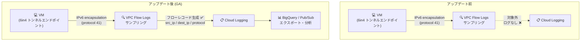

# Virtual Private Cloud: VPC Flow Logs の IPv6 カプセル化フローロギング対応 (GA)

**リリース日**: 2026-11-03

**サービス**: Virtual Private Cloud (VPC Flow Logs)

**機能**: IPv6 カプセル化 (IPv6 encapsulation) フローのロギング対応

**ステータス**: GA (一般提供)

📊 [このアップデートのインフォグラフィックを見る](https://takech9203.github.io/google-cloud-news-summary/20261103-vpc-flow-logs-ipv6-encapsulation-ga.html)

## 概要

VPC Flow Logs が IPv6 カプセル化 (IPv6 encapsulation、IANA プロトコル番号 41) フローのロギングに対応し、一般提供 (GA) となりました。IPv6 カプセル化は、IPv6 パケットを IPv4 パケット内にトンネリングする方式 (いわゆる 6in4 トンネル) で使用されるプロトコルです。今回のアップデートにより、VPC ネットワーク内でこの種のトンネルトラフィックが発生した場合も、VPC Flow Logs のサンプリング対象となり、ログレコードとして記録されるようになりました。

これまで VPC Flow Logs がサンプリングするプロトコルは TCP、UDP、ICMP、ESP、GRE、RDMA に限られており、IPv6 カプセル化フローはログに記録されず、ネットワーク可視性にギャップが存在していました。IPv4/IPv6 デュアルスタック移行期のトンネリングトラフィックや、オンプレミスとの IPv6 接続を IPv4 網上で運用している環境において、トラフィックの監視・監査・フォレンジックの網羅性が向上します。

ネットワーク管理者、セキュリティチーム、および IPv6 移行プロジェクトを進めている組織にとって、トンネルトラフィックを含めた包括的なフロー可視化が実現する重要なアップデートです。

**アップデート前の課題**

- VPC Flow Logs のサンプリング対象プロトコルに IPv6 カプセル化 (プロトコル番号 41) が含まれておらず、6in4 などの IPv6-in-IPv4 トンネルトラフィックがログに記録されなかった
- IPv6 移行期のトンネリングトラフィックが可視化されず、トラフィック分析やセキュリティ監査に死角が生じていた
- トンネルトラフィックの監視には Packet Mirroring などの別手段を検討する必要があった

**アップデート後の改善**

- IPv6 カプセル化フローが VPC Flow Logs のサンプリング・ロギング対象となり、トンネルトラフィックの可視化が可能になった
- `IpConnection` フィールドの `protocol` フィールドに IANA プロトコル番号が記録され、Cloud Logging 上でフィルタリング・分析が可能になった
- GA ステータスでの提供のため、本番環境の監視・監査要件にも安心して利用できる

## アーキテクチャ図



アップデート前は IPv6 カプセル化フローが VPC Flow Logs のサンプリング対象外でしたが、アップデート後はフローレコードが生成され、Cloud Logging や BigQuery での分析が可能になります。

## サービスアップデートの詳細

### 主要機能

1. **IPv6 カプセル化フローのロギング**
   - IPv6 カプセル化 (IANA プロトコル番号 41) のフローが VPC Flow Logs のログレコードとして記録される
   - 送信元 / 宛先 IP アドレス、プロトコル番号などの接続情報が `IpConnection` フィールドに記録される

2. **`IpConnection` フィールドでのプロトコル情報の記録**
   - `protocol` フィールド (IANA プロトコル番号) は TCP、UDP、ICMP、ESP、GRE に加えて IPv6 カプセル化フローでも記録される
   - `src_port` / `dest_port` は、ICMP、ESP、GRE、RDMA と同様に IPv6 カプセル化フローでは記録されない (ポート概念を持たないプロトコルのため)

3. **既存の VPC Flow Logs 機能との統合**
   - 既存のサンプリング、集約間隔、メタデータアノテーション、フィルタリングといった VPC Flow Logs の構成オプションの枠組みの中で動作する

## 技術仕様

### IpConnection フィールドにおける IPv6 カプセル化フローの扱い

| フィールド | 型 | IPv6 カプセル化フローでの扱い |
|------|------|------|
| `src_ip` | string | 記録される (すべてのフローで記録) |
| `dest_ip` | string | 記録される (すべてのフローで記録) |
| `src_port` | int32 | 記録されない (ICMP、ESP、GRE、RDMA と同様) |
| `dest_port` | int32 | 記録されない (ICMP、ESP、GRE、RDMA と同様) |
| `protocol` | int32 | 記録される (IANA プロトコル番号) |

### ログの確認例

Cloud Logging で IPv6 カプセル化フローを抽出するクエリの例:

```
resource.type="gce_subnetwork"
log_id("compute.googleapis.com/vpc_flows")
jsonPayload.connection.protocol=41
```

## 設定方法

### 前提条件

1. VPC ネットワークを使用していること (レガシーネットワークは非対応)
2. 対象サブネットで VPC Flow Logs が有効化されていること

### 手順

#### ステップ 1: サブネットで VPC Flow Logs を有効化

```bash
gcloud compute networks subnets update SUBNET_NAME \
    --region=REGION \
    --enable-flow-logs \
    --logging-aggregation-interval=interval-5-sec \
    --logging-flow-sampling=0.5 \
    --logging-metadata=include-all
```

既に VPC Flow Logs が有効なサブネットでは、追加の設定は不要です。IPv6 カプセル化フローは自動的にサンプリング対象となります。

#### ステップ 2: Cloud Logging でログを確認

```bash
gcloud logging read 'resource.type="gce_subnetwork" AND log_id("compute.googleapis.com/vpc_flows") AND jsonPayload.connection.protocol=41' \
    --limit=10 \
    --format=json
```

プロトコル番号 41 (IPv6 encapsulation) のフローレコードが記録されていることを確認します。

## メリット

### ビジネス面

- **監査・コンプライアンス対応の強化**: トンネルトラフィックを含むネットワークフローの網羅的な記録により、監査要件やフォレンジック調査への対応力が向上する
- **IPv6 移行の推進**: IPv6 移行期に発生するトンネリングトラフィックを可視化できるため、移行計画の進捗把握やトラブルシューティングが容易になる

### 技術面

- **可視性ギャップの解消**: 従来サンプリング対象外だった IPv6 カプセル化フローがログに記録され、ネットワーク監視の死角が減少する
- **既存ワークフローとの統合**: Cloud Logging、BigQuery エクスポート、ログベースのアラートなど、既存の VPC Flow Logs 分析パイプラインをそのまま利用できる
- **追加設定不要**: VPC Flow Logs が有効なサブネットでは追加の構成変更なしで IPv6 カプセル化フローが記録される

## デメリット・制約事項

### 制限事項

- IPv6 カプセル化フローでは `src_port` / `dest_port` フィールドは記録されない (プロトコルの性質上、ポートの概念がないため)
- VPC Flow Logs はサンプリングベースであり、すべてのパケットが記録されるわけではない。全パケットの分析が必要な場合は Packet Mirroring の利用を検討する

### 考慮すべき点

- ログ記録対象のフローが増えることで、Cloud Logging の取り込み・保存コストが増加する可能性がある。必要に応じてフィルタリングやセカンダリサンプリングレートの調整を検討する
- カプセル化された内部の IPv6 パケットの内容 (内部ヘッダー) ではなく、外部ヘッダーに基づくフロー情報が記録される点に留意する

## ユースケース

### ユースケース 1: IPv6 移行期のトンネルトラフィック監視

**シナリオ**: IPv4 ネットワーク上で 6in4 トンネルを使用して IPv6 接続を提供している環境で、トンネルトラフィックの量や通信先を把握したい。

**実装例**:
```
resource.type="gce_subnetwork"
log_id("compute.googleapis.com/vpc_flows")
jsonPayload.connection.protocol=41
```

**効果**: トンネルトラフィックのフローレコードを BigQuery にエクスポートして分析することで、トンネル利用状況の定量的な把握と、ネイティブ IPv6 への移行判断材料の収集が可能になる。

### ユースケース 2: セキュリティ監視における異常なトンネルトラフィックの検知

**シナリオ**: セキュリティチームが、想定外の IPv6 カプセル化トラフィック (許可していないトンネリングによるデータ持ち出しの可能性など) を検知したい。

**効果**: プロトコル番号 41 のフローに対するログベースのアラートを設定することで、想定外のトンネルトラフィック発生時に迅速に検知・対応できる。

## 料金

VPC Flow Logs の料金は Network Telemetry の料金体系に基づきます。ログ生成に対して課金され、Cloud Logging にログを保存する場合は Cloud Logging の取り込み・保存料金が別途適用されます。今回のアップデートによる料金体系の変更はありませんが、記録対象フローの増加に伴いログ量が増える可能性があります。

詳細は [Network Telemetry の料金ページ](https://cloud.google.com/vpc/pricing#network-telemetry) を参照してください。

## 利用可能リージョン

リージョン固有の制限に関する記載はリリースノートにありません。詳細は [VPC Flow Logs ドキュメント](https://docs.cloud.google.com/vpc/docs/flow-logs) を参照してください。

## 関連サービス・機能

- **Cloud Logging**: VPC Flow Logs のログレコードの保存・検索・分析基盤。ログベースのアラート設定にも利用
- **BigQuery**: フローログをエクスポートして大規模なトラフィック分析を行う際に利用
- **Packet Mirroring**: サンプリングではなく全パケットの詳細分析が必要な場合の補完手段
- **Cloud NAT**: `IpConnection` フィールドには Cloud NAT ゲートウェイの NAT IP / ポート情報も記録される
- **Network Intelligence Center**: フローログを活用したネットワーク可視化・分析ツール群

## 参考リンク

- 📊 [インフォグラフィック](https://takech9203.github.io/google-cloud-news-summary/20261103-vpc-flow-logs-ipv6-encapsulation-ga.html)
- [公式リリースノート](https://docs.cloud.google.com/release-notes#November_03_2026)
- [IpConnection フィールド形式 (About VPC Flow Logs records)](https://docs.cloud.google.com/vpc/docs/about-flow-logs-records#IpConnection)
- [VPC Flow Logs ドキュメント](https://docs.cloud.google.com/vpc/docs/flow-logs)
- [料金ページ (Network Telemetry)](https://cloud.google.com/vpc/pricing#network-telemetry)

## まとめ

VPC Flow Logs が IPv6 カプセル化フローのロギングに GA 対応し、これまで可視化できなかったトンネルトラフィックの監視が可能になりました。VPC Flow Logs を有効化済みの環境では追加設定なしで記録が始まるため、プロトコル番号 41 のフローを対象としたダッシュボードやアラートの整備を検討することを推奨します。IPv6 移行を進めている組織は、移行期のトラフィック把握にこの機能を活用できます。

---

**タグ**: #VPC #VPCFlowLogs #IPv6 #ネットワーク監視 #CloudLogging #GA
