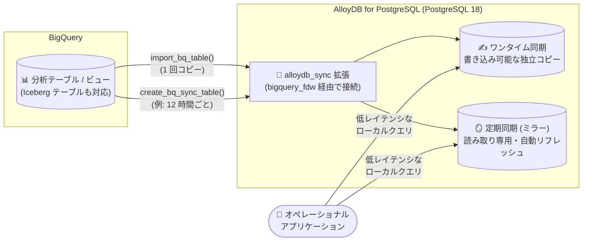

# AlloyDB for PostgreSQL: BigQuery データ同期 (alloydb_sync 拡張) が GA

**リリース日**: 2026-11-04

**サービス**: AlloyDB for PostgreSQL

**機能**: BigQuery から AlloyDB へのデータ同期 (alloydb_sync 拡張)

**ステータス**: GA (一般提供)

📊 [このアップデートのインフォグラフィックを見る](https://takech9203.github.io/google-cloud-news-summary/20261104-alloydb-bigquery-sync-ga.html)

## 概要

BigQuery から AlloyDB for PostgreSQL へデータを同期する機能が一般提供 (GA) になりました。`alloydb_sync` 拡張を使用して、BigQuery の分析テーブルを AlloyDB にコピー (ワンタイム同期) またはミラーリング (定期同期) し、低レイテンシなオペレーショナルアクセスを実現できます。

従来の Foreign Data Wrapper (`bigquery_fdw`) が BigQuery 上のデータをリモートクエリするのに対し、この同期機能はデータそのものを AlloyDB のローカルストレージにコピーします。これにより、アプリケーションからのクエリはローカルテーブルを読み取るだけで済み、パフォーマンスが大幅に向上します。顧客セグメンテーションや ML 予測結果などの分析成果物をトランザクショナルなアプリケーションから高速に参照したいユーザーに適した機能です。

SQL 関数 (`psql`) だけでなく Google Cloud コンソールの BigQuery 画面からも「Export or sync to AlloyDB」操作で設定でき、BigQuery 側を起点としたワークフローにも対応しています。

**アップデート前の課題**

- `bigquery_fdw` による外部テーブル参照では、クエリのたびに BigQuery へリモートアクセスが発生し、オペレーショナルワークロードが要求する低レイテンシを満たせない場合があった
- BigQuery の分析結果を AlloyDB に取り込むには、エクスポート/インポートのパイプライン (リバース ETL) を自前で構築・運用する必要があった
- 定期的にデータを最新化するには、スケジューラやジョブ管理の仕組みを別途用意する必要があった

**アップデート後の改善**

- `alloydb_sync.import_bq_table()` の 1 回の SQL 呼び出しで、BigQuery テーブルの書き込み可能な独立コピーを AlloyDB 内に作成できるようになった
- `alloydb_sync.create_bq_sync_table()` により、指定した間隔 (例: 12 時間ごと) で自動リフレッシュされる読み取り専用のミラーテーブルを作成できるようになった
- `alloydb_sync.job_status` ビューでジョブの進捗 (処理済みレコード数など) を監視し、`cancel_import_job()` でキャンセルするなど、ジョブ管理が SQL で完結するようになった
- GA に伴い、本番ワークロードでの利用が公式にサポートされた

## アーキテクチャ図



BigQuery の分析テーブルを `alloydb_sync` 拡張がローカルの AlloyDB ストレージへコピーし、アプリケーションはリモートアクセスなしで低レイテンシにデータを参照できます。

## サービスアップデートの詳細

### 主要機能

1. **ワンタイム同期 (`alloydb_sync.import_bq_table()`)**
   - BigQuery テーブル/ビューのデータを AlloyDB にストリーミングし、完全に独立した書き込み可能な PostgreSQL テーブルを作成
   - 同期後のテーブルには `INSERT`/`UPDATE`/`DELETE` を自由に実行可能
   - `on_exists` パラメータで既存テーブルがある場合の動作を制御 (`error` / `skip` / `replace`)
   - `primary_key` パラメータで主キー列を指定可能

2. **定期同期・ミラーリング (`alloydb_sync.create_bq_sync_table()`)**
   - BigQuery データと同期され続ける読み取り専用のローカルテーブルを作成
   - `refresh_interval` で自動リフレッシュ間隔を指定 (例: `12 hours`)
   - 定期リフレッシュを機能させるには `on_exists` を `replace` に設定することが推奨されている

3. **ジョブの監視・管理**
   - `alloydb_sync.job_status` ビューでステータス、処理済みレコード数、総レコード数、エラーメッセージを確認可能
   - `alloydb_sync.cancel_import_job('<ジョブ UUID>')` で実行中ジョブをキャンセル
   - `alloydb_sync.delete_bq_sync_table()` でミラーテーブルとスケジュールを削除 (通常の `DROP TABLE` は使用禁止)

4. **Google Cloud コンソールからの設定**
   - BigQuery の Explorer からテーブルを選択し「Export or sync to AlloyDB」で同期を設定可能
   - 既存クラスタへのエクスポートに加え、新規 AlloyDB クラスタ (無料トライアルクラスタ含む) の作成からの導線も用意

## 技術仕様

### 前提条件と構成要素

| 項目 | 詳細 |
|------|------|
| 対応 PostgreSQL バージョン | PostgreSQL 18 のみ |
| 必須データベースフラグ | `alloydb_sync.enabled=on` |
| 必要な拡張 | `alloydb_sync` (内部で `bigquery_fdw` を使用) |
| 外部サーバー名 | `bigquery_server` という名前が必須 |
| 必要な API | AlloyDB API、BigQuery Storage API など |
| クラスタ SA に必要な IAM ロール | BigQuery Data Viewer、BigQuery Read Session User、BigQuery Job User |

### 主なデータ型マッピング

| BigQuery データ型 | PostgreSQL データ型 |
|------|------|
| BOOLEAN | BOOLEAN |
| INTEGER (INT64) | BIGINT |
| FLOAT (FLOAT64) | DOUBLE PRECISION |
| STRING | TEXT |
| NUMERIC / BIGNUMERIC | NUMERIC |
| DATE / TIMESTAMP / TIME / DATETIME | DATE / TIMESTAMPTZ / TIME / TIMESTAMP |
| JSON | JSONB |
| BYTES | BYTEA |

## 設定方法

### 前提条件

1. AlloyDB インスタンス (PostgreSQL 18) にデータベースフラグ `alloydb_sync.enabled=on` を設定する
2. AlloyDB クラスタのサービスアカウントに、同期元 BigQuery データセットへの IAM ロール (BigQuery Data Viewer、Read Session User、Job User) を付与する
3. 同期元となる BigQuery テーブルを用意する

### 手順

#### ステップ 1: 拡張の作成と BigQuery 接続の構成

```sql
-- 同期したいデータベースごとに実行
CREATE EXTENSION IF NOT EXISTS alloydb_sync;

-- BigQuery への認証用に外部サーバーとユーザーマッピングを作成
CREATE EXTENSION IF NOT EXISTS bigquery_fdw;
CREATE SERVER IF NOT EXISTS bigquery_server
  FOREIGN DATA WRAPPER bigquery_fdw
  OPTIONS (runtime_project 'RUNTIME_PROJECT_ID');
CREATE USER MAPPING IF NOT EXISTS FOR USER SERVER bigquery_server;
```

外部サーバー名は `bigquery_server` にする必要があります。`runtime_project` はクエリを処理しコンピュートコストが計上されるプロジェクトで、省略時はデータ保管プロジェクトに課金されます。Google Cloud コンソールから設定する場合、これらの手順は自動実行されます。

#### ステップ 2: ワンタイム同期の実行

```sql
SELECT alloydb_sync.import_bq_table(
  'my-gcp-project.sales_data.transactions',
  'public.local_sales',
  'replace'
);
```

BigQuery の `transactions` テーブルを書き込み可能なローカルテーブル `public.local_sales` としてインポートします。

#### ステップ 3: 定期同期 (ミラー) の作成

```sql
SELECT alloydb_sync.create_bq_sync_table(
  'my-gcp-project.crm_data.profiles',
  'public.customer_mirror',
  '12 hours',
  'replace'
);
```

12 時間ごとに自動リフレッシュされる読み取り専用のミラーテーブルを作成します。

#### ステップ 4: ジョブの監視

```sql
SELECT import_id, status, records_processed, total_records, error_message
FROM alloydb_sync.job_status;
```

## メリット

### ビジネス面

- **リバース ETL パイプラインの運用コスト削減**: BigQuery の分析結果をアプリケーション DB に還流させる仕組みを、外部ツールなしで SQL のみで構築できる
- **分析データの即時活用**: 顧客セグメントや ML 予測などの分析成果物をオペレーショナルアプリケーションで直接利用でき、データ活用のリードタイムを短縮できる

### 技術面

- **低レイテンシ**: クエリが AlloyDB のローカルストレージを読むため、BigQuery へのリモートクエリ (FDW 方式) に比べて応答が高速
- **用途に応じた 2 つのモード**: 編集可能な独立コピー (ワンタイム) と自動リフレッシュされる読み取り専用ミラー (定期) を使い分けられる
- **SQL で完結するジョブ管理**: ジョブの進捗監視・キャンセル・削除がすべて SQL 関数とビューで完結する

## デメリット・制約事項

### 制限事項

- PostgreSQL バージョン 18 のみサポート
- `ARRAY`、`STRUCT`、`VECTOR`、`GEOGRAPHY`、`RANGE`、`INTERVAL` などの複合データ型は同期に非対応。`STRING(L)` や `NUMERIC(P, S)` などのパラメータ化型は `TEXT` にマッピングされる
- `refresh_interval` は月・年を指定できず、日・24 未満の時間・60 未満の分/秒の単一単位で指定する必要がある (`90 minutes` のような混合指定は切り捨てられる)
- ジョブの閲覧・キャンセル・同期テーブルの削除は、ジョブを開始したデータベースユーザーのみが実行可能
- `replace` 操作中は既存テーブルが先に削除・再作成されるため、同期完了まで並行クエリには空または部分的なデータが見える

### 考慮すべき点

- データ移動は CPU とメモリを消費するため、大規模テーブルの同期はオフピーク時間帯にスケジュールすることが推奨される
- 非常に大きなテーブルのインポートでは `temp_file_limit` (必要に応じて `work_mem` も) の引き上げが必要になる場合がある
- 同期テーブルの削除には必ず `alloydb_sync.delete_bq_sync_table()` を使用する。手動の `DROP TABLE` はバックグラウンドスケジューラのフックが残り、エラーの継続発生やワーカースロット枯渇の原因になる
- インポート中に BigQuery 側のソーステーブルを変更すると、更新後のデータが取り込まれる可能性がある

## ユースケース

### ユースケース 1: 分析結果によるオペレーショナル DB のエンリッチメント

**シナリオ**: BigQuery で計算した顧客セグメンテーションや ML 予測結果を、トランザクショナルなアプリケーションからリアルタイムに参照したい。

**実装例**:
```sql
SELECT alloydb_sync.create_bq_sync_table(
  'my-gcp-project.analytics.customer_segments',
  'public.customer_segments_mirror',
  '6 hours',
  'replace'
);
```

**効果**: アプリケーションはローカルテーブルを結合するだけで最新の分析結果を利用でき、BigQuery へのリモートクエリのレイテンシやオーバーヘッドを回避できる。

### ユースケース 2: 履歴データの独立コピーを使った加工・ベクトル化

**シナリオ**: BigQuery の分析データのローカルコピーを取得し、ソースデータセットとは独立して加工・インデックス作成 (例: AlloyDB AI によるベクトル埋め込み生成) を行いたい。

**効果**: `import_bq_table()` で作成されるテーブルは書き込み可能な独立コピーのため、ソースに影響を与えずに `UPDATE` やインデックス追加、埋め込み列の付与などを自由に実行できる。

## 料金

`alloydb_sync` 拡張自体の追加料金に関する個別の記載は確認できませんでした。同期したデータは AlloyDB のストレージに保存されるため、AlloyDB のコンピュート・ストレージ料金が適用されます。また、外部サーバー構成時の `runtime_project` には BigQuery 側のクエリ処理に伴うコンピュートコストが計上されます (省略時はデータ保管プロジェクトに課金)。

詳細は各料金ページを参照してください。

- [AlloyDB for PostgreSQL の料金](https://cloud.google.com/alloydb/pricing)
- [BigQuery の料金](https://cloud.google.com/bigquery/pricing)

## 利用可能リージョン

リージョンごとの提供状況に関する個別の記載は確認できませんでした。詳細は [AlloyDB のドキュメント](https://docs.cloud.google.com/alloydb/docs/sync-bigquery-data-to-alloydb) を参照してください。

## 関連サービス・機能

- **BigQuery**: 同期元となるデータウェアハウス。テーブル・ビューに加え、4 部構成名の Iceberg テーブルも同期元として指定可能
- **bigquery_fdw (Foreign Data Wrapper)**: `alloydb_sync` が BigQuery への接続に内部利用する拡張。データをコピーせずリモート参照したい場合は FDW 単体の利用も選択肢
- **BigQuery Storage Read API**: データ読み取りに使用され、クラスタのサービスアカウントに Read Session User ロールが必要
- **AlloyDB AI**: 取り込んだローカルデータに対するベクトル埋め込み生成など、同期データの後段活用で組み合わせ可能

## 参考リンク

- 📊 [インフォグラフィック](https://takech9203.github.io/google-cloud-news-summary/20261104-alloydb-bigquery-sync-ga.html)
- [公式リリースノート](https://docs.cloud.google.com/release-notes#November_04_2026)
- [ドキュメント: Sync BigQuery data to AlloyDB](https://docs.cloud.google.com/alloydb/docs/sync-bigquery-data-to-alloydb)
- [ドキュメント: BigQuery データへのアクセス方法の選択](https://docs.cloud.google.com/alloydb/docs/choose-access-bigquery-data-from-alloydb)
- [料金ページ](https://cloud.google.com/alloydb/pricing)

## まとめ

BigQuery から AlloyDB へのデータ同期が GA となり、リバース ETL を自前で構築することなく、SQL 関数またはコンソール操作だけで分析データをオペレーショナル DB に還流できるようになりました。BigQuery の分析結果を低レイテンシでアプリケーションに提供したい場合は、PostgreSQL 18 ベースの AlloyDB インスタンスで `alloydb_sync.enabled=on` を設定し、ワンタイム同期と定期ミラーリングのどちらが要件に合うかを検証することをお勧めします。

---

**タグ**: #AlloyDB #BigQuery #PostgreSQL #DataSync #ReverseETL #GA
