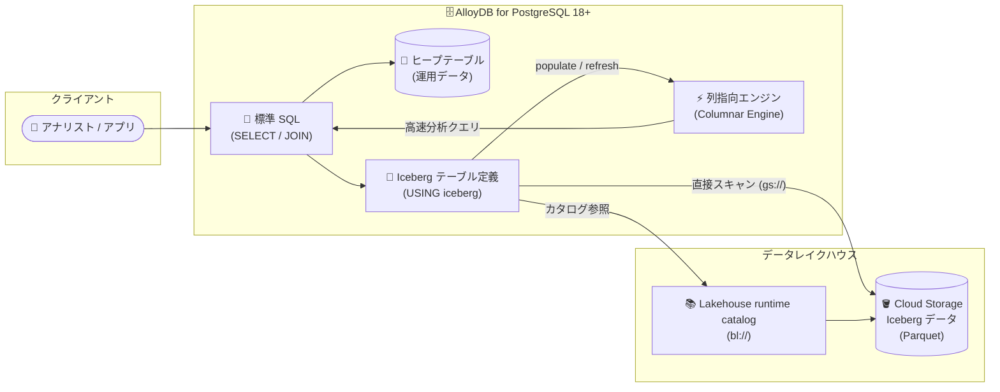

# AlloyDB for PostgreSQL: Direct Iceberg access (Preview)

**リリース日**: 2026-11-04

**サービス**: AlloyDB for PostgreSQL

**機能**: Direct Iceberg access (Apache Iceberg テーブルへの直接クエリ)

**ステータス**: Preview

📊 [このアップデートのインフォグラフィックを見る](https://takech9203.github.io/google-cloud-news-summary/20261104-alloydb-direct-iceberg-access-preview.html)

## 概要

AlloyDB for PostgreSQL で、Cloud Storage または Lakehouse runtime catalog に保存された Apache Iceberg テーブルを直接クエリできる「Direct Iceberg access」が Preview として利用可能になりました。本機能は PostgreSQL 18 以降の AlloyDB で利用でき、標準の SQL (SELECT) で Iceberg データセットを読み取れます。

最大の特徴は、AlloyDB の組み込み列指向エンジン (columnar engine) との統合です。Iceberg テーブルをストリーミングで直接スキャンするだけでなく、`google_columnar_engine_add()` 関数でテーブルを列指向エンジンのメモリに取り込む (populate) ことで、スキャン・結合・集計を高速化し、サブ秒レベルの分析クエリを実現します。複雑な ETL パイプラインを構築・運用することなく、データレイクハウス上のデータに対して高性能な分析クエリを実行できます。

運用系データベースとして AlloyDB を使いながら、データレイクハウスの履歴データも同じ SQL インターフェースで分析したい組織にとって、「Zero-ETL」でレイクハウスにアクセスできる重要なアップデートです。AlloyDB のヒープテーブル (運用データ) と Iceberg テーブル (大量の履歴データ) を JOIN することも可能です。

**アップデート前の課題**

- AlloyDB から Cloud Storage 上の Iceberg テーブルを直接クエリする手段がなく、データを分析するには ETL パイプラインを構築して AlloyDB や別の分析システムにデータをコピー・移動する必要があった
- 運用データ (AlloyDB) と履歴データ (データレイクハウス) を組み合わせた分析には、別の分析基盤 (BigQuery など) へのデータ統合が必要で、データの鮮度維持とパイプライン運用のコストが発生していた
- データレイクハウス上のオープンフォーマット (Iceberg) のデータを PostgreSQL の使い慣れた SQL で扱うことができなかった

**アップデート後の改善**

- Zero-ETL レイクハウスアクセス: データをコピー・移動せずに、外部の Iceberg データセットをその場でクエリできるようになった
- トランザクションと分析の統合: AlloyDB のヒープテーブルにあるライブな運用データと、Cloud Storage 上の Iceberg テーブルにある大量の履歴データを JOIN できるようになった
- 柔軟なカタログ統合: Cloud Storage バケットパス (`gs://`) または Lakehouse runtime catalog (`bl://`) 経由で Iceberg テーブルのメタデータにアクセスできるようになった
- 列指向エンジンによる高速化: Iceberg テーブルを列指向エンジンのメモリに取り込み、サブ秒レベルの分析処理が可能になった

## アーキテクチャ図



AlloyDB は `USING iceberg` で定義したテーブル経由で Cloud Storage 上の Iceberg データを直接スキャンするか、列指向エンジンのメモリに取り込んで高速に分析クエリを処理します。運用データ (ヒープテーブル) との JOIN も単一の SQL で実行できます。

## サービスアップデートの詳細

### 主要機能

1. **Iceberg テーブルへの直接クエリ (Zero-ETL)**
   - PostgreSQL の Table Access Method (TAM) インターフェース (`USING iceberg`) を利用して、Cloud Storage 上の Iceberg テーブルを AlloyDB のテーブルとして定義
   - 標準の SQL (SELECT) で Iceberg データをクエリ可能。ETL パイプラインの構築・管理・保守が不要
   - `CREATE TABLE ... AS SELECT` で Iceberg データのローカルコピー (書き込み可能) を作成することも可能

2. **2 つの読み取りモード**
   - **直接スキャン (Direct scan)**: 最新の Iceberg スナップショットのメタデータ・データファイルを Cloud Storage からストリーミングで読み取り、列指向エンジンが処理
   - **列指向エンジンアクセラレーション**: `google_columnar_engine_add()` でテーブルをメモリ上の列指向ストアに取り込み、以降のクエリはメモリから読み取ることでスループットを最大化・レイテンシを最小化

3. **柔軟なカタログ統合**
   - 直接の Cloud Storage バケットパス (`gs://BUCKET/PATH`) と Lakehouse runtime catalog の URI (`bl://projects/.../tables/...`) の両方をサポート
   - Lakehouse runtime catalog はエンドユーザー認証情報モードで利用可能

4. **運用データとの統合クエリ**
   - AlloyDB ヒープテーブルのライブな運用データと Iceberg テーブルの大量の履歴データを JOIN し、単一の SQL で横断分析が可能

## 技術仕様

### 主要な仕様

| 項目 | 詳細 |
|------|------|
| 対象バージョン | PostgreSQL 18 以降の AlloyDB |
| テーブル作成権限 | `alloydbsuperuser` ロールを持つデータベースユーザーのみ。作成後は `GRANT SELECT` で他ユーザーにクエリ権限を付与可能 |
| サポート操作 | SELECT (DQL) のみ。INSERT / UPDATE / DELETE / TRUNCATE は非サポート (読み取り専用) |
| データファイル形式 | Parquet (ORC は非サポート)。メタデータは JSON / Avro |
| カタログ | `gs://` (Cloud Storage 直接パス)、`bl://` (Lakehouse runtime catalog、エンドユーザー認証情報モードのみ) |
| スナップショット | 直接スキャンは常に最新スナップショット、列指向エンジン利用時は取り込み時点のスナップショットで実行。ポイントインタイムクエリは非サポート |
| Iceberg 仕様 | Iceberg v2 の delete files (positional / equality deletes)、v3 の deletion vectors は非サポート |

### サポートされるデータ型 (抜粋)

| Apache Iceberg データ型 | AlloyDB データ型 |
|------|------|
| boolean | BOOLEAN |
| int / long | INT / BIGINT |
| float / double | REAL / DOUBLE PRECISION |
| decimal(P, S) | NUMERIC(P, S) |
| string | TEXT / VARCHAR |
| date | DATE |
| timestamp / timestamptz | TIMESTAMP / TIMESTAMPTZ |

### 必要なデータベースフラグ

| フラグ | 値 | 説明 |
|------|------|------|
| `google_columnar_engine.enabled` | `on` | 列指向エンジンを有効化 |
| `google_columnar_engine.enable_iceberg_reads` | `on` | Direct Iceberg access を有効化 (インスタンス再起動が必要) |
| `google_columnar_engine.memory_size_in_mb` | 任意のサイズ | (オプション) 列指向エンジンへのメモリ割り当て。テーブルをメモリに取り込む場合に推奨 |

## 設定方法

### 前提条件

1. PostgreSQL 18 以降の AlloyDB クラスタを作成していること
2. Iceberg テーブルが Cloud Storage にホストされている (標準の Iceberg レイアウト: `data/`、`metadata/`、`version-hint.text`)、または Lakehouse runtime catalog に登録されていること
3. AlloyDB クラスタのサービスアカウントに IAM ロールを付与していること
   - Cloud Storage: 対象バケットへの Storage Object Viewer (`roles/storage.objectViewer`)
   - Lakehouse runtime catalog 利用時: カタログをホストするプロジェクトへの BigLake Viewer (`roles/biglake.viewer`)
4. `alloydbsuperuser` ロールを持つデータベースユーザーの認証情報を準備していること

### 手順

#### ステップ 1: クラスタのサービスアカウントを確認し IAM ロールを付与

```bash
# クラスタのサービスアカウントを確認 (serviceAccountEmail フィールド)
gcloud beta alloydb clusters describe CLUSTER_ID --region=REGION_ID

# Cloud Storage バケットへの読み取り権限を付与
gcloud storage buckets add-iam-policy-binding \
  gs://BUCKET_NAME \
  --member="serviceAccount:SERVICE_ACCOUNT_EMAIL" \
  --role="roles/storage.objectViewer"
```

#### ステップ 2: データベースフラグを設定

```bash
gcloud alloydb instances update INSTANCE_ID \
  --cluster=CLUSTER_ID \
  --region=REGION_ID \
  --database-flags=google_columnar_engine.enabled=on,google_columnar_engine.enable_iceberg_reads=on
```

`google_columnar_engine.enable_iceberg_reads` の有効化にはインスタンスの再起動が必要です。

#### ステップ 3: Iceberg テーブルを作成

```sql
-- Cloud Storage パスから作成する例
CREATE TABLE customer_orders (
  order_id BIGINT,
  customer_id INT,
  order_status TEXT,
  total_amount DOUBLE PRECISION,
  order_date DATE,
  is_completed BOOLEAN
) USING iceberg
WITH (
  uri = 'gs://my-iceberg-analytics-bucket/datasets/sales/customer_orders'
);
```

カラム名とデータ型は、基盤となる Iceberg テーブルのスキーマと一致させる必要があります。Lakehouse runtime catalog の場合は `uri` に `bl://projects/PROJECT_ID/catalogs/CATALOG_NAME/databases/DATABASE_NAME/tables/TABLE_NAME` 形式を指定します。

#### ステップ 4: クエリの実行と列指向エンジンへの取り込み

```sql
-- 標準 SQL でクエリ (運用テーブルとの JOIN も可能)
SELECT c.customer_name, SUM(o.total_amount) AS historical_spend
FROM customer_orders o
JOIN customers c ON o.customer_id = c.customer_id
GROUP BY c.customer_name;

-- 列指向エンジンに取り込んで高速化
SELECT google_columnar_engine_add('customer_orders');

-- 基盤の Iceberg テーブルに新しいスナップショットが書き込まれたら更新
SELECT google_columnar_engine_refresh('customer_orders');

-- 列指向エンジンの利用を EXPLAIN で確認 (Custom Scan (ColumnarScan) が表示される)
EXPLAIN (ANALYZE, COSTS OFF)
SELECT SUM(total_amount) FROM customer_orders WHERE is_completed = true;
```

## メリット

### ビジネス面

- **ETL パイプラインの構築・運用コスト削減**: データレイクハウスのデータをコピー・移動せずにその場で分析でき、パイプラインの開発・保守にかかる工数とコストを削減できる
- **データ活用のリードタイム短縮**: 運用データと履歴データを単一の SQL で横断分析でき、意思決定に必要なインサイトを迅速に得られる
- **オープンフォーマットの活用**: Apache Iceberg というオープンな標準フォーマットのデータ資産を、AlloyDB からそのまま活用できる

### 技術面

- **Zero-ETL アーキテクチャ**: `USING iceberg` のテーブル定義だけで Cloud Storage 上のデータにアクセスでき、データの二重管理が不要
- **列指向エンジンによる高速化**: メモリ上の列指向ストアに取り込むことで、スキャン・結合・集計がサブ秒レベルで実行可能
- **使い慣れた PostgreSQL インターフェース**: 標準 SQL、GRANT による権限管理、EXPLAIN による実行計画確認など、PostgreSQL の運用ノウハウをそのまま活用できる

## デメリット・制約事項

### 制限事項

- PostgreSQL 18 以降の AlloyDB でのみ利用可能
- 読み取り専用 (SELECT のみ)。Iceberg テーブルへの書き込み (INSERT / UPDATE / DELETE / TRUNCATE) は非サポート
- Iceberg テーブルの作成は `alloydbsuperuser` ロールを持つユーザーのみ可能
- データファイルは Parquet のみサポート (ORC は非サポート)
- Iceberg v2 の delete files、v3 の deletion vectors は非サポート
- ポイントインタイムクエリ (スナップショット指定) は非サポート
- `ALTER TABLE` によるスキーマ変更は非サポート。基盤の Iceberg テーブルがスキーマ移行を経ていないことが前提
- Lakehouse runtime catalog はエンドユーザー認証情報モードのみサポート (credential vending モードや他の REST カタログは非対応)
- Requester Pays の Cloud Storage バケットは非サポート
- 列指向エンジンへの部分的な取り込み (partial population) は非サポート。テーブル全体が列指向エンジンのメモリまたは SSD 領域に収まる必要がある

### 考慮すべき点

- Preview 機能のため、Pre-GA Offerings Terms が適用され、サポートが限定的な場合がある。本番環境への適用は GA を待つことを推奨
- 列指向エンジン利用時は取り込み時点のスナップショットでクエリが実行されるため、基盤データが更新された場合は `google_columnar_engine_refresh()` での更新が必要 (更新しないと古いデータが返る可能性がある)
- 直接スキャンでは `REPEATABLE READ` や `SERIALIZABLE` トランザクション内でも各ステートメントが最新スナップショットを読むため、トランザクション分離の挙動が通常のテーブルと異なる
- 大きな Parquet row group を含むテーブルの取り込みでは、ワーカーあたりの population heap メモリ上限を超える場合がある (vCPU の少ないインスタンスで発生しやすい)。`google_job_scheduler.max_parallel_workers_per_job = 0` の設定などで回避可能
- 列指向エンジン用のメモリ割り当て (`google_columnar_engine.memory_size_in_mb`) の設計が必要

## ユースケース

### ユースケース 1: 運用データと履歴データの横断分析

**シナリオ**: EC サイトの顧客マスタは AlloyDB で管理し、過去数年分の注文履歴は Iceberg 形式で Cloud Storage のデータレイクハウスに保存している。顧客ごとの累計購入額を分析したい。

**実装例**:
```sql
SELECT
  c.customer_name,
  c.account_tier,
  COUNT(o.order_id) AS total_orders,
  SUM(o.total_amount) AS historical_spend
FROM customer_orders o  -- Iceberg テーブル (Cloud Storage)
JOIN customers c        -- AlloyDB ヒープテーブル (運用データ)
  ON o.customer_id = c.customer_id
WHERE o.is_completed = true
GROUP BY c.customer_name, c.account_tier
ORDER BY historical_spend DESC;
```

**効果**: ETL なしでライブな顧客データと大量の履歴データを単一 SQL で結合分析でき、データ統合パイプラインの構築・運用が不要になる。

### ユースケース 2: 列指向エンジンによる高速ダッシュボード

**シナリオ**: BI ダッシュボードから Iceberg 上の売上データに対して集計クエリが頻繁に発行される。Cloud Storage への直接スキャンではレイテンシが要件を満たさない。

**実装例**:
```sql
-- よく使うカラムだけを列指向エンジンに取り込み
SELECT google_columnar_engine_add('customer_orders', 'customer_id,order_status');

-- 取り込み状態を確認 (status が USABLE ならキャッシュ済み)
SELECT relation_name, status FROM g_columnar_relations
WHERE relation_name = 'customer_orders';
```

**効果**: 以降のクエリはメモリ上の列指向ストアから読み取られ、サブ秒レベルの分析処理が可能になる。

### ユースケース 3: レイクハウスデータの選択的な取り込み

**シナリオ**: 直近のデータのみを AlloyDB 上で加工・更新したい。

**実装例**:
```sql
CREATE TABLE local_customer_orders AS
SELECT * FROM customer_orders
WHERE order_date >= '2026-01-01';
```

**効果**: Iceberg データの独立した書き込み可能なローカルコピーを簡単に作成でき、必要なデータだけを AlloyDB に取り込める。

## 料金

Direct Iceberg access 自体の追加料金に関する公式情報は現時点で確認できていません。AlloyDB インスタンス (vCPU / メモリ / ストレージ) の通常料金、および Cloud Storage のストレージ・オペレーション料金が適用されます。列指向エンジンはインスタンスのメモリを利用するため、取り込むテーブルサイズに応じたインスタンスサイジングを考慮してください。

詳細は以下の料金ページを参照してください。

- [AlloyDB for PostgreSQL の料金](https://cloud.google.com/alloydb/pricing)
- [Cloud Storage の料金](https://cloud.google.com/storage/pricing)

## 利用可能リージョン

リージョン固有の制限に関する記載は確認できていません。AlloyDB が利用可能なリージョンについては [AlloyDB locations](https://docs.cloud.google.com/alloydb/docs/locations) を参照してください。

## 関連サービス・機能

- **AlloyDB 列指向エンジン (Columnar Engine)**: 本機能の中核。Iceberg テーブルをメモリに取り込み、スキャン・結合・集計を高速化する
- **Cloud Storage**: Iceberg テーブルのデータ (Parquet) とメタデータ (JSON / Avro) の格納先
- **Lakehouse runtime catalog (BigLake)**: Iceberg テーブルのメタデータカタログ。`bl://` URI でカタログ経由のアクセスが可能
- **BigQuery**: 同日に GA となった AlloyDB への BigQuery データ同期 (`alloydb_sync`) と組み合わせると、BigQuery とレイクハウス双方のデータを AlloyDB で活用できる (詳細は別レポート参照)
- **Apache Iceberg**: オープンなテーブルフォーマット。スキーマ・スナップショット管理を提供する

## 参考リンク

- 📊 [インフォグラフィック](https://takech9203.github.io/google-cloud-news-summary/20261104-alloydb-direct-iceberg-access-preview.html)
- [公式リリースノート (2026-11-04)](https://docs.cloud.google.com/release-notes#November_04_2026)
- [Access Iceberg data from AlloyDB (公式ドキュメント)](https://docs.cloud.google.com/alloydb/docs/access-iceberg-data-from-alloydb)
- [AlloyDB 列指向エンジンについて](https://docs.cloud.google.com/alloydb/docs/columnar-engine/about)
- [Lakehouse runtime catalog について](https://docs.cloud.google.com/lakehouse/docs/about-lakehouse-catalogs)
- [AlloyDB for PostgreSQL の料金](https://cloud.google.com/alloydb/pricing)

## まとめ

Direct Iceberg access により、AlloyDB は運用データベースとデータレイクハウスの境界をまたぐ Zero-ETL な分析基盤へと進化しました。PostgreSQL 18 以降のクラスタで `USING iceberg` テーブルを定義するだけで、Cloud Storage 上の Iceberg データを標準 SQL でクエリでき、列指向エンジンとの組み合わせで高速な分析も可能です。Iceberg ベースのレイクハウスを運用している組織は、Preview 段階の制約 (読み取り専用、Parquet のみ等) を踏まえた上で、ETL パイプライン削減の効果を検証することを推奨します。

---

**タグ**: `AlloyDB` `PostgreSQL` `Apache Iceberg` `Cloud Storage` `Lakehouse` `Columnar Engine` `Zero-ETL` `Preview` `データ分析`
