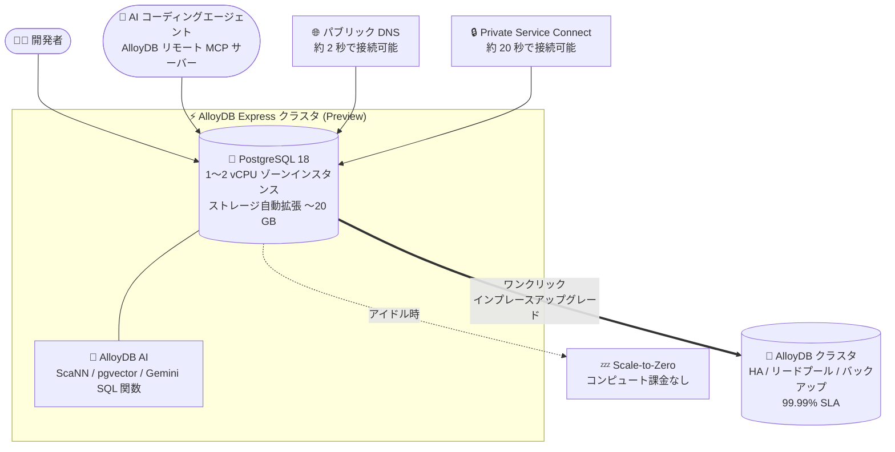

# AlloyDB for PostgreSQL: AlloyDB Express (Preview)

**リリース日**: 2026-11-04

**サービス**: AlloyDB for PostgreSQL

**機能**: AlloyDB Express

**ステータス**: Preview

📊 [このアップデートのインフォグラフィックを見る](https://takech9203.github.io/google-cloud-news-summary/20261104-alloydb-express-preview.html)

## 概要

AlloyDB Express が PostgreSQL 18 向けの Preview として利用可能になりました。AlloyDB Express は AlloyDB for PostgreSQL の新しい構成 (configuration) で、高速プロビジョニングとアイドル時の Scale-to-Zero を特徴とし、ラピッドプロトタイピングや AI コーディングエージェントを使ったワークフローに最適化されています。パブリック DNS 経由なら約 2 秒、Private Service Connect エンドポイント経由でも約 20 秒で接続可能な状態になるため、開発者やコーディングエージェントが数秒で PostgreSQL データベースを作成してクエリを実行できます。

小規模な 1 vCPU (4 GB RAM) / 2 vCPU (8 GB RAM) インスタンスであっても、完全な PostgreSQL 互換性と AlloyDB AI のフル機能 (ScaNN ベクトル検索、pgvector 拡張、自然言語クエリ、SQL からの埋め込み生成や Gemini モデル呼び出し) を利用できます。さらに、最初の 12 か月間は月次無料枠 (課金アカウントごとに月 50 コンピュートユニットと 2 GB ストレージ) が提供されます。

本番環境への移行が必要になった際は、ワンクリック (または 1 コマンド) でフル機能の AlloyDB クラスタにインプレースアップグレードできます。アップグレード時にはデータ、スキーマ、ユーザー認証情報、ネットワーク構成が保持され、接続文字列や DNS 名も変わらないため、アプリケーションコードの変更は不要です。

**アップデート前の課題**

- AlloyDB クラスタのプロビジョニングには数分かかり、プロトタイピングや AI コーディングエージェントによる反復的な開発サイクルには重かった
- AlloyDB は常時プロビジョニング型でコンピュートが時間課金されるため、アイドル時間の多い開発・検証用途ではコスト効率が悪かった
- 開発用に小さく始めたデータベースを本番用のエンタープライズ構成に移行するには、別クラスタへのデータ移行や接続先の変更が必要だった

**アップデート後の改善**

- パブリック DNS なら約 2 秒、Private Service Connect でも約 20 秒でデータベースが接続可能になり、数秒でプロトタイプ開発を開始できるようになった
- アイドル時にコンピュートがゼロまでスケールダウンし、非アクティブ期間中のコンピュート課金が発生しなくなった (新しい接続やクエリを受信すると約 20 秒で再開)
- ワンクリックのインプレースアップグレードで AlloyDB に移行でき、データ・スキーマ・認証情報・接続文字列を維持したまま本番向けのエンタープライズ機能 (リージョナル HA、リードプール、自動バックアップ、99.99% SLA など) を利用できるようになった
- 最初の 12 か月間の月次無料枠により、コストをかけずに AlloyDB を試せるようになった

## アーキテクチャ図



開発者や AI コーディングエージェントが数秒で PostgreSQL 18 データベースを作成・利用でき、アイドル時は Scale-to-Zero でコストを抑え、本番移行時はワンクリックでフル機能の AlloyDB にアップグレードできる構成を示しています。

## サービスアップデートの詳細

### 主要機能

1. **高速プロビジョニング**
   - パブリック DNS では約 2 秒以内、Private Service Connect エンドポイントでは約 20 秒以内に接続を受け付け可能
   - 開発者やコーディングエージェントが数秒でデータベースを作成・クエリでき、開発サイクルを高速化

2. **Scale-to-Zero コンピュート**
   - インスタンスがアイドル状態になるとコンピュートがゼロまでスケールダウンし、非アクティブ期間中のコンピュート課金が発生しない
   - 新しい接続やクエリを受信すると約 20 秒で動作を再開

3. **小規模インスタンスでのフル PostgreSQL 互換性と AlloyDB AI**
   - 1 vCPU (4 GB RAM) または 2 vCPU (8 GB RAM) の小規模インスタンスでも完全な PostgreSQL 互換性を提供
   - ScaNN ベクトル検索、pgvector 拡張、自然言語クエリ、SQL から埋め込み生成や Gemini モデルを直接呼び出す組み込み SQL 関数を利用可能

4. **月次無料枠 (最初の 12 か月)**
   - 課金アカウントごとに、毎月 50 コンピュートユニットと 2 GB のストレージが最初の 12 か月間無料
   - 無料枠を超えた分は 1 vCPU = 1 コンピュートユニット、2 vCPU = 2 コンピュートユニットとして秒単位で課金

5. **AlloyDB へのワンクリック・インプレースアップグレード**
   - Google Cloud コンソールのワンクリックまたは 1 コマンドで AlloyDB クラスタにアップグレード可能
   - データ、スキーマ、ユーザー認証情報、ネットワーク構成を保持し、接続文字列と DNS 名も変わらないためアプリケーションコードの変更が不要
   - アップグレード後は 20 GB ストレージ制限と 2 vCPU コンピュート制限が解除され、リージョナル HA、リードプール、自動バックアップ、99.99% SLA (リージョナル HA クラスタ) を利用可能

6. **ストレージ自動拡張**
   - データ増加に応じてストレージが最大 20 GB まで自動拡張し、使用した分だけ課金
   - 20 GB に達すると以降の書き込みは不可 (アップグレードで解除)

## 技術仕様

### AlloyDB Express と AlloyDB の比較

| 項目 | AlloyDB Express (Preview) | AlloyDB |
|------|---------------------------|---------|
| ユースケース | ラピッドプロトタイピング、AI コーディングエージェントのワークフロー | 開発・テスト・本番向けのフル機能 |
| プロビジョニング時間 | パブリック DNS 約 2 秒、PSC 約 20 秒 | 数分 |
| コンピュート構成 | 1 vCPU または 2 vCPU のゾーンインスタンス | 最大 288 vCPU、最大 20 リードプールノード |
| プロビジョニング動作 | トラフィックがないとゼロまでスケールダウン | 常時プロビジョニング |
| ストレージ | 自動拡張で最大 20 GB | 自動拡張で最大 128 TB |
| 高可用性 (HA) | 非対応 (ゾーンインスタンスのみ) | リージョナル HA + 自動フェイルオーバー |
| 災害復旧 | 非対応 | クロスリージョンレプリケーション (最大 5 セカンダリクラスタ) |
| SLA | なし | リージョナル HA クラスタで 99.99% |
| バックアップ | 非対応 | 自動/オンデマンドバックアップ、PITR、Backup and DR Service |
| 接続方式 | パブリック DNS、Private Service Connect | パブリック IP、PSC、プライベートサービスアクセス |
| PostgreSQL バージョン | 18 のみ | 14、15、16、17、18 |
| 暗号化 | Google デフォルト暗号化のみ (CMEK 非対応) | Google デフォルト暗号化または CMEK |
| 料金モデル | 使用量ベース (コンピュート/ストレージ) + 月次無料枠 | 時間単位のプロビジョニング型コンピュート + 使用量ベースストレージ |
| CUD (確約利用割引) | 適用外 | 1 年 / 3 年 CUD 適用可 |
| インターフェース | コンソール、gcloud CLI、REST API | コンソール、gcloud CLI、REST API、Terraform、Config Connector |
| アップグレードパス | AlloyDB へのインプレースアップグレード | AlloyDB Express へのダウングレードは不可 |

### リソース階層

| リソース | AlloyDB Express での特徴 |
|----------|--------------------------|
| クラスタ | データベース・ログ・メタデータのトップレベルコンテナ。クロスリージョンレプリケーションとバックアップは非対応 |
| インスタンス | 読み取り・書き込み両方を処理する単一のゾーンプライマリインスタンスのみ |
| ノード | 1 vCPU (4 GB RAM) または 2 vCPU (8 GB RAM) の単一ノード。スタンバイノードなしでコストを最小化 |

### セキュリティとメンテナンス

- **認証**: PostgreSQL ユーザー名/パスワード認証または IAM データベース認証をサポート。パスワード複雑性の強制はデフォルトで有効
- **データ漏洩対策**: VPC Service Controls に対応
- **ガバナンス**: データレジデンシー、Access Transparency、Access Approval に対応
- **暗号化**: Google デフォルト暗号化で保存時データを暗号化 (CMEK は非対応)
- **パッチ適用**: 最新のマイナーバージョンとセキュリティアップデートを自動適用。通常はインスタンス再開時、または稼働中であれば低使用時間帯に適用

## 設定方法

### 前提条件

1. Google Cloud プロジェクトで AlloyDB API が有効化されていること
2. サポート対象リージョン (asia-northeast1 など) を選択すること
3. gcloud CLI を使用する場合は最新版をインストールしておくこと (クラスタ作成は `gcloud beta` コマンド)

### 手順

#### ステップ 1: AlloyDB Express クラスタの作成

```bash
gcloud beta alloydb clusters create my-express-cluster \
  --region=asia-northeast1 \
  --password=INITIAL_PASSWORD \
  --enable-express \
  --project=PROJECT_ID
```

`--enable-express` フラグで AlloyDB Express 構成のクラスタを作成します。gcloud CLI ではデフォルトで Private Service Connect が有効になります。後で 1 vCPU のままインプレースアップグレードする予定がある場合は、C4A マシンシリーズをサポートするリージョンを選択します。

#### ステップ 2: プライマリインスタンスの作成

```bash
gcloud beta alloydb instances create my-express-instance \
  --cluster=my-express-cluster \
  --region=asia-northeast1 \
  --instance-type=PRIMARY \
  --cpu-count=1 \
  --enable-public-dns \
  --project=PROJECT_ID
```

インスタンス作成時の CPU カウントは 1 (1 vCPU, 4 GB RAM) を指定する必要があります (作成後に 2 vCPU へ変更可能)。パブリック DNS で接続する場合は `--enable-public-dns` を、Private Service Connect を使う場合は `--allowed-psc-projects=ALLOWED_PROJECT_ID` を指定します。なお、Google Cloud コンソールから作成する場合は、AlloyDB Express カードからワンクリックでクラスタとインスタンスが作成され、作成後に AlloyDB Studio が開いてすぐにクエリを実行できます。

#### ステップ 3: (必要に応じて) インスタンスのスケール変更

```bash
gcloud alloydb instances update my-express-instance \
  --cluster=my-express-cluster \
  --region=asia-northeast1 \
  --cpu-count=2 \
  --project=PROJECT_ID
```

ワークロードの増加に応じて 2 vCPU (8 GB RAM) にスケールアップできます。本番移行時は、コンソールのワンクリック操作または 1 コマンドで AlloyDB クラスタへインプレースアップグレードします。

## メリット

### ビジネス面

- **開発コストの削減**: アイドル時の Scale-to-Zero と使用量ベース課金により、利用時間が断続的な開発・検証環境のコストを最小化できる
- **無料での検証開始**: 最初の 12 か月間の月次無料枠 (50 コンピュートユニット + 2 GB ストレージ) により、初期投資なしで AlloyDB の評価・PoC を開始できる
- **本番移行の容易さ**: 接続文字列を変えずにワンクリックで本番構成に移行できるため、プロトタイプから本番化までのリードタイムを短縮できる

### 技術面

- **AI コーディングエージェントとの親和性**: 約 2 秒のプロビジョニングと AlloyDB リモート MCP サーバー対応により、エージェント主導の開発ワークフローでデータベースを即座に用意できる
- **小規模でもフル機能の AlloyDB AI**: 1 vCPU インスタンスでも ScaNN ベクトル検索、pgvector、Gemini モデルの SQL 呼び出しが使えるため、AI アプリのプロトタイピングに十分な機能が揃う
- **運用レスのメンテナンス**: マイナーバージョンやセキュリティアップデートがインスタンス再開時などに自動適用され、パッチ管理の手間がない

## デメリット・制約事項

### 制限事項

- Preview 段階であり、Pre-GA Offerings Terms が適用される (サポートが限定される可能性あり)
- PostgreSQL 18 のみサポート (AlloyDB は 14〜18 に対応)
- ストレージは最大 20 GB。上限に達すると書き込み不可になる
- コンピュートは 1 vCPU / 2 vCPU のゾーンインスタンスのみで、HA・災害復旧・バックアップ・SLA は非対応
- CMEK (顧客管理の暗号鍵) および CUD (確約利用割引) は非対応
- パブリック IP は非対応 (外部接続はパブリック DNS 経由)
- Terraform / Config Connector には非対応 (コンソール、gcloud CLI、REST API のみ)
- 対応リージョンは asia-east1、asia-east2、asia-northeast1、asia-southeast1、australia-southeast1、europe-west2、us-west1 の 7 リージョン
- AlloyDB へアップグレードした後、AlloyDB Express へのダウングレードは不可

### 考慮すべき点

- アイドル状態からの再開には約 20 秒かかるため、レイテンシ要件の厳しい常時稼働ワークロードには不向き
- ストレージはアイドル中も課金される (コンピュートのみ Scale-to-Zero の対象)
- 1 vCPU のままインプレースアップグレードする予定がある場合は、C4A マシンシリーズをサポートするリージョンでクラスタを作成する必要がある
- 本番ワークロードには Preview 機能の利用を避け、アップグレード後の AlloyDB で運用するのが推奨される

## ユースケース

### ユースケース 1: AI コーディングエージェントによるアプリ開発

**シナリオ**: Gemini CLI などの AI コーディングエージェントを使ってプロトタイプアプリを開発しており、エージェントが開発フローの中で自律的にデータベースを作成・スキーマ定義・クエリ実行を行いたい。

**実装例**:
```bash
# エージェントが AlloyDB リモート MCP サーバーや gcloud 経由で
# 数秒でデータベースを作成し、すぐに接続して開発を進める
gcloud beta alloydb clusters create agent-proto \
  --region=us-west1 --password=... --enable-express
```

**効果**: 約 2 秒でデータベースが利用可能になるため、エージェントの反復的な開発サイクルを妨げず、アイドル時はコンピュート課金ゼロでコストも抑えられる。

### ユースケース 2: AI アプリ (RAG) のプロトタイピング

**シナリオ**: pgvector と ScaNN を使ったベクトル検索ベースの RAG アプリケーションを検証したいが、検証段階で本格的な AlloyDB クラスタを常時稼働させるのはコストが見合わない。

**効果**: 1 vCPU の小規模インスタンスでも AlloyDB AI のフル機能 (ScaNN、pgvector、SQL からの埋め込み生成・Gemini 呼び出し) が使え、月次無料枠内で検証を開始できる。検証完了後はワンクリックで本番用 AlloyDB にアップグレードし、接続文字列を変えずにそのまま本番化できる。

### ユースケース 3: 開発・検証環境の常設データベース

**シナリオ**: 日中しか使わない開発環境用の PostgreSQL データベースを、使った分だけの課金で維持したい。

**効果**: アイドル時は Scale-to-Zero によりコンピュート課金が発生せず、ストレージも使用分 (最大 20 GB) のみの課金となるため、常時プロビジョニング型と比べて開発環境のコストを大幅に削減できる。

## 料金

AlloyDB Express はコンピュートとストレージの使用量ベース課金で、月次無料枠が付属します。

- **無料枠**: 課金アカウントごとに、最初の 12 か月間、毎月 50 コンピュートユニットと 2 GB のストレージが無料
- **コンピュート**: コンピュートユニット (vCPU:メモリ = 1:4) に基づく秒単位課金。1 vCPU インスタンス = 1 コンピュートユニット、2 vCPU インスタンス = 2 コンピュートユニット。アイドル中はコンピュート課金なし
- **ストレージ**: プロビジョニング容量ではなく実使用量に対して課金 (最大 20 GB)。インスタンスがアクティブでもアイドルでも課金対象
- **割引**: 標準のエンタープライズ割引は適用可能だが、CUD (確約利用割引) は適用外

詳細は [AlloyDB 料金ページ](https://cloud.google.com/alloydb/pricing) を参照してください。

## 利用可能リージョン

AlloyDB Express は以下の 7 リージョンで利用可能です。

- asia-east1 (台湾)
- asia-east2 (香港)
- asia-northeast1 (東京)
- asia-southeast1 (シンガポール)
- australia-southeast1 (シドニー)
- europe-west2 (ロンドン)
- us-west1 (オレゴン)

## 関連サービス・機能

- **AlloyDB for PostgreSQL**: ワンクリックのインプレースアップグレード先。リージョナル HA、リードプール、自動バックアップ、PITR、99.99% SLA などのエンタープライズ機能を提供
- **AlloyDB AI**: ScaNN ベクトル検索、pgvector 拡張、自然言語クエリ、SQL からの埋め込み生成・Gemini モデル呼び出しを AlloyDB Express でもフルに利用可能
- **AlloyDB リモート MCP サーバー**: AI コーディングエージェントから AlloyDB Express クラスタの作成・管理を行うためのインターフェース
- **Private Service Connect**: VPC ネットワークからデータベースをインターネットに公開せずに接続するためのプライベート接続方式
- **AlloyDB Auth Proxy / Language Connectors**: Go、Python、Java 向けのコネクタと Auth Proxy による安全な接続をサポート
- **VPC Service Controls**: データ漏洩対策ポリシーへの準拠を支援

## 参考リンク

- 📊 [インフォグラフィック](https://takech9203.github.io/google-cloud-news-summary/20261104-alloydb-express-preview.html)
- [公式リリースノート](https://docs.cloud.google.com/release-notes#November_04_2026)
- [AlloyDB Express overview](https://docs.cloud.google.com/alloydb/docs/express-overview)
- [Create and manage AlloyDB Express clusters](https://docs.cloud.google.com/alloydb/docs/create-manage-express-clusters)
- [料金ページ](https://cloud.google.com/alloydb/pricing)

## まとめ

AlloyDB Express は、約 2 秒のプロビジョニング、Scale-to-Zero、12 か月間の月次無料枠により、AlloyDB をプロトタイピングや AI コーディングエージェント主導の開発で気軽に使えるようにする重要なアップデートです。小規模インスタンスでも AlloyDB AI のフル機能が使え、本番移行時は接続文字列を変えずにワンクリックで AlloyDB にアップグレードできるため、AI アプリケーションの PoC から本番化までの道筋が大幅に簡素化されます。まずは無料枠の範囲で東京リージョン (asia-northeast1) などに Express クラスタを作成し、pgvector / ScaNN を使った検証から始めることを推奨します。

---

**タグ**: #AlloyDB #PostgreSQL #AlloyDBExpress #Preview #ScaleToZero #AIAgents #pgvector #ScaNN #Database
