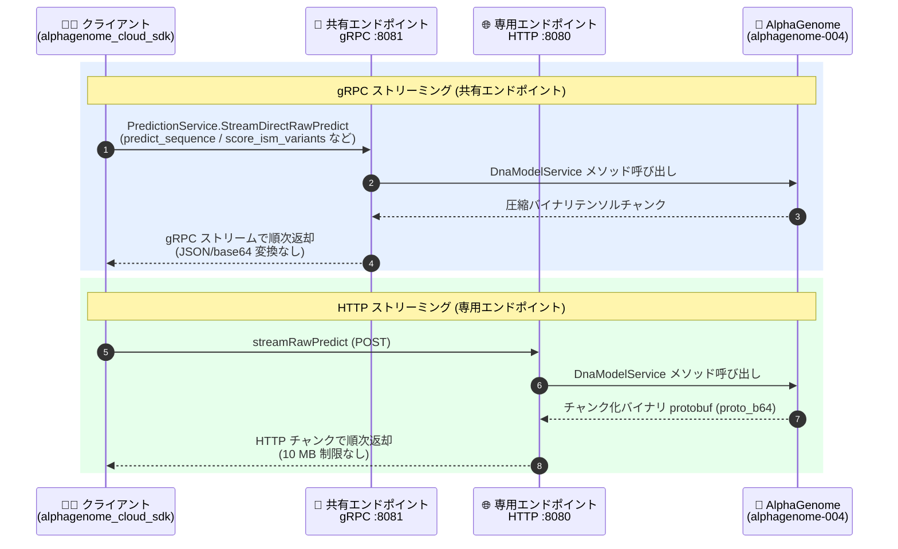

# Gemini Enterprise Agent Platform: AlphaGenome の gRPC / 統合 HTTP ストリーミング対応

**リリース日**: 2026-11-04

**サービス**: Gemini Enterprise Agent Platform

**機能**: AlphaGenome (alphagenome-004) の gRPC および統合 HTTP ストリーミング対応

**ステータス**: Feature (GA with allowlist)

📊 [このアップデートのインフォグラフィックを見る](https://takech9203.github.io/google-cloud-news-summary/20261104-alphagenome-grpc-http-streaming.html)

## 概要

Google DeepMind が開発したゲノム基盤モデル AlphaGenome の新しいサービングバージョン **alphagenome-004** が、Gemini Enterprise Agent Platform 上で HTTP/2 gRPC ストリーミングとチャンク化バイナリ protobuf HTTP ストリーミングを統合サポートしました。単一の統合コンテナが、共有エンドポイント向けの gRPC ストリーミング (`PredictionService.StreamDirectRawPredict`、ポート 8081) と、専用エンドポイント向けの HTTP ストリーミング (`streamRawPredict`、ポート 8080) の両方を提供します。

このアップデートにより、DnaModelService の全 7 メソッド (`predict_sequence`、`predict_interval`、`predict_variant`、`score_variant`、`score_interval`、`score_ism_variants`、`output_metadata`) と 11 のゲノムモダリティ (遺伝子発現、クロマチンアクセシビリティ、ヒストン修飾、RNA スプライシング、3D クロマチンコンタクトマップなど) において、1 MB (100 万塩基対) コンテキストのトラック予測のレイテンシが削減されます。gRPC では圧縮済みバイナリテンソルチャンクを直接ストリーミングするため、JSON や base64 のシリアライズオーバーヘッドが発生しません。

対象ユーザーは、ゲノム変異の機能的影響を大規模に解析するライフサイエンス研究機関・創薬企業・バイオインフォマティクスチームです。特に in silico 飽和変異導入 (ISM) のような高同時実行のマルチバリアント評価ワークロードで、HTTP ゲートウェイタイムアウトを回避できる点が大きな改善です。なお、AlphaGenome は研究用ツールであり、臨床診断用途には承認されていません。

**アップデート前の課題**

- 従来の alphagenome-003 は HTTP/1.1 ストリーミング (`streamRawPredict`、ポート 8080) のみに対応しており、JSON/base64 シリアライズのオーバーヘッドにより 1 MB トラック予測のレイテンシが大きかった
- `score_ism_variants` のような高同時実行のマルチバリアント評価では、HTTP ゲートウェイタイムアウトが発生することがあった
- 共有エンドポイント経由の HTTP では 10 MB のレスポンスサイズ制限があり、大きな予測結果の取得に制約があった

**アップデート後の改善**

- gRPC ストリーミング (共有エンドポイント) により、圧縮済みバイナリテンソルチャンクを直接送受信でき、1 MB トラック予測のレイテンシが削減された
- 専用エンドポイントの HTTP ストリーミングでは、チャンク化バイナリ protobuf ペイロード (`proto_b64`) により共有エンドポイントの 10 MB レスポンスサイズ制限を回避できるようになった
- `score_ism_variants` による in silico 飽和変異導入の同時マルチバリアント評価が、HTTP ゲートウェイタイムアウトなしで実行可能になった
- 統合 Python SDK (`alphagenome_cloud_sdk`) を通じて、gRPC / HTTP 両クライアントでモデルフォールド選択 (`ALL_FOLDS`、`FOLD_0`〜`FOLD_3`) が可能になった
- alphagenome-003 は Model Garden に残り、既存のレガシー HTTP デプロイメントとの後方互換性が維持される

## アーキテクチャ図



統合 SDK を利用するクライアントは、共有エンドポイントでは gRPC (ポート 8081)、専用エンドポイントでは HTTP ストリーミング (ポート 8080) を通じて、同一の alphagenome-004 コンテナが提供する DnaModelService メソッドを呼び出します。どちらの経路でもバイナリ形式のストリーミングにより大きな予測結果を低レイテンシで受信できます。

## サービスアップデートの詳細

### 主要機能

1. **統合サービングコンテナ (alphagenome-004)**
   - 単一コンテナで HTTP/2 gRPC ストリーミング (ポート 8081) と HTTP ストリーミング (ポート 8080) の両方を提供
   - DnaModelService の全 7 メソッドと 11 ゲノムモダリティをカバー

2. **gRPC ストリーミング (共有エンドポイント)**
   - Model Garden でのデプロイ時に「Public (shared endpoint)」を選択し、`dna_client_grpc.create_vertex_client` で接続
   - `PredictionService.StreamDirectRawPredict` により、圧縮バイナリテンソルチャンクを JSON/base64 変換なしで直接ストリーミング
   - 1 MB トラック予測のレイテンシを削減し、高同時実行ワークロードでのゲートウェイタイムアウトを回避

3. **HTTP ストリーミング (専用エンドポイント)**
   - デフォルトの「Public (dedicated endpoint)」でデプロイし、`dna_client_http.create_http_client` で接続
   - `streamRawPredict` によるチャンク化バイナリ protobuf (`proto_b64`) ストリーミングで、共有エンドポイントの 10 MB レスポンスサイズ制限を回避

4. **モデルフォールド選択**
   - gRPC / HTTP 両クライアントで `model_version` パラメータによるフォールド選択に対応 (`ALL_FOLDS` がデフォルト、`FOLD_0`〜`FOLD_3` を個別指定可能)

5. **後方互換性**
   - alphagenome-003 (HTTP/1.1 ストリーミングのみ) は Model Garden に残り、既存のレガシー HTTP デプロイメントを継続利用可能

## 技術仕様

### サービングバージョンの比較

| 項目 | alphagenome-004 (新) | alphagenome-003 (レガシー) |
|------|---------------------|---------------------------|
| プロトコル | HTTP/2 gRPC + HTTP ストリーミング (統合) | HTTP/1.1 ストリーミングのみ |
| gRPC エンドポイント | 共有エンドポイント: `StreamDirectRawPredict` (ポート 8081) | 非対応 |
| HTTP エンドポイント | 専用エンドポイント: `streamRawPredict` (ポート 8080)、`proto_b64` チャンク | `streamRawPredict` (ポート 8080) |
| 対応メソッド | DnaModelService 全 7 メソッド | HTTP 経由の既存メソッド |
| フォールド選択 | `ALL_FOLDS`、`FOLD_0`〜`FOLD_3` | — |
| 用途 | 新規デプロイメント (推奨、デフォルト) | 既存 HTTP クライアントの後方互換 |

### DnaModelService の 7 メソッド

| メソッド | 用途 |
|---------|------|
| `predict_sequence` | 生の DNA 配列からゲノムモダリティのトラック予測 |
| `predict_interval` | 参照ゲノムの染色体領域からの予測 |
| `predict_variant` | 変異前後 (reference / alternate) のペアトラック予測 |
| `score_variant` | 遺伝的変異の効果スコアリング |
| `score_interval` | ゲノム区間のスコアリング |
| `score_ism_variants` | in silico 飽和変異導入の同時マルチバリアント評価 |
| `output_metadata` | 出力メタデータの取得 |

### ハードウェア要件

| 項目 | 詳細 |
|------|------|
| 必要 GPU メモリ | 80 GB |
| NVIDIA H100 (80 GB) | a3-highgpu-1g / 2g / 4g / 8g |
| NVIDIA A100 (80 GB) | a2-ultragpu-1g / 2g / 4g / 8g |
| NVIDIA H100 Mega (80 GB) | a3-megagpu-8g |
| 非対応 | 40 GB A100 (a2-highgpu シリーズ) |
| コンテキスト長 | 最大 1 MB (100 万塩基対)、単一塩基解像度 |

## 設定方法

### 前提条件

1. [AlphaGenome リクエストフォーム](https://console.cloud.google.com/agent-platform/publishers/google/model-garden/alphagenome-request) から許可リスト (allowlist) への登録を完了していること
2. 対象リージョンで GPU サービングクォータ (`custom_model_serving_nvidia_h100_gpus` / `custom_model_serving_nvidia_a100_gpus` など) を確保していること
3. 実行環境が Agent Platform User (`roles/aiplatform.user`) IAM ロールを持つ認証情報で認証されていること
4. SDK wheel ファイルへのアクセスは制限されているため、Google Cloud アカウントチームを通じてサービスアカウントの許可リスト登録が必要

### 手順

#### ステップ 1: SDK のインストール

```bash
# AlphaGenome Cloud SDK の wheel ファイルをダウンロードしてインストール
wget -q https://github.com/GoogleCloudPlatform/vertex-ai-samples/raw/main/notebooks/community/alphagenome/whl/alphagenome_cloud_sdk-0.4.2.12-py3-none-any.whl
pip install alphagenome_cloud_sdk-0.4.2.12-py3-none-any.whl
```

Model Garden から alphagenome-004 をデプロイする際、エンドポイントアクセスとして「Public (shared endpoint)」(gRPC) または「Public (dedicated endpoint)」(HTTP、デフォルト) を選択します。

#### ステップ 2: クライアントの初期化 (gRPC / 共有エンドポイント)

```python
from alphagenome.models import dna_client
from alphagenome_cloud_sdk.models import dna_client_grpc

endpoint = "projects/PROJECT_ID/locations/LOCATION/endpoints/ENDPOINT_ID"

dna_model = dna_client_grpc.create_vertex_client(
    endpoint=endpoint,
    # model_version=dna_client.ModelVersion.ALL_FOLDS,  # フォールド選択 (任意)
)
```

専用エンドポイント (HTTP) の場合は `dna_client_http.create_http_client` に `streamRawPredict` の URL を渡します。

#### ステップ 3: 予測の実行

```python
# 1 MB コンテキストにパディングした DNA 配列のトラック予測
padded_sequence = 'GATTACA'.center(dna_client.SEQUENCE_LENGTH_1MB, 'N')

output = dna_model.predict_sequence(
    sequence=padded_sequence,
    requested_outputs=[
        dna_client.OutputType.CAGE,   # 転写開始点
        dna_client.OutputType.DNASE,  # クロマチンアクセシビリティ
    ],
    ontology_terms=['UBERON:0002048'],  # 肺組織
)
dnase_signals = output.dnase.values
```

## メリット

### ビジネス面

- **大規模変異解析の時間短縮**: in silico 飽和変異導入のようなマルチバリアント評価がタイムアウトなしで完走するため、創薬・機能ゲノミクス研究のイテレーションが高速化する
- **移行リスクの低減**: alphagenome-003 が後方互換のために維持されるため、既存ワークロードを止めずに段階的に alphagenome-004 へ移行できる

### 技術面

- **シリアライズオーバーヘッドの排除**: gRPC では圧縮バイナリテンソルチャンクを直接ストリーミングし、JSON/base64 変換が不要なため 1 MB トラック予測のレイテンシが削減される
- **レスポンスサイズ制限の回避**: 専用エンドポイントの `proto_b64` チャンクストリーミングにより、共有エンドポイントの 10 MB HTTP レスポンス制限を受けない
- **統一インターフェース**: gRPC クライアント (`GrpcDnaClient`) と HTTP クライアント (`HttpDnaClient`) が同一の `DnaModel` インターフェースを実装しており、コード変更を最小限に経路を切り替えられる

## デメリット・制約事項

### 制限事項

- AlphaGenome へのアクセスには許可リスト登録が必要 (GA with allowlist)。SDK wheel ファイルへのアクセスも制限されている
- 80 GB GPU メモリが必須で、対応マシンタイプは A100 80 GB / H100 / H100 Mega 系に限定される (a2-highgpu の 40 GB A100 は非対応)
- 研究用ツールであり、臨床診断用途には承認されていない

### 考慮すべき点

- gRPC (共有エンドポイント) と HTTP (専用エンドポイント) はデプロイ時のエンドポイントアクセス設定で決まるため、ワークロード特性に応じて事前に選択する必要がある
- 入力 DNA 配列はサポートされるコンテキスト長 (最大 1 MB) にパディングする必要がある
- デプロイ前に対象リージョンの GPU サービングクォータの確認が必要

## ユースケース

### ユースケース 1: in silico 飽和変異導入 (ISM) による変異効果の網羅的スクリーニング

**シナリオ**: 創薬研究チームが、疾患関連遺伝子の制御領域における全一塩基置換の機能的影響を網羅的に評価したい。従来は多数の変異を並列評価すると HTTP ゲートウェイタイムアウトが発生していた。

**実装例**:
```python
# gRPC クライアント経由で score_ism_variants を実行
# (共有エンドポイント、タイムアウトなしの同時マルチバリアント評価)
dna_model = dna_client_grpc.create_vertex_client(endpoint=endpoint)
# score_ism_variants により対象区間の飽和変異導入スコアを一括取得
```

**効果**: 高同時実行のマルチバリアント評価がタイムアウトなしで完走し、候補変異の優先順位付けが高速化する。

### ユースケース 2: 大規模トラック予測結果の低レイテンシ取得

**シナリオ**: バイオインフォマティクスパイプラインで、1 MB ゲノム区間の RNA-Seq・ATAC などのトラック予測を大量に取得する。JSON/base64 のオーバーヘッドと 10 MB レスポンス制限がボトルネックになっていた。

**効果**: gRPC のバイナリテンソルストリーミング、または専用エンドポイントの `proto_b64` チャンクストリーミングにより、大きな予測結果を低レイテンシかつサイズ制限なしで受信できる。

## 料金

AlphaGenome は Model Garden からのセルフデプロイ型モデルであり、Agent Platform エンドポイントにデプロイした GPU マシンタイプ (A100 80 GB / H100 / H100 Mega) のサービング料金が稼働時間に応じて課金されます。具体的な料金は以下の料金ページを参照してください。

- [Vertex AI / Agent Platform の料金](https://cloud.google.com/vertex-ai/pricing)

## 利用可能リージョン

公式ドキュメントにリージョン一覧の明記はありません。デプロイ先リージョンの GPU サービングクォータ (H100 / A100 80 GB) の確保が前提となります。詳細は [AlphaGenome ドキュメント](https://docs.cloud.google.com/gemini-enterprise-agent-platform/models/open-models/alphagenome) を参照してください。

## 関連サービス・機能

- **Model Garden**: alphagenome-004 / alphagenome-003 のデプロイ元。オープンモデルのセルフデプロイ手順に従ってエンドポイントを構築する
- **Agent Platform エンドポイント (共有 / 専用)**: gRPC は共有エンドポイント、HTTP ストリーミングは専用エンドポイントで提供される。自動スケーリングによるノード追加にも対応
- **IAM (Identity and Access Management)**: デプロイ済みエンドポイントへのアクセス制御。`roles/aiplatform.user` ロールが必要
- **Compute Engine GPU クォータ**: A100 80 GB / H100 系マシンタイプのサービングクォータ管理

## 参考リンク

- 📊 [インフォグラフィック](https://takech9203.github.io/google-cloud-news-summary/20261104-alphagenome-grpc-http-streaming.html)
- [公式リリースノート](https://docs.cloud.google.com/release-notes#November_04_2026)
- [AlphaGenome ドキュメント (Gemini Enterprise Agent Platform)](https://docs.cloud.google.com/gemini-enterprise-agent-platform/models/open-models/alphagenome)
- [Gemini Enterprise Agent Platform リリースノート](https://docs.cloud.google.com/gemini-enterprise-agent-platform/release-notes)
- [AlphaGenome API リファレンス (公式)](https://www.alphagenomedocs.com)
- [料金ページ](https://cloud.google.com/vertex-ai/pricing)

## まとめ

alphagenome-004 の統合 gRPC / HTTP ストリーミング対応により、1 MB ゲノムコンテキストの大規模トラック予測と in silico 飽和変異導入が、シリアライズオーバーヘッドやゲートウェイタイムアウトなしで実行可能になりました。ゲノム変異解析を Google Cloud 上で運用しているチームは、レガシーの alphagenome-003 から alphagenome-004 への移行と、ワークロード特性 (共有エンドポイント + gRPC か、専用エンドポイント + HTTP か) に応じたデプロイ構成の検討を推奨します。

---

**タグ**: #GeminiEnterpriseAgentPlatform #AlphaGenome #gRPC #Streaming #ModelGarden #Genomics #GoogleDeepMind
