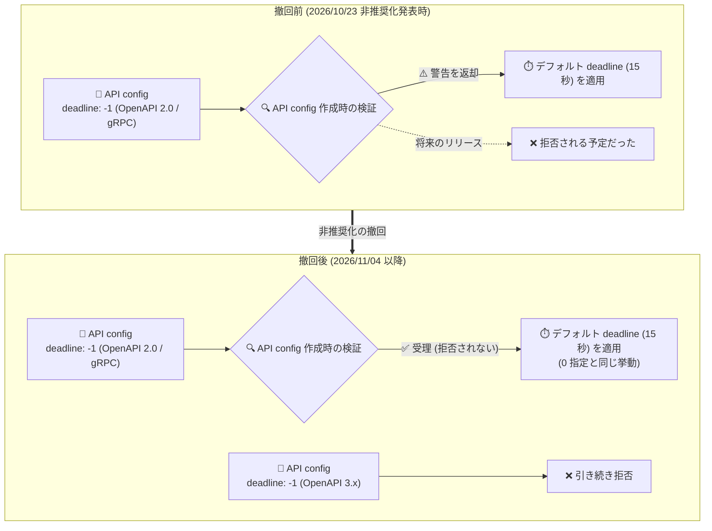

# API Gateway: 負のバックエンド deadline 値の非推奨化を撤回

**リリース日**: 2026-11-04

**サービス**: API Gateway

**機能**: 負のバックエンド deadline 値の非推奨化撤回 (Deprecation Withdrawal)

**ステータス**: Announcement

📊 [このアップデートのインフォグラフィックを見る](https://takech9203.github.io/google-cloud-news-summary/20261104-api-gateway-negative-backend-deadlines-undeprecated.html)

## 概要

Google Cloud は、2026 年 10 月 23 日に発表していた API Gateway の負のバックエンド deadline 値の非推奨化 (deprecation) を撤回しました。OpenAPI 2.0 の `x-google-backend` 拡張、または gRPC の `BackendRule` において、負の deadline 値は従来どおりデフォルトの deadline (`0` を指定した場合と同じ挙動) として扱われ、今後も拒否されることはありません。

10 月 23 日の発表時点では、負の deadline 値を含む API config の作成時にオペレーションメタデータへ警告が返され、将来のリリースで拒否される予定とされていました。今回の撤回により、既存の API config に負の deadline 値が含まれている場合でも、修正を急ぐ必要はなくなりました。

なお、OpenAPI 3.x のバックエンド設定 (`x-google-api-management.backends` の `Backends` オブジェクト) では、引き続き負の deadline 値は拒否されます。OpenAPI 2.0 と 3.x で挙動が異なる点には注意が必要です。

**アップデート前の課題**

2026 年 10 月 23 日の非推奨化発表以降、以下の懸念がありました。

- OpenAPI 2.0 / gRPC 設定内の負の deadline 値が将来のリリースで拒否される予定とされており、既存の API config の棚卸しと修正が必要だった
- 負の deadline 値を含む API config の作成時にオペレーションメタデータへ警告が返されていた
- CI/CD パイプラインで API config を再デプロイする際、将来の拒否によりデプロイが失敗するリスクがあった

**アップデート後の改善**

- OpenAPI 2.0 の `x-google-backend` 拡張および gRPC の `BackendRule` では、負の deadline 値が今後も拒否されないことが確定した
- 負の deadline 値は従来どおりデフォルト deadline (15.0 秒) として扱われ、`0` 指定と同じ挙動を維持する
- 非推奨化対応のための設定修正作業が不要になり、既存の API config をそのまま利用し続けられる

## アーキテクチャ図



非推奨化の撤回前後における負の deadline 値の扱いを比較した図です。OpenAPI 2.0 / gRPC では負の値がデフォルト deadline として扱われ続ける一方、OpenAPI 3.x では引き続き拒否されます。

## サービスアップデートの詳細

### 主要なポイント

1. **非推奨化の撤回**
   - 2026 年 10 月 23 日に発表された負のバックエンド deadline 値の非推奨化が撤回された
   - 将来のリリースで負の値が拒否される予定だったが、この計画は取り消された

2. **OpenAPI 2.0 / gRPC での挙動維持**
   - OpenAPI 2.0 の `x-google-backend` 拡張、および gRPC の `BackendRule` において、負の deadline 値はデフォルト deadline として扱われる
   - `0` を指定した場合、またはフィールドを省略した場合と同じ挙動 (デフォルト 15.0 秒)

3. **OpenAPI 3.x では引き続き拒否**
   - OpenAPI 3.x の `Backends` オブジェクトでは、負の deadline 値は拒否される
   - OpenAPI 3.x へ移行する際は、負の deadline 値を `0` に変更するかフィールドを削除する必要がある

## 技術仕様

### deadline フィールドの挙動 (仕様別)

| 仕様 | 負の値の扱い | デフォルト値 | 最大値 |
|------|-------------|-------------|--------|
| OpenAPI 2.0 (`x-google-backend`) | デフォルト deadline を使用 (拒否されない) | 15.0 秒 | 3600 秒 (非ストリーミングゲートウェイは 600 秒) |
| gRPC (`BackendRule`) | デフォルト deadline を使用 (拒否されない) | 15.0 秒 | 3600 秒 (非ストリーミングゲートウェイは 600 秒) |
| OpenAPI 3.x (`Backends` オブジェクト) | **拒否される** | 15.0 秒 | 3600 秒 (非ストリーミングゲートウェイは 600 秒) |

### 設定例 (OpenAPI 2.0 の x-google-backend 拡張)

```yaml
swagger: "2.0"
info:
  title: my-api
  version: 1.0.0
x-google-backend:
  address: https://my-backend.example.com
  # 負の値はデフォルト deadline (15.0 秒) として扱われる
  # 0 を指定した場合、またはフィールド省略時と同じ挙動
  deadline: -1
```

### deadline の補足仕様

- SSE やチャンク転送のエンドポイントでは、deadline はストリーム全体の継続時間を制限する
- gRPC や WebSocket のエンドポイントでは、メッセージ間の間隔を制限する
- 非ストリーミングゲートウェイでは最大 600 秒が上限で、超過する値はゲートウェイの作成・更新時に拒否される

## メリット

### ビジネス面

- **移行作業の回避**: 非推奨化対応として計画していた API config の棚卸し・修正作業が不要になり、運用コストを削減できる
- **デプロイリスクの解消**: 将来のリリースで負の値が拒否されることによる CI/CD パイプラインの失敗リスクがなくなった

### 技術面

- **後方互換性の維持**: 既存の OpenAPI 2.0 / gRPC の API config をそのまま再デプロイでき、挙動も変わらない
- **挙動の明確化**: 負の値 = `0` 指定 = フィールド省略がいずれもデフォルト deadline (15.0 秒) になることが公式に確認された

## デメリット・制約事項

### 制限事項

- OpenAPI 3.x のバックエンド設定では、負の deadline 値は引き続き拒否される
- 非ストリーミングゲートウェイでは deadline の上限が 600 秒 (ストリーミングでは 3600 秒) である点は変わらない

### 考慮すべき点

- OpenAPI 2.0 から 3.x への移行を計画している場合は、負の deadline 値を `0` に修正するかフィールドを削除しておく必要がある
- 負の値は動作するものの意図が伝わりにくいため、新規作成する設定ではデフォルトを使う場合は `0` 指定またはフィールド省略が推奨される (可読性の観点)

## ユースケース

### ユースケース 1: 既存 API config の非推奨化対応を中止

**シナリオ**: 10 月 23 日の非推奨化発表を受けて、負の deadline 値を含む OpenAPI 2.0 の API config を洗い出し、修正を計画していた。

**効果**: 修正作業を中止でき、既存の設定をそのまま利用し続けられる。CI/CD での再デプロイも将来にわたって失敗しない。

### ユースケース 2: OpenAPI 3.x への移行準備

**シナリオ**: OpenAPI 2.0 ベースの API config を OpenAPI 3.x に移行する計画がある。

**実装例**:
```yaml
# OpenAPI 3.x では負の値は拒否されるため、移行時に修正する
x-google-api-management:
  backends:
    my-backend:
      address: https://my-backend.example.com
      deadline: 0  # デフォルト (15.0 秒) を使用。負の値は不可
```

**効果**: 移行時のバリデーションエラーを事前に回避できる。

## 料金

このアップデートは挙動・ポリシーに関する発表であり、料金への影響はありません。API Gateway の料金は [料金ページ](https://cloud.google.com/api-gateway/pricing) を参照してください。

## 関連サービス・機能

- **Cloud Endpoints (ESP / ESPv2)**: 同じ `x-google-backend` 拡張を使用するが、ESPv2 では非正の deadline 値は無視されデフォルト値が自動適用される
- **Cloud Run / Cloud Functions / App Engine**: API Gateway の代表的なバックエンドであり、deadline 設定はこれらサーバーレスバックエンドへのリクエストタイムアウトに影響する
- **Service Infrastructure (gRPC BackendRule)**: gRPC サービス構成の `BackendRule` も今回の撤回の対象

## 参考リンク

- 📊 [インフォグラフィック](https://takech9203.github.io/google-cloud-news-summary/20261104-api-gateway-negative-backend-deadlines-undeprecated.html)
- [公式リリースノート](https://docs.cloud.google.com/release-notes#November_04_2026)
- [OpenAPI 2.0 拡張ドキュメント](https://docs.cloud.google.com/api-gateway/docs/oasv2-extensions)
- [OpenAPI 3.x 拡張ドキュメント](https://docs.cloud.google.com/api-gateway/docs/oasv3-extensions)
- [料金ページ](https://cloud.google.com/api-gateway/pricing)

## まとめ

API Gateway における負のバックエンド deadline 値の非推奨化が撤回され、OpenAPI 2.0 / gRPC の既存設定は今後も拒否されずデフォルト deadline として動作し続けることが確定しました。非推奨化対応として計画していた設定修正は不要ですが、OpenAPI 3.x では負の値が引き続き拒否されるため、3.x への移行時には deadline 値の見直しを行ってください。

---

**タグ**: #APIGateway #OpenAPI #gRPC #Deprecation #BackendDeadline #Announcement
