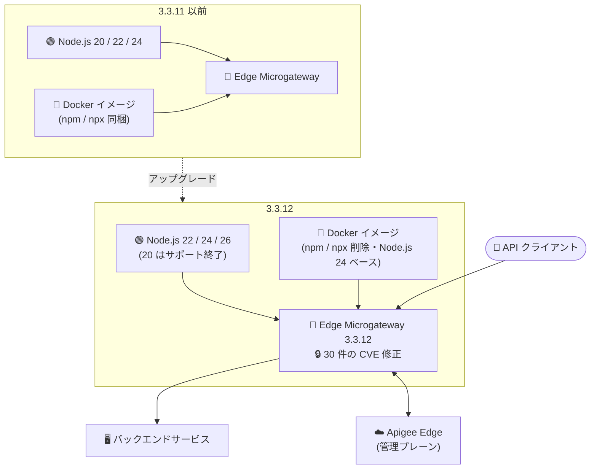

# Apigee Edge for Public Cloud: Edge Microgateway 3.3.12 リリース

**リリース日**: 2026-11-04

**サービス**: Apigee Edge for Public Cloud

**機能**: Edge Microgateway 3.3.12 (セキュリティ修正 + Node.js サポート変更 + Docker イメージ変更)

**ステータス**: リリース済み (破壊的変更を含む)

📊 [このアップデートのインフォグラフィックを見る](https://takech9203.github.io/google-cloud-news-summary/20261104-apigee-edge-microgateway-3-3-12.html)

## 概要

2026 年 11 月 4 日、Apigee は Edge Microgateway 3.3.12 をリリースしました。Edge Microgateway は Apigee Edge と連携して動作する軽量な API ゲートウェイで、バックエンドサービスの近くに配置して OAuth 認証やクォータなどの API 管理機能を提供します。今回のリリースは、30 件の CVE に対応するセキュリティ修正を含む重要なアップデートであり、すべての Edge Microgateway 利用者にアップグレードが推奨されます。

コンポーネントバージョンは microgateway 3.3.12、plugins 3.3.9、edgeauth 3.2.2 です。アップグレードは `edgemicro` npm パッケージのバージョン 3.3.12 のインストール、または Docker イメージ `gcr.io/apigee-microgateway/edgemicro:3.3.12` の取得で行います。

一方で、本リリースには 2 つの**破壊的変更 (Breaking Change)** が含まれる点に注意が必要です。(1) Node.js 20 のサポートが終了し、サポート対象は Node.js 22、24、26 のみになりました (Node.js 26 サポートは本リリースで新規追加)。(2) Docker イメージから `npm` および `npx` コマンドラインツールが削除されました。npm インストール環境と Docker 環境の両方の運用者は、アップグレード前に影響を確認する必要があります。

**アップデート前の課題**

- Edge Microgateway 3.3.11 以前には、今回修正された 30 件の CVE (CVE-2026-111497 など) に関連する脆弱性が存在していた
- Node.js 26 はサポート対象外で、最新の Node.js リリースラインを利用できなかった
- Docker イメージに `npm` / `npx` が同梱されており、コンテナイメージの攻撃対象領域 (attack surface) が大きかった

**アップデート後の改善**

- 30 件の CVE が修正され、セキュリティ態勢が改善された
- Node.js 26 のサポートが追加され、最新の Node.js リリースラインで運用可能になった
- Docker イメージから `npm` / `npx` が削除され、イメージの攻撃対象領域が縮小された (公式ドキュメントに明記)

## アーキテクチャ図



3.3.12 へのアップグレードにより実行基盤の要件が変わる点 (Node.js 22/24/26 必須、Docker イメージからの npm/npx 削除) と、セキュリティ修正が適用される点を示しています。

## サービスアップデートの詳細

### 主要機能

1. **セキュリティ脆弱性の修正 (30 件の CVE)**
   - CVE-2026-12590、CVE-2026-14257、CVE-2026-45819、CVE-2026-54272、CVE-2026-59870、CVE-2026-69152、CVE-2026-69192、CVE-2026-69198、CVE-2026-73088、CVE-2026-73089、CVE-2026-82417、CVE-2026-82562、CVE-2026-84375、CVE-2026-87018、CVE-2026-101910〜101913、CVE-2026-102276〜102278、CVE-2026-109383、CVE-2026-109869、CVE-2026-109924、CVE-2026-109932、CVE-2026-110816、CVE-2026-111181、CVE-2026-111497、CVE-2026-111997、CVE-2026-115897 を修正
   - Docker イメージは `node:24.22.1-trixie-slim` ベースでビルドされており、Node.js の CVE-2026-111497 修正を含む
   - **注意**: npm インストールの場合、`edgemicro` パッケージのアップグレードだけでは CVE-2026-111497 は修正されない。各ホストの Node.js ランタイム自体を修正版にアップグレードする必要がある

2. **【破壊的変更】Node.js 20 サポートの終了と Node.js 26 サポートの追加**
   - Edge Microgateway 3.3.12 がサポートするのは Node.js 22、24、26 のみ
   - npm インストールの場合、3.3.12 へのアップグレード前に各ホストの Node.js ランタイムを 22、24、26 のいずれかにアップグレードする必要がある
   - 3.3.12 の Docker イメージは Node.js 24 ベースのため、Docker デプロイメントではこの変更への対応は不要

3. **【破壊的変更】Docker イメージからの npm / npx の削除**
   - 3.3.12 以降、Edge Microgateway Docker イメージには `npm` と `npx` が含まれず、コンテナ内でこれらのツールを実行するコマンドは失敗する
   - この変更は Edge Microgateway 自体の動作には影響しない (イメージの攻撃対象領域の縮小が目的)
   - カスタムプラグインが npm 依存関係を持つ場合、プラグインをコンテナに追加する**前に**各プラグインディレクトリで `npm install` を実行し、`node_modules` ディレクトリを含めた状態でデプロイする必要がある
   - npm インストール形式の Edge Microgateway には影響しない

## 技術仕様

### コンポーネントバージョン

| コンポーネント | バージョン |
|------|------|
| microgateway | 3.3.12 |
| plugins | 3.3.9 |
| edgeauth | 3.2.2 |

### サポートされる Node.js バージョン

| 項目 | 詳細 |
|------|------|
| サポート対象 | Node.js 22、24、26 |
| サポート終了 | Node.js 20 (3.3.12 で削除) |
| 新規サポート | Node.js 26 (本リリースで追加) |
| Docker イメージのベース | `node:24.22.1-trixie-slim` (Node.js 24) |

### CVE-2026-111497 対応に必要な Node.js 修正バージョン (npm インストールの場合)

| Node.js リリースライン | 修正バージョン (以降) |
|------|------|
| 22.x | 22.23.4 |
| 24.x | 24.22.1 |
| 26.x | 26.12.1 |

## 設定方法

### 前提条件

1. (npm インストールの場合) 各ホストの Node.js ランタイムを 22、24、26 のいずれかにアップグレード済みであること (CVE-2026-111497 対応には上表の修正バージョン以降が必要)
2. (Docker でカスタムプラグインを使う場合) npm 依存関係を持つプラグインは、事前に各プラグインディレクトリで `npm install` を実行して `node_modules` を同梱しておくこと

### 手順

#### ステップ 1: npm インストールのアップグレード

```bash
# Node.js ランタイムを 22 / 24 / 26 にアップグレードした後
npm install -g edgemicro@3.3.12
```

npm アップグレードの詳細手順は公式の「Upgrading Edge Microgateway」ドキュメントを参照してください。

#### ステップ 2: Docker デプロイメントのアップグレード

```bash
# 3.3.12 の Docker イメージを取得
docker pull gcr.io/apigee-microgateway/edgemicro:3.3.12
```

Docker イメージは Node.js 24 ベースのため、Node.js のバージョン対応は不要です。ただしコンテナ内で `npm` / `npx` を実行する運用手順がある場合は、3.3.12 で失敗するため見直しが必要です。

#### ステップ 3: カスタムプラグインの依存関係の事前インストール (Docker のみ)

```bash
# 各カスタムプラグインのディレクトリで依存関係を事前にインストール
cd plugins/my-custom-plugin
npm install
# node_modules を含めた状態でプラグインをコンテナに追加 (ボリュームマウントまたはイメージへの組み込み)
```

詳細は公式ドキュメント「Adding a custom plugin」(https://docs.apigee.com/api-platform/microgateway/3.3.x/docker#adding_a_custom_plugin) を参照してください。

## メリット

### ビジネス面

- **セキュリティリスクの低減**: 30 件の CVE が一括で修正され、API ゲートウェイ経由の攻撃リスクとコンプライアンス指摘事項を削減できる
- **サポートライフサイクルの維持**: サポート対象の Node.js バージョンで運用を継続でき、ベンダーサポートを受けられる状態を維持できる

### 技術面

- **コンテナイメージの攻撃対象領域の縮小**: npm / npx の削除により、コンテナ内で不要なツールが悪用されるリスクが減少する
- **Node.js 26 対応**: 最新の Node.js リリースラインへの移行パスが確保され、ランタイムの長期運用計画が立てやすくなる

## デメリット・制約事項

### 制限事項

- Node.js 20 環境では Edge Microgateway 3.3.12 は動作しない (Node.js 22 / 24 / 26 のみサポート)
- 3.3.12 の Docker イメージでは、コンテナ内で `npm` / `npx` を実行するコマンドはすべて失敗する

### 考慮すべき点

- npm インストールでは、`edgemicro` パッケージのアップグレードだけでは CVE-2026-111497 は修正されない。ホストの Node.js ランタイム自体のアップグレード (22.23.4 / 24.22.1 / 26.12.1 以降) が必須
- コンテナ起動時や CI/CD パイプラインでコンテナ内 `npm install` を実行してプラグイン依存関係を解決している場合、その手順は 3.3.12 で動作しなくなるため、ビルド時に依存関係を解決するフローへの変更が必要
- アップグレードの順序に注意: npm インストールでは、先にホストの Node.js をアップグレードしてから Edge Microgateway を 3.3.12 にアップグレードする

## ユースケース

### ユースケース 1: npm インストール環境のセキュリティアップグレード

**シナリオ**: オンプレミスの VM 上で npm インストールした Edge Microgateway 3.3.11 を Node.js 20 で運用している。セキュリティチームから CVE 対応を求められている。

**実装例**:
```bash
# 1. ホストの Node.js を修正版にアップグレード (例: 22.x)
#    CVE-2026-111497 対応には 22.23.4 以降が必要
# 2. Edge Microgateway をアップグレード
npm install -g edgemicro@3.3.12
```

**効果**: 30 件の CVE への対応が完了し、サポート対象の Node.js バージョンでの運用に移行できる。

### ユースケース 2: カスタムプラグイン入りの Docker デプロイメントの移行

**シナリオ**: Kubernetes 上で Edge Microgateway の Docker イメージを運用しており、npm 依存関係を持つカスタムプラグインをコンテナ内で `npm install` して利用している。

**効果**: ビルドステージで各プラグインの `npm install` を実行し `node_modules` を同梱する方式に変更することで、npm / npx 非搭載の 3.3.12 イメージへ安全に移行でき、イメージの攻撃対象領域も縮小される。

## 関連サービス・機能

- **Apigee Edge for Public Cloud**: Edge Microgateway の管理プレーン。API プロキシ、API プロダクト、アナリティクスの管理を担う
- **Artifact Registry / Container Registry (gcr.io)**: 公式 Docker イメージ `gcr.io/apigee-microgateway/edgemicro` の配布元
- **Apigee X / hybrid**: Google Cloud の最新世代 API 管理プラットフォーム。長期的には Apigee Edge からの移行先の選択肢となる

## 参考リンク

- 📊 [インフォグラフィック](https://takech9203.github.io/google-cloud-news-summary/20261104-apigee-edge-microgateway-3-3-12.html)
- [公式リリースノート](https://docs.cloud.google.com/release-notes#November_04_2026)
- [Edge Microgateway リリースノート](https://docs.apigee.com/release/notes/edge-microgateway-release-notes-0)
- [Adding a custom plugin (Docker)](https://docs.apigee.com/api-platform/microgateway/3.3.x/docker#adding_a_custom_plugin)
- [Supported software and supported versions](https://docs.apigee.com/release/supported-software#apigeeedgemicrogateway)

## まとめ

Edge Microgateway 3.3.12 は 30 件の CVE を修正する重要なセキュリティリリースであり、すべての利用者に早期のアップグレードが推奨されます。ただし Node.js 20 サポート終了と Docker イメージからの npm / npx 削除という 2 つの破壊的変更を含むため、npm インストール環境ではホストの Node.js ランタイム (22.23.4 / 24.22.1 / 26.12.1 以降) を先にアップグレードし、Docker 環境ではカスタムプラグインの依存関係解決をビルド時に行うよう手順を見直してから適用してください。

---

**タグ**: #Apigee #EdgeMicrogateway #セキュリティ #CVE #NodeJS #Docker #APIゲートウェイ #破壊的変更
