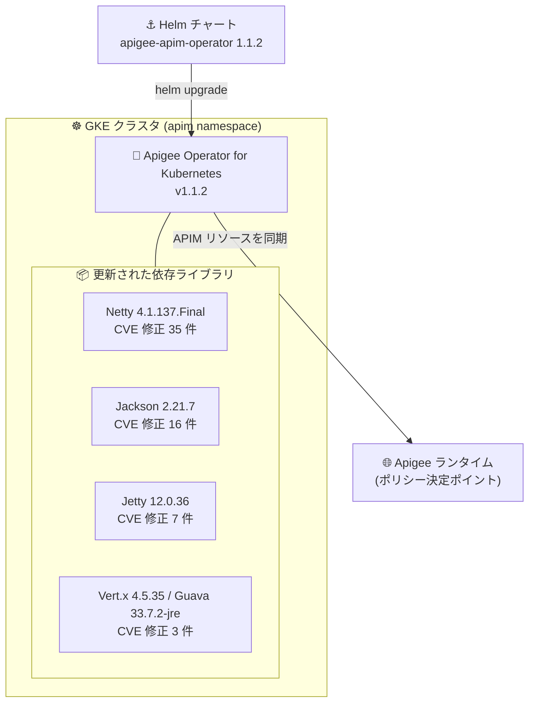

# Apigee Operator for Kubernetes: バージョン 1.1.2 リリース (Netty ほか依存ライブラリのセキュリティ修正)

**リリース日**: 2026-11-04

**サービス**: Apigee Operator for Kubernetes

**機能**: バージョン 1.1.2 (セキュリティアップデート)

**ステータス**: 一般提供 (GA)

📊 [このアップデートのインフォグラフィックを見る](https://takech9203.github.io/google-cloud-news-summary/20261104-apigee-operator-kubernetes-1-1-2.html)

## 概要

2026 年 11 月 4 日、Google Cloud は Apigee のアップデート版をリリースし、**Apigee Operator for Kubernetes バージョン 1.1.2** が利用可能になりました。Apigee Operator for Kubernetes は、kubectl や Helm などの Kubernetes ネイティブなツールを使って API プロダクトやオペレーションの定義といった API 管理タスクを実行できるオペレーターで、GKE クラスタと Apigee ランタイムを APIM リソース経由で同期させる仕組みを提供します。

今回の 1.1.2 はセキュリティ修正を中心としたリリースです。オペレーターが内部で使用する Java 系の依存ライブラリ群が一括で更新され、**Netty 4.1.137.Final**、**Jackson 2.21.7**、**Jetty 12.0.36**、**Vert.x 4.5.35**、**Guava 33.7.2-jre** へのアップグレードにより、合計 61 件の CVE (Netty 35 件、Jackson 16 件、Jetty 7 件、Vert.x 2 件、Guava 1 件) に対処しています。

Apigee Operator for Kubernetes を本番の GKE クラスタで運用しているチームにとって、依存ライブラリの既知脆弱性を解消する重要なアップデートであり、早期の適用が推奨されます。

**アップデート前の課題**

- 旧バージョン (1.1.1 以前) のオペレーターには、Netty、Jackson、Jetty、Vert.x、Guava の旧バージョンに起因する多数の既知脆弱性 (CVE) が含まれていた
- コンテナイメージの脆弱性スキャン (Artifact Analysis や社内のスキャナー) で、オペレーターの依存ライブラリ由来の検出が多数報告される状態だった
- ネットワーク処理 (Netty) や JSON 処理 (Jackson) など、オペレーターの通信経路に関わるコンポーネントに未修正の脆弱性が残っていた

**アップデート後の改善**

- Netty を 4.1.137.Final にアップグレードし、CVE-2026-33870 や CVE-2026-33871 をはじめとする 35 件の脆弱性を修正
- Jackson 2.21.7 (16 件)、Jetty 12.0.36 (7 件)、Vert.x 4.5.35 (2 件)、Guava 33.7.2-jre (1 件) へのアップグレードにより、残りの依存ライブラリの脆弱性も一括で解消
- Helm チャートのバージョンを 1.1.2 に上げて再デプロイするだけで、これらの修正をまとめて適用できる

## アーキテクチャ図



GKE クラスタ上で稼働する Apigee Operator for Kubernetes の依存ライブラリ 5 種がバージョン 1.1.2 で一括更新され、合計 61 件の CVE が修正されます。適用は Helm チャートのバージョン更新のみで完結します。

## サービスアップデートの詳細

### 主要機能

1. **Apigee Operator for Kubernetes 1.1.2 の提供開始**
   - 2026 年 11 月 4 日のリリースノートで、オペレーターの新バージョン 1.1.2 が利用可能になったことが発表された
   - 機能追加ではなく、依存ライブラリのセキュリティ修正を目的としたメンテナンスリリース

2. **Netty のアップグレード (4.1.137.Final)**
   - オペレーターの非同期ネットワーク処理を担う Netty を 4.1.137.Final に更新
   - CVE-2026-33870、CVE-2026-33871、CVE-2026-41417、CVE-2026-42578〜42581、CVE-2026-42583〜42585、CVE-2026-42587、CVE-2026-44249、CVE-2026-45416、CVE-2026-45673、CVE-2026-45674、CVE-2026-47244、CVE-2026-47691、CVE-2026-48043、CVE-2026-50010、CVE-2026-50020、CVE-2026-50560、CVE-2026-55831、CVE-2026-55833、CVE-2026-56745、CVE-2026-56746、CVE-2026-56819、CVE-2026-59898〜59901、CVE-2026-59903、CVE-2026-59921、CVE-2026-73508、CVE-2026-75595、CVE-2026-75596 の 35 件に対処

3. **Jackson のアップグレード (2.21.7)**
   - JSON 処理ライブラリ Jackson を 2.21.7 に更新
   - CVE-2026-18401、CVE-2026-19032、CVE-2026-54512〜54515、CVE-2026-59888、CVE-2026-59889、CVE-2026-68494、CVE-2026-68497、CVE-2026-77310、CVE-2026-83557、CVE-2026-89407、CVE-2026-89425、CVE-2026-91776、CVE-2026-91777 の 16 件に対処

4. **Jetty / Vert.x / Guava のアップグレード**
   - Jetty 12.0.36: CVE-2025-11143、CVE-2026-1605、CVE-2026-2332、CVE-2026-6790、CVE-2026-8384、CVE-2026-10050、CVE-2026-10051 の 7 件に対処
   - Vert.x 4.5.35: CVE-2026-1002、CVE-2026-6860 の 2 件に対処
   - Guava 33.7.2-jre: CVE-2026-102554 の 1 件に対処

## 技術仕様

### 修正された依存ライブラリと CVE 件数

| ライブラリ | 更新後バージョン | 修正 CVE 件数 | 役割 |
|------|------|------|------|
| Netty | 4.1.137.Final | 35 件 | 非同期ネットワーク I/O フレームワーク |
| Jackson | 2.21.7 | 16 件 | JSON シリアライズ/デシリアライズ |
| Jetty | 12.0.36 | 7 件 | HTTP サーバー/クライアント |
| Vert.x | 4.5.35 | 2 件 | リアクティブアプリケーションツールキット |
| Guava | 33.7.2-jre | 1 件 | Java コアユーティリティ |
| **合計** | - | **61 件** | - |

### Apigee Operator for Kubernetes の前提条件

| 項目 | 要件 |
|------|------|
| GKE バージョン | 1.27 以降 (ApigeeBackendService 利用時は 1.34.x 以降) |
| Apigee バージョン | 1-15-0-apigee-4 以降 |
| Helm バージョン | 3.13.3 以降 |
| サポート対象 API | REST API のみ (gRPC / GraphQL は非対応) |

## 設定方法

### 前提条件

1. Apigee Operator for Kubernetes が稼働中の GKE クラスタ (GKE 1.27 以降)
2. Helm 3.13.3 以降
3. オペレーター用の Google サービスアカウントと Workload Identity の構成 (既存インストールでは設定済み)

### 手順

#### ステップ 1: 現在のインストール状態を確認

```bash
# 現在のチャートバージョンを確認
helm list -n apim

# オペレーター Pod の稼働状態を確認
kubectl get pods -n apim
```

既存リリース (例: 1.1.1) のチャート名とリリース名を確認します。

#### ステップ 2: CRD とオペレーターを 1.1.2 に更新

```bash
# CRD チャートを 1.1.2 に更新
helm upgrade apigee-apim-crds -n apim \
  oci://us-docker.pkg.dev/apigee-release/apigee-k8s-tooling-helm-charts/apigee-apim-operator-crds \
  --version 1.1.2 \
  --atomic

# オペレーター本体を 1.1.2 に更新 (既存の values 設定を引き継ぐ)
helm upgrade apigee-apim-operator -n apim \
  oci://us-docker.pkg.dev/apigee-release/apigee-k8s-tooling-helm-charts/apigee-apim-operator-helm \
  --version 1.1.2 \
  --reuse-values \
  --atomic
```

`--atomic` を指定すると、アップグレード失敗時に自動でロールバックされます。

#### ステップ 3: 更新後の動作確認

```bash
# チャートバージョンが 1.1.2 になったことを確認
helm list -n apim

# オペレーター Pod が Running / READY 1/1 であることを確認
kubectl get pods -n apim
```

## メリット

### ビジネス面

- **セキュリティコンプライアンスの維持**: 既知 CVE 61 件が解消されるため、脆弱性管理ポリシーや監査要件 (SLA 内の脆弱性修正期限など) への対応が容易になる
- **運用負荷の低減**: 依存ライブラリ 5 種の修正が単一の Helm チャート更新で適用でき、個別のパッチ管理が不要

### 技術面

- **攻撃対象領域の縮小**: ネットワーク処理 (Netty)、HTTP 処理 (Jetty)、JSON 処理 (Jackson) といった通信経路上のコンポーネントの脆弱性が解消される
- **脆弱性スキャンのノイズ削減**: コンテナイメージスキャンで検出されていた依存ライブラリ由来の指摘が解消され、本当に対処が必要な検出に集中できる

## デメリット・制約事項

### 制限事項

- Apigee Operator for Kubernetes 自体の既知の制限は継続する (REST API のみ対応、API 管理ポリシー付き GKE Gateway リソースは最大 25 個、1 環境あたり APIM 拡張ポリシーは最大 50 個、リージョン拡張非対応など)
- Apigee ランタイムとの併用が前提であり、スタンドアロン製品ではない

### 考慮すべき点

- 本リリースはセキュリティ修正が中心であり、適用を先送りすると既知脆弱性が残存するため、計画的な早期適用が望ましい
- アップグレード時はオペレーター Pod が再作成されるため、変更管理プロセスに沿ったメンテナンス計画 (dry-run の実施、`--atomic` によるロールバック確保) を推奨

## ユースケース

### ユースケース 1: 定期脆弱性スキャンへの対応

**シナリオ**: セキュリティチームがコンテナイメージの定期スキャンを実施しており、Apigee Operator for Kubernetes のイメージから Netty や Jackson の CVE が多数検出されている。

**実装例**:
```bash
# dry-run で影響を確認してから適用
helm upgrade apigee-apim-operator -n apim \
  oci://us-docker.pkg.dev/apigee-release/apigee-k8s-tooling-helm-charts/apigee-apim-operator-helm \
  --version 1.1.2 --reuse-values --atomic --dry-run=server
```

**効果**: 1 回のチャート更新で 61 件の CVE 検出が解消され、脆弱性対応の SLA を満たせる。

### ユースケース 2: GKE 上の API 管理基盤の定期メンテナンス

**シナリオ**: GKE Gateway + Apigee Operator for Kubernetes で API ポリシー適用基盤を運用しており、四半期ごとのメンテナンスウィンドウでコンポーネントを更新している。

**効果**: メンテナンスウィンドウ内で 1.1.2 への更新を組み込むことで、機能面の変更リスクを抑えつつセキュリティ水準を最新に保てる。

## 料金

Apigee Operator for Kubernetes は Apigee ランタイムと組み合わせて利用するコンポーネントであり、今回のアップデートによる料金変更はありません。Apigee の料金体系は以下の料金ページを参照してください。

- [Apigee 料金ページ](https://cloud.google.com/apigee/pricing)

## 関連サービス・機能

- **Apigee**: オペレーターが同期先とする API 管理プラットフォーム。ポリシー決定ポイント (PDP) として機能する
- **Google Kubernetes Engine (GKE)**: オペレーターの稼働基盤。GKE Gateway と Application Load Balancer のトラフィック拡張をポリシー適用ポイント (PEP) として利用する
- **GKE Inference Gateway**: ApigeeBackendService リソースを通じて統合でき、生成 AI ワークロードの API 管理・ガバナンス・収益化に Apigee を活用できる
- **Apigee hybrid**: 同日に Apigee hybrid v1.15.10 もリリースされており、ハイブリッド環境の利用者は併せて確認を推奨 (Apigee Operator for Kubernetes 自体は現時点で Apigee hybrid では利用不可)

## 参考リンク

- 📊 [インフォグラフィック](https://takech9203.github.io/google-cloud-news-summary/20261104-apigee-operator-kubernetes-1-1-2.html)
- [公式リリースノート](https://docs.cloud.google.com/release-notes#November_04_2026)
- [Apigee Operator for Kubernetes リリースノート](https://docs.cloud.google.com/apigee/docs/api-platform/apigee-kubernetes/release-notes)
- [Apigee Operator for Kubernetes 概要](https://docs.cloud.google.com/apigee/docs/api-platform/apigee-kubernetes/apigee-apim-operator-overview)
- [Apigee Operator for Kubernetes のインストール](https://docs.cloud.google.com/apigee/docs/api-platform/apigee-kubernetes/apigee-apim-operator-install)
- [料金ページ](https://cloud.google.com/apigee/pricing)

## まとめ

Apigee Operator for Kubernetes 1.1.2 は、Netty 4.1.137.Final へのアップグレードを筆頭に、Jackson、Jetty、Vert.x、Guava を含む依存ライブラリの合計 61 件の CVE を修正するセキュリティリリースです。機能面の変更はないため適用リスクは小さく、GKE 上でオペレーターを運用しているすべての環境で、Helm チャートを 1.1.2 へ早期に更新することを推奨します。

---

**タグ**: Apigee, Apigee Operator for Kubernetes, GKE, セキュリティ, CVE, Netty, Jackson, Jetty, アップデート
