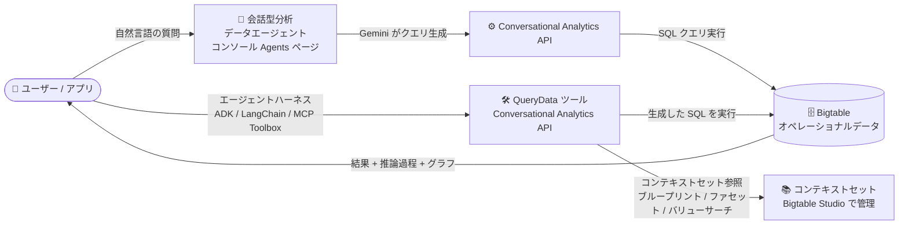

# Bigtable: 会話型分析 (Conversational Analytics) と QueryData ツール (Preview)

**リリース日**: 2026-11-04

**サービス**: Bigtable

**機能**: 会話型分析 (Conversational Analytics) / QueryData ツール

**ステータス**: Preview

📊 [このアップデートのインフォグラフィックを見る](https://takech9203.github.io/google-cloud-news-summary/20261104-bigtable-conversational-analytics-querydata-preview.html)

## 概要

Bigtable に、自然言語でオペレーショナルデータを照会できる 2 つの関連機能が Preview として追加されました。1 つ目は **会話型分析 (Conversational Analytics)** で、Conversational Analytics API を利用し、テーブルやビューなどのナレッジソースを指定したデータエージェントを作成して、自然言語のチャットで Bigtable のデータについて質問できます。2 つ目は **QueryData ツール** で、会話型の言語を使ってデータベースのデータを照会し、データエージェントを構築するためのエージェンティックなツールです。

会話型分析は Google Cloud コンソールの Bigtable の「Agents」ページから利用でき、「先四半期の売上合計は?」のような質問をテーブルのフィールド名を知らなくても投げかけられます。回答にはテキスト・コード・グラフに加え、エージェントの推論過程 (reasoning) や生成されたクエリが含まれます。一方 QueryData は、Conversational Analytics API の QueryData エンドポイントとして提供され、ADK や LangChain などのエージェントハーネスから呼び出して、自然言語から SQL への変換をプログラマティックに行うアプリケーション組み込み向けの機能です。

対象ユーザーは、Bigtable 上のオペレーショナルデータをアドホックに分析したいビジネスユーザー・アナリスト (会話型分析)、および顧客サービス自動化や EC ショッピングアシスタントなど、自然言語インターフェースを持つデータエージェントアプリケーションを構築する開発者 (QueryData) です。

**アップデート前の課題**

- Bigtable のデータを分析するには SQL (GoogleSQL) やクライアントライブラリによるクエリの記述が必要で、テーブルスキーマやフィールド名を熟知していないユーザーはデータに直接アクセスできなかった
- 自然言語でデータベースを照会するエージェントアプリケーションを構築する場合、自然言語から SQL への変換ロジック (スキーマ解釈、曖昧さの解消、クエリ生成) を自前で実装する必要があった
- 一般的な LLM による Text-to-SQL では、組織固有の用語やビジネスロジックを反映した正確なクエリ生成が難しかった

**アップデート後の改善**

- Google Cloud コンソールからデータエージェントを作成・公開し、自然言語の会話 (永続化されたチャット) で Bigtable のデータを分析できるようになった
- QueryData エンドポイントにより、クエリブループリント・ファセット・バリューサーチからなるコンテキストセットを使った高精度な自然言語からのクエリ生成を、エージェントハーネス (ADK、LangChain、Antigravity など) や MCP Toolbox から利用できるようになった
- エージェントの回答に推論過程と生成クエリが表示され、結果の検証やクエリの再利用が容易になった

## アーキテクチャ図



ユーザーはコンソールの会話型分析 (対話的な分析) または QueryData ツール (アプリケーション組み込み) を通じて自然言語で質問し、Conversational Analytics API がコンテキスト情報を使って SQL を生成・実行し、Bigtable のデータから回答を返します。

## サービスアップデートの詳細

### 主要機能

1. **会話型分析のデータエージェント**
   - テーブルやビューなどのナレッジソースを選択してデータエージェントを作成
   - フィールド名のシノニムやビジネス用語、フィルタリング・グルーピングのデフォルトなどのカスタムメタデータと指示を設定可能
   - コンソールの「Agents」ページで、自分が作成したエージェントと他のユーザーから共有されたエージェントを管理

2. **会話 (Conversations)**
   - データエージェントまたはデータソースとの永続化されたチャット
   - 「sales」「most popular」のような一般的な用語での複数パートの質問に対応 (フィールド名の指定やフィルタ条件の定義が不要)
   - 回答はテキスト・コード・グラフで返され、「Show thinking」で推論過程、「See detail」で生成クエリと結果を確認可能
   - データソースとの直接会話も可能だが、データエージェントの方がコンテキストを持つため精度が高い

3. **コンテキスト生成の 2 方式**
   - **Guided**: Google Cloud コンソールで作成。コードを書かずに利用したいユーザー向け
   - **Advanced**: Gemini CLI や IDE で作成。エージェント品質をより細かく制御したいユーザー向け。QueryData のコンテキストを再利用

4. **QueryData ツール**
   - Conversational Analytics API の QueryData エンドポイントとして提供されるエージェンティックツール
   - 自然言語から SQL へのクエリ生成をプログラマティックに実行 (スキーマ解釈とクエリ合成を担当)
   - エージェントハーネス (Antigravity、ADK、LangChain など) が会話履歴・ユーザー状態・ツールオーケストレーションを管理し、QueryData に自然言語リクエストを送信
   - MCP Toolbox または直接の API 呼び出しでアプリケーションと統合

5. **コンテキストセット (QueryData)**
   - **クエリブループリント**: 代表的な自然言語の質問と検証済み SQL のペア。ビジネスインテントと SQL のマッピングを定義
   - **クエリファセット**: 日付範囲やしきい値などのモジュール化された SQL 述語・フィルタ条件。組み合わせごとのブループリント作成が不要
   - **バリューサーチ**: 「Bay Area」→「San Francisco」のように、曖昧な表現を実際のカラム値に解決 (完全一致・トライグラム類似・セマンティックベクトル埋め込み)
   - コンテキストエンジニアリングエージェントによるコンテキスト作成の自動化にも対応

## 技術仕様

### QueryData の処理フロー

| ステップ | 処理内容 |
|------|------|
| 1. 値の解決 (Value resolution) | バリューサーチクエリを実行し、プロンプト内のエンティティ (名前、都市、カテゴリなど) をデータベースのカラム値にマッピング |
| 2. インテントマッチングと曖昧さ解消 | リクエストをコンテキストセットのブループリント・ファセットと照合。曖昧な場合は明確化のための質問を返す |
| 3. クエリ合成 | マッチしたブループリント構造、適用されたファセット、解決された値から完全な SQL クエリを合成 |
| 4. クエリ実行 | 生成されたクエリをデータベースに対して実行し結果を返す |

### アーキテクチャ上の特性

| 項目 | 詳細 |
|------|------|
| コントロールプレーン | オーケストレーション (プランニング、ワークフロー管理、ツール呼び出し) はグローバルエンドポイントのみを使用 |
| データプレーン | 実際のデータベースレコードやベクトルドキュメントの取得・処理はリージョナルエンドポイントを使用 |
| 基盤モデル | Gemini for Google Cloud。Vertex AI の Dynamic Shared Quota (DSQ) で容量管理されるため、高負荷時に一時的な 429 エラーが発生する場合がある |
| アクセス制御 | Conversational Analytics API の IAM ロールと権限で管理 |

## 設定方法

### 前提条件

1. Bigtable インスタンスとクエリ対象のテーブル・ビューが存在すること
2. データエージェント作成・会話に必要な IAM ロールを保有していること (詳細は公式ドキュメントの required roles を参照)

### 手順 (会話型分析でエージェントと会話する)

#### ステップ 1: データエージェントの作成

Google Cloud コンソールの Bigtable ページでインスタンスを選択し、ナビゲーションメニューの「Agents」からテーブル・ビューをナレッジソースとして指定し、データエージェントを作成・公開します。必要に応じてシノニムやフィルタリングのデフォルトなどのコンテキストと指示を設定します。

#### ステップ 2: エージェントとの会話

「Agent Catalog」タブからエージェントカードをクリックしてチャットパネルを開き、「Ask a question」フィールドに質問を入力します (Gemini が提案する質問から開始することも可能)。「Show thinking」で推論過程、「See detail」で生成クエリと結果を確認できます。

### 手順 (QueryData をアプリケーションに組み込む)

1. **コンテキストの作成**: クエリブループリント・ファセット・バリューサーチを定義する (コンテキストエンジニアリングエージェントで自動化も可能)
2. **コンソールでの管理**: Bigtable Studio でコンテキストセットを作成・管理し、クエリ生成に利用可能にする
3. **アプリケーションとの統合**: MCP Toolbox または直接の API 呼び出しで、アプリケーションや AI エージェントを QueryData に接続する

## メリット

### ビジネス面

- **データ活用の民主化**: SQL やスキーマの知識がないユーザーでも、自然言語で Bigtable のオペレーショナルデータから洞察を得られる
- **エージェントアプリの開発加速**: 顧客サービス自動化 (「注文はどこ?」)、EC ショッピングアシスタント (「100 ドル以下のランニングシューズを見せて」)、フィールドオペレーション (在庫・部品の照会) などのユースケースを短期間で実現できる
- **Preview 期間中は追加料金なし**: 実行されるクエリの Bigtable 料金のみで試用できる

### 技術面

- **高精度なクエリ生成**: 汎用 LLM の知識や生スキーマだけに頼らず、コンテキストセット (ブループリント・ファセット・バリューサーチ) で組織固有の用語とビジネスロジックを反映
- **透明性と検証可能性**: 推論過程と生成クエリが表示されるため、AI の回答を検証でき、クエリの再利用も可能
- **柔軟な統合**: コンソールでの対話的な利用 (会話型分析) から、ADK / LangChain / MCP Toolbox 経由のプログラマティックな利用 (QueryData) まで、同じ Conversational Analytics API 基盤で対応

## デメリット・制約事項

### 制限事項

- 両機能とも Preview であり、Pre-GA Offerings Terms (QueryData はさらに生成 AI プレビュー製品の追加規約) が適用される。サポートは限定的で、「現状のまま」提供される
- Gemini for Google Cloud は早期段階の技術であり、もっともらしいが事実と異なる出力を生成する可能性があるため、出力の検証が推奨される
- Vertex AI の Dynamic Shared Quota により、高負荷時に一時的な 429 Resource Exhausted エラーが発生する場合がある (短い遅延の後にリトライ)

### 考慮すべき点

- データソースとの直接会話はデータエージェントよりも精度が低くなる可能性があるため、精度が求められるケースではデータエージェントの利用が推奨される
- エージェント作成前に、エージェントが自動生成するコンテキストと指示でまず動作を確認してからカスタマイズすることが推奨される
- Gemini for Google Cloud によるデータの取り扱い (データガバナンス) を事前に確認すること

## ユースケース

### ユースケース 1: 運用データのセルフサービス分析

**シナリオ**: EC サイトの注文イベントを Bigtable に保存している企業で、ビジネスアナリストが SQL を書かずに売上傾向やユーザー行動を分析したい。

**実装例**:
```
1. コンソールの Bigtable「Agents」ページで注文テーブルをナレッジソースとするデータエージェントを作成
2. 「sales」=「order_amount カラムの合計」などのシノニムとビジネス用語を設定して公開
3. アナリストが「先四半期の売上合計は?」「セッション時間の上位 5 ユーザーを見せて」と自然言語で質問
```

**効果**: データエンジニアへのクエリ作成依頼が不要になり、分析のリードタイムが短縮される。生成クエリが表示されるため結果の検証も容易。

### ユースケース 2: 顧客サービスエージェントへの QueryData 組み込み

**シナリオ**: 「注文はどこ?」「現在の残高は?」といった大量の定型的な問い合わせに自動応答するカスタマーサービスエージェントを、ADK や LangChain で構築したい。

**効果**: QueryData のコンテキストセット (検証済み SQL のブループリント、バリューサーチによる曖昧さ解消) により、正確でグラウンディングされた回答を返すエージェントを、Text-to-SQL ロジックを自前実装せずに構築できる。

## 料金

会話型分析・QueryData ともに、データエージェントやコンテキストセットの作成、会話・照会時に実行されるクエリに対して [Bigtable の料金](https://cloud.google.com/bigtable/pricing) (コンピュート料金) が課金されます。**Preview 期間中は、データエージェント・会話・コンテキストセット・QueryData の作成と利用自体に追加料金はかかりません。** 詳細は [Data Cloud Agent pricing](https://cloud.google.com/products/data-agents/pricing) を参照してください。

## 利用可能リージョン

会話型分析のコントロールプレーン (オーケストレーション) はグローバルエンドポイントのみを使用し、データプレーン (データベースレコードの取得・処理) はリージョナルエンドポイントを使用します。対応リージョンの詳細は公式ドキュメントを参照してください。

## 関連サービス・機能

- **Conversational Analytics API**: 両機能の基盤となる API。BigQuery や Looker の会話型分析でも使用されており、コンソールで作成したデータエージェントを API 経由で呼び出すことも可能
- **Gemini for Google Cloud**: 会話型分析を支える生成 AI 基盤。Vertex AI の Dynamic Shared Quota で容量管理される
- **BigQuery 会話型分析**: BigQuery では同様のデータエージェント機能が先行して提供されており、今回のアップデートで Bigtable のオペレーショナルデータにも対象が拡大
- **MCP Toolbox / Agent Development Kit (ADK) / LangChain**: QueryData をアプリケーションや AI エージェントに統合するためのエージェントハーネス・ツール群
- **Bigtable Studio**: QueryData のコンテキストセットを作成・管理するコンソール環境
- **Gemini CLI**: 会話型分析の Advanced コンテキスト作成に使用

## 参考リンク

- 📊 [インフォグラフィック](https://takech9203.github.io/google-cloud-news-summary/20261104-bigtable-conversational-analytics-querydata-preview.html)
- [公式リリースノート](https://docs.cloud.google.com/release-notes#November_04_2026)
- [Conversational analytics for Bigtable overview](https://docs.cloud.google.com/gemini/data-agents/conversational-analytics/bigtable)
- [QueryData tool overview](https://docs.cloud.google.com/gemini/data-agents/querydata/bigtable/data-agent-overview)
- [Create data agents (Bigtable)](https://docs.cloud.google.com/gemini/data-agents/conversational-analytics/bigtable/create-data-agents)
- [Analyze data with conversations (Bigtable)](https://docs.cloud.google.com/gemini/data-agents/conversational-analytics/bigtable/create-conversations)
- [Conversational Analytics API overview](https://docs.cloud.google.com/gemini/docs/conversational-analytics-api/overview)
- [Bigtable 料金ページ](https://cloud.google.com/bigtable/pricing)

## まとめ

Bigtable のオペレーショナルデータに対する自然言語インターフェースが、コンソールでの対話的な分析 (会話型分析) とアプリケーション組み込み向けのエージェンティックツール (QueryData) の両面から Preview として提供されました。Preview 期間中は追加料金なしで試用できるため、まずはコンソールでデータエージェントを作成して回答精度を評価し、エージェントアプリケーションへの組み込みを検討する場合は QueryData のコンテキストセットの設計に着手することをおすすめします。

---

**タグ**: #Bigtable #ConversationalAnalytics #QueryData #DataAgents #GeminiForGoogleCloud #NaturalLanguage #Preview #AI
