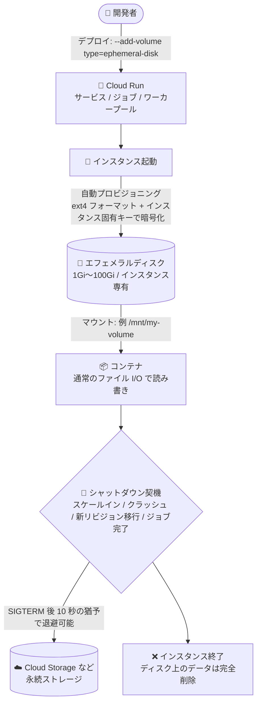

# Cloud Run: エフェメラルディスクが一般提供 (GA) に

**リリース日**: 2026-11-04

**サービス**: Cloud Run

**機能**: エフェメラルディスク (Ephemeral disk)

**ステータス**: GA (一般提供)

📊 [このアップデートのインフォグラフィックを見る](https://takech9203.github.io/google-cloud-news-summary/20261104-cloud-run-ephemeral-disk-ga.html)

## 概要

Cloud Run のエフェメラルディスクが一般提供 (GA) になりました。エフェメラルディスクは、サービス、ジョブ、ワーカープールのインスタンスが稼働している間だけ存続するディスクベースのボリュームをマウントできる機能です。必要なディスクサイズとマウントパスを指定するだけで、Cloud Run がインスタンス起動時にディスクを自動プロビジョニングし、ext4 でフォーマットしたうえでインスタンス固有のキーで暗号化します。

従来、Cloud Run で書き込み可能なローカルストレージとして利用できたのはメモリを消費するインメモリボリューム (`emptyDir` の `medium: Memory`) が中心であり、大きな一時ファイルを扱うにはその分のメモリをインスタンスに割り当てる必要がありました。エフェメラルディスクはメモリとは独立したディスク領域を提供するため、大容量データの一時処理やディスクキャッシュを、メモリ増量のコストをかけずに実現できます。

大きなファイルを扱うデータ処理ワークロードや、リモートストレージからの取得を減らしてレイテンシを最適化したい Web サービングのキャッシュ用途など、Cloud Run 上でローカルディスクを前提とするアプリケーションを運用するすべてのユーザーが対象です。

**アップデート前の課題**

- 書き込み可能なローカルファイルシステム (インメモリボリューム) はインスタンスのメモリを消費するため、大きな一時ファイルを扱うには高いメモリ割り当てが必要で、その分のコストが発生していた
- メモリに収まらない大規模データを処理するには、ファイルを分割して処理するオーケストレーションを自前で実装する必要があった
- 本機能は GA 以前はプレビュー段階であり、本番ワークロードでの利用には SLA などの観点で慎重な判断が必要だった

**アップデート後の改善**

- メモリとは独立したディスクベースのボリューム (1 ボリュームあたり 1Gi〜100Gi) をマウントできるようになり、大容量の一時データをメモリ増量なしで扱えるようになった
- GA となり、サービス・ジョブ・ワーカープールのいずれでも本番利用を前提とした構成が可能になった
- ディスクは起動時に自動プロビジョニング・ext4 フォーマット・インスタンス固有キーでの暗号化が行われ、通常のファイル I/O でそのまま読み書きできる

## アーキテクチャ図



Cloud Run インスタンスのライフサイクルとエフェメラルディスクの関係を示しています。ディスクはインスタンス起動時に自動作成・マウントされ、インスタンス終了時にデータごと完全に削除されます。終了前の SIGTERM から SIGKILL までの 10 秒間で、必要なデータを永続ストレージへ退避できます。

## サービスアップデートの詳細

### 主要機能

1. **インスタンス専有のディスクベースボリューム**
   - サイズ (1Gi〜100Gi) とマウントパスを指定するだけで、Cloud Run がディスクを自動プロビジョニング
   - 起動時に ext4 でフォーマットされ、インスタンス固有のキーで暗号化される
   - ディスクは特定のインスタンスに専有され、他のインスタンスやリビジョンとは共有されない

2. **サービス・ジョブ・ワーカープールすべてに対応**
   - Cloud Run サービス、ジョブ、ワーカープールのいずれでも利用可能
   - Google Cloud コンソール、gcloud CLI、YAML、Terraform で構成できる

3. **通常のファイル I/O でアクセス可能**
   - マウントしたボリュームは、各言語の標準ファイル操作ライブラリでそのまま読み書きできる
   - ローカルファイルシステムを前提とする既存コンテナをコード変更なしで移行しやすい

4. **ライフサイクルに連動したデータ削除**
   - インスタンスのシャットダウン (クラッシュ、スケールイン、新リビジョンへのトラフィック移行、ジョブタスクの完了など) 時にデータは完全削除される
   - シャットダウン前の SIGTERM から SIGKILL までの 10 秒間で、ディスク内容の永続ストレージへの退避などのクリーンアップが可能

## 技術仕様

### ストレージとインスタンスの制限

| 項目 | 詳細 |
|------|------|
| ボリュームサイズ | 1 ボリュームあたり 1Gi〜100Gi |
| インスタンスあたりのストレージ上限 | デフォルト合計 10 GiB (超過には割り当て増加リクエストが必要) |
| インスタンスあたりのボリューム数 | 最大 10 ボリューム |
| プロジェクトのリージョン割り当て | 初回デプロイ時にリージョンあたり 100 GiB が自動付与され、リージョン内の全稼働インスタンスで共有 (増加リクエスト可能) |
| 実行環境 | 第 2 世代実行環境のみ対応 |
| マウント禁止パス | `/dev`、`/proc`、`/sys` およびそのサブディレクトリ |
| フォーマット / 暗号化 | ext4 / インスタンス固有キーによる暗号化 |

### YAML での定義 (emptyDir / medium: Disk)

```yaml
apiVersion: serving.knative.dev/v1
kind: Service
metadata:
  name: SERVICE
spec:
  template:
    spec:
      containers:
        - name: CONTAINER_NAME
          image: IMAGE_URL
          volumeMounts:
            - name: VOLUME_NAME
              mountPath: /mnt/my-volume
      volumes:
        - name: VOLUME_NAME
          emptyDir:
            medium: Disk
            sizeLimit: 10Gi
```

### 必要な IAM ロール

| ロール | 対象 |
|--------|------|
| Cloud Run デベロッパー (`roles/run.developer`) | Cloud Run サービス / ジョブ / ワーカープール |
| サービス アカウント ユーザー (`roles/iam.serviceAccountUser`) | サービス ID |

## 設定方法

### 前提条件

1. gcloud CLI をインストール・初期化し、コンポーネントを最新化する (`gcloud components update`)
2. 第 2 世代実行環境を使用する (サービスの場合は `--execution-environment=gen2` を指定。ジョブはデフォルトで第 2 世代)
3. 上記の IAM ロールが付与されていること

### 手順

#### ステップ 1: サービスにエフェメラルディスクを追加

```bash
gcloud run services update SERVICE \
  --execution-environment=gen2 \
  --add-volume=name=VOLUME_NAME,type=ephemeral-disk,size=10Gi \
  --add-volume-mount=volume=VOLUME_NAME,mount-path=/mnt/my-volume
```

`size` は 1Gi〜100Gi の範囲で指定します。ジョブの場合は `gcloud run jobs update`、ワーカープールの場合は `gcloud run worker-pools update` を使用します (この 2 つでは `--execution-environment` の指定は不要)。

#### ステップ 2: アプリケーションからボリュームに読み書き

```python
# Python の例: マウントパス配下へ通常のファイル操作で書き込み
f = open("/mnt/my-volume/sample-logfile.txt", "a")
```

マウントしたボリュームは通常のローカルファイルシステムと同様に扱えます。

#### ステップ 3: ボリュームの削除 (不要になった場合)

```bash
gcloud run services update SERVICE \
  --remove-volume=VOLUME_NAME \
  --remove-volume-mount=/mnt/my-volume
```

ボリュームを削除するには、そのボリュームを使用するすべてのボリュームマウントも削除する必要があります。

## メリット

### ビジネス面

- **コスト最適化**: 大きな一時ファイルのためにメモリを増量する必要がなくなり、メモリコストを抑えながら大規模データを処理できる
- **本番利用の安心感**: GA となったことで、本番ワークロードでの採用判断がしやすくなった

### 技術面

- **大規模データ処理**: メモリに収まらないサイズのデータセットも、ディスク上の一時領域を使って処理できる
- **既存コンテナとの互換性**: 通常のファイル I/O でアクセスできるため、ローカルディスクを前提とする既存アプリケーションを変更なしで移行しやすい
- **セキュリティ**: ディスクはインスタンス固有キーで自動暗号化され、他のインスタンスと共有されない

## デメリット・制約事項

### 制限事項

- 第 2 世代実行環境でのみ利用可能
- インスタンスあたりデフォルト合計 10 GiB、プロジェクトあたりリージョンごとに 100 GiB の割り当て制限がある (増加リクエスト可能)
- デプロイ時には「インスタンスあたりのディスクサイズ × 最大インスタンス数」がリージョン割り当てを超えられない
- `/dev`、`/proc`、`/sys` とそのサブディレクトリにはマウントできない
- ジョブではライブマイグレーションがサポートされず、特に長時間実行ジョブの信頼性が低下する可能性がある

### 考慮すべき点

- データはインスタンス終了 (クラッシュ、スケールイン、新リビジョンへの移行、ジョブ完了) とともに完全削除されるため、永続化が必要なデータは SIGTERM 後 10 秒の猶予期間などを使って Cloud Storage 等へ退避する設計が必要
- Google Cloud コンソールから新リビジョンをデプロイすると、ディスクボリュームがインメモリボリュームに変換されてしまいメモリ不足を引き起こす既知の問題があるため、gcloud CLI / YAML (`medium: Disk`) でのデプロイを徹底する
- 大量データをダウンロードする場合、Direct VPC を有効にしないとネットワーク転送速度が低下することがある
- プロビジョニングしたディスクサイズ全体とインスタンスの稼働時間が課金に影響する

## ユースケース

### ユースケース 1: 大容量ファイルのデータ処理

**シナリオ**: Cloud Run ジョブで数十 GB の動画やログファイルをダウンロードして変換・集計する。従来はファイル全体をメモリに載せるか、分割処理のオーケストレーションが必要だった。

**実装例**:
```bash
gcloud run jobs update video-transcode-job \
  --add-volume=name=scratch,type=ephemeral-disk,size=50Gi \
  --add-volume-mount=volume=scratch,mount-path=/mnt/scratch
```

**効果**: 大量のメモリを割り当てることなく一時作業領域を確保でき、コストを抑えながらより大きなデータセットを処理できる。

### ユースケース 2: Web サービングのディスクキャッシュ

**シナリオ**: Cloud Run サービスで、リモートストレージから頻繁に取得するアセットやモデルファイルをローカルにキャッシュしてレスポンスを高速化したい。

**効果**: リモートストレージへのアクセスを減らし、アプリケーションのレイテンシを最適化できる。キャッシュはインスタンス終了時に自動で破棄されるため、後片付けの実装も不要。

## 料金

エフェメラルディスク専用の個別料金表は公開されていませんが、公式ドキュメントでは「プロビジョニングしたディスク全体のサイズと、それを使用するインスタンスの稼働時間がコストに寄与する」とされています。CPU・メモリ・ネットワーク下り (外向き) と合わせて、詳細は Cloud Run の料金ページを確認してください。

- [Cloud Run 料金ページ](https://cloud.google.com/run/pricing)

## 利用可能リージョン

エフェメラルディスクは、すべての [Cloud Run のロケーション](https://docs.cloud.google.com/run/docs/locations)で利用できます。

## 関連サービス・機能

- **Cloud Storage**: インスタンス終了前にディスク上のデータを退避する永続化先。Cloud Storage FUSE ボリュームマウントと使い分けることで、永続データと一時データを適切に分離できる
- **Cloud Run ボリュームマウント (in-memory / NFS / Cloud Storage)**: エフェメラルディスクは既存のボリュームタイプを補完する選択肢で、メモリを消費しない一時領域が必要な場合に適する
- **Direct VPC**: 大量データをディスクへダウンロードする際のネットワーク転送速度を確保するために有効化が推奨される

## 参考リンク

- 📊 [インフォグラフィック](https://takech9203.github.io/google-cloud-news-summary/20261104-cloud-run-ephemeral-disk-ga.html)
- [公式リリースノート](https://docs.cloud.google.com/release-notes#November_04_2026)
- [ドキュメント: サービスでのエフェメラルディスク構成](https://docs.cloud.google.com/run/docs/configuring/services/ephemeral-disk)
- [ドキュメント: ジョブでのエフェメラルディスク構成](https://docs.cloud.google.com/run/docs/configuring/jobs/ephemeral-disk)
- [ドキュメント: ワーカープールでのエフェメラルディスク構成](https://docs.cloud.google.com/run/docs/configuring/workerpools/ephemeral-disk)
- [料金ページ](https://cloud.google.com/run/pricing)

## まとめ

Cloud Run のエフェメラルディスクが GA となり、メモリとは独立した最大 100Gi のディスクベース一時領域を、サービス・ジョブ・ワーカープールで本番利用できるようになりました。大容量ファイルの処理やディスクキャッシュのためにメモリを増量していたワークロードは、コスト削減の観点から移行を検討する価値があります。導入時は第 2 世代実行環境の利用、割り当て上限、インスタンス終了時のデータ消失を踏まえた退避設計に注意してください。

---

**タグ**: Cloud Run, Ephemeral Disk, GA, ストレージ, ボリュームマウント, サーバーレス, コンテナ
