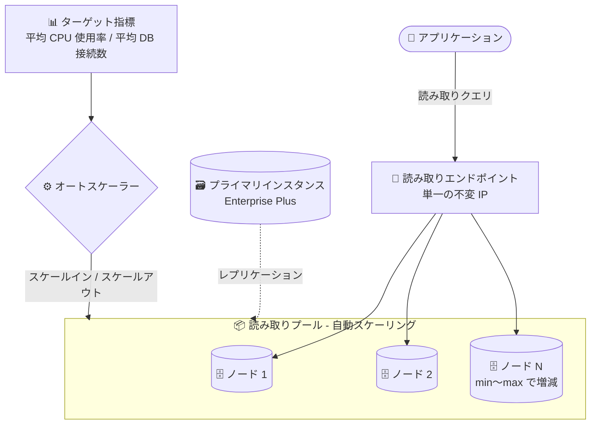

# Cloud SQL for SQL Server: 読み取りプール自動スケーリング (GA)

**リリース日**: 2026-11-04

**サービス**: Cloud SQL for SQL Server

**機能**: 読み取りプール自動スケーリング (Read Pool Autoscaling)

**ステータス**: GA (一般提供)

📊 [このアップデートのインフォグラフィックを見る](https://takech9203.github.io/google-cloud-news-summary/20261104-cloud-sql-sql-server-read-pool-autoscaling-ga.html)

## 概要

Cloud SQL for SQL Server で読み取りプール (Read Pool) の自動スケーリングが一般提供 (GA) になりました。読み取りプールは、大規模な読み取りワークロードを分散するための読み取りレプリカの集合 (各レプリカは「読み取りプールノード」と呼ばれる) であり、単一の読み取りエンドポイントを通じてアクセスできます。今回の GA により、アプリケーションのワークロード需要に応じて、読み取りプールノードの追加 (スケールアウト) と削除 (スケールイン) が自動化されます。

自動スケーリングは、次の 2 つのターゲット指標のいずれか、または両方に基づいて制御できます。

1. **平均 CPU 使用率 (Average CPU utilization)**: 読み取りプール全体の平均 CPU 使用率を指定した目標値以内に維持するようにスケーリング
2. **平均データベース接続数 (Average database connections)**: 各ノードが処理するクライアント接続数の平均を指定値以内に維持するようにスケーリング

読み取りワークロードの変動が大きい SQL Server アプリケーションを運用するユーザーにとって、手動でのキャパシティ調整が不要になり、運用負荷の軽減とコスト最適化を両立できるアップデートです。

**アップデート前の課題**

- 読み取りプールのノード数は固定で、ワークロードの増減に応じて手動でスケールイン / スケールアウト操作を行う必要があった
- ピーク負荷に合わせてノード数を多めに確保すると、オフピーク時に余剰キャパシティのコストが発生していた
- 急激な読み取り負荷の増加に対して、人手による対応では遅延が発生し、パフォーマンス低下のリスクがあった

**アップデート後の改善**

- CPU 使用率または接続数のターゲット指標を設定するだけで、読み取りプールのサイズが自動的に調整されるようになった
- 最小 / 最大ノード数の範囲内で需要に追従するため、余剰キャパシティを抑えつつピーク負荷にも対応できるようになった
- スケールアウト時は必要なノード数を並列で一括追加するため、負荷急増への追従が速い
- アプリケーションは単一の読み取りエンドポイントに接続したままでよく、ノード数の増減時に接続設定の変更が不要

## アーキテクチャ図



アプリケーションは単一の読み取りエンドポイント経由で読み取りプールにアクセスし、オートスケーラーが CPU 使用率や接続数の指標に基づいてノード数を最小〜最大の範囲で自動調整します。ノード増減時もエンドポイントは変わらないため、アプリケーション側の再設定は不要です。

## サービスアップデートの詳細

### 主要機能

1. **ターゲット指標に基づく自動スケーリング**
   - `AVERAGE_CPU_UTILIZATION`: 読み取りプール全体の平均 CPU 使用率 (`cloudsql.googleapis.com/database/cpu/utilization`) を目標値 (0.1〜0.9) 以内に維持
   - `AVERAGE_DB_CONNECTIONS`: ノードあたりの平均クライアント接続数 (`cloudsql.googleapis.com/database/network/connections`) を目標値 (10〜32,767) 以内に維持
   - 2 つの指標は片方のみ、または両方を設定可能。両方設定した場合は、各指標が示すノード数のうち大きい方が適用される

2. **スケーリング動作の制御**
   - 最小ノード数 (`minNodeCount`) と最大ノード数 (`maxNodeCount`) の指定が必須
   - スケールインは 1 回の操作で 1 ノードずつ削除、スケールアウトは必要なノード数を並列で一括追加
   - スケールイン / スケールアウトそれぞれにクールダウン期間を設定可能 (デフォルト 600 秒、最小 60 秒)
   - `disableScaleIn` オプションでスケールイン操作のみを無効化可能 (縮小させたくないワークロード向け)

3. **運用の可視性**
   - スケーリング操作は Google Cloud コンソールのオペレーションとして確認可能
   - System Insights の主要指標チャート (CPU 使用率、データベースごとの接続数) でスケーリング判断に使われる指標をモニタリング可能

## 技術仕様

### ターゲット指標の制限値

| 項目 | 詳細 |
|------|------|
| 平均 CPU 使用率の設定範囲 | 0.1〜0.9 |
| 平均 DB 接続数の設定範囲 | 10〜32,767 (上限は `max connections` データベースフラグの値に依存) |
| 最大ノード数 | プライマリインスタンスあたり、読み取りレプリカと読み取りプールノードの合計で最大 7 |
| クールダウン期間 | デフォルト 600 秒、最小 60 秒 (スケールイン / スケールアウト個別に設定可) |
| スケールイン | 1 操作につき 1 ノードずつ削除 |
| スケールアウト | 必要なノード数を並列で追加 |
| 対象エディション | Cloud SQL Enterprise Plus edition (新ネットワークアーキテクチャ) のみ |
| スケーリング中のダウンタイム | スケールイン / スケールアウトはサブ秒のダウンタイム |

### 自動スケーリング設定 (Cloud SQL Admin API)

```json
{
  "settings": {
    "readPoolAutoScaleConfig": {
      "enabled": true,
      "minNodeCount": 2,
      "maxNodeCount": 5,
      "disableScaleIn": false,
      "scaleInCooldownSeconds": 600,
      "scaleOutCooldownSeconds": 600,
      "targetMetrics": [
        {
          "metric": "AVERAGE_CPU_UTILIZATION",
          "targetValue": 0.5
        }
      ]
    }
  }
}
```

## 設定方法

### 前提条件

1. プライマリインスタンスと読み取りプールの両方が Cloud SQL Enterprise Plus edition であること
2. インスタンスが新ネットワークアーキテクチャ上にあること
3. 自動スケーリングの最大ノード数は、同一プライマリに紐づく読み取りレプリカ / 他の読み取りプールノードとの合計が 7 を超えないように設定すること

### 手順

#### ステップ 1: 自動スケーリングを有効にした読み取りプールを作成

```bash
gcloud sql instances create READ_POOL_NAME \
  --tier=MACHINE_TIER --edition=ENTERPRISE_PLUS \
  --instance-type=READ_POOL_INSTANCE --node-count=NODE_COUNT \
  --database-version=DATABASE_VERSION \
  --master-instance-name=PRIMARY_INSTANCE_NAME \
  --region=REGION --network=NETWORK_NAME \
  --no-assign-ip \
  --auto-scale-enabled \
  --auto-scale-max-node-count=MAX_NODE_COUNT \
  --auto-scale-min-node-count=MIN_NODE_COUNT \
  --auto-scale-target-metrics=AVERAGE_CPU_UTILIZATION=0.50
```

平均 CPU 使用率 0.50 を目標として、読み取りプールが自動的にスケールイン / スケールアウトします。

#### ステップ 2: 既存の読み取りプールで自動スケーリングを有効化

```bash
gcloud sql instances patch INSTANCE_NAME \
  --auto-scale-enabled \
  --auto-scale-max-node-count=5 \
  --auto-scale-min-node-count=2 \
  --auto-scale-out-cooldown-seconds=180 \
  --auto-scale-in-cooldown-seconds=180 \
  --auto-scale-target-metrics=AVERAGE_DB_CONNECTIONS=50
```

既存の読み取りプールに対しては `patch` コマンドで有効化できます。有効化時点のノード数は、指定する最小〜最大の範囲内に収まっている必要があります。

## メリット

### ビジネス面

- **コスト最適化**: オフピーク時は自動でスケールインするため、ピークに合わせた固定キャパシティの余剰コストを削減できる
- **運用負荷の軽減**: 読み取りキャパシティの監視と手動スケーリング作業が不要になり、DBA の運用工数を削減できる
- **ユーザー体験の安定化**: 負荷急増時に自動でスケールアウトすることで、読み取りパフォーマンスの劣化を抑制できる

### 技術面

- **アプリケーション変更不要**: 単一の読み取りエンドポイント (不変 IP) を使用するため、ノード増減時に接続設定の変更が不要
- **柔軟な指標設定**: CPU バウンドなワークロードには CPU 使用率、接続数バウンドなワークロードには接続数と、特性に応じた指標を選択 (または併用) できる
- **Terraform 対応**: `google_sql_database_instance` リソースの `read_pool_auto_scale_config` ブロックで IaC 管理が可能

## デメリット・制約事項

### 制限事項

- Cloud SQL Enterprise Plus edition (新ネットワークアーキテクチャ) のインスタンスでのみ利用可能
- プライマリあたりの読み取りレプリカ + 読み取りプールノードの合計は最大 7 のため、自動スケーリングの最大ノード数もこの範囲内に制限される
- 自動スケーリング操作の実行中は、読み取りプールおよびプライマリインスタンスに対する他のオペレーションがブロックされる
- レプリケーションのオーバーヘッドや SQL Server 以外のプロセスに起因して CPU 使用率が高い場合、CPU ベースの自動スケーリングはスロットリングされる

### 考慮すべき点

- スケールインは 1 ノードずつのため、急激な負荷減少に対する縮小は緩やかに進む (コスト面では即時反映されない)
- クールダウン期間 (デフォルト 600 秒) により、連続したスケーリング操作には待ち時間が発生する
- 読み取りプールはレプリケーションラグの大きいノードからもトラフィックを配信するため、高い読み取り一貫性が必要なアプリケーションには単一レプリカの垂直スケーリングが推奨される
- SQL Server の読み取りプールは Read Scale Availability Group ベースであり、Advanced DR やカスケードレプリカとは併用できない

## ユースケース

### ユースケース 1: 営業時間帯に読み取り負荷が集中する業務アプリケーション

**シナリオ**: 日中の営業時間帯にレポート参照や検索クエリが集中し、夜間はほぼアイドル状態になる社内業務システム。従来はピークに合わせて読み取りプールのノード数を固定していた。

**実装例**:
```bash
gcloud sql instances patch sqlserver-read-pool \
  --auto-scale-enabled \
  --auto-scale-min-node-count=1 \
  --auto-scale-max-node-count=5 \
  --auto-scale-target-metrics=AVERAGE_CPU_UTILIZATION=0.60
```

**効果**: 日中は CPU 使用率 60% を維持するよう自動でスケールアウトし、夜間は最小 1 ノードまでスケールインするため、パフォーマンスを維持しながらオフピーク時のコストを削減できる。

### ユースケース 2: 接続数が変動する BI / 分析ワークロード

**シナリオ**: 月次決算やキャンペーン分析の時期に BI ツールからの同時接続数が急増する。接続数の上限超過によるクエリ失敗を防ぎたい。

**効果**: `AVERAGE_DB_CONNECTIONS` をターゲット指標に設定することで、ノードあたりの平均接続数が目標値を超えないよう自動でノードが追加され、接続集中時のエラーやレイテンシ悪化を防止できる。

## 料金

読み取りプールのノードは、Cloud SQL Enterprise Plus edition のインスタンスとしてノード数とマシン構成に応じて課金されます。自動スケーリングによりノード数が増減すると、課金対象のノード数もそれに応じて変動します。詳細な料金は料金ページを参照してください。

- [Cloud SQL 料金ページ](https://cloud.google.com/sql/pricing)

## 利用可能リージョン

Cloud SQL Enterprise Plus edition が利用可能なリージョンで使用できます。詳細は [リージョン別の提供状況](https://docs.cloud.google.com/sql/docs/sqlserver/region-availability-overview) を参照してください。

## 関連サービス・機能

- **Cloud SQL 読み取りプール (Read Pools)**: 本機能の基盤。単一エンドポイントで読み取りレプリカ群への負荷分散を提供
- **Cloud Monitoring**: スケーリング判断に使用される指標 (`database/cpu/utilization`、`database/network/connections`) の監視・アラート設定
- **Cloud SQL System Insights**: 読み取りプールの CPU 使用率や接続数の主要指標チャートを可視化
- **Cloud SQL for MySQL / PostgreSQL 読み取りプール自動スケーリング**: 同等の自動スケーリング機能が MySQL / PostgreSQL でも提供されており、マルチエンジン環境で一貫した運用が可能

## 参考リンク

- 📊 [インフォグラフィック](https://takech9203.github.io/google-cloud-news-summary/20261104-cloud-sql-sql-server-read-pool-autoscaling-ga.html)
- [公式リリースノート](https://docs.cloud.google.com/release-notes#November_04_2026)
- [ドキュメント: Read pool autoscaling (SQL Server)](https://docs.cloud.google.com/sql/docs/sqlserver/read-pool-autoscaling)
- [ドキュメント: About read pools (SQL Server)](https://docs.cloud.google.com/sql/docs/sqlserver/about-read-pools)
- [料金ページ](https://cloud.google.com/sql/pricing)

## まとめ

Cloud SQL for SQL Server の読み取りプール自動スケーリングが GA となり、CPU 使用率または接続数に基づく読み取りキャパシティの自動調整が本番環境で利用できるようになりました。読み取り負荷の変動が大きい SQL Server ワークロードを Enterprise Plus edition で運用している場合は、まず既存の読み取りプールに対して最小 / 最大ノード数とターゲット指標を設定し、System Insights で挙動を確認しながら導入することを推奨します。

---

**タグ**: Cloud SQL, SQL Server, Read Pool, Autoscaling, GA, Enterprise Plus, Database
