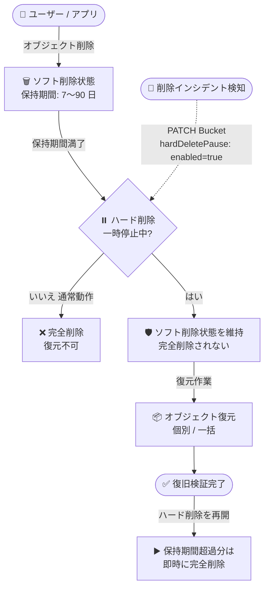

# Cloud Storage: ソフト削除オブジェクトのハード削除一時停止機能

**リリース日**: 2026-11-04

**サービス**: Cloud Storage

**機能**: ソフト削除されたオブジェクトの完全 (ハード) 削除の一時停止

**ステータス**: リリース済み (Feature)

📊 [このアップデートのインフォグラフィックを見る](https://takech9203.github.io/google-cloud-news-summary/20261104-cloud-storage-pause-hard-deletions.html)

## 概要

Cloud Storage に、バケット単位でソフト削除オブジェクトの完全削除 (ハード削除) を一時停止できる機能が追加されました。通常、ソフト削除されたオブジェクトはソフト削除ポリシーの保持期間 (デフォルト 7 日間、最大 90 日間) が経過すると自動的に完全削除されますが、この機能を使うと保持期間が満了してもオブジェクトは完全削除されず、ハード削除を再開するまでソフト削除状態のまま保持されます。

この機能は、大規模な誤削除インシデントや悪意ある削除が発生した際に、復元作業のための時間を確保することを目的としています。数十億オブジェクト規模のバケットの復旧では、復元処理がソフト削除の保持期間内に完了しない可能性があります。ハード削除を一時停止することで、「保持期間切れによるデータの恒久的な喪失」というタイムリミットを気にせず、調査・復元・検証を進められます。

ストレージ管理者、データ保護 (バックアップ/DR) 担当者、セキュリティインシデント対応チームにとって、ランサムウェアや誤操作によるマスデリーションへの対応手段が強化されるアップデートです。

**アップデート前の課題**

- ソフト削除されたオブジェクトは、保持期間 (最大 90 日間) が満了すると自動的に完全削除され、それを止める手段がなかった
- 保持期間の変更は変更後に削除されたオブジェクトにのみ適用されるため、すでにソフト削除済みのオブジェクトの保持期間を延長できなかった
- 数十億オブジェクト規模の復元や、削除範囲の調査に時間がかかる場合、保持期間内に作業が完了せずデータを恒久的に失うリスクがあった

**アップデート後の改善**

- バケット単位でハード削除を一時停止でき、ソフト削除済みオブジェクトを保持期間満了後も削除されない状態で保持できるようになった
- 大規模復元や削除インシデントの調査・復旧検証を、時間的制約なく実施できるようになった
- 一時停止は即時に反映されるため、インシデント検知後すぐにデータ喪失を食い止められるようになった

## アーキテクチャ図



削除インシデント検知時にハード削除を一時停止すると、保持期間が満了してもオブジェクトはソフト削除状態のまま維持され、復元・検証完了後に再開するというインシデント対応フローを示しています。

## サービスアップデートの詳細

### 主要機能

1. **ハード削除の一時停止 (Pause)**
   - バケットのソフト削除ポリシーに `hardDeletePause` 設定を追加し、`enabled: true` にすることで有効化
   - 一時停止中は、保持期間が満了したソフト削除オブジェクトも完全削除されず保持される
   - 一時停止は即時に有効化される (キャッシュされた API レスポンスでは反映に数秒かかる場合あり)

2. **ハード削除の再開 (Resume)**
   - `hardDeletePause` の `enabled` を `false` に設定して再開
   - 再開時、すでに保持期間を超過していたオブジェクトは即時に完全削除される
   - 保持期間内のオブジェクトは、通常どおり保持期間満了時に完全削除される

3. **一時停止中の動作**
   - オブジェクトの削除操作自体は引き続き可能で、削除されたオブジェクトはソフト削除状態になる
   - 一時停止中もソフト削除の保持期間の変更は可能だが、ソフト削除の無効化はできない
   - 一時停止中はバケット自体を削除できない

## 技術仕様

### 機能仕様

| 項目 | 詳細 |
|------|------|
| 設定単位 | バケット単位 |
| 設定フィールド | `softDeletePolicy.hardDeletePause.enabled` (boolean) |
| 前提条件 | バケットでソフト削除が有効であること |
| 操作頻度の制限 | 一時停止 / 再開の切り替えは 24 時間に 1 回まで |
| 反映タイミング | 即時 (キャッシュにより数秒の遅延の可能性あり) |
| 一時停止中の削除操作 | 可能 (削除されたオブジェクトはソフト削除状態になる) |
| 一時停止中のバケット削除 | 不可 |
| 一時停止中のソフト削除無効化 | 不可 (保持期間の変更は可能) |
| 必要なロール / 権限 | Storage 管理者 (`roles/storage.admin`)、`storage.buckets.update` |

### 設定例 (JSON API)

```json
{
  "softDeletePolicy": {
    "hardDeletePause": {
      "enabled": true
    }
  }
}
```

## 設定方法

### 前提条件

1. 対象バケットでソフト削除が有効であること (バケット作成時には一時停止を設定できない)
2. `storage.buckets.update` 権限を含むロール (例: `roles/storage.admin`) を持っていること
3. gcloud CLI がインストール・初期化されていること (アクセストークンの取得に使用)

### 手順

#### ステップ 1: ハード削除を一時停止する

```bash
# 設定ファイルを作成
cat > pause.json << 'EOF'
{
  "softDeletePolicy": {
    "hardDeletePause": {
      "enabled": true
    }
  }
}
EOF

# JSON API でバケットを更新
curl -X PATCH --data-binary @pause.json \
  -H "Authorization: Bearer $(gcloud auth print-access-token)" \
  -H "Content-Type: application/json" \
  "https://storage.googleapis.com/storage/v1/b/BUCKET_NAME"
```

`BUCKET_NAME` を対象バケット名に置き換えます。これ以降、ソフト削除オブジェクトは保持期間が満了しても完全削除されません。

#### ステップ 2: 復元作業を実施する

```bash
# ソフト削除されたオブジェクトを一括復元 (例)
gcloud storage restore "gs://BUCKET_NAME/**" --async
```

削除範囲の調査、必要なオブジェクトの復元 (個別または一括)、復旧内容の検証を行います。

#### ステップ 3: ハード削除を再開する

```bash
# 設定ファイルを作成
cat > resume.json << 'EOF'
{
  "softDeletePolicy": {
    "hardDeletePause": {
      "enabled": false
    }
  }
}
EOF

# JSON API でバケットを更新
curl -X PATCH --data-binary @resume.json \
  -H "Authorization: Bearer $(gcloud auth print-access-token)" \
  -H "Content-Type: application/json" \
  "https://storage.googleapis.com/storage/v1/b/BUCKET_NAME"
```

再開すると、保持期間をすでに超過していたオブジェクトは即時に完全削除されます。復旧の検証が完了してから再開してください。

## メリット

### ビジネス面

- **データ喪失リスクの低減**: 誤削除やランサムウェア等によるマスデリーション発生時に、保持期間のタイムリミットに追われることなく確実に復旧できる
- **インシデント対応の質の向上**: 削除の影響範囲の調査や復旧後の検証を、データ喪失のプレッシャーなく丁寧に実施できる

### 技術面

- **大規模復元への対応**: 数十億オブジェクト規模のバケットなど、復元処理が保持期間内に完了しないケースでも安全に復旧できる
- **即時性**: 一時停止は即時に反映されるため、インシデント検知直後の初動対応として有効
- **既存機能との統合**: ソフト削除ポリシーの拡張として提供されるため、既存のバケット設定 (PATCH Bucket) の延長で利用できる

## デメリット・制約事項

### 制限事項

- 一時停止 / 再開の切り替えは 24 時間に 1 回までに制限される
- ソフト削除が有効なバケットでのみ利用可能 (バケット作成時には設定できない)
- 一時停止中はソフト削除を無効化できず、バケット自体の削除もできない

### 考慮すべき点

- 一時停止中もソフト削除オブジェクトのストレージ料金は発生し続けるため、長期間の一時停止はコストが大幅に増加する可能性がある。復旧完了後は速やかに再開することが推奨される
- 再開した時点で、保持期間を超過していたオブジェクトは即座に完全削除されるため、再開前に復元の完了と検証を必ず済ませておく必要がある
- 24 時間に 1 回という切り替え頻度の制限があるため、一時停止 / 再開の操作は計画的に行う必要がある

## ユースケース

### ユースケース 1: マスデリーションインシデントからの大規模復旧

**シナリオ**: 誤って実行されたバッチ処理により、数億オブジェクトを格納する本番バケットの大部分が削除された。ソフト削除の保持期間は 7 日間だが、全オブジェクトの復元と整合性検証には 2 週間以上かかる見込み。

**実装例**:
```bash
# 1. 即座にハード削除を一時停止
curl -X PATCH --data-binary '{"softDeletePolicy":{"hardDeletePause":{"enabled":true}}}' \
  -H "Authorization: Bearer $(gcloud auth print-access-token)" \
  -H "Content-Type: application/json" \
  "https://storage.googleapis.com/storage/v1/b/prod-data-bucket"

# 2. 一括復元を非同期で実行
gcloud storage restore "gs://prod-data-bucket/**" --async

# 3. 検証完了後にハード削除を再開
```

**効果**: 保持期間の 7 日間を超えても復元対象のオブジェクトが完全削除されず、時間をかけて確実に全データを復旧できる。

### ユースケース 2: セキュリティインシデントの調査

**シナリオ**: 不正アクセスの疑いがあり、バケット内で意図しない削除が行われた形跡がある。削除の影響範囲が特定できておらず、どのオブジェクトを復元すべきか調査が必要。

**効果**: 調査が完了するまで証跡 (ソフト削除オブジェクト) が完全削除されることを防ぎ、影響範囲の特定後に必要なオブジェクトだけを確実に復元できる。

## 料金

ハード削除の一時停止機能自体に追加料金は発生しませんが、一時停止中もソフト削除状態のオブジェクトにはストレージ料金が継続して課金されます。保持期間満了後も削除されずに保持され続けるため、一時停止期間が長引くほどストレージコストが増加します。復旧完了後は速やかにハード削除を再開することが推奨されます。

詳細は [Cloud Storage の料金ページ](https://cloud.google.com/storage/pricing) を参照してください。

## 関連サービス・機能

- **ソフト削除 (Soft Delete)**: 本機能の前提となる機能。削除されたオブジェクトを 7〜90 日間保持し、復元を可能にする。本機能はこのソフト削除ポリシーの拡張として提供される
- **一括復元 (Bulk Restore)**: ソフト削除オブジェクトの大規模復元に使用する非同期の長時間実行オペレーション。本機能と組み合わせることで大規模復旧を時間制約なく実施できる
- **オブジェクトのバージョニング (Object Versioning)**: 非現行バージョンの削除時もソフト削除状態になるため、本機能による保護の対象となる
- **バケットロック / オブジェクト保持ロック**: 削除自体を防止する機能。ソフト削除と本機能は、削除後の復元可能期間を保護する補完的なレイヤーとして機能する
- **ソフト削除向け Recommender**: Cloud Billing のコストと使用状況に基づき、ソフト削除の有効化 / 無効化の推奨事項を提示する

## 参考リンク

- 📊 [インフォグラフィック](https://takech9203.github.io/google-cloud-news-summary/20261104-cloud-storage-pause-hard-deletions.html)
- [公式リリースノート](https://docs.cloud.google.com/release-notes#November_04_2026)
- [ドキュメント: Pause permanent (hard) deletions of soft-deleted objects](https://docs.cloud.google.com/storage/docs/pause-hard-deletions)
- [ドキュメント: ソフト削除の概要](https://docs.cloud.google.com/storage/docs/soft-delete)
- [ドキュメント: ソフト削除されたオブジェクトの復元](https://docs.cloud.google.com/storage/docs/use-soft-deleted-objects)
- [料金ページ](https://cloud.google.com/storage/pricing)

## まとめ

ソフト削除の保持期間という「復旧のタイムリミット」を一時的に止められる本機能は、大規模な誤削除やセキュリティインシデントへの対応力を大きく高めるアップデートです。ソフト削除を利用しているバケットの運用手順書 (ランブック) に、インシデント検知時の初動として「ハード削除の一時停止」を組み込むことを推奨します。あわせて、一時停止中はストレージコストが増加するため、復旧完了後に速やかに再開する運用ルールも整備しておくとよいでしょう。

---

**タグ**: Cloud Storage, ソフト削除, ハード削除, データ保護, 災害復旧, インシデント対応, ストレージ
