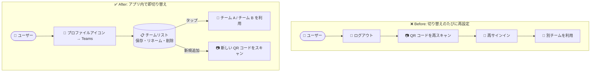

# Gemini Enterprise: モバイルアプリでのチーム切り替え機能

**リリース日**: 2026-11-04

**サービス**: Gemini Enterprise

**機能**: モバイルアプリでのチーム切り替え (Switch between teams in the mobile app)

**ステータス**: GA (一般提供)

📊 [このアップデートのインフォグラフィックを見る](https://takech9203.github.io/google-cloud-news-summary/20261104-gemini-enterprise-mobile-team-switching.html)

## 概要

Gemini Enterprise モバイルアプリにおいて、複数のチーム (team) をログアウトや QR コードの再スキャンなしで切り替えられる機能が一般提供 (GA) になりました。なお、「チーム」は従来「インスタンス (instance)」と呼ばれていたものの新名称です。モバイルアプリにおけるチームは、ブラウザーにおける Gemini Enterprise Web アプリに相当する概念で、管理者から複数のチームへのアクセス権を付与されているユーザーは、アプリ内でそれらを行き来できます。

初めてチームを開くと、モバイルアプリがそのチームをチームリストに自動保存します。さらに、リスト内のチームには自分だけに見えるニックネームを設定でき、使わなくなったチームはリストから削除することもできます。複数の組織・部門の Gemini Enterprise 環境を利用するユーザーや、検証環境と本番環境を使い分ける管理者にとって、モバイルでの利便性が大きく向上するアップデートです。

**アップデート前の課題**

- モバイルアプリで別のチーム (インスタンス) に切り替えるには、ログアウトして QR コードを再スキャンする必要があった
- 一度アクセスしたチームの情報がアプリ内に保持されず、切り替えのたびにセットアップ手順を繰り返す必要があった
- 複数チームを識別しやすくする名前付けや、不要になったチームの整理手段がなかった

**アップデート後の改善**

- アプリ内のプロファイルアイコン → 「Teams」から、ログアウトや QR コード再スキャンなしでチームを切り替え可能になった
- 初回アクセス時にチームがチームリストへ自動保存され、2 回目以降はタップするだけで開けるようになった
- チームにニックネームを設定 (Rename) でき、識別しやすくなった (名前は本人にのみ表示され、他のユーザーには見えない)
- 不要になったチームをリストから削除 (Remove) できるようになった

## アーキテクチャ図

アップデート前はチームを切り替えるたびにログアウトと QR コードの再スキャンが必要でしたが、アップデート後はアプリ内のチームリストからタップするだけで切り替えられます。新しいチームの追加時のみ QR コードのスキャンが必要です。

## サービスアップデートの詳細

### 主要機能

1. **チームの切り替え (Switch teams)**
   - プロファイルアイコン → 「Teams」をタップし、チーム名を選択するだけで切り替え可能
   - 新しいチームを追加する場合は「Scan new QR code」をタップして QR コードをスキャン
   - 「Teams」メニューが表示されない場合は、管理者が MDM 構成で無効化している可能性がある

2. **チームリストへの自動保存**
   - チームを初めて開くと、モバイルアプリが自動的にチームリストへ保存
   - 以降はリストから選択するだけでアクセス可能
   - ただしセッションがタイムアウトした後の再サインインには QR コードが必要なため、QR コードは保管しておく必要がある

3. **チームのニックネーム設定 (Rename)**
   - チームリストで対象チームの「その他」アイコン (⋮) → 「Rename」で名前を変更可能
   - 設定した名前は本人にのみ表示され、他のユーザーには見えない (プライベートな名前)

4. **チームのリスト削除 (Remove)**
   - 使わなくなったチームは「その他」アイコン (⋮) → 「Remove」でリストから削除可能
   - 削除したチームを再び使う場合は、QR コードの再スキャンが必要

## 技術仕様

### チームの概念

| 項目 | 詳細 |
|------|------|
| チーム (team) | ブラウザーにおける Gemini Enterprise Web アプリに相当。旧称は「インスタンス (instance)」 |
| 同時利用 | モバイルアプリでは複数チームを同時に開くことはできない (切り替えのみ) |
| チームリスト | 初回アクセス時に自動保存。リネーム・削除が可能 |
| QR コード | 新規チームの追加、およびセッションタイムアウト後の再サインインに必要 |
| 管理者制御 | MDM 構成により「Teams」機能の無効化が可能 |

### モバイルアプリの構成方法 (管理者向け)

管理者は以下の 3 つの方法でモバイルアプリのアクセスを構成できます。

| 方法 | 概要 |
|------|------|
| MDM ソリューション | AppConfig パラメータで事前構成。他の構成方法より優先される |
| QR コード | Web アプリの Feature Management で「Enable mobile app access」を有効化し、ホームページに QR コードを表示 |
| アクセスリンク | Google Cloud コンソールから URL をコピーしてユーザーに配布 |

## 設定方法

### 前提条件

1. Gemini Enterprise モバイルアプリ (Apple App Store / Google Play) をインストール済みであること
2. 管理者から複数のチーム (Web アプリ) へのアクセス権が付与されていること
3. 各チームの QR コードまたはアクセスリンクを初回に一度スキャン/アクセスしていること

### 手順

#### ステップ 1: チームを切り替える

1. モバイルアプリでプロファイルアイコンをタップ
2. 「Teams」をタップ (表示されない場合は管理者が MDM で無効化している可能性あり)
3. 切り替えたいチーム名をタップ (新しいチームを追加する場合は「Scan new QR code」をタップ)

#### ステップ 2: チームをリネームする

1. プロファイルアイコン → 「Teams」をタップ
2. 対象チームの「その他」アイコン (⋮) をタップ
3. 「Rename」をタップして任意の名前を設定 (自分にのみ表示される)

#### ステップ 3: チームをリストから削除する

1. プロファイルアイコン → 「Teams」をタップ
2. 対象チームの「その他」アイコン (⋮) をタップ
3. 「Remove」をタップ (再利用時は QR コードの再スキャンが必要)

## メリット

### ビジネス面

- **モバイルでの生産性向上**: 複数の組織・部門の Gemini Enterprise 環境を利用するユーザーが、外出先でもストレスなく環境を行き来できる
- **オンボーディング負荷の軽減**: 切り替えのたびに QR コードを探して再スキャンする手間がなくなり、ヘルプデスクへの問い合わせ削減も期待できる

### 技術面

- **セッション管理の簡素化**: ログアウト → 再サインインのフローが不要になり、チーム間の移動がアプリ内で完結する
- **管理者によるガバナンス維持**: MDM 構成で Teams 機能自体を無効化できるため、企業のセキュリティポリシーに応じた制御が可能

## デメリット・制約事項

### 制限事項

- モバイルアプリでは複数のチームを同時に開くことはできない (ブラウザーのタブのような並行利用は不可)
- セッションタイムアウト後の再サインインには QR コードが必要なため、QR コードは引き続き保管しておく必要がある
- リストから削除したチームを再利用するには、QR コードの再スキャンが必要

### 考慮すべき点

- 管理者が MDM 構成で機能を無効化している場合、「Teams」メニューは表示されない
- 1 台のデバイスで複数の ID プロバイダーを使ってサインインすると認証競合 (「Incomplete sign-in details」エラー) が発生する場合がある。その場合はサインアウトして再サインインすることで解消できる
- チームのニックネームは本人にのみ表示されるため、組織内で統一した名前運用はできない

## ユースケース

### ユースケース 1: 複数部門の環境を使い分けるユーザー

**シナリオ**: 営業部門と全社共通の 2 つの Gemini Enterprise 環境 (チーム) へのアクセス権を持つユーザーが、外出先のモバイルで両方の環境のエージェントを使いたい。

**効果**: 各チームの QR コードを初回に一度スキャンするだけでチームリストに保存され、以降はプロファイルアイコン → Teams からタップ 1 つで切り替えられる。「営業 AI」「全社ポータル」などのニックネームを付けて識別性を高められる。

### ユースケース 2: 複数環境を管理する管理者・検証担当者

**シナリオ**: Gemini Enterprise の管理者が、検証用チームと本番用チームをモバイルで行き来しながら、エージェントの動作やデータソースの応答を確認したい。

**効果**: ログアウト・再スキャンの往復が不要になり、検証サイクルが短縮される。検証が終わったチームはリストから Remove して整理できる。

## 料金

本機能は Gemini Enterprise モバイルアプリの標準機能であり、追加料金は発生しません。Gemini Enterprise 自体はエディション (Business / Standard / Plus / Frontline) ごとのシートベースのサブスクリプション課金です。詳細は料金ページを参照してください。

- [Gemini Enterprise 料金](https://cloud.google.com/gemini-enterprise/pricing)

## 関連サービス・機能

- **Gemini Enterprise Web アプリ**: モバイルアプリの「チーム」はブラウザーの Web アプリに相当する。Web アプリの「Settings & help → Mobile login」から表示される QR コードでモバイルアプリをセットアップする
- **MDM (Mobile Device Management)**: 管理者は MDM ソリューション (AppConfig 対応) でモバイルアプリを事前構成でき、Teams 機能の無効化や引用リンクのブラウザー挙動の制御も可能
- **ID プロバイダー (Google Identity / Workforce Identity Federation)**: モバイルアプリのサインインは Google Identity とサードパーティ ID プロバイダーの両方に対応

## 参考リンク

- 📊 [インフォグラフィック](https://takech9203.github.io/google-cloud-news-summary/20261104-gemini-enterprise-mobile-team-switching.html)
- [公式リリースノート](https://docs.cloud.google.com/release-notes#November_04_2026)
- [Use the mobile app - Teams (公式ドキュメント)](https://docs.cloud.google.com/gemini/enterprise/docs/use-the-mobile-app)
- [Configure the mobile app (管理者向けドキュメント)](https://docs.cloud.google.com/gemini/enterprise/docs/configure-mobile-app)
- [Gemini Enterprise 料金](https://cloud.google.com/gemini-enterprise/pricing)

## まとめ

Gemini Enterprise モバイルアプリのチーム切り替え機能が GA となり、複数環境を利用するユーザーはログアウトや QR コード再スキャンなしでチームを行き来できるようになりました。複数チームを利用しているユーザーは、よく使うチームにニックネームを設定してリストを整理することを推奨します。管理者は、MDM で本機能の有効/無効を組織ポリシーに合わせて制御できる点も確認しておきましょう。

---

**タグ**: #GeminiEnterprise #モバイルアプリ #Teams #GA #UX改善
