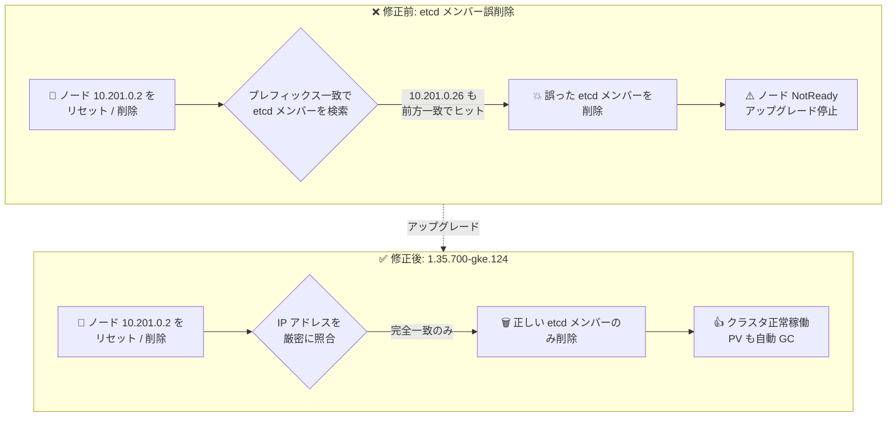

# Google Distributed Cloud (software only) for bare metal: 1.35.700-gke.124 リリース

**リリース日**: 2026-11-04

**サービス**: Google Distributed Cloud (software only) for bare metal

**機能**: バージョン 1.35.700-gke.124 (Kubernetes v1.35.8-gke.100)

**ステータス**: GA (ダウンロード提供開始)

📊 [このアップデートのインフォグラフィックを見る](https://takech9203.github.io/google-cloud-news-summary/20261104-google-distributed-cloud-bare-metal-1-35-700.html)

## 概要

Google Distributed Cloud (software only) for bare metal のパッチバージョン 1.35.700-gke.124 がダウンロード可能になりました。本バージョンは Kubernetes v1.35.8-gke.100 上で動作します。リリース後、GKE On-Prem API クライアント (Google Cloud コンソール、gcloud CLI、Terraform) でのインストールやアップグレードに利用可能になるまで、約 7〜14 日かかります。

本リリースの中心は、信頼を失効した eMudhra (emSign) および AAA Certificate Services ルート CA の削除というセキュリティ強化と、クラスタ運用の安定性に関わる複数の重要なバグ修正です。特に、コントロールプレーンノードのリセット/削除時に IP アドレスのプレフィックス一致により誤った etcd メンバーが削除される問題や、ノード削除時にローカル PersistentVolume リソースが孤立する問題など、オンプレミスクラスタの運用担当者に直接影響する修正が含まれています。

サードパーティのストレージベンダーを使用している場合は、本リリースの認定を通過済みかどうかを[ストレージパートナー一覧](https://docs.cloud.google.com/kubernetes-engine/enterprise/docs/resources/partner-storage)で確認してください。

**アップデート前の課題**

- 信頼を失効した eMudhra (emSign) および AAA Certificate Services ルート CA がシステムコンポーネントやコンテナベースイメージに残っており、侵害された eMudhra 中間 CA を拒否できていなかった
- クラスタからノードを削除すると、そのノードのローカル PersistentVolume リソースがガベージコレクションされず、孤立したまま残っていた
- コントロールプレーンノードのリセット/削除時に、別のコントロールプレーンノードの IP アドレスが同じプレフィックスを共有している場合 (例: `10.201.0.2` と `10.201.0.26`)、誤った etcd / etcd-events メンバーが削除され、影響を受けたノードが NotReady になりクラスタアップグレードが停止することがあった
- コンテナイメージの展開 (unpack) 中にノードが再起動すると、containerd の状態が破損することがあった
- クラスタのアップグレードまたはロールバック実行中に、定期的な構成ドリフトヘルスチェックが「version not supported」エラーで失敗していた
- audit-proxy が恒久的なエラーに対しても監査ログのエクスポートを無限に再試行し、過剰な監査ログトラフィックを発生させていた
- Kubernetes プリフライトヘルスチェックが対象クラスタの Namespace ではなく管理クラスタの全 Namespace をスキャンしていたため、無関係なクラスタに古い reconciling リソースが残っているとクラスタアップグレードが失敗していた

**アップデート後の改善**

- システムコンポーネントとコンテナベースイメージから失効したルート CA が削除され、侵害された eMudhra 中間 CA が拒否されるようになった
- ノード削除時にローカル PersistentVolume リソースが自動的にガベージコレクションされるようになった (1.35.700-gke.124 へのアップグレード後に作成された PV に適用。既存の孤立 PV は手動削除が必要)
- IP アドレスのプレフィックス一致による誤った etcd メンバー削除が解消され、コントロールプレーンノードのリセット/削除が安全になった
- イメージ展開中のノード再起動に対する containerd の耐性が向上した
- アップグレード/ロールバック中の構成ドリフトヘルスチェックの誤検知が解消された
- [Vulnerability fixes](https://docs.cloud.google.com/kubernetes-engine/distributed-cloud/bare-metal/docs/vulnerabilities) に記載の脆弱性が修正された

## アーキテクチャ図



コントロールプレーンノードの IP アドレスがプレフィックスを共有する場合に誤った etcd / etcd-events メンバーが削除されていた問題が、本バージョンで解消されます。あわせてノード削除時のローカル PV の自動ガベージコレクションも修正されました。

## サービスアップデートの詳細

### 主要機能 (Feature)

1. **失効ルート CA の削除と侵害された中間 CA の拒否**
   - システムコンポーネントとコンテナベースイメージを更新し、信頼を失効した eMudhra (emSign) および AAA Certificate Services ルート CA を削除
   - 侵害された eMudhra 中間 CA を拒否するように変更
   - クラスタ内の TLS 信頼ストアが最新のセキュリティ状況に追従

### バグ修正 (Fixed)

1. **脆弱性修正**
   - [Vulnerability fixes](https://docs.cloud.google.com/kubernetes-engine/distributed-cloud/bare-metal/docs/vulnerabilities) に記載された脆弱性を修正

2. **ノード削除時のローカル PersistentVolume の孤立**
   - ノードをクラスタから削除した際に、ローカル PV リソースがガベージコレクションされず残存していた問題を修正
   - 本修正は 1.35.700-gke.124 へのアップグレード後に作成されたローカル PV に適用される
   - 既存の孤立した PV リソースは手動で削除する必要がある

3. **etcd / etcd-events メンバーの誤削除**
   - コントロールプレーンノードのリセット/削除時に、別ノードの IP アドレスが同じプレフィックスを共有する場合 (例: `10.201.0.2` と `10.201.0.26`) に誤ったメンバーを削除していた問題を修正
   - この問題により影響ノードが NotReady となり、クラスタアップグレードが停止していた

4. **containerd の状態破損への耐性向上**
   - コンテナイメージの展開中にノードが再起動した場合の、containerd の状態破損に対する耐性を改善

5. **構成ドリフトヘルスチェックの誤検知**
   - クラスタのアップグレードまたはロールバック進行中に、定期的な構成ドリフトヘルスチェックが「version not supported」エラーで失敗していた問題を修正

6. **audit-proxy の無限リトライ**
   - 恒久的なエラーに対して監査ログエクスポートを無限に再試行し、過剰な監査ログトラフィックを発生させていた問題を修正

7. **プリフライトヘルスチェックのスキャン範囲**
   - Kubernetes プリフライトヘルスチェックが対象クラスタの Namespace ではなく管理クラスタの全 Namespace をスキャンし、無関係なクラスタの古い reconciling リソースによってアップグレードが失敗していた問題を修正

## 技術仕様

### リリース情報

| 項目 | 詳細 |
|------|------|
| バージョン | 1.35.700-gke.124 |
| Kubernetes バージョン | v1.35.8-gke.100 |
| リリース種別 | パッチリリース (セキュリティ強化 + バグ修正) |
| GKE On-Prem API クライアント対応 | リリース後約 7〜14 日で console / gcloud CLI / Terraform から利用可能 |
| ストレージ | サードパーティベンダー利用時は認定済み[ストレージパートナー](https://docs.cloud.google.com/kubernetes-engine/enterprise/docs/resources/partner-storage)を確認 |

### ローカル PV 修正の適用範囲

| 対象 | 挙動 |
|------|------|
| アップグレード後に作成されたローカル PV | ノード削除時に自動でガベージコレクションされる |
| アップグレード前から存在する孤立 PV | 自動では削除されない。手動削除が必要 |

## 設定方法

### 前提条件

1. Google Distributed Cloud (software only) for bare metal クラスタが稼働していること
2. アップグレード対象バージョンへのアップグレードパスがサポートされていること ([Upgrade clusters](https://docs.cloud.google.com/kubernetes-engine/distributed-cloud/bare-metal/docs/how-to/upgrade) を参照)

### 手順

#### ステップ 1: クラスタ構成ファイルのバージョン更新

```bash
# クラスタ構成ファイルの anthosBareMetalVersion を更新
# anthosBareMetalVersion: 1.35.700-gke.124
```

クラスタ構成ファイル内のバージョンフィールドを新しいバージョンに変更します。

#### ステップ 2: bmctl によるアップグレード実行

```bash
bmctl upgrade cluster -c CLUSTER_NAME \
  --kubeconfig ADMIN_KUBECONFIG
```

GKE On-Prem API クライアント (console / gcloud CLI / Terraform) を使用する場合は、リリース後 7〜14 日で新バージョンが選択可能になります。

#### ステップ 3: 孤立したローカル PV のクリーンアップ (該当する場合)

```bash
# ノード削除後に残存した孤立ローカル PV を確認
kubectl get pv -o wide

# 孤立している PV を手動で削除
kubectl delete pv PV_NAME
```

アップグレード前に発生した孤立 PV は自動では削除されないため、手動でのクリーンアップが必要です。

## メリット

### ビジネス面

- **セキュリティコンプライアンスの維持**: 失効したルート CA の削除と侵害された中間 CA の拒否により、業界の証明書信頼要件への準拠を維持できる
- **運用停止リスクの低減**: アップグレード停止やノード NotReady を引き起こすバグの修正により、計画メンテナンスの失敗リスクが減少する

### 技術面

- **etcd 運用の安全性向上**: IP プレフィックス一致による誤削除の解消で、コントロールプレーンノードのリセット/削除操作が安全になる
- **ストレージリソースの自動クリーンアップ**: ノード削除時のローカル PV ガベージコレクションにより、リソースの残骸管理の手間が減る
- **ノード障害への耐性向上**: イメージ展開中の再起動による containerd 状態破損への耐性が改善され、ノードの復旧性が高まる
- **監査ログトラフィックの正常化**: audit-proxy の無限リトライ解消により、不要なログトラフィックが抑制される

## デメリット・制約事項

### 制限事項

- ローカル PV のガベージコレクション修正は、1.35.700-gke.124 へのアップグレード後に作成された PV にのみ適用される。既存の孤立 PV は手動削除が必要
- GKE On-Prem API クライアント (console / gcloud CLI / Terraform) で本バージョンが利用可能になるまで、リリースから約 7〜14 日かかる

### 考慮すべき点

- サードパーティストレージベンダー利用時は、本リリースの認定を通過しているかストレージパートナー一覧で事前確認が必要
- 複数のコントロールプレーンノードで IP アドレスのプレフィックスを共有する構成 (例: `10.201.0.2` と `10.201.0.26`) を運用している場合、本バージョンへのアップグレード前のノードリセット/削除操作は特に注意が必要

## ユースケース

### ユースケース 1: コントロールプレーンノードの安全な入れ替え

**シナリオ**: 3 ノード HA 構成のコントロールプレーンで、ハードウェア保守のためノードをリセット・再追加する。ノード IP が `10.201.0.2`、`10.201.0.20`、`10.201.0.26` のようにプレフィックスを共有している。

**効果**: 従来は誤った etcd メンバーが削除されてノードが NotReady になりアップグレードが停止するリスクがあったが、本バージョンでは正しいメンバーのみが削除され、安全にノードの入れ替えができる。

### ユースケース 2: ワーカーノードのスケールダウンとストレージ管理

**シナリオ**: ローカル PV (LVP share / LVP node mounts) を使用するクラスタで、需要減に応じてワーカーノードを削除する。

**効果**: 本バージョン以降に作成されたローカル PV はノード削除時に自動でガベージコレクションされ、孤立 PV の棚卸しや手動削除の運用負荷が軽減される。

## 料金

Google Distributed Cloud (software only) for bare metal 自体のバージョンアップに追加料金は発生しません。料金の詳細は公式の料金ページを参照してください。

- [Google Distributed Cloud 料金](https://cloud.google.com/distributed-cloud/pricing)

## 利用可能リージョン

オンプレミス (自社ベアメタルハードウェア) で稼働するソフトウェアのため、特定のリージョンに依存しません。ダウンロードは全ユーザーに提供されています。

## 関連サービス・機能

- **GKE (Google Kubernetes Engine)**: Google Distributed Cloud は GKE をベースにオンプレミス環境向けに拡張した Kubernetes ディストリビューション
- **GKE On-Prem API**: Google Cloud コンソール、gcloud CLI、Terraform からオンプレミスクラスタのライフサイクルを管理
- **Cloud Audit Logs**: audit-proxy 経由で監査ログを Google Cloud にエクスポート (本リリースでリトライ挙動を修正)
- **Google Distributed Cloud (software only) for VMware**: 同日に VMware 版 1.35.700-gke.124 もリリースされており、同様の CA 削除・修正が含まれる

## 参考リンク

- 📊 [インフォグラフィック](https://takech9203.github.io/google-cloud-news-summary/20261104-google-distributed-cloud-bare-metal-1-35-700.html)
- [公式リリースノート](https://docs.cloud.google.com/release-notes#November_04_2026)
- [Google Distributed Cloud for bare metal リリースノート](https://docs.cloud.google.com/kubernetes-engine/distributed-cloud/bare-metal/docs/release-notes)
- [クラスタのアップグレード](https://docs.cloud.google.com/kubernetes-engine/distributed-cloud/bare-metal/docs/how-to/upgrade)
- [脆弱性修正 (Vulnerability fixes)](https://docs.cloud.google.com/kubernetes-engine/distributed-cloud/bare-metal/docs/vulnerabilities)
- [ローカル PV の構成 (LVP share / LVP node mounts)](https://docs.cloud.google.com/kubernetes-engine/distributed-cloud/bare-metal/docs/installing/configure-local-storage)
- [ストレージパートナー一覧](https://docs.cloud.google.com/kubernetes-engine/enterprise/docs/resources/partner-storage)
- [Google Distributed Cloud (software only) for bare metal について](https://docs.cloud.google.com/kubernetes-engine/distributed-cloud/bare-metal/docs/concepts/about-bare-metal)

## まとめ

本リリースは、失効ルート CA の削除というセキュリティ強化に加え、etcd メンバーの誤削除やローカル PV の孤立など、クラスタ運用に直結する重要なバグ修正を含むパッチリリースです。特にコントロールプレーンノードの保守作業やノードのスケールダウンを定期的に行う環境では、早期のアップグレードを推奨します。アップグレード後は、既存の孤立ローカル PV が自動削除されない点に留意し、必要に応じて手動クリーンアップを実施してください。

---

**タグ**: Google Distributed Cloud, bare metal, GDC, Kubernetes, オンプレミス, パッチリリース, セキュリティ, etcd, PersistentVolume, containerd
