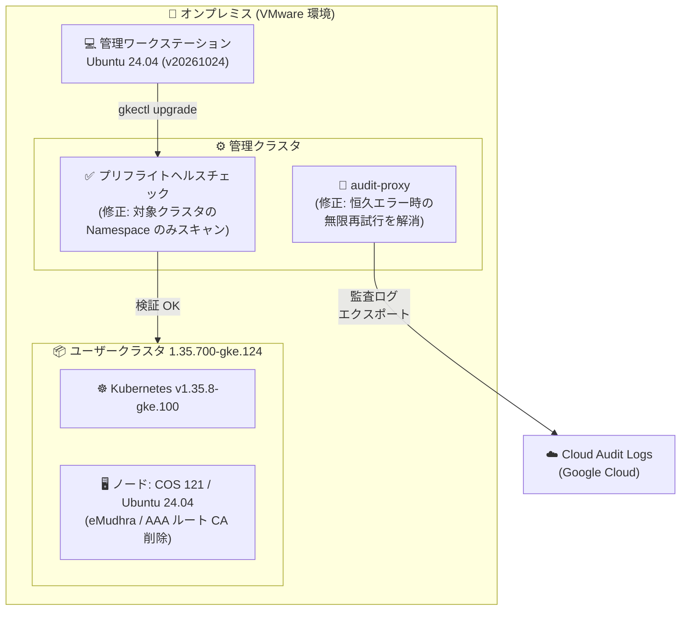

# Google Distributed Cloud (software only) for VMware: 1.35.700-gke.124 リリース (CA 信頼ストア更新・audit-proxy / プリフライトチェック修正)

**リリース日**: 2026-11-04

**サービス**: Google Distributed Cloud (software only) for VMware

**機能**: バージョン 1.35.700-gke.124 リリース (セキュリティ強化・バグ修正)

**ステータス**: Announcement / Feature / Fixed

📊 [このアップデートのインフォグラフィックを見る](https://takech9203.github.io/google-cloud-news-summary/20261104-google-distributed-cloud-vmware-1-35-700.html)

## 概要

Google Distributed Cloud (software only) for VMware のパッチバージョン **1.35.700-gke.124** がダウンロード可能になりました。本バージョンは **Kubernetes v1.35.8-gke.100** 上で動作します。リリース後、GKE On-Prem API クライアント (Google Cloud コンソール、gcloud CLI、Terraform) でこのバージョンが利用可能になるまでには約 7〜14 日かかります。

今回のリリースの中心はセキュリティ強化です。信頼が取り消された **eMudhra (emSign) および AAA Certificate Services ルート CA** をシステムコンポーネントとコンテナベースイメージから削除し、漏洩した eMudhra 中間 CA を拒否するよう更新されました。あわせて Container-Optimized OS (COS) のマイルストーン 121 への更新 (`cos-121-18867-652-7`)、Ubuntu 24.04 ノード / 管理ワークステーションのベースイメージ更新 (`ubuntu-gke-op-2404-1-34-v20261024`、USN-8944-1 対応) が含まれます。

さらに、運用面で影響の大きい 2 つのバグ修正が含まれています。1 つは `audit-proxy` が恒久的なエラー (permanent error) に対しても監査ログのエクスポートを無限に再試行し、過剰な監査ロギングトラフィックを発生させていた問題の修正。もう 1 つは Kubernetes プリフライトヘルスチェックが対象クラスタの Namespace だけでなく管理クラスタ内の全 Namespace をスキャンしていたため、無関係なクラスタに古い調整中 (reconciling) リソースが残っているとクラスタアップグレードが失敗していた問題の修正です。オンプレミスで VMware 環境上の GDC クラスタを運用する IT 管理者・オペレーターにとって、適用を推奨できるメンテナンスリリースです。

**アップデート前の課題**

- 信頼が取り消された eMudhra (emSign) / AAA Certificate Services ルート CA がシステムコンポーネントやベースイメージの信頼ストアに残っており、漏洩した eMudhra 中間 CA に対する防御が不十分だった
- `audit-proxy` が恒久的なエラー発生時にも監査ログのエクスポートを無限に再試行し、過剰な監査ロギングトラフィックが発生していた
- Kubernetes プリフライトヘルスチェックが対象クラスタの Namespace ではなく管理クラスタの全 Namespace をスキャンしていたため、アップグレード対象と無関係なクラスタに古い reconciling リソースが残っているだけでクラスタアップグレードが失敗することがあった

**アップデート後の改善**

- 信頼が取り消されたルート CA が信頼ストアから削除され、漏洩した eMudhra 中間 CA を拒否することでサプライチェーン / TLS のセキュリティ態勢が改善された
- `audit-proxy` が恒久的なエラーを適切に扱うようになり、不要な再試行による過剰な監査ロギングトラフィックが解消された
- プリフライトヘルスチェックが対象クラスタの Namespace のみをスキャンするようになり、無関係なクラスタの状態が原因でアップグレードが失敗しなくなった
- COS milestone 121 / Ubuntu 24.04 最新ベースイメージへの更新と脆弱性修正により、ノード OS レイヤーのセキュリティが向上した

## アーキテクチャ図



1.35.700-gke.124 では、ノード OS イメージの CA 信頼ストア更新に加え、アップグレードを妨げていたプリフライトチェックのスキャン範囲と、Cloud Audit Logs へのエクスポートを担う audit-proxy の再試行動作が修正されました。

## サービスアップデートの詳細

### 主要機能

1. **信頼取り消し済み CA の削除 (セキュリティ強化)**
   - システムコンポーネントとコンテナベースイメージから、信頼が取り消された eMudhra (emSign) および AAA Certificate Services ルート CA を削除
   - 漏洩した eMudhra 中間 CA を拒否するよう更新
   - クラスタ内コンポーネントが不正な証明書チェーンを信頼するリスクを低減

2. **ノード OS / ベースイメージの更新**
   - Container-Optimized OS (COS) をマイルストーン 121 (`cos-121-18867-652-7`) にアップグレード (同様に eMudhra / AAA ルート CA を削除)
   - Ubuntu 24.04 ノードおよび管理ワークステーションのベースイメージを `ubuntu-gke-op-2404-1-34-v20261024` に更新 (USN-8944-1 で eMudhra ルート CA を削除)

3. **audit-proxy の再試行動作の修正**
   - `audit-proxy` は Kubernetes API サーバーの監査ログを Cloud Audit Logs にバッファリング・書き込みするコンポーネント
   - 恒久的なエラーに対してもエクスポートを無限に再試行し、過剰な監査ロギングトラフィックを発生させていた問題を修正

4. **プリフライトヘルスチェックのスキャン範囲の修正**
   - Kubernetes プリフライトヘルスチェックが管理クラスタ内の全 Namespace をスキャンしていた問題を修正
   - 修正後は対象クラスタの Namespace のみをスキャンするため、無関係なクラスタに古い reconciling リソースが残っていてもアップグレードが失敗しない

5. **脆弱性修正**
   - [Vulnerability fixes](https://docs.cloud.google.com/kubernetes-engine/distributed-cloud/vmware/docs/vulnerabilities) に記載された脆弱性を修正

## 技術仕様

### バージョン情報

| 項目 | 詳細 |
|------|------|
| GDC for VMware バージョン | 1.35.700-gke.124 |
| Kubernetes バージョン | v1.35.8-gke.100 |
| Container-Optimized OS | milestone 121 (`cos-121-18867-652-7`) |
| Ubuntu ベースイメージ | `ubuntu-gke-op-2404-1-34-v20261024` (Ubuntu 24.04、USN-8944-1) |
| GKE On-Prem API クライアント対応 | リリース後約 7〜14 日で利用可能 (コンソール / gcloud CLI / Terraform) |
| 削除されたルート CA | eMudhra (emSign)、AAA Certificate Services |

### Cloud Audit Logs 連携 (audit-proxy)

- 監査ログは `cloudAuditLogging.projectID` で指定した Google Cloud プロジェクト (フリートホストプロジェクトと同一である必要あり) に送信される
- `audit-proxy` は管理クラスタの Pod (ユーザークラスタではサイドカー) としてデプロイされ、ログをバッファリングして Cloud Audit Logs に書き込む
- ネットワーク断の際は 10 GB のディスクバッファにキャッシュされ、満杯になると古いエントリから破棄される

## 設定方法

### 前提条件

1. アップグレード元クラスタがサポートされているバージョンスキュー内にあること ([Upgrade overview](https://docs.cloud.google.com/kubernetes-engine/distributed-cloud/vmware/docs/how-to/upgrade-overview) を参照)
2. 管理クラスタ・ユーザークラスタの最新バックアップを取得済みであること
3. サードパーティストレージベンダーを使用している場合、[storage partners](https://docs.cloud.google.com/kubernetes-engine/distributed-cloud/vmware/docs/resources/storage-partners) で本リリースの認定状況を確認すること

### 手順

#### ステップ 1: アップグレード前の診断

```bash
gkectl diagnose cluster \
    --kubeconfig ADMIN_CLUSTER_KUBECONFIG \
    --cluster-name USER_CLUSTER_NAME
```

アップグレード前に管理クラスタ・ユーザークラスタが健全な状態であることを確認し、問題があれば先に解消します。

#### ステップ 2: 管理ワークステーションとクラスタのアップグレード

```bash
# 管理ワークステーションのアップグレード後、ユーザークラスタをアップグレード
gkectl upgrade cluster \
    --kubeconfig ADMIN_CLUSTER_KUBECONFIG \
    --config USER_CLUSTER_CONFIG
```

詳細な手順 (管理ワークステーション → ユーザークラスタ → 管理クラスタの順序やノードプール個別アップグレード) は [Upgrade clusters](https://docs.cloud.google.com/kubernetes-engine/distributed-cloud/vmware/docs/how-to/upgrading) を参照してください。なお、GKE On-Prem API クライアント (コンソール / gcloud CLI / Terraform) 経由のアップグレードは、リリース後約 7〜14 日でこのバージョンが選択可能になります。

## メリット

### ビジネス面

- **コンプライアンスとセキュリティ態勢の維持**: 信頼が取り消された CA を放置すると証明書ベースの攻撃リスクや監査指摘の原因になり得る。本バージョン適用でブラウザ / OS ベンダーの CA 信頼ストアの動向に追随できる
- **運用コストの削減**: audit-proxy の過剰トラフィック解消により、不要な監査ロギングトラフィックとそれに伴う帯域・運用負荷を削減できる

### 技術面

- **アップグレードの信頼性向上**: プリフライトチェックのスキャン範囲が対象クラスタに限定され、マルチクラスタ環境で無関係なクラスタの状態に起因するアップグレード失敗がなくなる
- **ノード OS の最新化**: COS 121 / Ubuntu 24.04 最新イメージへの更新により、OS レイヤーの脆弱性修正と CA 信頼ストアの更新が一括で適用される

## デメリット・制約事項

### 制限事項

- GKE On-Prem API クライアント (コンソール、gcloud CLI、Terraform) でこのバージョンが利用可能になるまでリリース後約 7〜14 日かかる
- サードパーティストレージベンダー利用時は、本リリースに対するベンダーの認定状況を事前に確認する必要がある

### 考慮すべき点

- プリフライトチェックの修正は本バージョンに含まれるため、修正の恩恵を受けるには先にこのバージョンへのアップグレードが必要。既存環境で同事象に遭遇している場合は、古い reconciling リソースの解消が別途必要になる可能性がある
- クラスタアップグレードはノードの再作成を伴うため、メンテナンスウィンドウと PodDisruptionBudget の設定を事前に確認することを推奨

## ユースケース

### ユースケース 1: マルチクラスタ環境でのアップグレード失敗の解消

**シナリオ**: 1 つの管理クラスタ配下で複数のユーザークラスタを運用しており、ある古いクラスタに stale な reconciling リソースが残っているため、別の健全なクラスタのアップグレードがプリフライトチェックで失敗していた。

**効果**: 1.35.700-gke.124 ではプリフライトチェックが対象クラスタの Namespace のみをスキャンするため、無関係なクラスタの状態に影響されずにアップグレードを進められる。

### ユースケース 2: 監査ログトラフィックの異常増加への対処

**シナリオ**: Cloud Audit Logs へのエクスポートで恒久的なエラー (権限不足など) が発生しており、audit-proxy の無限再試行により監査ロギングトラフィックが異常に増加していた。

**効果**: 本バージョンへのアップグレードにより無限再試行が解消され、ネットワーク帯域とログ基盤への不要な負荷がなくなる。根本原因 (権限設定など) の是正と合わせて健全な監査ログエクスポートを維持できる。

## 料金

本リリースはソフトウェアアップデートであり、適用自体に追加料金は発生しません。Google Distributed Cloud (software only) の料金体系 (vCPU ベースのライセンス) は料金ページを参照してください。なお、Cloud Audit Logs 機能は Google Distributed Cloud の価格に含まれています。

- [Google Distributed Cloud (software only) の料金](https://cloud.google.com/kubernetes-engine/distributed-cloud/vmware/docs/pricing)

## 利用可能リージョン

オンプレミス (VMware vSphere 環境) で稼働するソフトウェアのため、リージョンの制約はありません。ダウンロードは即時可能で、GKE On-Prem API クライアント経由の利用はリリース後約 7〜14 日で可能になります。

## 関連サービス・機能

- **GKE On-Prem API (コンソール / gcloud CLI / Terraform)**: クラスタのライフサイクル管理をクラウド側から実行するためのクライアント。本バージョンは約 7〜14 日後に利用可能
- **Cloud Audit Logs**: audit-proxy 経由でオンプレミスクラスタの Kubernetes API 監査ログを集中管理 (不変、400 日間保持)
- **Google Distributed Cloud (software only) for bare metal**: 同日に同バージョン 1.35.700-gke.124 がリリースされており、同様の CA 削除・audit-proxy / プリフライトチェック修正が含まれる
- **Container-Optimized OS (COS)**: ノード OS として使用される Google 提供のセキュリティ強化 OS。本リリースで milestone 121 に更新

## 参考リンク

- 📊 [インフォグラフィック](https://takech9203.github.io/google-cloud-news-summary/20261104-google-distributed-cloud-vmware-1-35-700.html)
- [公式リリースノート](https://docs.cloud.google.com/release-notes#November_04_2026)
- [GDC for VMware リリースノート](https://docs.cloud.google.com/kubernetes-engine/distributed-cloud/vmware/docs/release-notes)
- [クラスタのアップグレード](https://docs.cloud.google.com/kubernetes-engine/distributed-cloud/vmware/docs/how-to/upgrading)
- [アップグレードの概要とバージョンスキュー](https://docs.cloud.google.com/kubernetes-engine/distributed-cloud/vmware/docs/how-to/upgrade-overview)
- [Cloud Audit Logs の使用 (audit-proxy)](https://docs.cloud.google.com/kubernetes-engine/distributed-cloud/vmware/docs/how-to/audit-logging)
- [脆弱性修正 (Vulnerability fixes)](https://docs.cloud.google.com/kubernetes-engine/distributed-cloud/vmware/docs/vulnerabilities)

## まとめ

GDC (software only) for VMware 1.35.700-gke.124 は、信頼取り消し済み CA の削除とノード OS 更新によるセキュリティ強化に加え、マルチクラスタ環境でのアップグレード失敗や監査ログの過剰トラフィックといった運用上の実害があるバグを修正するメンテナンスリリースです。該当事象に遭遇している環境や 1.35 系を運用中の環境では、`gkectl diagnose cluster` で健全性を確認のうえ、早期の適用を推奨します。

---

**タグ**: #GoogleDistributedCloud #VMware #Kubernetes #OnPremises #Security #AuditLogging #GDC
