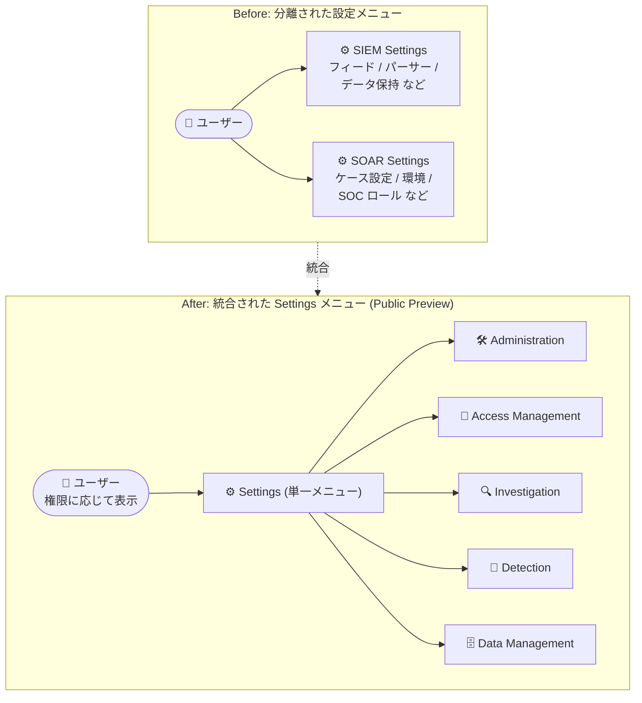

# Google SecOps: Consolidated Settings and Navigation (統合された設定とナビゲーション)

**リリース日**: 2026-11-04

**サービス**: Google SecOps (Google Security Operations)

**機能**: Consolidated Settings and Navigation (設定メニューと左ナビゲーションの統合)

**ステータス**: Public Preview

📊 [このアップデートのインフォグラフィックを見る](https://takech9203.github.io/google-cloud-news-summary/20261104-google-secops-consolidated-settings-navigation.html)

## 概要

Google SecOps (旧 Chronicle) の「Consolidated Settings and Navigation」機能が Public Preview になりました。これまで別々に存在していた「SIEM Settings」メニューと「SOAR Settings」メニューが単一の「Settings」メニューに統合され、設定項目は **Administration (管理)**、**Access Management (アクセス管理)**、**Investigation (調査)**、**Detection (検出)**、**Data Management (データ管理)** の 5 つのカテゴリにグループ化されます。あわせて、プラットフォーム左側のナビゲーションメニューも刷新されます。

Google SecOps は SIEM (Chronicle SIEM) と SOAR (旧 Siemplify) を統合したセキュリティ運用プラットフォームですが、製品統合の経緯から設定画面が SIEM 系と SOAR 系で分かれており、管理者やアナリストは目的の設定がどちらのメニューにあるかを意識して操作する必要がありました。今回のアップデートは、この「2 つの製品の寄せ集め」感を解消し、機能ベース (何をしたいか) で設定を探せる一貫した管理体験を提供するものです。

また、権限制御も強化されており、各設定ページはその操作に必要な権限を持つユーザーにのみ表示されます。さらに、Cloud IAM の Viewer および Editor 権限を持つユーザーは、一部の SOAR 設定ページを読み取り専用モードで閲覧できるようになりました。本機能のナビゲーション変更に合わせて、Google SecOps の公式ドキュメントも新しいナビゲーションパスを反映した内容に更新されています。

**アップデート前の課題**

- SIEM 系の設定 (フィード、フォワーダー、パーサー、データ保持など) と SOAR 系の設定 (ケースステージ、プレイブック関連、環境、SOC ロールなど) が「SIEM Settings」「SOAR Settings」という別々のメニューに分かれており、目的の設定がどちらにあるかを覚えておく必要があった
- 設定が製品 (SIEM / SOAR) 単位で分類されていたため、「アクセス管理」「データ管理」といった業務目的ベースで設定項目を横断的に探すことが難しかった
- Cloud IAM の Viewer / Editor ユーザーは SOAR 設定ページの内容を参照できず、設定内容の確認にも管理者相当の関与が必要になるケースがあった

**アップデート後の改善**

- SIEM Settings と SOAR Settings が単一の「Settings」メニューに統合され、Administration / Access Management / Investigation / Detection / Data Management の 5 カテゴリから機能ベースで設定を探せるようになった
- 左ナビゲーションメニューも刷新され、Your Workdesk、Cases、Investigation、Detection、Automation、Dashboards & Reports、Content Hub といった業務フローに沿った構造でプラットフォーム全体を移動できるようになった
- 各設定ページは必要な権限を持つユーザーにのみ表示されるようになり、権限に応じた画面の出し分けが行われる
- Cloud IAM の Viewer / Editor ユーザーが一部の SOAR 設定ページを読み取り専用モードで閲覧できるようになり、設定確認のための権限付与が柔軟になった

## アーキテクチャ図



従来は SIEM と SOAR で分かれていた設定メニューが単一の Settings メニューに統合され、5 つの機能カテゴリに再編されます。各設定ページは権限を持つユーザーにのみ表示されます。

## サービスアップデートの詳細

### 主要機能

1. **設定メニューの統合 (SIEM Settings + SOAR Settings → Settings)**
   - 従来の「SIEM Settings」と「SOAR Settings」が廃止され、単一の「Settings」メニューに一本化
   - 製品 (SIEM / SOAR) 単位ではなく、機能・業務目的単位の 5 カテゴリに再分類: Administration、Access Management、Investigation、Detection、Data Management

2. **左ナビゲーションメニューの刷新**
   - プラットフォーム全体の左ナビゲーションが更新され、Your Workdesk (ワークデスク)、Cases (ケース)、Investigation (SIEM Search / SOAR Search / Data Tables)、Detection (Rules & Detections / Alerts & IoCs / Emerging Threats / Risk Analytics / Reference Lists)、Automation (Playbooks / Integrations Setup / Jobs Scheduler / IDE)、Dashboards & Reports、Content Hub という業務フローに沿った構造に整理

3. **権限ベースの設定ページ表示**
   - 各設定ページは、該当ページの操作に必要な権限を持つユーザーにのみ表示される
   - 不要な設定項目がユーザーに見えなくなることで、誤操作リスクの低減と UI のシンプル化を両立

4. **Cloud IAM Viewer / Editor ユーザーの読み取り専用アクセス**
   - Cloud IAM の Viewer および Editor 権限を持つユーザーが、一部の SOAR 設定ページを読み取り専用モードで閲覧可能に
   - 設定内容の確認・監査目的のアクセスに、管理者権限の付与が不要になる

5. **ドキュメントの更新**
   - Google SecOps 公式ドキュメントが新しいナビゲーションパスを反映して更新済み
   - 新ナビゲーションでの各機能の場所は「Navigate the Google SecOps platform」ページに一覧表として整理されている

## 技術仕様

### 新しい Settings メニューのカテゴリ構成

公式ドキュメント「Navigate the Google SecOps platform」に基づく、主な設定ページの新しい配置は以下のとおりです。

| カテゴリ | 主な設定ページ (抜粋) |
|------|------|
| Administration | Profile、Rebranding、SOAR Localization、SOAR License Management、SOAR Email Settings / SIEM Email Settings、SOAR Remote Agents、SOAR Support Access、SIEM Linked Instances、Email Templates、Requests、Audit、Public Preview、Google Cloud Platform |
| Access Management | Data Access (データ RBAC スコープ)、Users and Groups、Environments、SOC Roles、Permissions (API keys)、Group Mapping、API Keys、User Management、Object Sharing、Roles (IAM) |
| Investigation | Tags、Case Stages、Close Case、Case Name、Views、Calculated Fields、Cross Environment Policy、Alert Grouping、SLAs、Properties Metadata、Ontology Status、Visual Families、Custom Lists、Networks、Domains、Blocklist、Statistics、Custom Fields、Gemini Investigations |
| Detection | Enrichment Blocks、Entity Risk Scores |
| Data Management | Feeds、Forwarders、Parsers、Available Log Types、Google Workspace、Data Processing、Collection Agents、Data Export (BigQuery)、Data Retention、Connectors、SOAR Webhooks |

### 権限と表示制御

| 項目 | 詳細 |
|------|------|
| 設定ページの表示 | 該当ページに必要な権限を持つユーザーにのみ表示 |
| Cloud IAM Viewer / Editor | 一部の SOAR 設定ページを読み取り専用モードで閲覧可能 |
| Public Preview の有効化 | Google SecOps の Administrator ロールが必要 (全ユーザーが Public Preview 機能の一覧は閲覧可能) |

## 設定方法

### 前提条件

1. Google SecOps テナントが利用可能であること
2. Public Preview 機能の有効化には、Google SecOps の Administrator ロールが必要

### 手順

#### ステップ 1: Public Preview Features ページを開く

本機能はオプトイン方式の Public Preview です。まだ本機能にオプトインしていない場合は、**SIEM Settings > Public Preview** から Public Preview Features ページを開きます (オプトイン後は **Settings > Administration > Public Preview** に配置されます)。

#### ステップ 2: 機能を有効化する

1. Public Preview Features ページで対象機能 (Consolidated Settings and Navigation) の行を探す
2. 「Preview Status」トグルをオンにする
3. 確認ダイアログで「Enable」をクリック

有効化後は、統合された Settings メニューと新しい左ナビゲーションが適用されます。問題があった場合、管理者はトグルをオフにして即座に無効化し、フィードバックを提供できます。

**注意**: FedRAMP や HIPAA などのコンプライアンス管理対象テナントでは、Public Preview Features ページでの機能のオン / オフ切り替えは利用できず、Google SecOps サポートへの依頼が必要です。

## メリット

### ビジネス面

- **運用効率の向上**: 設定項目が業務目的ベースの 5 カテゴリに整理されることで、管理者が目的の設定に到達するまでの時間が短縮され、SOC 運用のオーバーヘッドが削減される
- **オンボーディングの容易化**: SIEM と SOAR の製品史を知らなくても設定を探せるため、新任の管理者・アナリストの学習コストが下がる
- **監査・ガバナンスの強化**: Cloud IAM Viewer / Editor による読み取り専用アクセスにより、監査担当者などに過剰な権限を付与せずに設定内容を確認してもらえる

### 技術面

- **権限ベースの UI 出し分け**: 必要な権限を持つユーザーにのみ設定ページが表示されるため、最小権限の原則に沿った運用がしやすくなる
- **SIEM / SOAR の統合体験**: 単一プラットフォームとしての一貫したナビゲーションにより、SIEM 検索から SOAR ケース管理までの画面遷移が自然になる
- **ドキュメントとの整合**: 公式ドキュメントが新ナビゲーションに合わせて更新済みであり、手順書と実画面の乖離が生じにくい

## デメリット・制約事項

### 制限事項

- Public Preview 段階の機能であり、Pre-GA Offerings Terms が適用される (サポートが限定的な場合や、GA までに変更が入る可能性がある)
- コンプライアンス管理対象テナント (FedRAMP、HIPAA など) では、セルフサービスでの有効化ができず、サポート経由での対応が必要

### 考慮すべき点

- ナビゲーション構造が大きく変わるため、既存の社内手順書・Runbook・トレーニング資料の記載 (「SIEM Settings > ...」「SOAR Settings > ...」) を新パスに更新する必要がある
- オプトイン方式のため、チーム内で有効化のタイミングを調整しないと、ユーザーごとに見えている画面構造が異なり混乱を招く可能性がある
- 権限ベースの表示制御により、従来見えていた設定ページが見えなくなるユーザーが発生し得るため、ロール設計の確認が推奨される

## ユースケース

### ユースケース 1: SOC 管理者による設定作業の効率化

**シナリオ**: SIEM のフィード設定と SOAR のコネクタ設定を両方管理している SOC 管理者が、データ取り込みに関する設定を一括で見直したい。

**実装例**:
```
Settings > Data Management 配下で完結:
- Feeds (SIEM フィード)
- Forwarders (SIEM フォワーダー)
- Parsers (パーサー管理)
- Connectors (SOAR コネクタ)
- SOAR Webhooks (SOAR Webhook)
- Data Export (BigQuery エクスポート)
```

**効果**: 従来は SIEM Settings と SOAR Settings を行き来する必要があったデータ取り込み関連の設定が、Data Management カテゴリに集約され、一箇所で確認・変更できる。

### ユースケース 2: 監査担当者への読み取り専用アクセス付与

**シナリオ**: 内部監査チームが SOAR の SLA 設定やアクセス管理設定の内容を定期的に確認する必要があるが、変更権限は付与したくない。

**効果**: Cloud IAM の Viewer 権限を付与するだけで、監査担当者は対象の SOAR 設定ページを読み取り専用モードで閲覧でき、管理者が画面キャプチャを提供するなどの手間が不要になる。

## 料金

本アップデートは UI / ナビゲーションの改善であり、追加料金に関する言及はありません。Google SecOps 自体の料金は既存のライセンス体系 (パッケージ) に従います。

- [Google SecOps の料金](https://cloud.google.com/security/products/security-operations)

## 関連サービス・機能

- **Cloud IAM**: 今回のアップデートで Viewer / Editor ロールによる SOAR 設定ページの読み取り専用閲覧が可能になった。Google SecOps の機能アクセス制御の基盤
- **Google SecOps SIEM**: フィード、パーサー、データ保持などの SIEM 設定が新しい Settings メニューの Data Management / Administration カテゴリに再配置された
- **Google SecOps SOAR**: ケースステージ、環境、SOC ロール、コネクタなどの SOAR 設定が機能ベースのカテゴリに再配置された
- **BigQuery**: Settings > Data Management > Data Export から Google SecOps データの BigQuery エクスポートを設定可能
- **Gemini (Agentic SOC)**: Settings > Investigation > Gemini Investigations からセキュリティトークンや Triage and Investigation エージェントを管理

## 参考リンク

- 📊 [インフォグラフィック](https://takech9203.github.io/google-cloud-news-summary/20261104-google-secops-consolidated-settings-navigation.html)
- [公式リリースノート (2026-11-04)](https://docs.cloud.google.com/release-notes#November_04_2026)
- [Navigate the Google SecOps platform (新ナビゲーションの一覧)](https://docs.cloud.google.com/chronicle/docs/secops/navigate-the-secops-platform)
- [Manage preview features (Public Preview 機能の管理)](https://docs.cloud.google.com/chronicle/docs/secops/preview-features-manage)

## まとめ

Google SecOps の設定メニューと左ナビゲーションが統合され、SIEM / SOAR という製品の区分ではなく業務目的ベースで設定を探せるようになる、プラットフォーム統合の節目となるアップデートです。Public Preview のオプトイン方式のため、まずは検証環境や合意の取れたチームで有効化し、社内手順書のナビゲーションパス更新とロール設計の確認を進めることを推奨します。

---

**タグ**: #GoogleSecOps #SIEM #SOAR #ConsolidatedSettings #Navigation #PublicPreview #CloudIAM #SecurityOperations
