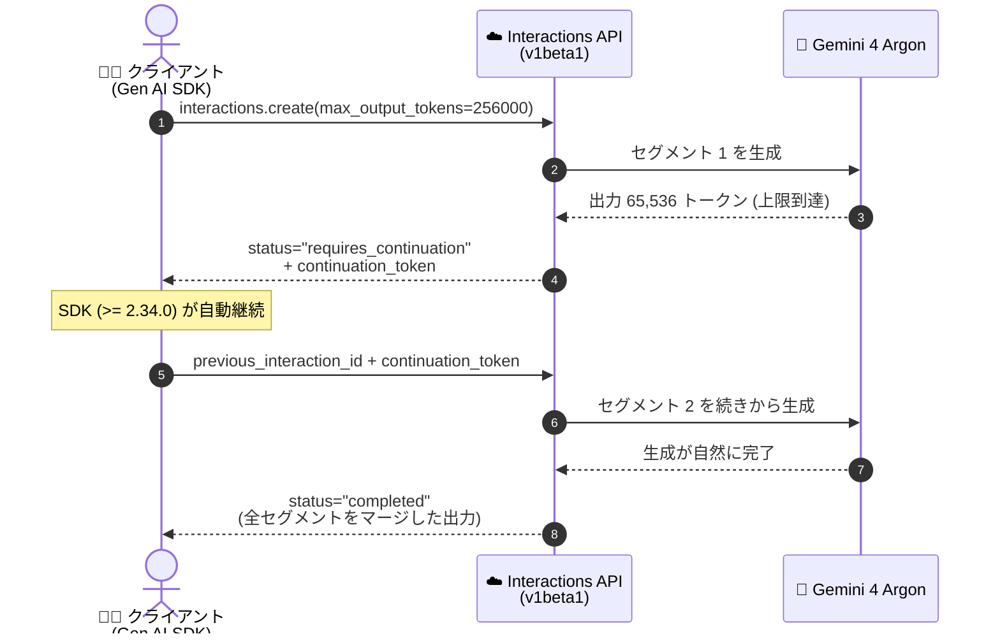

# Gemini Enterprise Agent Platform: Interactions API の Gemini 4 Argon 向け Long Decodes が GA

**リリース日**: 2026-11-05

**サービス**: Gemini Enterprise Agent Platform

**機能**: Interactions API long decodes for Gemini 4 Argon

**ステータス**: 一般提供 (GA)

📊 [このアップデートのインフォグラフィックを見る](https://takech9203.github.io/google-cloud-news-summary/20261105-agent-platform-interactions-api-long-decodes.html)

## 概要

Gemini Enterprise Agent Platform の Interactions API (`v1beta1`) において、Gemini 4 Argon (`gemini-4-argon` および `gemini-4-argon-cyber-permissive`) を対象とした **Long Decodes (長時間デコード)** が一般提供 (GA) になりました。これにより、1 ターンの出力を最大 **1,048,576 トークン (入力トークン分を差し引いた値)** まで拡張できます。

Gemini 4 Argon は入力と出力を合算した 1,048,576 トークンの統合トークン上限を持ち、単一のフォアグラウンドリクエスト (セグメント) では、ストリーミング時は最大 65,536 トークン、非ストリーミング時は最大 32,768 トークンまで出力を生成します (出力には思考・関数呼び出し・最終応答を含む)。Long Decodes は、この生成を複数のセグメントに分割して継続するもので、セグメントの上限に達すると `status="requires_continuation"` と暗号化された `continuation_token` が返され、次のリクエストでトークンを渡すことで続きを生成できます。

継続方法は 4 通りから選択できます。(1) Google Gen AI SDK による自動継続 (Python `google-genai >= 2.34.0`、JavaScript/TypeScript `@google/genai >= 2.32.0`、Go `>= 1.77.0`、Java `>= 1.80.0`)、(2) サーバー管理のバックグラウンド実行 (`background=true`)、(3) 保存あり (`store=true`) のカスタム継続ループ、(4) ステートレス (`store=false`) のカスタム継続ループです。難しい数学・科学・研究課題の形式証明、最難関のコーディング/エージェントタスク、出力上限で打ち切られる評価ハーネスなど、1 つの応答で 65,536 トークンを超える出力・思考が必要なワークロードを対象としています。

**アップデート前の課題**

- Interactions API の 1 回のフォアグラウンドリクエストでは、出力 (思考 + 関数呼び出し + 最終応答) がストリーミングで 65,536 トークン、非ストリーミングで 32,768 トークンに制限されていた
- 難しい数学の形式証明や大規模なコード生成など、思考に大量のトークンを使うタスクでは、応答が出力上限で打ち切られる (評価ハーネスが思考だけでリクエスト上限を使い切る) ことがあった
- Google Gen AI SDK の旧バージョンや OpenAI 互換レイヤーでは、continuation token を使った長い応答の取得ができなかった

**アップデート後の改善**

- `max_output_tokens` を最大 1,048,576 (入力トークン分を除く) まで設定し、単一ターンの出力をセグメント上限を超えて拡張できるようになった
- 対応バージョンの Google Gen AI SDK では `interactions.create()` が `status="requires_continuation"` を自動で検知し、`continuation_token` をセグメント間で自動的に引き継ぐ (自動継続はデフォルトで有効)
- `background=true` を指定すると、サーバー側が継続ループを非同期で実行し、マージされた出力を 1 つの `Interaction` に格納する (クライアントは `get` でポーリングするだけでよい)
- Zero Data Retention (ZDR) ワークフロー向けに、`store=false` のステートレス継続ループも利用できる
- Agent Studio では出力トークン上限を 65,536 超〜1,048,576 に設定するだけで、continuation token が自動処理される

## アーキテクチャ図



Gemini 4 Argon の Long Decodes における継続フロー。セグメント上限に達すると `requires_continuation` と `continuation_token` が返され、SDK の自動継続 (またはカスタムループ / `background=true` のサーバーループ) が `completed` になるまで次セグメントを要求します。

## サービスアップデートの詳細

### 主要機能

1. **Google Gen AI SDK による自動継続 (推奨)**
   - Python `google-genai >= 2.34.0`、JavaScript/TypeScript `@google/genai >= 2.32.0`、Go `>= 1.77.0`、Java `>= 1.80.0` で、`interactions.create()` が `status="requires_continuation"` を検知して `continuation_token` を自動で辿る
   - 非ストリーミング (`stream=False`) では全セグメントが 1 つの `Interaction` にマージされ、使用量 (usage) は合算、`interaction.continuation_ids` に順序付きのセグメント ID が入る
   - ストリーミングでは全セグメントのイベントが順番に yield され、中間セグメントは `status="requires_continuation"` の `interaction.completed` イベントを発行する
   - `automatic_continuation=False` で単一セグメントのみ返すオプトアウトも可能
   - 後続セグメントの失敗・タイムアウト・切断時は `ContinuationInterruptedError` が `partial_interaction`、`continuation_token`、`interaction_id`、`continuation_ids` を保持して送出され、途中から再開できる

2. **サーバー管理のバックグラウンド実行 (`background=true`)**
   - `store=true` が必須。サーバーが継続ループを非同期で実行し、マージ済み出力を 1 つの `Interaction` に保存する
   - クライアントは `interactions.get` でステータス (`queued` / `in_progress` → `completed` など) をポーリングするだけでよく、クライアント側でストリームを開き続ける必要がない
   - Gen AI SDK 非対応言語でも REST から利用可能
   - 実行中の `cancel` と、永続化されたチェックポイント `continuation_token` (32,768 出力トークン以降に永続化) からのフォアグラウンド/バックグラウンドいずれかでの再開に対応

3. **カスタム継続ループ (stored / stateless)**
   - **保存あり (`store=true`)**: `continuation_token` を発行したセグメントの `id` を `previous_interaction_id` に渡し、`input` は省略 (保存済みセグメントがターン入力を保持)
   - **ステートレス (`store=false`)**: `previous_interaction_id` を省略し、元の `input` を `continuation_token` とともに毎セグメント再送。Zero Data Retention (ZDR) ワークフロー向け
   - ストリーミングでは 32,768 トークン以降、5,000 トークンごとにチェックポイントが切られ、切断時の再開に利用できる
   - 同一の `previous_interaction_id` + `continuation_token` を再利用すると、独立した分岐継続 (ブランチ) を作成できる

### ステータス遷移

| ステータス | 意味 | 次のアクション |
|------|------|------|
| `requires_continuation` | `max_output_tokens` 到達前にセグメント上限 (非ストリーミング 32,768 / ストリーミング 65,536) に到達 | 返却された `continuation_token` を次のリクエストに渡して継続 |
| `incomplete` | `max_output_tokens` の総予算を使い切った | `max_output_tokens` を引き上げて継続 (引き上げずに継続すると HTTP 400) |
| `completed` | 生成が自然に完了 | `continuation_token` はクリアされる。継続不要 |

## 技術仕様

### トークン上限と継続オプション

| 項目 | 詳細 |
|------|------|
| 対象モデル | `gemini-4-argon`、`gemini-4-argon-cyber-permissive` |
| API | Interactions API (`v1beta1` のみ。`v1` は非対応 — 既知の問題) |
| 統合トークン上限 | 入力 + 出力 (思考・関数呼び出し・最終応答を含む) で 1,048,576 トークン |
| セグメントあたりの出力上限 | ストリーミング 65,536 トークン / 非ストリーミング 32,768 トークン |
| `max_output_tokens` | 最大 1,048,576 (入力トークン分を除く)。省略時の総出力予算は 65,536 トークン |
| セグメントあたりの時間制限 | フォアグラウンド 20 分 / リクエスト (`background=true` は非同期) |
| ストリーミングチェックポイント | 32,768 トークン以降、5,000 トークンごと |
| SDK 最小バージョン (自動継続) | Python `google-genai >= 2.34.0`、JS/TS `@google/genai >= 2.32.0`、Go `>= 1.77.0`、Java `>= 1.80.0` |
| サーバー側保存 | `store=true` (デフォルト) で 7 日間保存後に自動削除。`store=false` で ZDR 対応 |
| ロケーション | `global`、`us`、`eu` |

### 継続オプションの比較

| 継続オプション | セグメント開始の主体 | サーバー保存 | 適した用途 |
|------|------|------|------|
| Gen AI SDK 自動継続 (推奨) | SDK | `store=true` (7 日) または `store=false` | ほとんどのステートフル/ステートレスアプリ |
| バックグラウンドループ (`background=true`) | サーバー (クライアントは `get` でポーリング) | `store=true` 必須 (7 日) | 非同期ジョブ、REST からの他言語利用、単一レコード保存 |
| カスタム stored ループ (`store=true`) | 自前コード (`previous_interaction_id` + `continuation_token`、`input` 省略) | 7 日 | REST 呼び出し、カスタムチェックポイント復旧 |
| カスタム stateless ループ (`store=false`) | 自前コード (元の `input` + `continuation_token`) | なし | Zero Data Retention が必要なカスタムハーネス |

### 継続時のバリデーションルール

- セグメント間で `model`、`system_instruction`、関数宣言 (`tools`) を変更すると HTTP 400 エラー
- `generation_config.thinking_level` と組み込みツール (`google_search`、`code_execution`、`url_context`) の途中変更はサーバー側で拒否されないが、全セグメントで変更しないことが推奨 (既知の問題)
- `store=true` → `store=false` への途中切り替えは可能 (逆方向は不可。`previous_interaction_id` の参照先となる保存済み親 Interaction が存在しないため)
- `requires_continuation` / `incomplete` 状態のセグメントから新しいユーザーターンを開始すると HTTP 400 (デコードを `completed` まで完了させるか、直近の `completed` な Interaction から分岐する)
- 最終セグメントが `completed` に達した後、その `id` を `previous_interaction_id` に渡すと、全セグメントにまたがる完全な会話履歴が再構築される
- フォアグラウンドモードでは各セグメントが個別の `Interaction` リソースとして保存される (`delete` は最後のセグメントから逆順に実行する)

## 設定方法

### 前提条件

1. Google Cloud プロジェクトで Agent Platform を利用可能にし、ロケーション `global`、`us`、`eu` のいずれかを使用する
2. Google Gen AI SDK を自動継続対応バージョンにアップグレードする (Python `google-genai >= 2.34.0` など)。SDK はデフォルトで `v1beta1` を使用するため、`http_options` で `api_version='v1'` を指定しないこと。REST 直叩きの場合は `/v1beta1/` エンドポイントパスを使用する
3. モデルに `gemini-4-argon` または `gemini-4-argon-cyber-permissive` を指定する

### 手順

#### ステップ 1: SDK のアップグレード

```bash
pip install --upgrade "google-genai>=2.34.0"
```

自動継続は `google-genai >= 2.34.0` でデフォルト有効になります。

#### ステップ 2: 自動継続による Long Decode (Python)

```python
from google import genai

client = genai.Client(
    enterprise=True,
    project="PROJECT_ID",
    location="global",
)

# 自動継続はデフォルトで有効。全セグメントが 1 つの Interaction にマージされる
interaction = client.interactions.create(
    model="gemini-4-argon",
    input="Write a complete formal proof of the prime number theorem.",
    generation_config={
        "max_output_tokens": 256000,
        "thinking_level": "high",
    },
)
print(interaction.output_text)
print(f"Merged segment IDs: {interaction.continuation_ids}")
```

#### ステップ 3: バックグラウンド実行 (サーバー管理ループ)

```python
import time
from google import genai

client = genai.Client(enterprise=True, project="PROJECT_ID", location="global")

interaction = client.interactions.create(
    model="gemini-4-argon",
    input="Write a complete formal proof of the prime number theorem.",
    background=True,
    store=True,  # background=True には store=True が必須
    generation_config={"max_output_tokens": 256000, "thinking_level": "high"},
)

while interaction.status in ("queued", "in_progress"):
    time.sleep(10)
    interaction = client.interactions.get(id=interaction.id)

print(f"Status: {interaction.status}")
print(interaction.output_text)
```

REST の場合は `https://aiplatform.googleapis.com/v1beta1/projects/PROJECT_ID/locations/global/interactions` に `"background": true, "store": true` を指定して POST し、`GET .../interactions/INTERACTION_ID` でポーリングします。

## メリット

### ビジネス面

- **打ち切りのない長文出力**: 形式証明、研究レポート、大規模なコード成果物など、従来は出力上限で途切れていた成果物を 1 ターンで取得できる
- **非同期ジョブ化による運用効率**: `background=true` でサーバーに継続ループを委譲でき、数分かかる長時間デコードをクライアント接続を維持せずに実行できる
- **コンプライアンス対応**: `store=false` のステートレス継続により、Zero Data Retention 要件のあるワークフローでも Long Decodes を利用できる

### 技術面

- **SDK がセグメント管理を抽象化**: 対応 SDK では continuation token の受け渡し・マージ・使用量集計が自動化され、アプリケーションコードは単一呼び出しのまま
- **チェックポイントによる耐障害性**: ストリーミングは 32,768 トークン以降 5,000 トークンごとにチェックポイントを持ち、切断時は `ContinuationInterruptedError` の情報から再開できる
- **柔軟なモード切り替えと分岐**: stored 継続ではフォアグラウンド/バックグラウンドをセグメント単位で切り替え可能。同一トークンの再利用で独立した分岐継続も作成できる

## デメリット・制約事項

### 制限事項

- `v1beta1` API のみ対応 (`v1` は非対応)。旧バージョンの SDK や OpenAI 互換レイヤーでは continuation token による長い応答を取得できない (既知の問題)
- `background=true` は `store=true` が必須 (ステートレスモードでは非同期実行不可)
- セグメント間で `model`、`system_instruction`、関数宣言を変更すると HTTP 400。`thinking_level` と組み込みツールも全セグメントで固定が必要
- 出力上限はあくまで「1,048,576 − 入力トークン」。入力が 1,048,576 トークン近くある場合、Long Decode の恩恵はほぼない
- `incomplete` 状態から `max_output_tokens` を引き上げずに継続すると HTTP 400 エラー
- ロケーション間 (global / us / eu) をまたいだ Interaction のチェーンは不可

### 考慮すべき点

- Long Decode は推論のための余地を広げるものであり、**回答が長くなるわけではない** (推論の深さは `thinking_level` で制御)。「70 万語の本を書いて」のような固定長指定には従わない
- チャット、Q&A、要約、分類、抽出などの通常タスクは 32,768 トークン以内で完了するため、Long Decode は不要
- 短いターンを多数繰り返すエージェントでは、各ターンの大きな出力が統合 1,048,576 トークン上限を急速に消費する
- 長時間デコードは数分単位で実行されるため、レイテンシ重視のリクエストには不向き
- `store=true` のセグメントは 7 日間保存される。早期削除する場合は最後のセグメントから逆順に `delete` する

## ユースケース

### ユースケース 1: 数学・科学の形式証明や研究タスク

**シナリオ**: 素数定理の完全な形式証明のように、モデルが 65,536 トークンを超える思考と検証を必要とする難問を解かせる。

**実装例**:
```python
interaction = client.interactions.create(
    model="gemini-4-argon",
    input="Write a complete formal proof of the prime number theorem.",
    generation_config={"max_output_tokens": 256000, "thinking_level": "high"},
)
```

**効果**: モデルが 65,536 トークンを超えて推論を展開・検証でき、途中で打ち切られない完全な証明を 1 ターンで取得できる。

### ユースケース 2: 評価ハーネスでの出力打ち切り防止

**シナリオ**: ベンチマーク評価で、モデルが 1 リクエスト分のトークン (65,536 または 32,768) を思考だけで使い切り、最終回答が得られず不当にスコアが下がる。

**効果**: Long Decode により思考後の最終回答まで生成が継続され、打ち切りによる評価の歪みを防げる。GenerateContent 直叩きのカスタムハーネスにはステートレス継続ループが適する。

### ユースケース 3: 最難関のコーディング・エージェントタスクの非同期実行

**シナリオ**: 思考とコードを合わせて 65,536 トークンを超える大規模なコード生成を、クライアント接続を維持せずにジョブとして実行したい。

**効果**: `background=true` + `max_output_tokens`(例: 131,072 や 262,144) でサーバーが継続ループを実行。クライアントはポーリングのみで、キャンセルとチェックポイントからの再開にも対応できる。

## 料金

Long Decodes 固有の料金は Release Notes には記載されていません。Gemini 4 Argon の利用料金は Gemini Enterprise Agent Platform の生成 AI 料金ページを参照してください。

- [Gemini Enterprise Agent Platform の生成 AI 料金](https://cloud.google.com/gemini-enterprise-agent-platform/generative-ai/pricing)

## 利用可能リージョン

Gemini 4 Argon は `global`、`us`、`eu` のロケーションで利用できます。Interaction のチェーンは同一ロケーション内に限られます (ロケーションをまたぐ参照は 404 エラー)。

## 関連サービス・機能

- **GenerateContent API (`generateContent` / `streamGenerateContent`)**: Interactions API と同様に `v1beta1` で Long Decodes に対応。`finish_reason=CONTINUATION` と `continuation_token` を使い、`finish_reason=STOP` まで継続する。SDK 自動継続の最小バージョンは Interactions API と異なる (Python `>= 2.30.1` など、.NET / Kotlin もサポート)
- **Agent Studio**: 出力トークン上限を 65,536 超〜1,048,576 に設定すると continuation token を自動処理し、コンソール上から Long Decode を試せる
- **Zero Data Retention (ZDR)**: `store=false` のステートレス継続は ZDR ワークフローに準拠し、サーバー側に Interaction の状態を保存しない
- **コンテキストキャッシュ (暗黙的キャッシュ)**: Gemini 4 Argon は暗黙的キャッシュのみ対応 (最小 4,096 トークン)。静的なプロンプトを先頭に置くことでキャッシュ効率が向上する
- **Thinking levels**: `low` / `medium` / `high` で推論の深さを制御。`high` は Long Decode と組み合わせて難問に取り組む場合に適する

## 参考リンク

- 📊 [インフォグラフィック](https://takech9203.github.io/google-cloud-news-summary/20261105-agent-platform-interactions-api-long-decodes.html)
- [公式リリースノート](https://docs.cloud.google.com/release-notes#November_05_2026)
- [Gemini 4 Argon デベロッパーガイド - Long decodes](https://docs.cloud.google.com/gemini-enterprise-agent-platform/models/guides/gemini-4-argon#long-decodes)
- [Gemini 4 Argon モデルページ](https://docs.cloud.google.com/gemini-enterprise-agent-platform/models/gemini/4-argon)
- [Interactions API デベロッパーガイド](https://docs.cloud.google.com/gemini-enterprise-agent-platform/models/capabilities/interactions/developer-guide)
- [料金ページ](https://cloud.google.com/gemini-enterprise-agent-platform/generative-ai/pricing)

## まとめ

Interactions API の Long Decodes GA により、Gemini 4 Argon の単一ターン出力が従来のセグメント上限 (65,536 / 32,768 トークン) を超えて最大 1,048,576 トークン (入力分を除く) まで拡張可能になりました。まずは Google Gen AI SDK を対応バージョン (Python `google-genai >= 2.34.0` など) にアップグレードし、自動継続を基本としつつ、非同期ジョブには `background=true`、ZDR 要件には `store=false` のステートレスループを使い分けることを推奨します。導入時は `v1beta1` 必須である点と、セグメント間でモデル・システム指示・ツール宣言を変更できない点に注意してください。

---

**タグ**: #GeminiEnterpriseAgentPlatform #InteractionsAPI #Gemini4Argon #LongDecodes #GA #GenAISDK #LLM
