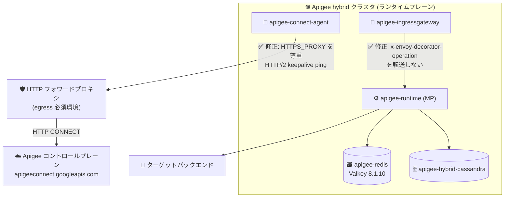

# Apigee hybrid: v1.14.10 パッチリリース (connect-agent プロキシ修正・多数のセキュリティ修正)

**リリース日**: 2026-11-05

**サービス**: Apigee hybrid

**機能**: v1.14.10 パッチリリース (バグ修正・セキュリティ修正)

**ステータス**: リリース済み (パッチリリース)

📊 [このアップデートのインフォグラフィックを見る](https://takech9203.github.io/google-cloud-news-summary/20261105-apigee-hybrid-v1-14-10.html)

## 概要

2026 年 11 月 5 日、Apigee hybrid ソフトウェアの更新バージョン v1.14.10 がリリースされました。本リリースはパッチリリースであり、コンテナイメージは Apigee hybrid の Helm チャートに統合されています。Helm チャートを使用してパッチにアップグレードするとイメージが自動的に更新されるため、通常は手動でのイメージ変更は不要です。

本リリースでは 8 件のバグ修正が含まれており、特に重要なのは、HTTP フォワードプロキシ経由での egress を必須とするクラスタで `apigee-connect-agent` が `HTTPS_PROXY` を無視してコントロールプレーンへの tether (接続) を確立できなくなる問題 (Bug ID 578314600) の修正です。この問題は v1.14.9 などの以前のパッチで導入されたリグレッションで、該当環境ではマネジメントプレーン操作が失敗する深刻な影響がありました。そのほか、侵害された emSign ルート証明書のトラストストアからの削除、`apigee-redis` コンテナの Valkey エンジン (8.1.10) への移行、HTTP/2 フローでのポリシー疑似ヘッダー設定の修正などが含まれます。

また、`apigee-asm-ingress`、`apigee-asm-istiod`、`apigee-hybrid-cassandra`、`apigee-runtime` をはじめとする 18 のコンテナコンポーネントに対して、多数の CVE に対応するセキュリティ修正が適用されています。Apigee hybrid v1.14 系を運用しているすべてのユーザーに適用が推奨されるリリースです。

**アップデート前の課題**

- HTTP フォワードプロキシ経由の egress が必須のクラスタでは、`apigee-connect-agent` が `HTTPS_PROXY` 設定を無視してコントロールプレーン (`apigeeconnect.googleapis.com:443`) に直接接続しようとするため接続がタイムアウトし、「no connections available from the Apigee connect agent(s)」エラーでマネジメントプレーン操作が失敗していた (既知の問題 578314600。v1.14.9 などが影響対象)
- システムおよび Java (`cacerts`) トラストストアに、侵害された emSign ルート証明書とクロス署名用 Comodo AAA Services ルート証明書が含まれていた
- `apigee-ingressgateway` が内部ヘッダー `x-envoy-decorator-operation` を上流のランタイムやターゲットバックエンドに転送していた
- HTTP/2 フローで `AssignMessage`、`HTTPModifier`、`RaiseFault` ポリシーが新規リクエスト (`createNew="true"`) を作成する際、`:path` と `:authority` 疑似ヘッダーを設定できず invalid-header エラーで失敗していた
- `OASValidation` ポリシーの strict パラメータ検証が、高負荷時に正当なリクエストを断続的に HTTP 400 で拒否していた
- Helm チャートで設定した `podDisruptionBudget` のオーバーライドが Kubernetes API サーバーによって破棄されていた
- マルチ証明書トラストストアのトラストアンカー変更時、`features.truststore.multi_cert_bundle.enabled` をランタイムで切り替えると Message Processor の再起動が必要だった

**アップデート後の改善**

- `apigee-connect-agent` が `HTTPS_PROXY` (プロキシ認証情報を含む) を正しく尊重しつつ、コントロールプレーン接続で HTTP/2 keepalive ping を使用するようになり、フォワードプロキシ必須環境でも tether を確立できるようになった
- 侵害された emSign ルートと Comodo AAA Services ルートが全コンテナのトラストストアから削除され、セキュリティリスクが低減された
- `apigee-redis` コンテナが Valkey エンジン (バージョン 8.1.10) を使用するようになった (RESP2 ワイヤプロトコルと `redis-server`/`redis-cli` バイナリ名は変更なし)
- HTTP/2 フローのポリシーで `:path` と `:authority` 疑似ヘッダーを設定できるようになった
- `podDisruptionBudget` オーバーライドが正しく適用されるようになった
- マルチ証明書トラストストアのトラストアンカー変更時に、アウトバウンド SSLContext が自動的に再構築されるようになり、Message Processor の再起動が不要になった
- 18 のコンテナコンポーネントで既知の CVE に対するセキュリティ修正が適用された

## アーキテクチャ図



v1.14.10 では、フォワードプロキシ必須のクラスタで `apigee-connect-agent` がコントロールプレーンへの tether を確立できるようになり、ingressgateway の内部ヘッダー漏えいも修正されました。

## サービスアップデートの詳細

### バグ修正 (Fixed)

| Bug ID | 修正内容 |
|--------|---------|
| 578314600 | `apigee-connect-agent` が `HTTPS_PROXY` を無視し、HTTP フォワードプロキシが必須のクラスタで tether を確立できなかった問題を修正。エージェントは `HTTPS_PROXY` (プロキシ認証情報を含む) を尊重しつつ、コントロールプレーン接続で HTTP/2 keepalive ping を使用 |
| 576707253 | 侵害された emSign ルートとクロス署名用 Comodo AAA Services ルートを、全コンテナのシステムおよび Java (`cacerts`) トラストストアから削除 |
| 573622417 | `apigee-ingressgateway` が `x-envoy-decorator-operation` ヘッダーを上流のランタイムおよびターゲットバックエンドに転送していた問題を修正 |
| 571378258 | `apigee-redis` コンテナが Valkey エンジン (バージョン 8.1.10) を使用するように変更。RESP2 ワイヤプロトコルと `redis-server`/`redis-cli` バイナリ名は変更なし |
| 554114419 | HTTP/2 フローで新規リクエストを作成する (`createNew="true"`) `AssignMessage`、`HTTPModifier`、`RaiseFault` ポリシーが `:path` と `:authority` 疑似ヘッダーを設定できず invalid-header エラーで失敗する問題を修正 |
| 524115876 | `OASValidation` ポリシーの strict パラメータ検証で、高負荷時に正当なリクエストを拒否する断続的な HTTP 400 エラーを修正 |
| 449228485 | Helm チャートで設定した `podDisruptionBudget` オーバーライドが Kubernetes API サーバーによって破棄される問題を修正 |
| 432315283 | マルチ証明書トラストストアのトラストアンカー変更時、`features.truststore.multi_cert_bundle.enabled` をランタイムで切り替えると Message Processor の再起動が必要だった問題を修正。アウトバウンド SSLContext が自動的に再構築されるようになった |

### セキュリティ修正 (Security)

以下の 18 コンポーネントに対して、CVE に対応するセキュリティ修正が適用されました。

| コンポーネント | 主な対応 CVE (抜粋) |
|---------------|-------------------|
| apigee-asm-ingress | CVE-2026-116585、CVE-2026-116586、CVE-2026-56857 ほか計 22 件 |
| apigee-asm-istiod | CVE-2026-40179、CVE-2026-42151、CVE-2026-44903、GHSA-gcjh-h69q-9w9g ほか計 27 件 |
| apigee-connect-agent | CVE-2026-56857、CVE-2026-78659 ほか計 15 件 |
| apigee-envoy | CVE-2026-5450、CVE-2026-5928 |
| apigee-fluent-bit | CVE-2026-111497、CVE-2026-35189、CVE-2026-8286 ほか計 26 件 |
| apigee-hybrid-cassandra | CVE-2026-18401、CVE-2026-54512、CVE-2026-68494 ほか計 24 件 |
| apigee-hybrid-cassandra-client | CVE-2026-56857 ほか計 15 件 |
| apigee-kube-rbac-proxy | CVE-2026-56857 ほか計 15 件 |
| apigee-mart-server | CVE-2026-89407、CVE-2026-89425、CVE-2026-91776、CVE-2026-91777 |
| apigee-mint-task-scheduler | CVE-2026-89407 ほか計 4 件 |
| apigee-open-telemetry-collector | CVE-2026-116585、CVE-2026-116586、CVE-2026-116587 |
| apigee-operators | CVE-2026-56857、CVE-2026-63209 ほか計 16 件 |
| apigee-prom-prometheus | CVE-2026-81870、CVE-2026-84303 ほか計 18 件 |
| apigee-prometheus-adapter | CVE-2026-56857 ほか計 15 件 |
| apigee-redis | CVE-2026-56857 ほか計 15 件 |
| apigee-runtime | CVE-2026-89407、CVE-2026-89425、CVE-2026-91776、CVE-2026-91777 |
| apigee-synchronizer | CVE-2026-89407 ほか計 4 件 |
| apigee-udca | CVE-2026-116585、CVE-2026-116587 ほか計 18 件 |
| apigee-watcher | CVE-2026-56857、CVE-2026-63209 ほか計 16 件 |

CVE の全リストは[公式リリースノート](https://docs.cloud.google.com/apigee/docs/hybrid/release-notes)を参照してください。

## 技術仕様

### パッチリリースの適用方式

| 項目 | 詳細 |
|------|------|
| リリース種別 | パッチリリース |
| イメージ配布 | コンテナイメージは Apigee hybrid Helm チャートに統合 |
| 適用方法 | Helm チャートでのアップグレードによりイメージが自動更新 (手動のイメージ変更は通常不要) |
| 対象バージョン系列 | Apigee hybrid v1.14 系 |

### 既知の問題 578314600 の背景

Google Cloud の既知の問題ページによると、この問題は hybrid 1.14.9、1.15.8、1.15.9、1.16.11、1.16.12、1.17.1、1.17.2 に影響します。`overrides.yaml` で `httpProxy` を設定すると `apigee-connect-agent` Pod に `HTTPS_PROXY` が設定されますが、Bug 513032450 の修正で導入されたカスタム TCP keep-alive ダイヤラーが gRPC 組み込みの HTTP CONNECT プロキシ処理をバイパスし、`apigeeconnect.googleapis.com:443` へ直接接続を試みることが原因でした。アウトバウンド通信がフォワードプロキシに制限されたクラスタでは接続がタイムアウトし、マネジメントプレーン操作が失敗します。v1.14.10 では、`HTTPS_PROXY` を尊重しつつカスタムダイヤラーの代わりに HTTP/2 keepalive ping で接続維持を行う方式に修正されました。

## 設定方法

### 前提条件

1. Apigee hybrid v1.14 系がインストール済みであること
2. Helm チャートによる管理を使用していること (パッチリリースのイメージは Helm チャートに統合されているため)
3. アップグレード前にバックアップが有効化・取得済みであること (v1.14 系ではアップグレード前のバックアップを確認するガードレールチェックが導入されている)

### 手順

#### ステップ 1: アップグレードガイドの確認

v1.14.10 へのアップグレード手順は公式ドキュメントを参照してください。

- [Upgrading Apigee hybrid to v1.14](https://docs.cloud.google.com/apigee/docs/hybrid/v1.14/upgrade)
- 新規インストールの場合: [The big picture](https://docs.cloud.google.com/apigee/docs/hybrid/v1.14/big-picture)

#### ステップ 2: Helm チャートによるアップグレード

パッチリリースでは、Helm チャートを使用したアップグレードによりコンテナイメージが自動的に更新されます。各チャートの `helm upgrade` 実行前に `--dry-run` での検証が推奨されます。

```bash
# 例: ドライランで検証してからアップグレード
helm upgrade operator apigee-operator/ \
  --install \
  --namespace APIGEE_NAMESPACE \
  -f OVERRIDES_FILE \
  --dry-run=server

helm upgrade operator apigee-operator/ \
  --install \
  --namespace APIGEE_NAMESPACE \
  -f OVERRIDES_FILE
```

operator、datastore、telemetry、redis、ingress-manager、org、env、virtualhost の各チャートを順にアップグレードします。詳細な手順と検証コマンドはアップグレードガイドを参照してください。

## メリット

### ビジネス面

- **セキュリティコンプライアンスの維持**: 18 コンポーネントにわたる多数の CVE 対応と侵害されたルート証明書の削除により、エンタープライズのセキュリティ要件・監査要件への準拠を維持できる
- **運用の安定性向上**: フォワードプロキシ必須環境でのマネジメントプレーン接続障害が解消され、プロキシのデプロイや管理操作が確実に実行できる

### 技術面

- **フォワードプロキシ環境の完全サポート**: `apigee-connect-agent` が `HTTPS_PROXY` (認証情報付き) を正しく処理し、egress 制限の厳しいエンタープライズネットワークでも tether を確立できる
- **内部ヘッダーの漏えい防止**: `x-envoy-decorator-operation` ヘッダーがバックエンドに転送されなくなり、内部実装情報の露出が防止される
- **無停止でのトラストストア更新**: マルチ証明書トラストストアのトラストアンカー変更時に SSLContext が自動再構築され、Message Processor の再起動が不要になった
- **可用性設定の確実な適用**: `podDisruptionBudget` オーバーライドが正しく適用され、ノードメンテナンス時の可用性を意図どおり制御できる

## デメリット・制約事項

### 考慮すべき点

- パッチ適用には Helm チャートによるクラスタコンポーネントのアップグレード作業が必要であり、変更管理プロセスに沿った計画が必要
- `apigee-redis` のエンジンが Valkey 8.1.10 に変更された。RESP2 ワイヤプロトコルとバイナリ名は変更なしだが、Redis 内部に依存したカスタム監視・運用がある場合は動作確認を推奨
- フォワードプロキシ経由の接続問題 (578314600) の影響を受けている環境では、修正済みバージョンへのアップグレードが唯一の恒久対応となる

## ユースケース

### ユースケース 1: egress をフォワードプロキシに制限した金融機関のクラスタ

**シナリオ**: セキュリティポリシーによりクラスタからの外部通信をすべて HTTP フォワードプロキシ経由に制限している環境で、v1.14.9 へのアップグレード後に「no connections available from the Apigee connect agent(s)」エラーが発生し、プロキシのデプロイなどの管理操作が失敗していた。

**実装例**:
```yaml
# overrides.yaml (既存のフォワードプロキシ設定)
httpProxy:
  host: proxy.example.com
  port: 3128
  scheme: HTTP
```

**効果**: v1.14.10 にアップグレードすることで、`apigee-connect-agent` が `HTTPS_PROXY` を尊重して tether を確立し、マネジメントプレーン操作が正常に動作する。

### ユースケース 2: 脆弱性スキャン指摘への対応

**シナリオ**: コンテナイメージの脆弱性スキャンで Apigee hybrid コンポーネントに複数の CVE が検出され、セキュリティチームから対応期限が設定されている。

**効果**: v1.14.10 への Helm アップグレードのみで 18 コンポーネントの CVE 修正と侵害されたルート証明書の削除が一括適用され、個別のイメージ差し替え作業なしに指摘へ対応できる。

## 料金

本リリースはソフトウェアのパッチ更新であり、料金への影響はありません。Apigee の料金体系は [Apigee 料金ページ](https://cloud.google.com/apigee/pricing)を参照してください。

## 関連サービス・機能

- **Google Kubernetes Engine (GKE) / Kubernetes**: Apigee hybrid のランタイムプレーンが稼働する基盤。`podDisruptionBudget` 修正は Kubernetes のノードメンテナンス時の可用性制御に直結する
- **Apigee (コントロールプレーン)**: `apigee-connect-agent` が tether を確立する接続先。管理操作・構成同期に必須
- **Cloud Service Mesh / Istio (ASM)**: `apigee-asm-ingress`、`apigee-asm-istiod` としてイングレス層を構成しており、本リリースで多数のセキュリティ修正が適用された
- **Valkey**: `apigee-redis` コンテナの新しいエンジン (8.1.10)。Redis 互換の OSS キー・バリューストア

## 参考リンク

- 📊 [インフォグラフィック](https://takech9203.github.io/google-cloud-news-summary/20261105-apigee-hybrid-v1-14-10.html)
- [公式リリースノート](https://docs.cloud.google.com/release-notes#November_05_2026)
- [Apigee hybrid リリースノート](https://docs.cloud.google.com/apigee/docs/hybrid/release-notes)
- [Apigee hybrid v1.14 アップグレードガイド](https://docs.cloud.google.com/apigee/docs/hybrid/v1.14/upgrade)
- [Apigee 既知の問題 (578314600 など)](https://docs.cloud.google.com/apigee/docs/release/known-issues)
- [Apigee リリースプロセス (コンテナイメージサポート)](https://docs.cloud.google.com/apigee/docs/release/apigee-release-process#apigee-hybrid-container-images)
- [料金ページ](https://cloud.google.com/apigee/pricing)

## まとめ

Apigee hybrid v1.14.10 は、フォワードプロキシ必須環境でのコントロールプレーン接続障害 (578314600) の修正と、18 コンポーネントにわたる広範なセキュリティ修正を含む重要なパッチリリースです。特に v1.14.9 で `httpProxy` を使用している環境では管理操作が失敗する深刻な影響があるため、早急なアップグレードを推奨します。Helm チャートによるアップグレードでイメージが自動更新されるため、計画的なメンテナンスウィンドウでの適用を検討してください。

---

**タグ**: #ApigeeHybrid #Apigee #PatchRelease #Security #CVE #Kubernetes #Helm #APIManagement
