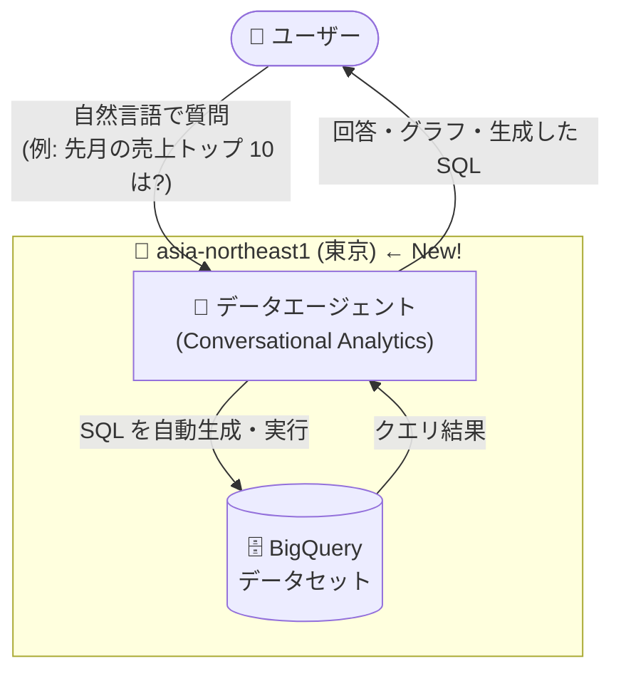

# BigQuery: Conversational Analytics の東京リージョン対応と Metadata curation ページの Knowledge Catalog への統合

**リリース日**: 2026-11-05

**サービス**: BigQuery

**機能**: Conversational Analytics の asia-northeast1 (東京) 対応 / Metadata curation コンソールページの廃止

**ステータス**: Feature (Conversational Analytics 東京対応) / Change (Metadata curation ページ廃止)

📊 [このアップデートのインフォグラフィックを見る](https://takech9203.github.io/google-cloud-news-summary/20261105-bigquery-conversational-analytics-tokyo.html)

## 概要

2026 年 11 月 5 日、BigQuery に関する 2 つのアップデートが発表されました。

1 つ目は、**BigQuery の Conversational Analytics (会話型分析) が asia-northeast1 (東京) ロケーションで利用可能になった**ことです。Conversational Analytics は、自然言語でデータに質問すると、データエージェントが SQL を生成・実行して回答やグラフを返す機能です。これまでサポートされるロケーションは US / EU のマルチリージョン エンドポイント、北米の一部リージョン (northamerica-northeast1、northamerica-northeast2、us-east4)、および Global に限られていました。今回の東京対応により、日本国内にデータを保持したままエージェントや会話リソースを東京リージョンに配置できるようになり、データレジデンシー要件を持つ日本企業にとって大きな前進となります。

2 つ目は、**BigQuery の「Metadata curation」コンソールページが削除された**ことです。これまで同ページで行っていた Cloud Storage の検出スキャン (discovery scan) のスケジュール設定、データプロファイリング、データ品質管理などのデータガバナンス タスクは、今後 **Knowledge Catalog** で実施します。機能自体が廃止されたわけではなく、ガバナンス機能の入口が Knowledge Catalog に一本化された形です。

**アップデート前の課題**

- Conversational Analytics のエージェント・会話リソースの保存先およびML 処理のロケーションとして、日本 (asia-northeast1) を選択できなかった
- データレジデンシー要件のある日本企業は、Global ロケーションや US/EU のエンドポイントを使わざるを得ず、国内利用のハードルになっていた
- データガバナンス機能の管理画面が「BigQuery Metadata curation」ページと Knowledge Catalog に分かれており、導線が分散していた

**アップデート後の改善**

- Conversational Analytics のエージェントと会話リソースを asia-northeast1 (東京) に配置できるようになり、日本国内でのデータ保持と ML 処理が可能になった
- 東京リージョンの BigQuery データセットに対して、より低レイテンシかつデータレジデンシーに配慮した会話型分析が実現できるようになった
- Cloud Storage 検出スキャン、データプロファイリング、データ品質などのガバナンス タスクの入口が Knowledge Catalog に統一され、管理導線がシンプルになった

## アーキテクチャ図



ユーザーが自然言語で質問すると、データエージェントが BigQuery に対する SQL を生成・実行し、回答やグラフを返します。今回のアップデートにより、この一連の処理 (エージェント・会話リソースの保存と ML 処理) を東京リージョン内で完結できるようになりました。

## サービスアップデートの詳細

### 主要機能

1. **Conversational Analytics の asia-northeast1 (東京) 対応 (Feature)**
   - エージェントと会話リソースの保存先、および ML 処理のロケーションとして東京を選択可能に
   - 自然言語の質問から SQL 生成・実行・可視化までをエージェントが実施
   - エージェント作成時にロケーションを選択可能 (保存後は変更不可)

2. **データエージェントの構成要素**
   - ナレッジソース: テーブル、ビュー、グラフ、UDF など (最大 100 個)
   - 検証済みクエリ (verified queries): ユーザーの質問にマッチした場合に実行される確定的な SQL
   - 用語集 (グロッサリー): 列とビジネス用語を紐付けるセマンティック コンテキスト
   - エージェント指示: 会計年度の定義やフォーマット ルールなどの自然言語ルール

3. **Metadata curation コンソールページの削除 (Change)**
   - BigQuery コンソールの「Metadata curation」ページが削除された
   - Cloud Storage 検出スキャンのスケジュール設定、データプロファイリング、データ品質管理などは Knowledge Catalog で実施する
   - 検出スキャンで作成された BigLake テーブルは引き続き BigQuery で管理・クエリ可能

## 技術仕様

### Conversational Analytics のサポート ロケーション

| ロケーション | 種類 | 備考 |
|------|------|------|
| us (US MREP) | マルチリージョン | 米国内のデータセンター |
| eu (EU MREP) | マルチリージョン | EU 加盟国内のデータセンター |
| northamerica-northeast1 (モントリオール) | リージョン | BigQuery データソースのみ |
| northamerica-northeast2 (トロント) | リージョン | BigQuery データソースのみ |
| us-east4 (北バージニア) | リージョン | - |
| **asia-northeast1 (東京)** | リージョン | **今回追加** |
| global | グローバル | デフォルト (保存先の制御は不可) |

### ロケーションのデフォルト動作

| 条件 | 使用されるロケーション |
|------|------|
| すべてのナレッジソースが同一のサポート対象リージョン | そのリージョン |
| すべてのナレッジソースが US 内のリージョン | US MREP |
| すべてのナレッジソースが EU 内のリージョン | EU MREP |
| 上記以外 | Global |

エージェント作成時に別のロケーションを明示的に選択することも可能です。保存後のロケーション変更はできません。

### Metadata curation ページ廃止後のタスク移行先

| タスク | 移行先 |
|------|------|
| Cloud Storage 検出スキャンのスケジュール設定 | Knowledge Catalog |
| データプロファイリング (profile scan) | Knowledge Catalog |
| データ品質スキャン (data quality scan) | Knowledge Catalog |
| その他のデータガバナンス タスク | Knowledge Catalog |

## 設定方法

### 前提条件

1. BigQuery データセットが asia-northeast1 (東京) または対象ロケーションに存在すること
2. Gemini for Google Cloud / Conversational Analytics API の利用が有効化されていること
3. データエージェントの操作に必要な IAM 権限 (例: `cloudaicompanion.topics.*` 関連権限) があること

### 手順

#### ステップ 1: データエージェントの作成 (東京ロケーションを選択)

BigQuery コンソールの Agent Catalog タブからデータエージェントを作成し、ナレッジソース (テーブルやビュー) を追加します。エージェント作成時にロケーションとして asia-northeast1 を選択できます (保存後は変更不可)。

#### ステップ 2: Cloud Storage 検出スキャンの管理 (Knowledge Catalog)

```bash
# gcloud で検出スキャンを作成する例 (東京リージョン)
gcloud dataplex datascans create data-discovery SCAN_ID \
  --location=asia-northeast1 \
  --data-source-resource=gs://YOUR_BUCKET
```

従来 BigQuery の Metadata curation ページで行っていた検出スキャンのスケジュール設定は、Knowledge Catalog のコンソールまたは gcloud / REST API から実施します。

## メリット

### ビジネス面

- **日本企業のデータレジデンシー要件に対応**: エージェント・会話リソースを東京に配置できるため、データの国内保持を求める規制・社内ポリシーに対応しやすくなる
- **データ民主化の促進**: SQL を書けないビジネス ユーザーも自然言語で BigQuery のデータに質問でき、分析の裾野が広がる

### 技術面

- **低レイテンシ**: 東京リージョンの BigQuery データセットと同一リージョンで処理が完結し、応答性が向上する
- **ガバナンス導線の一元化**: 検出スキャン・プロファイリング・データ品質の管理が Knowledge Catalog に統一され、運用がシンプルになる

## デメリット・制約事項

### 制限事項

- エージェントのロケーションは保存後に変更できない
- 1 エージェントに追加できるナレッジソースは最大 100 個
- Conversational Analytics の既知の制限 (クエリ、会話、可視化に関する制約) が適用される

### 考慮すべき点

- Metadata curation ページを利用していた運用手順書やブックマークは Knowledge Catalog ベースに更新が必要
- エージェントのスコープを広げすぎると指示の競合や出力のあいまいさが発生しやすいため、用途ごとにエージェントを分割することが推奨される
- コスト管理のため、プロジェクト / ユーザー / クエリ単位の支出上限 (例: `big_query_max_billed_bytes`) の設定を検討する

## ユースケース

### ユースケース 1: 日本国内の売上データに対する自然言語分析

**シナリオ**: 東京リージョンの BigQuery に売上データを保持する国内小売企業が、データレジデンシー要件を満たしつつ、ビジネス部門にセルフサービス分析を提供したい。

**実装例**:
```text
1. asia-northeast1 のデータセット (売上テーブルを JOIN したビュー) をナレッジソースに登録
2. エージェント作成時にロケーションとして asia-northeast1 を選択
3. 用語集に「粗利」「客単価」などの社内用語を定義し、検証済みクエリを登録
4. ビジネス ユーザーが「先月の店舗別売上トップ 10 は?」と自然言語で質問
```

**効果**: データを国内に保持したまま、SQL 知識のないユーザーでも即座にデータ分析が可能になる。

### ユースケース 2: Knowledge Catalog によるデータレイクのガバナンス運用

**シナリオ**: Cloud Storage 上のデータレイクに対して検出スキャンを定期実行し、BigLake テーブルとして BigQuery に公開しつつ、データ品質スキャンで品質を監視している。

**効果**: Metadata curation ページ廃止後も、Knowledge Catalog を単一の入口として検出スキャンのスケジュール、プロファイリング、データ品質管理を一元的に運用できる。

## 料金

Conversational Analytics では、データエージェントの作成時およびエージェント / データソースとの会話時に実行されるクエリに対して、BigQuery のコンピューティング料金 (分析料金) が課金されます。エージェント自体の料金は Data Cloud Agent の料金体系に従います。

- [BigQuery の料金 (分析料金モデル)](https://cloud.google.com/bigquery/pricing#analysis_pricing_models)
- [Data Cloud Agent の料金](https://cloud.google.com/products/data-agents/pricing)

コスト管理のため、エージェント設定の `big_query_max_billed_bytes` やプロジェクト / ユーザー / クエリ単位の支出上限を設定できます。

## 利用可能リージョン

Conversational Analytics は、us / eu マルチリージョン、northamerica-northeast1、northamerica-northeast2、us-east4、global に加え、今回のアップデートで **asia-northeast1 (東京)** で利用可能になりました。最新のロケーション一覧は[公式ドキュメント](https://docs.cloud.google.com/gemini/data-agents/conversational-analytics-api/locations)を参照してください。

## 関連サービス・機能

- **Conversational Analytics API (Gemini Data Analytics)**: コンソールで作成したデータエージェントを API 経由で呼び出し、独自アプリケーションに組み込める
- **Knowledge Catalog**: Metadata curation ページの後継として、検出スキャン・プロファイリング・データ品質などのガバナンス タスクを担う
- **BigLake**: Cloud Storage 検出スキャンにより自動作成されるテーブル形式。BigQuery から SQL でクエリ可能
- **Looker / Looker Studio**: Conversational Analytics API がサポートするもう 1 つの主要データソース

## 参考リンク

- 📊 [インフォグラフィック](https://takech9203.github.io/google-cloud-news-summary/20261105-bigquery-conversational-analytics-tokyo.html)
- [公式リリースノート](https://docs.cloud.google.com/release-notes#November_05_2026)
- [Conversational Analytics の概要 (BigQuery)](https://docs.cloud.google.com/bigquery/docs/conversational-analytics)
- [Conversational Analytics API のロケーション](https://docs.cloud.google.com/gemini/data-agents/conversational-analytics-api/locations)
- [Cloud Storage の検出スキャン (Knowledge Catalog)](https://docs.cloud.google.com/knowledge-catalog/docs/cloud-storage-discovery)
- [データ品質スキャン](https://docs.cloud.google.com/bigquery/docs/data-quality-scan)
- [料金ページ (Data Cloud Agent)](https://cloud.google.com/products/data-agents/pricing)

## まとめ

Conversational Analytics の東京リージョン対応により、日本企業がデータレジデンシー要件を満たしながら自然言語によるデータ分析を導入できるようになりました。東京リージョンに BigQuery データを持つ組織は、データエージェントの PoC を開始する好機です。また、Metadata curation ページを利用していた場合は、Knowledge Catalog ベースの運用手順への更新を進めてください。

---

**タグ**: BigQuery, Conversational Analytics, Gemini, asia-northeast1, Tokyo, データレジデンシー, Knowledge Catalog, データガバナンス, 自然言語分析
