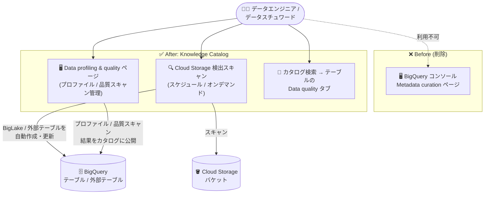

# BigQuery: Metadata curation コンソールページの廃止と Knowledge Catalog への移行

**リリース日**: 2026-11-05

**サービス**: BigQuery / Knowledge Catalog

**機能**: Metadata curation コンソールページの削除 (データガバナンスタスクの Knowledge Catalog への集約)

**ステータス**: Change (コンソール UI の変更)

📊 [このアップデートのインフォグラフィックを見る](https://takech9203.github.io/google-cloud-news-summary/20261105-bigquery-metadata-curation-knowledge-catalog.html)

## 概要

BigQuery コンソールの **Metadata curation (メタデータキュレーション) ページが削除**された。今後は **Knowledge Catalog** (旧 Dataplex Universal Catalog) を使用して、Cloud Storage の検出スキャン (discovery scan) のスケジュール設定、データプロファイリングとデータ品質 (auto data quality) の管理、および関連するデータガバナンスタスクを実行する。

このアップデートは機能の廃止ではなく、**管理画面の集約・移行**である。Cloud Storage 検出スキャン、データプロファイリング、データ品質スキャンといった機能自体は Knowledge Catalog 側で引き続き提供されており、Google Cloud コンソールの Knowledge Catalog セクション (「Data profiling & quality」ページなど) から管理する形に一本化された。Knowledge Catalog は BigQuery メタデータの一元的なガバナンスとエージェントアクセスを担うサービスとして位置付けられており、今回の変更はガバナンス関連 UI を Knowledge Catalog に集約する流れの一環といえる。

対象ユーザーは、BigQuery コンソールからメタデータキュレーション (検出スキャン、プロファイリング、品質スキャン) を運用していたデータエンジニア、データスチュワード、ガバナンス担当者。日常の操作導線が変わるため、新しいアクセス経路の確認が必要になる。

**アップデート前の課題**

- データガバナンス関連の管理画面が BigQuery コンソール (Metadata curation ページ) と Knowledge Catalog の双方に存在し、操作導線が分散していた
- BigQuery 側のページと Knowledge Catalog 側のページのどちらを使うべきかが分かりにくかった

**アップデート後の改善**

- Cloud Storage 検出スキャンのスケジュール設定、データプロファイリング、データ品質の管理が Knowledge Catalog に一本化され、データガバナンスタスクの管理場所が明確になった
- Knowledge Catalog の「Data profiling & quality」ページからプロジェクト横断でスキャンの作成・実行・編集・履歴確認ができるほか、テーブル単位では Knowledge Catalog 検索からテーブルを開き「Data quality」タブで直接管理できる
- gcloud CLI (`gcloud dataplex datascans ...`) やクライアントライブラリ、REST API による自動化経路は引き続き利用できる

## アーキテクチャ図



BigQuery コンソールの Metadata curation ページは削除され、Cloud Storage 検出スキャン、データプロファイリング、データ品質スキャンの管理はすべて Knowledge Catalog のコンソールページに集約された。検出スキャンは従来どおり Cloud Storage をスキャンして BigQuery に BigLake / 外部テーブルを作成・更新する。

## サービスアップデートの詳細

### 主要機能 (移行先での管理内容)

1. **Cloud Storage 検出スキャン (automatic discovery)**
   - Knowledge Catalog から検出スキャンを作成し、スケジュール実行 (Repeat: 開始時刻・曜日・頻度を指定) またはオンデマンド実行を設定できる
   - スキャンは Cloud Storage バケット/パスをスキャンし、構造化・半構造化データ (Parquet、Avro、ORC、JSON、CSV) を BigLake 外部テーブルまたは非 BigLake 外部テーブルとして、非構造化データ (画像、ドキュメント、音声/動画) を BigLake オブジェクトテーブルとして BigQuery に登録する
   - スキャン実行時に、スキャン対象バケットに対応する BigQuery データセットが自動作成される (データセット名はバケット名と同名。使用不可の文字はアンダースコアに置換)
   - BigLake テーブルを作成する場合は Google Cloud リソース接続 ID の指定が必要。未指定の場合は非 BigLake 外部テーブルが作成される

2. **データプロファイリングの管理**
   - Knowledge Catalog の「Data profiling & quality」ページから、データプロファイルスキャンの作成・実行・結果確認を行う
   - プロファイル結果を Knowledge Catalog メタデータとして公開でき、カタログ上のテーブルエントリから参照できる

3. **データ品質 (auto data quality) の管理**
   - 「Data profiling & quality」ページから、品質スキャンの作成、Run now による即時実行、表示名・フィルタ・スケジュール・品質ルールの編集、スキャン権限の管理、ジョブ履歴 (直近 300 ジョブまたは過去 1 年分) の確認ができる
   - テーブル単位の管理も可能: Knowledge Catalog の検索ページでテーブルを検索して開き、「Data quality」タブから新規スキャン作成・実行・設定編集・履歴表示を行える
   - スキャン結果を Knowledge Catalog メタデータとして公開している場合、最新の結果は Google Cloud コンソールの BigQuery と Knowledge Catalog 双方のテーブルページの「Data quality」タブに表示される

## 技術仕様

### タスク別の移行先

| タスク | 移行先 (Knowledge Catalog) |
|------|------|
| Cloud Storage 検出スキャンのスケジュール | 検出スキャンの作成画面 (Repeat / On demand を設定) |
| データプロファイリングの管理 | Data profiling & quality ページ |
| データ品質スキャンの管理 | Data profiling & quality ページ、またはテーブルの Data quality タブ |
| 品質スキャン結果の確認 | スキャン詳細ページ (Overview / Jobs history)、テーブルの Data quality タブ |

### コンソール以外のアクセス経路 (変更なし)

スキャンの管理は、コンソールに加えて以下の方法でも引き続き可能。

```bash
# データ品質スキャンの実行
gcloud dataplex datascans run DATASCAN --location=LOCATION

# 品質スキャンの履歴ジョブの一覧表示
gcloud dataplex datascans jobs list \
  --location=LOCATION --datascan=DATASCAN

# 品質スキャンジョブの結果確認
gcloud dataplex datascans jobs describe JOB \
  --location=LOCATION --datascan=DATASCAN --view=FULL
```

REST API (`dataScans.get` など) やクライアントライブラリ (C#、Go、Java、Ruby など) も Dataplex API として提供されている。

## 設定方法

### 移行にあたってユーザーが行うこと

#### ステップ 1: 新しい管理画面への導線の切り替え

Google Cloud コンソールで、BigQuery コンソールの Metadata curation ページの代わりに Knowledge Catalog の各ページを使用する。

- データプロファイリング / データ品質: Knowledge Catalog の **Data profiling & quality** ページ
- Cloud Storage 検出スキャン: Knowledge Catalog の検出スキャン作成画面

#### ステップ 2: テーブル単位の品質管理フローの確認

テーブル単位でデータ品質を管理する場合は、以下の手順で操作する。

1. Google Cloud コンソールで Knowledge Catalog の Search ページに移動
2. 対象テーブルを検索して選択
3. **Data quality** タブをクリック
4. スキャン結果が公開済みの場合は「Data quality scan」から新規作成 / 即時実行 / 設定編集 / 権限管理 / 履歴表示を選択。未公開の場合は「Create data quality scan」または「View existing scans」を選択

#### ステップ 3: 自動化スクリプト・ブックマークの点検

- gcloud / REST API / クライアントライブラリによる自動化は Dataplex API ベースのまま変更されないため、修正は不要
- BigQuery コンソールの Metadata curation ページへの社内手順書のリンクやブックマークは、Knowledge Catalog の該当ページへ更新する

## メリット

### ビジネス面

- **ガバナンス業務の一元化**: 検出スキャン、プロファイリング、品質管理などのデータガバナンスタスクの管理場所が Knowledge Catalog に集約され、チーム内の運用手順やトレーニングをシンプルにできる
- **カタログ中心のガバナンスへの布石**: Knowledge Catalog は BigQuery メタデータの一元管理とデータ品質スコアカード、リネージ、データプロダクトなどを担うサービスであり、品質・プロファイル結果をカタログ上で活用する運用に自然につながる

### 技術面

- **API / CLI の互換性維持**: スキャンの実体は Dataplex API の DataScan リソースであり、gcloud・REST・クライアントライブラリの自動化経路は影響を受けない
- **結果の参照性は維持**: 品質スキャン結果を Knowledge Catalog メタデータとして公開していれば、従来どおり BigQuery コンソールのテーブルページの Data quality タブからも最新結果を参照できる

## デメリット・制約事項

### 考慮すべき点

- BigQuery コンソールの Metadata curation ページに慣れたユーザーは、操作導線の変更に伴い新しいページ (Knowledge Catalog の Data profiling & quality ページなど) を覚える必要がある
- 社内の運用手順書、ランブック、ブックマークに旧ページへの導線が残っている場合は更新が必要
- 既存の品質スキャンで結果を BigQuery / Knowledge Catalog のコンソールページに公開する設定にしている場合、今後の結果を Knowledge Catalog メタデータとして公開するにはスキャンを編集して公開設定を再度有効化する必要がある (カタログ公開には追加の権限が必要になる場合がある)

## ユースケース

### ユースケース 1: Cloud Storage データレイクの定期カタログ化

**シナリオ**: データレイクとして運用する Cloud Storage バケットに日々追加される Parquet / CSV ファイルを、スキーマ定義なしで BigQuery から分析したい。

**実装例**:
```text
1. Knowledge Catalog で検出スキャンを作成し、対象バケットと
   リソース接続 ID を指定 (BigLake 外部テーブルを作成する場合)
2. Discovery frequency で「Repeat」を選択し、開始時刻・曜日・頻度を設定
3. スキャンがデータをグループ化し、BigLake 外部テーブルとして登録
4. BigQuery で SQL による分析、Knowledge Catalog で検索・発見
```

**効果**: スキーマの手動定義なしに Cloud Storage のデータが BigQuery で分析可能になり、メタデータは Knowledge Catalog に自動登録される。

### ユースケース 2: テーブル単位のデータ品質運用

**シナリオ**: 重要な BigQuery テーブルに品質ルールを設定し、定期スキャンと結果のモニタリングを行いたい。

**効果**: Knowledge Catalog の検索からテーブルを開き、Data quality タブでスキャンの作成・実行・ルール編集・履歴確認までを完結できる。結果をカタログメタデータとして公開すれば、BigQuery / Knowledge Catalog 双方のテーブルページで品質状況を確認できる。

## 料金

今回の変更はコンソール UI の移行であり、新たな料金は発生しない。検出スキャン、データプロファイリング、データ品質スキャン自体の料金は Dataplex (Knowledge Catalog) の料金体系に従う。

- [Dataplex 料金ページ](https://cloud.google.com/dataplex/pricing)

## 関連サービス・機能

- **Knowledge Catalog (旧 Dataplex Universal Catalog)**: 今回の移行先。BigQuery メタデータの自動取り込み、セマンティック検索、データ品質スコアカード、データリネージ、データプロダクトなどガバナンス機能全般を提供する
- **BigLake / BigQuery 外部テーブル**: Cloud Storage 検出スキャンが作成・更新するテーブルタイプ。リソース接続 ID の有無とデータ形式に応じて BigLake 外部テーブル、非 BigLake 外部テーブル、BigLake オブジェクトテーブルが作成される
- **Cloud Storage**: 検出スキャンの対象。構造化 (Parquet、Avro、ORC、JSON、CSV)・非構造化 (画像、ドキュメント、音声/動画) データをカタログ化できる
- **Knowledge Studio (Preview)**: 2026-11-02 に発表された Knowledge Catalog の新機能群。自然言語によるデータ探索やエンリッチメントタスクを提供しており、今回の UI 集約と合わせて Knowledge Catalog がデータガバナンスとコンテキスト管理のハブになりつつある (関連レポート: [Knowledge Catalog: Knowledge Studio (Preview)](2026-11-02-knowledge-catalog-knowledge-studio-preview.md))

## 参考リンク

- 📊 [インフォグラフィック](https://takech9203.github.io/google-cloud-news-summary/20261105-bigquery-metadata-curation-knowledge-catalog.html)
- [公式リリースノート](https://docs.cloud.google.com/release-notes#November_05_2026)
- [Discover and catalog Cloud Storage data](https://docs.cloud.google.com/knowledge-catalog/docs/cloud-storage-discovery)
- [About data profiling](https://docs.cloud.google.com/knowledge-catalog/docs/data-profiling-overview)
- [Use auto data quality](https://docs.cloud.google.com/knowledge-catalog/docs/use-auto-data-quality#console)
- [Use Knowledge Catalog with BigQuery](https://docs.cloud.google.com/bigquery/docs/use-knowledge-catalog)
- [料金ページ (Dataplex)](https://cloud.google.com/dataplex/pricing)

## まとめ

BigQuery コンソールの Metadata curation ページが削除され、Cloud Storage 検出スキャン、データプロファイリング、データ品質の管理は Knowledge Catalog に一本化された。機能自体や API / gcloud による自動化経路は変わらないため影響は操作導線に限られるが、該当ページを日常的に使用していたチームは、Knowledge Catalog の「Data profiling & quality」ページとテーブルの Data quality タブを使う運用への切り替えと、社内手順書・ブックマークの更新を行うことを推奨する。

---

**タグ**: BigQuery, Knowledge Catalog, Dataplex, Metadata curation, データガバナンス, データ品質, データプロファイリング, Cloud Storage 検出スキャン, BigLake, コンソール変更
