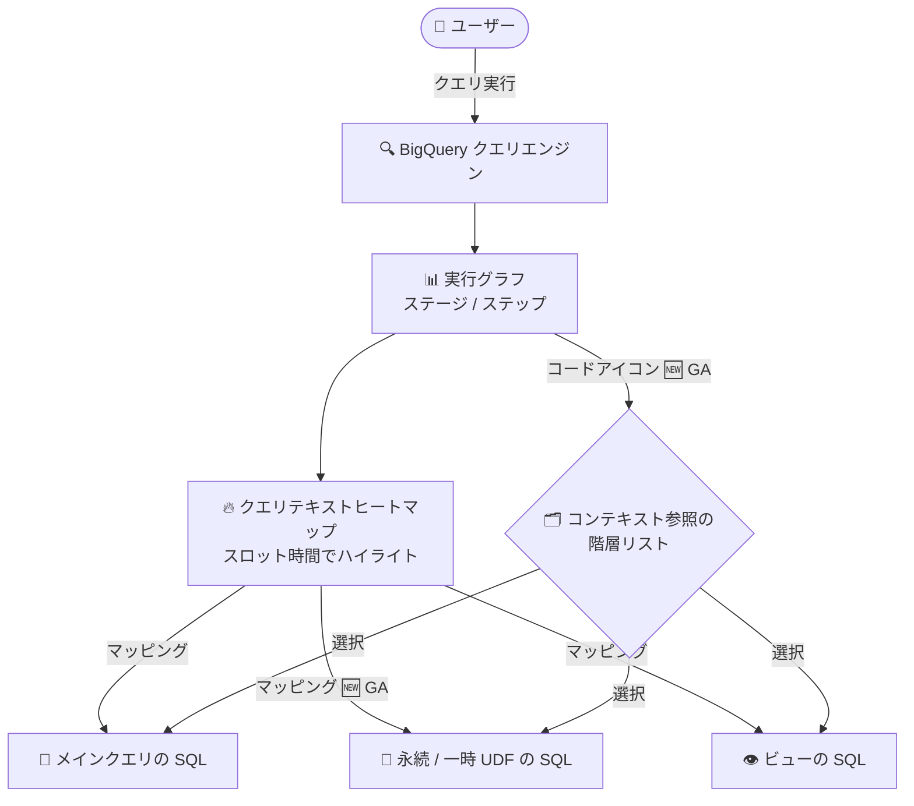

# BigQuery: クエリテキストヒートマップの機能強化 (GA) と Metadata curation ページの廃止

**リリース日**: 2026-11-05

**サービス**: BigQuery

**機能**: クエリテキストヒートマップのコンテキスト参照ナビゲーションと UDF SQL テキスト表示 (GA) / Metadata curation コンソールページの廃止

**ステータス**: GA (クエリテキストヒートマップ 2 機能) / 変更 (Metadata curation ページ廃止)

📊 [このアップデートのインフォグラフィックを見る](https://takech9203.github.io/google-cloud-news-summary/20261105-bigquery-query-text-heatmap-ga.html)

## 概要

BigQuery のクエリ実行グラフ (Execution graph) に含まれる「クエリテキストヒートマップ」に 2 つの機能強化が一般提供 (GA) となりました。1 つ目は、ステージのステップに対して、ネストされた関数呼び出しやビュー参照などの「コンテキスト参照の階層リスト」を表示・ナビゲートできる機能です。2 つ目は、永続 (persistent) および一時 (temporary) ユーザー定義関数 (UDF) の SQL テキストをヒートマップ上に表示できる機能です。これにより、ビューや UDF を多用する複雑なクエリでも、どの SQL コードがどの実行ステージに対応し、どこにスロット時間が費やされているかを Google Cloud コンソール上で直接追跡できるようになります。

クエリテキストヒートマップは、実行グラフの左パネルに表示され、ステージのスロット時間 (slot-time) に基づいてクエリテキストをハイライトする機能です。マッピングされたクエリテキストをクリックすると対応するステージが選択され、逆にステージのステップ詳細からコードアイコンをクリックすると該当するクエリテキストの行に移動できます。今回の GA により、この双方向ナビゲーションがネストされた参照構造 (ビューの中のビュー、UDF 内の関数呼び出しなど) にも対応しました。

また、同日のリリースノートでは、BigQuery の「Metadata curation」コンソールページの廃止も発表されました。今後は Knowledge Catalog (旧 Dataplex Universal Catalog) を使用して、Cloud Storage のディスカバリスキャンのスケジュール設定、データプロファイリングとデータ品質の管理、および関連するデータガバナンスタスクを実行します。

**アップデート前の課題**

- ビューや UDF を含む複雑なクエリでは、ステージのステップがどの SQL コード (特にネストされた参照先) に対応するかをコンソール上で階層的にたどる手段がなかった
- 一時 UDF や永続 UDF の SQL 定義をヒートマップ上で確認できず、UDF 内部のロジックとステージの対応関係の把握が難しかった
- メタデータキュレーション関連の操作が BigQuery コンソールの専用ページに分かれており、Knowledge Catalog のガバナンス機能と導線が分散していた

**アップデート後の改善**

- ステージのステップから、ネストされた関数呼び出しやビュー参照を含むコンテキスト参照の階層リストを開き、該当するコード行に直接ジャンプできるようになった (GA)
- 永続 UDF と一時 UDF の SQL テキストがクエリテキストヒートマップに表示され、UDF を含むクエリのパフォーマンス分析が容易になった (GA)
- Cloud Storage ディスカバリスキャン、データプロファイリング、データ品質などのガバナンスタスクが Knowledge Catalog に一本化された

## アーキテクチャ図



実行グラフの各ステージのステップが、メインクエリ・ビュー・UDF の SQL テキストにマッピングされ、コンテキスト参照の階層リストから該当コード行へ直接ナビゲートできる構成を示しています。

## サービスアップデートの詳細

### 主要機能

1. **コンテキスト参照の階層リスト (GA)**
   - ステージのステップ詳細で、クエリテキストにマッピングされたステップにはコードアイコンが表示される
   - マッピング先が単一の場合はクリックで直接該当コードに移動し、複数箇所または階層構造がある場合は、ネストされた関数呼び出しやビュー参照などのコンテキスト参照を階層リストとして表示するダイアログが開く
   - リストから参照先を選択すると、該当するコード行がハイライトされ、自動的にスクロールして表示される

2. **永続・一時 UDF の SQL テキスト表示 (GA)**
   - クエリテキストヒートマップが、永続 UDF と一時 UDF の SQL テキストの表示に対応した
   - クエリがビューや永続ルーティンを使用し、ステージのステップがそれらのクエリテキストにマッピングされている場合、ヒートマップにはビューやルーティンの名前と SQL テキストがマッピングとともに表示される
   - マッピングされたクエリテキストにポインタを合わせると、対応するステージとそのスロット時間がツールチップに表示され、クリックすると実行グラフ上で該当ステージが選択される

3. **Metadata curation コンソールページの廃止 (変更)**
   - BigQuery の Metadata curation コンソールページが削除された
   - 今後は Knowledge Catalog を使用して、Cloud Storage ディスカバリスキャンのスケジュール設定、データプロファイリングとデータ品質の管理、関連するデータガバナンスタスクを実行する
   - Knowledge Catalog は BigQuery、Cloud Storage、Pub/Sub、Spanner などの Google Cloud データソース全体を対象とした一元的なガバナンスソリューション

## 技術仕様

### クエリテキストヒートマップの動作

| 項目 | 詳細 |
|------|------|
| 表示場所 | Google Cloud コンソールの実行グラフタブの左パネル |
| ハイライトの基準 | マッピングされたステップを持つステージの合計スロット時間 |
| 対応する SQL テキスト | メインクエリ、参照されたビュー、SQL UDF (永続・一時) |
| ナビゲーション | クエリテキスト → ステージ選択、ステップのコードアイコン → コード行ハイライト |
| 複数マッピング | 1 つのクエリテキスト部分が複数ステージにマッピング可能 (ツールチップに各ステージとスロット時間を表示) |

### 必要な IAM 権限

ビューやルーティンのマッピングを表示するには、以下の権限が必要です。リソースが削除された場合や権限がない場合、該当リソースのマッピングは表示されません。

| 対象リソース | 必要な権限 |
|------|------|
| ビュー | `bigquery.tables.get` |
| ルーティン (UDF など) | `bigquery.routines.get` |

### ヒートマップ解釈上の注意

- ヒートマップの色はステージ全体のスロット時間に基づく。BigQuery はステップ単位のスロット時間を計測しないため、マッピングされたクエリテキスト部分の実際のスロット時間を正確に表すものではない
- 1 つのステージが複数の複雑な操作 (結合と集計など) を含む場合、特定のコード部分のスロット時間が過大に表示される可能性があるため、ステージを構成する他のステップも併せて確認する必要がある
- 実行グラフが非常に複雑な場合、ペイロードサイズの制約によりサブステップが切り詰められることがある

## 設定方法

### 前提条件

1. Google Cloud コンソールで BigQuery を使用できること
2. ビュー・ルーティンのマッピング表示には、対象リソースへの `bigquery.tables.get` / `bigquery.routines.get` 権限があること

### 手順

#### ステップ 1: 実行グラフを開く

1. Google Cloud コンソールの BigQuery ページでクエリを実行する
2. 完了したクエリの「実行の詳細 (Execution Details)」から「実行グラフ (Execution graph)」タブをクリックする
3. 左パネルにクエリテキストヒートマップ、中央に実行グラフ、右パネルにクエリ / ステージ詳細が表示される

#### ステップ 2: コンテキスト参照をナビゲートする

1. 実行グラフでステージをクリックし、右パネルの「ステップ詳細」を確認する
2. クエリテキストにマッピングされたステップのコードアイコンをクリックする
3. マッピング先が複数または階層構造の場合、コンテキスト参照の階層リストのダイアログが開くので、参照先 (ネストされた関数呼び出しやビュー参照) を選択すると該当コード行がハイライトされる

#### ステップ 3: Metadata curation の代替として Knowledge Catalog を使用する

1. Google Cloud コンソールで Knowledge Catalog に移動する
2. Cloud Storage ディスカバリスキャンのスケジュール設定、データプロファイリング / データ品質スキャンの作成・管理などのガバナンスタスクを Knowledge Catalog 上で実行する

## メリット

### ビジネス面

- **クエリ最適化の迅速化**: スロット時間の大きいステージと対応する SQL コードを直接結び付けられるため、オンデマンド課金やスロット予約のコスト最適化につながるボトルネック特定が速くなる
- **ガバナンス導線の一元化**: メタデータキュレーション関連のタスクが Knowledge Catalog に統合され、データガバナンス運用の窓口が明確になる

### 技術面

- **ネストされた参照の可視化**: ビューの中のビューや UDF 内の関数呼び出しといった階層構造を、コンソール上でたどりながらデバッグできる
- **UDF を含むクエリの分析性向上**: 永続・一時 UDF の SQL 定義がヒートマップに表示されるため、UDF 内部のロジックが実行ステージとどう対応するかを確認できる
- **双方向ナビゲーション**: クエリテキストからステージ、ステージのステップからコード行へ、双方向に移動して分析できる

## デメリット・制約事項

### 制限事項

- ヒートマップの色はステージ全体のスロット時間に基づくため、特定のコード部分単体の正確なスロット時間を表すものではない
- 参照先のビューやルーティンが削除された場合、または `bigquery.tables.get` / `bigquery.routines.get` 権限を失った場合、そのリソースのマッピングは表示されない
- ドライランやキャッシュから結果を返すクエリなど、実行リソースを使用しないジョブには実行グラフの診断情報が含まれない

### 考慮すべき点

- Metadata curation ページを運用手順やドキュメントで参照しているチームは、Knowledge Catalog のページへの導線に更新する必要がある
- 1 つのステージが複数の複雑な操作を含む場合はヒートマップの色が実態を過大に表す可能性があるため、ステップ詳細も併せて確認する

## ユースケース

### ユースケース 1: ビュー・UDF を多用する複雑なクエリのボトルネック特定

**シナリオ**: データマート層のビューを複数重ね、永続 UDF でビジネスロジックをカプセル化したクエリが遅く、どの部分が原因か特定したい。

**実装例**:
```
1. クエリ実行後、「実行の詳細」→「実行グラフ」タブを開く
2. ヒートマップで濃い赤にハイライトされた SQL (ビューや UDF の定義を含む) を確認
3. スロット時間の大きいステージのステップ詳細からコードアイコンをクリックし、
   コンテキスト参照の階層リストで原因となるネストされた参照先に移動
```

**効果**: ビューや UDF の内部まで含めて、スロット時間を消費している SQL コードを特定でき、リライトやマテリアライズの判断が速くなる。

### ユースケース 2: Metadata curation から Knowledge Catalog への運用移行

**シナリオ**: BigQuery の Metadata curation ページで Cloud Storage のディスカバリスキャンやデータ品質スキャンを管理していたチームが、ページ廃止に伴い運用を移行する。

**効果**: Knowledge Catalog 上でディスカバリスキャン、データプロファイリング、データ品質スキャンを一元管理でき、BigQuery 以外のデータソース (Cloud Storage、Pub/Sub、Spanner など) も含めたガバナンス運用に拡張できる。

## 関連サービス・機能

- **BigQuery クエリプラン / 実行グラフ**: クエリテキストヒートマップは実行グラフの一部であり、`jobs.get` API からもクエリプランと実行タイムライン情報を取得できる
- **BigQuery ユーザー定義関数 (UDF)**: 今回ヒートマップでの SQL テキスト表示に対応した永続・一時 UDF。SQL 式や JavaScript でカスタムロジックをカプセル化する機能
- **Knowledge Catalog (旧 Dataplex Universal Catalog)**: Metadata curation ページの代替。ディスカバリスキャン、データプロファイリング、データ品質、データリネージなどのガバナンス機能を提供

## 参考リンク

- 📊 [インフォグラフィック](https://takech9203.github.io/google-cloud-news-summary/20261105-bigquery-query-text-heatmap-ga.html)
- [公式リリースノート](https://docs.cloud.google.com/release-notes#November_05_2026)
- [クエリプランとタイムラインの説明 (実行グラフ / クエリテキストヒートマップ)](https://docs.cloud.google.com/bigquery/docs/query-plan-explanation)
- [ユーザー定義関数 (UDF)](https://docs.cloud.google.com/bigquery/docs/user-defined-functions)
- [Knowledge Catalog の概要](https://docs.cloud.google.com/knowledge-catalog/docs/introduction)
- [データ品質スキャン](https://docs.cloud.google.com/bigquery/docs/data-quality-scan)

## まとめ

クエリテキストヒートマップの GA 強化により、ビューや UDF を含む複雑なクエリでも、スロット時間を消費する SQL コードをコンソール上で階層的にたどって特定できるようになりました。クエリ最適化の際は実行グラフとヒートマップを第一の分析手段として活用することを推奨します。また、Metadata curation ページは廃止されたため、該当機能を利用していたチームは Knowledge Catalog への運用移行を進めてください。

---

**タグ**: BigQuery, クエリ最適化, 実行グラフ, クエリテキストヒートマップ, UDF, Knowledge Catalog, データガバナンス, GA
